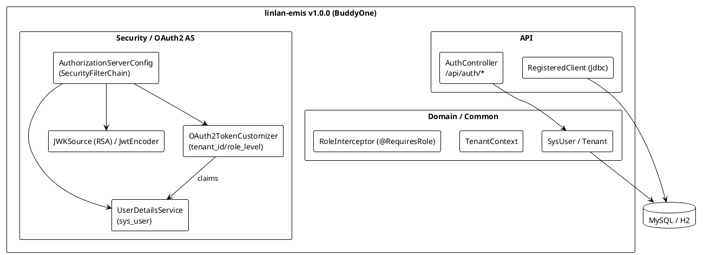

# linlan-emis (BuddyOne) v1.0.0 实现方案文档

> 版本：`v1.0.0` | 主线：企业多租户 IAM/SSO 中台（OAuth2/OIDC + 多租户 + 基础角色） | 基线：P0 最小后端骨架
>
> 本方案将 `spec.md` 的 §5.1–§5.7 能力领域转化为分层落位、接口清单与实现细节。**不新增 Maven 模块、不新增第三方依赖（仅引入 spring-authorization-server 1.x）。** 深度细节参见 `01-architecture.md`~`04-permission-model.md`。

---

# 一、需求与存量功能关系分析

## 1.1 已实现功能（P0 可直接复用的存量骨架）

| 存量能力 | 复用方式 |
| --- | --- |
| `SysUser`（合并 emis `UserInfo` + ontology 租户/角色） | 作为身份主表，v1.0.0 扩展 OAuth2 客户端/授权记录 |
| `TenantContext`（`ThreadLocal`） | 全链路租户/角色上下文，JWT 过滤器与 Header 透传复用 |
| `@RequiresRole` / `@PublicApi` + `RoleInterceptor`（fail-closed） | 权限校验骨架保留，OIDC 上线后语义不变 |
| BCrypt（`spring-security-crypto`） | 密码哈希，标准 `DaoAuthenticationProvider` 复用 |
| `DataInitializer` | 播种 admin/guest 默认账号与默认租户 |
| `JwtAuthenticationFilter` / `WebMvcConfig` | P0 自签 JJWT 过滤器；v1.0.0 升级为信任 SAS 签发 JWT 或由资源服务器接管 |
| `test-client`（linlan-emis-test-client） | 标准 OIDC 授权码登录参考实现，展示 id_token claims |

## 1.2 需要新增的功能或接口

- **security**：`UserDetailsService`（从 `sys_user` 加载，映射 `tenant_id`/`role_level`）、`DaoAuthenticationProvider`、SAS 1.x 安全链（`SecurityFilterChain` + `OAuth2AuthorizationServerConfigurer`）。
- **oauth2**：`RegisteredClientRepository`（Jdbc）、`JWKSource`（RSA）、`JwtEncoder`、`OAuth2TokenCustomizer<JwtEncodingContext>`（编入 `tenant_id`/`role_level`）。
- **db**：引入 SAS 官方 schema（`oauth2_registered_client`、`oauth2_authorization`、`oauth2_authorization_consent`）。
- **下游适配**：DSH-Desktop/xiaolan 加 OIDC 客户端；dsh-java 加资源服务器（保留 `ApiKeyAuthInterceptor` 走机器调用）。

## 1.3 存量功能详细分析（横切点）

### 1.3.1 认证链路迁移

P0：`JwtAuthenticationFilter` 解析自签 JJWT → 注入 `TenantContext` → `RoleInterceptor` 校验。
v1.0.0：本地登录保留 BCrypt；令牌签发从 jjwt 自签切换为 SAS 的 `JwtEncoder`（RSA）。过滤器仍解析 Bearer JWT 并注入 `TenantContext`，或更优地由 Spring Security `oauth2ResourceServer().jwt()` 接管（P2 决策）。

### 1.3.2 分层依赖约束

保持：控制器只翻译协议；安全/用例在 `sys`/`security`；数据访问在 MyBatis Mapper。`spring-security-oauth2-authorization-server` 仅作用于授权服务器配置层。

---

# 二、增量设计方案

## 2.1 实现模型

### 2.1.1 上下文视图



### 2.1.2 状态与并发模型

- **RegisteredClient**：Jdbc 持久化，首次 seeding（DSH-Desktop 等）。
- **OAuth2Authorization / Consent**：Jdbc 持久化（SAS 官方表）。
- **TenantContext**：`ThreadLocal`，请求结束 `clear()`。
- **RSA 密钥**：生产固定密钥库（如 `keystore.jks`），避免重启失效导致 JWKS 轮换。

## 2.2 接口清单

### （1）本地认证（保留 P0）

| 方法 | 路径 | 说明 |
| --- | --- | --- |
| POST | `/api/auth/login` | `{ userName, password }` → `Result<LoginResponse>` |
| POST | `/api/auth/register` | 注册 |
| GET | `/api/auth/me` | 当前用户 |
| DELETE | `/api/auth/user/{id}` | 注销（需 role_level=0） |

### （2）标准 OIDC（SAS 1.x）

| 端点 | 用途 |
| --- | --- |
| `/oauth2/authorize` | 授权码起点 |
| `/oauth2/token` | 换取 access/refresh/id_token |
| `/oauth2/jwks` | JWT 公钥集合（下游验签） |
| `/oauth2/userinfo` | OIDC 用户信息 |
| ``/.well-known/openid-configuration`` | OIDC Discovery |

## 2.3 数据模型

### 2.3.1 `sys_user`（合并 emis + ontology）

| 字段 | 类型 | 说明 |
| --- | --- | --- |
| `user_id` | BIGINT PK | 用户ID |
| `tenant_id` | BIGINT | 租户ID（主任可 NULL） |
| `role_level` | INT | 0 主任 / 1 研究员 / 2 访客 |
| `user_name` | VARCHAR(64) UNIQUE | 登录名 |
| `password` | VARCHAR(128) | BCrypt 密文 |
| `status` / `del_flag` | CHAR(1) | 状态/软删 |

### 2.3.2 `emis_tenant`

```sql
CREATE TABLE emis_tenant (
    tenant_id   BIGINT AUTO_INCREMENT PRIMARY KEY,
    tenant_name VARCHAR(128) NOT NULL,
    status      CHAR(1) DEFAULT '0',
    created_at  DATETIME DEFAULT NOW()
);
```

### 2.3.3 SAS 官方表

`oauth2_registered_client`、`oauth2_authorization`、`oauth2_authorization_consent`（取自 SAS 官方 JDBC schema）。

### 2.3.4 错误码表（规划）

| 错误码 | 场景 |
| --- | --- |
| `401` | 未登录 / token 无效 |
| `403` | 权限不足 / fail-closed 默认拒绝 |
| `400xx` | 注册参数校验 / 用户不存在 |

## 2.4 OAuth2 Token Customizer（关键：对接 02 / 04）

```java
@Bean
public OAuth2TokenCustomizer<JwtEncodingContext> jwtTokenCustomizer() {
    return context -> {
        if (OAuth2TokenType.ACCESS_TOKEN.equals(context.getTokenType())) {
            Authentication principal = context.getPrincipal();
            // 从 UserDetails 取出 tenant_id / role_level 放入 claims
            context.getClaims().claim("tenant_id", ...);
            context.getClaims().claim("role_level", ...);
            context.getClaims().claim("scope", ...);
        }
    };
}
```

下游资源服务器解码 JWT 后拿到 `tenant_id`/`role_level`，直接喂给 `TenantContext` 与 `@RequiresRole`。

## 2.5 分层落位清单

| 层 | 包 / 文件 | 职责 |
| --- | --- | --- |
| security | `sys.security`：`UserDetailsService`、`JwtAuthenticationFilter` | 用户加载、JWT 解析 |
| oauth2 | `sys.oauth2`：`AuthorizationServerConfig`、`JWKSource`、`OAuth2TokenCustomizer` | AS 配置 |
| api | `sys.controller`：`AuthController` | 本地认证 REST |
| domain | `sys.entity`：`SysUser`；`common`：`TenantContext` | 实体与上下文 |
| mapper | `sys.mapper`：MyBatis Mapper | 数据访问 |
| app | `application.yml`、`schema.sql` | 配置与 DDL |

## 2.6 测试策略

- **单元测试**：`UserDetailsService` 加载（租户/角色映射）、`OAuth2TokenCustomizer` claim 注入、`RoleInterceptor` 三态（@PublicApi / @RequiresRole / 无注解 403）。
- **集成测试**：OIDC 授权码全流程（test-client 登录）、JWKS 验签、跨租户隔离断言。
- **架构守护**：控制器不反向依赖安全实现细节。

## 2.7 风险与回滚

1. **SAS 0.4→1.x 迁移成本**：`javax`→`jakarta`、移除 `WebSecurityConfigurerAdapter`、组件式 DSL；属已知大改，按 `03` 清单分步。
2. **RSA 密钥管理**：生产固定密钥库，密钥泄露需 JWKS 轮换。
3. **下游改造协调**：dsh-java 引入 Spring Security 资源服务器链与既有 `ApiKeyAuthInterceptor` 共存，需明确放行机器接口。
4. **多租户软隔离边界**：v1.0.0 为软隔离，P3 才硬隔离；需文档注明查询必须带 `tenant_id`。
