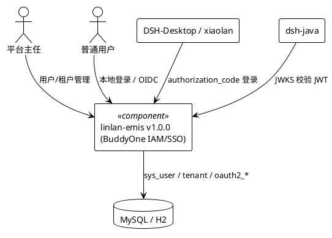

# linlan-emis (BuddyOne) v1.0.0 需求规格

> 版本：`v1.0.0` | 主线：企业多租户身份认证与访问管理中台（IAM/SSO） | 基线：P0 最小后端骨架（已落地）
>
> **版本范围声明**：v1.0.0 全部设计与任务统一纳入本版本，与本规格同目录归档。四件套分别为 `docs/1.0.0/spec.md`（本需求规格）、`design.md`（技术方案）、`tasks.md`（任务清单）、`release-v1.0.0-development-notes.md`（开发说明）。
>
> **历史背景**：P0 已完成最小后端骨架（本地账号登录 + JJWT 自签 + `tenant_id`/`role_level` + `TenantContext` + `@RequiresRole` fail-closed）。v1.0.0 在 P0 之上补齐**标准 OAuth2/OIDC 授权服务器**、**多租户隔离**与**下游 SSO 接入**，形成可生产的 IAM/SSO 中台。
>
> **依赖新增声明**：本版本引入 `spring-security-oauth2-authorization-server` 1.x（与 Spring Boot 3.5.16 / Spring Security 6.5 对齐），不引入其他第三方依赖。
>
> **本阶段边界**：本文档仅定义"做什么（What）"与验收标准，不包含类签名、算法与部署实现等"怎么做（How）"细节（见 `design.md` 与 `01-architecture.md`~`04-permission-model.md`）。

---

# **1. Component Positioning**

## **1.1 Core Responsibility**

本组件负责作为 Linlan 产品家族的统一身份提供商（IdP/SSO）：

1. **本地账号认证**：用户名/密码（BCrypt）登录、注册、注销、查询当前用户。
2. **标准 OAuth2 + OIDC 授权服务器**：基于 `spring-security-oauth2-authorization-server` 1.x 签发 access/refresh/id_token（JWT，JWKS 可验）。
3. **多租户内核**：`tenant_id` + `TenantContext` + 行级隔离（v1.0.0 为软隔离，P3 升级硬隔离）。
4. **基础角色**：`role_level`（0 主任 / 1 研究员 / 2 访客）+ `@RequiresRole`（fail-closed）。
5. **下游 SSO**：DSH-Desktop 以 OIDC 公共客户端登录；dsh-java / linlan-xiaolan 作为 OAuth2 资源服务器消费 JWT。

## **1.2 Core Inputs**

1. **本地登录请求**：`POST /api/auth/login` `{ userName, password }`。
2. **OIDC 授权请求**：授权码流程（`/oauth2/authorize` → `/oauth2/token`）。
3. **注册/注销请求**：`POST /api/auth/register`、`DELETE /api/auth/user/{id}`（需 role_level=0）。
4. **下游资源服务器**：经 JWKS 校验的 Bearer JWT（携带 `tenant_id`/`role_level` claims）。
5. **外部配置**：RSA 密钥（JWKS）、RegisteredClient 凭据（经配置/环境变量注入，secret 不落盘）。

## **1.3 Core Outputs**

1. **本地登录响应**：`Result<LoginResponse>`（含令牌）。
2. **OIDC 令牌**：access / refresh / id_token（JWT）。
3. **JWKS**：`/oauth2/jwks` 公钥集合（下游验签）。
4. **用户信息**：`/oauth2/userinfo`（OIDC）。
5. **多租户上下文**：`TenantContext`（tenant_id / role_level / userId）注入与跨服务 Header 透传。

## **1.4 Responsibility Boundaries**

本组件**不负责**：

1. **下游业务系统细粒度权限**（各产品自留 RBAC）。
2. **第三方联合登录**（GitHub/Google/微信/飞书）与 **OTP/SMS/MFA**（P1 规划）。
3. **`tenant_id` 硬隔离**的 MyBatis 拦截器插件（P3 规划，v1.0.0 为软隔离）。
4. **前端 Web 控制台**（`frontend/` 占位）与 **Python API**（`py-api/` 占位）。
5. **下游产品的用户/权限数据**：仅消费 BuddyOne 签发的 JWT claims。

---

# **2. Domain Terminology**

**租户（Tenant）**
::: 独立身份域，主键 `tenant_id`；种子租户 `tenant_id=1`「默认租户」。主任（`role_level=0`，`tenant_id IS NULL`）可跨租户。

**角色层级（role_level）**
::: 跨产品统一语义：`0` 主任 / `1` 研究员 / `2` 访客；`@RequiresRole(N)` ⇒ 当前 `role_level <= N` 放行；值越小权限越大。

**租户上下文（TenantContext）**
::: `ThreadLocal` 存放当前请求的 `tenantId / roleLevel / userId`，由 JWT 过滤器或服务间 Header（X-Tenant-Id / X-Role-Level / X-User-Id）注入，请求结束清理。

**OAuth2 / OIDC 授权服务器**
::: 基于 `spring-security-oauth2-authorization-server` 1.x 的标准授权服务器，签发 JWT 并暴露 JWKS / userinfo / discovery。

**JWT / JWKS**
::: P0 用 jjwt 0.12 自签 JWT；v1.0.0 升级为 SAS 签发的 RSA JWT，下游经 `/oauth2/jwks` 验签。

**id_token / access_token / refresh_token**
::: OIDC 标准令牌；id_token 承载 `tenant_id`/`role_level`/subject 等 claim。

---

# **3. Roles and Boundaries**

## **3.1 Core Roles**

1. **平台主任（role_level=0）**：租户管理、用户管理、注销他人。
2. **普通用户（role_level=1/2）**：业务接口与基础接口。
3. **下游接入方（DSH-Desktop / dsh-java / xiaolan）**：OIDC 客户端或资源服务器。

## **3.2 External Systems**

1. **下游资源服务器（dsh-java）**：经 JWKS 校验 JWT。
2. **下游 OIDC 客户端（DSH-Desktop / xiaolan）**：标准授权码登录。
3. **数据库**：MySQL（生产）/ H2（本地）。

## **3.3 Interaction Context**

---

# **4. DFX Constraints**

## **4.1 Performance**

1. **JWKS 缓存**：下游拉取 JWKS 后本地缓存，避免每请求远程验签。
2. **令牌校验**：资源服务器本地验签，不引入额外 IO。

## **4.2 Reliability**

1. **默认失败拒绝**：未标注 `@PublicApi` 且无 `@RequiresRole` 的端点默认 403。
2. **未登录**：缺 token 访问受保护端点返回 401。
3. **权限不足**：`role_level > N` 返回 403。

## **4.3 Security**

1. **密码 BCrypt 哈希**，不明文存储/日志。
2. **JWT 签名（RSA）**经 JWKS 可验，禁止自签弱密钥。
3. **多租户软隔离**：查询自动拼 `tenant_id` 过滤。
4. **禁止记录明文密钥 / 令牌**；RegisteredClient secret 经环境变量注入。

## **4.4 Maintainability**

1. **分层落位**：security → sys → common；控制器只翻译协议。
2. **注解语义清晰**：`@RequiresRole` / `@PublicApi`。
3. **文档中文为主**；README 稳定不承载版本明细（变更进 CHANGELOG）。

## **4.5 Compatibility**

1. **技术栈与 dsh-java 对齐**：SB 3.5.16 / Java 17 / MyBatis 3.0.5。
2. **下游兼容**：OIDC 标准协议，无需私有逻辑。
3. **版本统一**：backend / test-client pom 统一 `1.0.0`；四件套归档于 `docs/1.0.0/`。

---

# **5. Core Capabilities**

## **5.1 本地账号认证**

### **5.1.1 Business Rules**

1. **登录**：用户名 + 密码 BCrypt 校验，成功签发令牌 → `Result<LoginResponse>`。
2. **注册**：创建 `sys_user`（默认租户 / 默认角色）。
3. **注销（需 role_level=0）**：删除用户；非主任返回 403。
4. **当前用户**：`GET /api/auth/me` 返回当前上下文。

### **5.1.2 Exception Scenarios**

1. **密码错误** → 认证失败（区分度错误码）。
2. **注销非主任** → 403 权限不足。
3. **用户不存在** → 失败提示。

## **5.2 多租户模型与隔离**

### **5.2.1 Business Rules**

1. **`sys_user` 带 `tenant_id`**；`TenantContext` 注入当前租户/角色/用户。
2. **软隔离（v1.0.0）**：查询自动拼 `tenant_id`；主任（`tenant_id IS NULL`）可跨租户。
3. **种子租户** `tenant_id=1`「默认租户」。
4. 详见 `02-user-tenant-model.md`。

### **5.2.2 Exception Scenarios**

1. **跨租户访问**：非主任访问他租户数据 → 隔离拒绝。
2. **缺租户上下文**：未注入时拒绝（fail-closed 边界）。

## **5.3 OAuth2 / OIDC 授权服务器**

### **5.3.1 Business Rules**

1. **SAS 1.x 标准端点**：`/oauth2/authorize`、`/oauth2/token`、`/oauth2/jwks`、`/oauth2/userinfo`、``/.well-known/openid-configuration``。
2. **RegisteredClient 落库**（Jdbc）：DSH-Desktop / 各下游作为客户端注册。
3. **Token Customizer**：把 `tenant_id` / `role_level` 编入 JWT claims。
4. **RSA 密钥**：生产用固定密钥库，切勿每次启动随机。
5. 详见 `03-oauth2-authorization-server.md`。

### **5.3.2 Exception Scenarios**

1. **未配置客户端** → 授权拒绝。
2. **token 验签失败**（JWKS 不匹配）→ 401。

## **5.4 权限模型 @RequiresRole**

### **5.4.1 Business Rules**

1. **fail-closed**：未标注 `@PublicApi` 且无 `@RequiresRole` 的端点默认 403。
2. **`@RequiresRole(N)`** ⇒ `role_level <= N` 放行。
3. **`@PublicApi`**：跳过角色校验。
4. 详见 `04-permission-model.md`。

### **5.4.2 Exception Scenarios**

1. **未登录访问受保护端点** → 401。
2. **`role_level > N`** → 403 权限不足。

## **5.5 下游接入 / SSO**

### **5.5.1 Business Rules**

1. **DSH-Desktop / xiaolan**：OIDC 公共/机密客户端（`oauth2Login()`，authorization_code）。
2. **dsh-java**：资源服务器（`oauth2ResourceServer().jwt()` + JWKS）；机器/服务间调用保留 `ApiKeyAuthInterceptor`。
3. **跨服务透传**：`X-Tenant-Id` / `X-Role-Level` Header 注入 `TenantContext`。

## **5.6 版本发布与工程治理**

1. **pom 统一 1.0.0**；`CHANGELOG.md` 分节（新增/更新）。
2. **四件套归档**于 `docs/1.0.0/`。
3. **README 稳定**：变更只进 CHANGELOG。

## **5.7 AI 可发现性文档**

1. **`llms.txt`**：面向 LLM 的项目摘要。
2. **`AGENTS.md`**：AI 编码助手的构建/测试命令与约定。
3. **`README.en.md`**：英文 README。

---

## 附：v1.0.0 能力清单与版本范围汇总

| 序号 | 能力领域 | 归属环节 | 说明 |
| --- | --- | --- | --- |
| 1 | 本地账号认证 | §5.1 | 登录/注册/注销/me（BCrypt） |
| 2 | 多租户模型与隔离 | §5.2 | `tenant_id` + `TenantContext`（软隔离） |
| 3 | OAuth2/OIDC 授权服务器 | §5.3 | SAS 1.x + JWKS + token customizer |
| 4 | 权限模型 @RequiresRole | §5.4 | fail-closed + 角色层级 |
| 5 | 下游 SSO 接入 | §5.5 | OIDC 客户端 / 资源服务器 / Header 透传 |
| 6 | 版本发布与工程治理 | §5.6 | pom 1.0.0、CHANGELOG、四件套 |
| 7 | AI 可发现性文档 | §5.7 | `llms.txt` / `AGENTS.md` / `README.en.md` |
