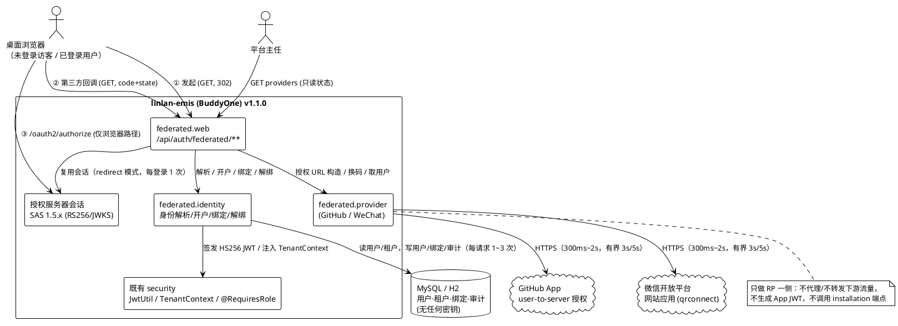
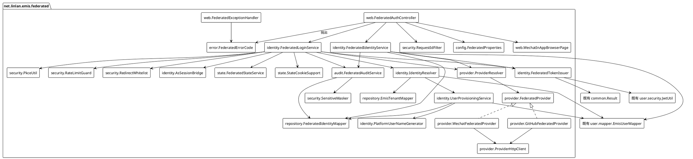
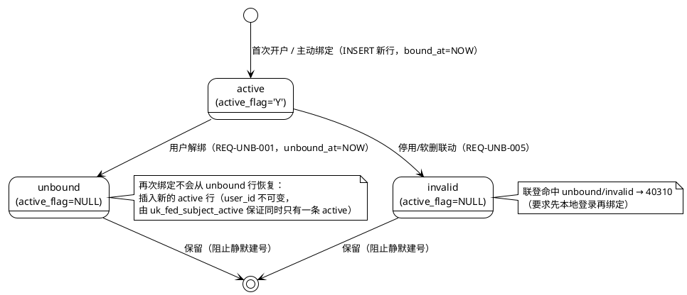
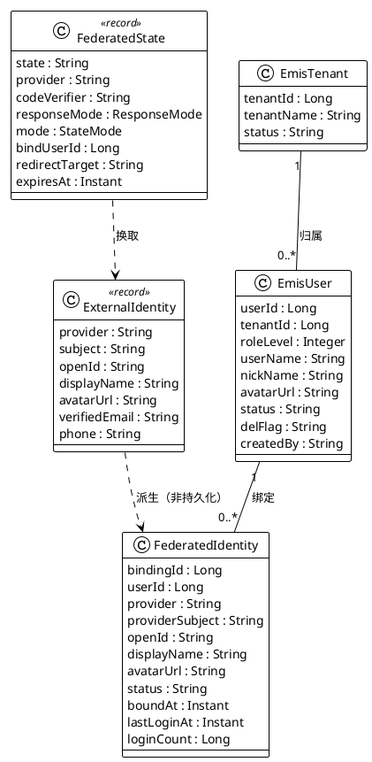

# linlan-emis (BuddyOne) v1.1.0 实现方案 —— 两条轻量联合登录（GitHub App / 微信 unionid）

> 版本：`v1.1.0` | 需求基线：`docs/1.1.0/spec.md`（R4，2026-11-15，1485 行 / 编号需求 106 条、实际功能 104 条）× 代码基线：`v1.0.0`（`emis-backend:1.0.0`）
> 定位：**多租户 + 多角色语义的本地扩展型 IAM 中台**。本期只新增 GitHub App 与微信网站应用扫码两条联合登录入口，**不建设通用 IdP 平台**（D9/D10、spec §12-18..21）。
> 本文只写"How"，不含完整源码；伪代码与签名级说明仅用于表达结构与约束。`tasks.md` 由任务阶段另行产出。

## 章节导航（需求点 → 本文章节）

| 用户要求的输出项 | 本文落点 |
| --- | --- |
| ① 设计目标与约束 + REQ 映射表 | §1（一、需求与存量功能关系分析：1.1–1.5） |
| ② 总体方案与调用链（含 2 张时序图） | §2.1（二、增量设计方案 · 实现模型） |
| ③ 分层与包结构落位 + 类清单 | §2.2 |
| ④ 数据模型（DDL / 体验租户与角色 / 种子落位） | §2.3 |
| ⑤ 接口设计（端点 / DTO / 错误码 / `Result<T>`） | §2.4 |
| ⑥ 安全设计（state / PKCE / 一次性 / 白名单 / 脱敏 / 私钥） | §2.5 |
| ⑦ 配置清单（属性名 / 环境变量 / 默认值 / 缺失行为） | §2.6 |
| ⑧ 关键流程伪代码（开户 / 绑定 / 解绑 / 回滚） | §2.7 |
| ⑨ 测试策略 + AC-01..AC-46 映射 | §2.8 |
| ⑩ 实施顺序与风险 | §2.9 |
| ⑪ 与 spec / 既有设计的关系 + 1.2+ 边界 | §2.10 |
| ⑫ 开放问题承接 + 设计自主决定项 | §2.11 |
| 参考实现四级判定逐项采纳表（REQ-REUSE-010 / AC-44） | §2.11.3 |

---

# 一、需求与存量功能关系分析

## 1.1 设计目标与硬约束

### 1.1.1 目标

1. 在**既有分层内**（`controller → service → mapper` + `security` 横切）新增一个自洽的 `federated` 垂直切片，完成"发起授权 → 回调校验 → 换码取身份 → 身份解析/绑定/开户 → 签发 HS256 平台令牌 → 返回前端"的最小闭环。
2. **零新增第三方依赖、零新增 Maven 模块**；不引入 `spring-boot-starter-oauth2-client`、不引入 `WebClient/webflux`、不引入 Redis、不引入测试桩框架（WireMock 等）。
3. **两条令牌链严格分离**：`/api/**` 复用 `JwtUtil` 的 HS256（claims 与 24h 有效期不变）；OIDC 侧 RS256 + `/oauth2/jwks` 一行不改。
4. 所有失败路径**不产生半成品**：无孤立用户、无孤立绑定、无已签发令牌、无匿名降级。

### 1.1.2 硬约束（来自 spec，设计不得回退）

| 约束 | 来源 | 设计体现 |
| --- | --- | --- |
| GitHub 用 **GitHub App user-to-server**，不依赖 installation，不校验 org/team，App 私钥不参与登录 | D1/D6、REQ-GH-001/-011/-012/-013 | §2.2.3 `GitHubFederatedProvider`；§2.5.7 私钥探针 |
| 微信 **unionid 为主键**，`provider_subject=unionid`，openid 仅记录最近一次；缺 unionid → `40115` 拒绝 | D2、REQ-WX-002/-006/-007 | §2.3.2 DDL 唯一键；§2.4.3 错误码；§2.7.2 解析伪代码 |
| 首登默认**体验租户 + 体验角色**，免审批直接入库，无本地账号自动开户；同邮箱/手机号冲突 `40910`；未绑定 `40310` | D3/D4/D5、REQ-ID-004/-005/-007/-015/-016/-020 | §2.3.3 体验租户/角色；§2.7.1 开户事务 |
| 平台令牌**复用现有 HS256 JWT**，`LoginResponse` 不变 | D7、REQ-SES-001/-002/-004 | §2.2.4 `FederatedTokenIssuer`（调用 `JwtUtil`） |
| **密钥零入库**（client_id/AppID/secret 全部环境变量注入），缺失 `50300` 不降级 | D1/D2、REQ-CFG-001/-003/-007 | §2.3.1 无密钥列；§2.6 配置清单 |
| 微信内置浏览器：UA 检测 → 系统浏览器引导 + 本地密码兜底（OQ-06 保留） | D8、REQ-WX-010/-011/-012 | §2.4.2 引导端点；§2.7.6 兜底语义 |
| provider 抽象只允许"**一个接口 + 配置驱动**" | D10、§12-18 | §2.2.3 显式 `switch`，无注册表/SPI/路由/CRUD |
| 不重复建设 `dsh-java` IdP、不代理/转发第三方流量、不改造成联邦网关 | D10、§12-19 | §2.2.1 上下文视图（只做 RP 一侧） |
| 不复制 `emis-java-backend` 源码/模块/分层；仅借鉴常量语义、errcode 映射、state 一次性、字段词汇 | §13 开头、REQ-REUSE-002/-009 | §2.11.3 逐项采纳表 |

### 1.1.3 本期明确不做（对应 §14 / §1.4，防止设计越界）

provider 注册表 DB 化、SPI/`ServiceLoader`、优先级路由、provider 管理后台/CRUD、配置热更新、通用 OAuth2/OIDC RP 框架、审计查询接口/统计看板（CAND-09）、体验租户升级运营面（CAND-11）、App JWT 与 GitHub App 管理 API（CAND-12）、令牌黑名单（CAND-06）、跨租户绑定（CAND-07）、资料定时同步（CAND-08）、微信多端打通（CAND-10）、MFA/OTP/短信（CAND-05）、LDAP/AD/SAML/CAS（CAND-01/CAND-04）。

---

## 1.2 存量功能对比（代码位置精确到文件/行）

### 1.2.1 已实现功能（100% 直接复用）

| 需求功能 | 存量功能 | 代码位置 | 匹配度 |
| --- | --- | --- | --- |
| HS256 平台 JWT 签发（claims `sub/user_name/preferred_username/role_level/tenant_id`，默认 24h） | `JwtUtil.generateToken(Long,String,Integer,Long)` | `backend/src/main/java/net/linlan/emis/user/security/JwtUtil.java:29-42` | 100% |
| JWT 解析与 claim 取值（snake_case 优先、camelCase 兜底） | `JwtUtil.parseToken` / `getUserId` / `getRoleLevel` / `getTenantId` | 同上 `:44-83` | 100% |
| Bearer 令牌 → `TenantContext` 注入 + 请求结束 `clear()` | `JwtAuthenticationFilter.doFilterInternal` | `.../user/security/JwtAuthenticationFilter.java:37-59` | 100% |
| `@RequiresRole(N)`（`role_level<=N` 放行、未登录 401、无注解 403、fail-closed） | `RoleInterceptor.preHandle` | `.../user/security/RoleInterceptor.java:21-50` | 100% |
| 统一响应包装 `Result<T>`（`code/message/data`，`@JsonInclude(NON_NULL)`） | `Result` | `.../common/Result.java:10-66` | 100% |
| `LoginResponse`（token/userId/userName/nickName/roleLevel/tenantId） | `LoginResponse` | `.../user/dto/LoginResponse.java:5-13` | 100% |
| 本地登录 → `LoginResponse` 装配（含 token 签发） | `UserService.login` / `toLogin` | `.../user/service/UserService.java:32-44, 88-97` | 100% |
| OIDC RS256 + JWKSource + `OAuth2TokenCustomizer`（同源 claims） | `SecurityConfig.jwtEncoder` / `jwtTokenCustomizer` | `.../security/SecurityConfig.java:100-125` | 100% |
| `/api/**` 放行 + CSRF 豁免（联合登录回调可公开访问的前提） | `SecurityConfig.securityFilterChain` | 同上 `:48-67` | 100% |
| 表单登录会话机制（`formLogin` + `HttpSession` 承载 `SecurityContext`） | `SecurityConfig.formLogin` | 同上 `:56` | 100%（联合登录复用同一机制） |
| 用户实体：`tenant_id`/`role_level`/`status`/`del_flag`/`created_by` | `EmisUser` | `.../user/entity/EmisUser.java:9-33` | 100% |
| MyBatis 注解式 Mapper（H2/MySQL 通用） | `EmisUserMapper` | `.../user/mapper/EmisUserMapper.java:13-41` | 100% |
| 租户/角色上下文 `ThreadLocal` | `TenantContext` | `.../common/TenantContext.java:7-60` | 100% |
| 种子数据（默认租户 1 + admin/guest） | `DataInitializer.run` | `.../config/DataInitializer.java:38-69` | 100%（扩展体验租户种子） |
| 双库 DDL 幂等（`CREATE TABLE IF NOT EXISTS`） | `schema.sql` | `backend/src/main/resources/schema.sql:6-98` | 100% |
| claims 契约单测（HS256 与 RS256 同源） | `JwtClaimsContractTest` | `backend/src/test/java/net/linlan/emis/security/JwtClaimsContractTest.java:37-79` | 100% |

### 1.2.2 需要扩展的功能（≥50%，改造后复用）

| 需求功能 | 存量功能 | 差异说明 | 扩展方向 |
| --- | --- | --- | --- |
| 本地自助注册落**体验租户**（REQ-COMP-005） | `UserService.register` 默认 `tenantId=1`，且采信请求体 `tenantId` | 输出差异：`tenant_id` 由 1 → 体验租户；输入差异：请求体 `tenantId` 不应再决定落点 | 改 `UserService.register`：忽略 `RegisterRequest.tenantId`，统一取 `FederatedProperties.Provisioning.defaultTenantId`；`created_by='register'` 保留（`UserService.java:46-62`） |
| 体验租户可用性校验（REQ-ID-017、REQ-CFG） | `DataInitializer` 仅种 `tenant_id=1`「默认租户」 | 需新增体验租户种子 + 启动校验 + 运行期校验 | 扩 `DataInitializer`（幂等播种 `tenant_id=2`「体验租户」）；新增 `ExperienceTenantValidator`、`EmisTenantMapper` |
| 用户软删时绑定失效（REQ-UNB-005 / AC-28） | `UserService.softDelete` 仅 `UPDATE emis_user SET del_flag='1'` | 缺"联动标记绑定 invalid"这一副作用 | 在 `softDelete` 同事务内调用 `FederatedIdentityService.invalidateByUser(userId)`（`UserService.java:84-86`、`EmisUserMapper.java:36-37`） |
| 账号状态 → 软删用户不可用 | `findByUserName` / `findById` 均带 `del_flag='0'`，软删后查不到 | 联合登录需要**先查到再判状态**（要区分 `40310`/`40311`/`40312`），不能靠"查不到"表达 | 新增 `EmisUserMapper.findByIdIncludeDeleted`；绑定查询单独判 `status`/`del_flag` |
| 身份 Header 透传（REQ-SEC-006 / AC-14） | `TenantContextInterceptor` 无条件接受 `X-Tenant-Id`/`X-Role-Level`/`X-User-Id` | **安全缺陷**：可覆盖 JWT 身份、绕过 `@RequiresRole` | 新增开关 `emis.tenant.header-trust-enabled`（默认 `false`）；默认关闭 Header 透传（`WebMvcConfig.java:31-65`） |
| 本地登录失败防护/限流（REQ-SEC-010、REQ-WX-011） | 现状**无**任何限流/失败计数（`UserService.login` 直接比对） | spec 假定"沿用现有登录失败防护"，与现状不符 | 新增最小内存限流 `RateLimitGuard`，覆盖 federated authorize/callback + `/api/auth/login` |
| 错误响应业务码 | `Result` 仅有 `success/forbidden/unauthorized/notFound/fail` | 无 5 位业务码通道 | 新增 `FederatedErrorCode` + `FederatedException` + `@RestControllerAdvice`，仍用 `Result` 包装 |
| 结构化日志（REQ-SEC-011） | 无统一 trace/request_id | 缺 MDC 与脱敏工具 | 新增 `RequestIdFilter` + `SensitiveMasker` |

### 1.2.3 需要新增的功能（存量 0%）

按模块分组（**每组可独立成任务**）：

**A. provider 契约与两条实现**
- `FederatedProvider` 接口（`code/isEnabled/isConfigured/buildAuthorizeUrl/exchange`）
- `GitHubFederatedProvider`：GitHub App user-to-server 授权 URL、换码、`GET /user`、`GET /user/emails`（可选降级）
- `WechatFederatedProvider`：`qrconnect` 授权 URL（`snsapi_login` + `#wechat_redirect`）、`sns/oauth2/access_token`、`sns/userinfo`
- 端点/参数常量（自有命名，语义借鉴参考工程 R-01）
- 微信 `errcode` → 业务码映射（R-02）

**B. 一次性 state 与 PKCE**
- `FederatedStateService`：`SecureRandom` 32 字节 Base64URL、TTL ≤10min、**取走即失效**（原子 `remove`）、容量上限与惰性清理
- `PkceUtil`：`code_verifier`（43 字符）+ `S256` `code_challenge`
- `StateCookieSupport`：`HttpOnly` + `SameSite=Lax` + `Path=/api/auth/federated` 的摘要 Cookie（**不依赖 HttpSession**）

**C. 身份解析/开户/绑定**
- `ExternalIdentity`（record，禁含 token/secret）
- `IdentityResolver`：冲突检查顺序（active 绑定 → 历史解绑/失效 → 邮箱/手机号 → 自助开户开关 → 体验租户可用性）
- `UserProvisioningService`：独立 bean 的**开户事务**（用户 + 绑定同事务）
- `FederatedIdentityService`：已绑定登录、主动绑定、解绑、失效联动
- `PlatformUserNameGenerator`：`gh_<id>` / `wx_<sha256(unionid)[0:12]>` + 冲突后缀

**D. Web 层**
- `FederatedAuthController`（`/api/auth/federated/**`）
- `FederatedExceptionHandler`
- `WechatInAppBrowserPage`（内置浏览器引导 HTML，无模板引擎）
- `AuditQuery` 不做（CAND-09）

**E. 横切**
- `FederatedProperties`（`@ConfigurationProperties("emis.federated")`）
- `FederatedErrorCode` / `FederatedException`
- `FederatedAuditService` + `FederatedAuditMapper`（审计写入，失败降级）
- `RateLimitGuard`、`RedirectWhitelist`、`SensitiveMasker`、`RequestIdFilter`
- `ProviderHttpClient`（`RestClient` + 有界超时，零新依赖）

---

## 1.3 需求编号 → 设计落位映射（逐条）

> 编号 **106** 条（`REQ-GH`14 + `REQ-WX`13 + `REQ-ID`20 + `REQ-SES`10 + `REQ-CFG`10 + `REQ-SEC`14 + `REQ-UNB`7 + `REQ-COMP/DOC`8 + `REQ-REUSE`10）；其中 `REQ-ID-019`、`REQ-SEC-012` 仅保留约束、功能移出 1.2+，故 **1.1.0 实际功能交付 104 条**。spec §11 统计写"104 / 102"，差异见 §1.5-C7。

### 1.3.1 REQ-GH（GitHub App，14）

| 编号 | 要点 | 设计落位 | 备注 |
| --- | --- | --- | --- |
| REQ-GH-001 | GitHub App user-to-server 换码 | §2.2.3 `GitHubFederatedProvider.exchange`；§2.4.2 授权 URL 构造；常量 `GitHubEndpoints` | 端点事实冲突见 §1.5-C1 |
| REQ-GH-002 | 一次性 state + 与会话绑定，≤10min | §2.5.1 `FederatedStateService` + `StateCookieSupport` | TTL 上限由 `FederatedProperties` 强校验 |
| REQ-GH-003 | PKCE S256 强制 | §2.5.2 `PkceUtil`；verifier 存于服务端 state 记录 | 回调不接受客户端 verifier |
| REQ-GH-004 | 回调先校验 state 再换码 | §2.7.4 `FederatedLoginCallbackFlow` 固定顺序；失败 `40111` | 顺序不可交换 |
| REQ-GH-005 | `provider_subject` = 数字用户 ID | §2.2.3 `GitHubFederatedProvider` 取 `id` 转字符串 | 不用 `login`/email |
| REQ-GH-006 | `error=access_denied` → `40110` | §2.4.3 错误码表；`ProviderErrorMapper` | |
| REQ-GH-007 | code 无效/已用 → `40112` + 审计 | §2.5.4 `UsedCodeCache` + `CODE_REPLAY` 审计 | AC-08 构造细节见 §2.8.2 |
| REQ-GH-008 | 超时/不可用 → `50200` | §2.6.4 有界超时（3s/5s）；`ProviderTimeoutException` | 不降级匿名 |
| REQ-GH-009 | 已验证主邮箱仅用于冲突检测 | §2.7.2 冲突检测；不参与绑定/合并 | 权限前提见 §1.5-C2 |
| REQ-GH-010 | 缺 `id` → `40113` | §2.7.2 `SUBJECT_MISSING` | |
| REQ-GH-011 | 私钥非登录前置、不生成 App JWT | §2.5.7 `GitHubAppKeyProbe`（只读、只告警）；`isConfigured()` 不含私钥 | |
| REQ-GH-012 | installation 解耦 | 全链路不调用任何 installation 端点（§2.2.3 端点白名单） | |
| REQ-GH-013 | 不限制 org/team | 设计不引入任何 org/team 查询 | 负向约束 |
| REQ-GH-014 | user-to-server token 仅内存一次性使用 | §2.2.3 `exchange` 局部变量；不入 DTO、不落日志 | `ExternalIdentity` 无 token 字段 |

### 1.3.2 REQ-WX（微信，13）

| 编号 | 要点 | 设计落位 | 备注 |
| --- | --- | --- | --- |
| REQ-WX-001 | 只接网站应用扫码 | §2.4.2 `WechatFederatedProvider.buildAuthorizeUrl`（`qrconnect` + `snsapi_login`） | 无小程序/公众号端点 |
| REQ-WX-002 | `unionid` 为主键，openid 附属 | §2.3.2 DDL（`provider_subject`=unionid、`open_id` 附属）；§2.7.2 | |
| REQ-WX-003 | 一次性 state，无 PKCE 时以 state 补偿 | §2.5.1/§2.5.2（微信 `codeVerifier=null`） | |
| REQ-WX-004 | 先 state 后换码，AppSecret 不出响应 | §2.7.4 顺序；secret 只在 `ProviderHttpClient` 入参 | |
| REQ-WX-005 | `invalid code`/`code been used` → `40112` 不重试 | §2.4.3 `errcode` 映射（40029/40163） | |
| REQ-WX-006 | 缺 unionid → `40115`，禁回退 | §2.7.2 硬校验；`UNIONID_MISSING` 审计 | `require-unionid` 恒 true |
| REQ-WX-007 | 同 unionid 不同 openid 命中同一身份 | §2.3.2 `UNIQUE(provider,provider_subject,active_flag)`；`open_id` 每次更新 | 不建多应用历史表 |
| REQ-WX-008 | 声明 unionid 前提、无 openid 降级开关 | §2.6.1 配置（`require-unionid` 禁止 false）；§2.10 文档项 | 配置为 false 时启动失败 |
| REQ-WX-009 | 微信超时 → `50200` | §2.6.4 有界超时 | |
| REQ-WX-010 | 内置浏览器 UA → 引导页，不白屏/5xx | §2.4.2 `GET .../wechat/in-app-browser-guide`；§2.7.6 | 返回 HTML 200 |
| REQ-WX-011 | 内置浏览器保留本地密码兜底，不降安全 | §2.7.6：兜底走既有 `/api/auth/login`（BCrypt + 停用校验 + 限流） | 需补限流（§1.5-C3） |
| REQ-WX-012 | 兜底不改变存量租户/角色 | 兜底路径复用 `UserService.login`（不写库、不改租户） | |
| REQ-WX-013 | 凭据类型不匹配 → `40114` + 审计 | §2.4.3（`40013`/`40125`/`40001`→`40114`）；`APP_CREDENTIAL_INVALID` | |

### 1.3.3 REQ-ID（身份/开户/绑定，20）

| 编号 | 要点 | 设计落位 | 备注 |
| --- | --- | --- | --- |
| REQ-ID-001 | `provider+subject` 全局唯一，一外部身份仅绑一用户 | §2.3.2 唯一约束 `uk_fed_subject_active`；冲突 → `40312` | |
| REQ-ID-002 | 一用户可绑多 provider（各至多一条 active） | §2.3.2 `uk_fed_user_provider_active` | |
| REQ-ID-003 | 身份取自平台记录 | §2.2.4 `FederatedTokenIssuer` 只读 `EmisUser` | 不读第三方响应的租户/角色 |
| REQ-ID-004 | 自助开户默认开启，用户+绑定同事务，体验租户/角色 | §2.7.1 `UserProvisioningService.provision`（`@Transactional`） | 独立 bean 防自调用失效 |
| REQ-ID-005 | 显式关闭 → `40310`，不建号 | §2.7.2 分支 | |
| REQ-ID-006 | `user_name` 全局唯一、可识别来源 | §2.7.3 `PlatformUserNameGenerator` | 规则见 §2.11.2 D-06 |
| REQ-ID-007 | 邮箱/手机号冲突 → `40910`，禁静默合并 | §2.7.2 冲突检测；`EMAIL_CONFLICT` 审计 | |
| REQ-ID-008 | 绑定目标只取会话身份 | §2.5.5 发起时从 `TenantContext.userId` 写入 state；回调只读 state；请求体身份参数一律忽略 | |
| REQ-ID-009 | 绑定须重走一次 provider 授权 | §2.4.2 `.../{provider}/bind/authorize` → 同一 callback（`mode=bind`） | |
| REQ-ID-010 | 同 provider 已绑定 → `40312` | §2.7.3 `bind` 事务第 2 步 | |
| REQ-ID-011 | 停用/软删 → `40311` | §2.7.2 状态判定（先于发令牌） | |
| REQ-ID-012 | 回收后绑定失效，不得被开户复用 | §2.3.2 `status='invalid'`；§2.7.1 `invalidateByUser` | |
| REQ-ID-013 | 绑定不改 `user_name`/`tenant_id`/`role_level` | §2.7.3 `bind` 只 INSERT 绑定行 | 负向断言测试 |
| REQ-ID-014 | 资料仅首次填充，无定时同步 | §2.7.5 `fillProfileIfBlank`（仅为空时写 `nick_name`/`avatar_url`） | 写死，无开关 |
| REQ-ID-015 | 不强制本地账号前置 | §2.7.1 无匹配即开户 | 默认路径即开户 |
| REQ-ID-016 | 用户与绑定同时落库，无审批中间态 | §2.7.1 单事务；无 `pending` 状态值 | `status` 只有 0/1 |
| REQ-ID-017 | 体验租户独立（建议 2），不复用 1 | §2.3.3 种子 `tenant_id=2`；`ExperienceTenantValidator` | 设计决定 D-02 |
| REQ-ID-018 | 体验角色 = `role_level=2`，不新增取值 | §2.3.3 常量 `RoleLevel.EXPERIENCE`；不建 role 表 | 设计决定 D-03 |
| REQ-ID-019 | **移出 1.1.0**；仅保留"不变"约束 | §2.7.3/§2.7.4 均不改租户/角色 | 1.2+ CAND-11 |
| REQ-ID-020 | 冲突检查固定顺序 | §2.7.2 `IdentityResolver` 五步固定顺序 | 不跳步 |

### 1.3.4 REQ-SES（会话/令牌，10）

| 编号 | 要点 | 设计落位 | 备注 |
| --- | --- | --- | --- |
| REQ-SES-001 | 复用 `JwtUtil` HS256，claims 不变 | §2.2.4 `FederatedTokenIssuer`（唯一签发点，调用 `JwtUtil.generateToken`） | |
| REQ-SES-002 | `LoginResponse` 同构 | 同上，直接复用 `LoginResponse` | |
| REQ-SES-003 | 浏览器路径复用 AS 会话，禁第二套会话 | §2.5.6 `AsSessionBridge`（`HttpSessionSecurityContextRepository.saveContext`） | 仅 `response_mode=redirect` 时执行 |
| REQ-SES-004 | 有效期与本地一致（24h） | 复用同一 `JwtUtil` 实例（`emis.jwt.expiration-ms`） | 不为联合登录单独配置 |
| REQ-SES-005 | 不新增独立 refresh | 设计不引入 refresh token | OIDC 侧既有 refresh 不受影响 |
| REQ-SES-006 | 登出使 AS 会话失效 | 复用 SAS 既有登出（本期不加端点） | API 侧以客户端丢弃令牌为准 |
| REQ-SES-007 | 令牌不入 URL | §2.4.2：`redirect` 模式 302 目标**不含 token**；`json` 模式 token 在响应体 | 审计断言 |
| REQ-SES-008 | 注入 `TenantContext` 使 `@RequiresRole` 生效 | §2.7.4 回调内显式 set + `finally` clear | 同时保证 Header 不可影响（§2.5.5） |
| REQ-SES-009 | RS256/JWKS 链不变 | `SecurityConfig` 不改动（`SecurityConfig.java:100-125`） | 代码评审项 |
| REQ-SES-010 | 两链职责分离、禁混用 | §2.10.3 边界声明 | 负向集成测试 |

### 1.3.5 REQ-CFG（配置/凭证，10）

| 编号 | 要点 | 设计落位 | 备注 |
| --- | --- | --- | --- |
| REQ-CFG-001 | 密钥环境变量注入、禁入库/日志/前端 | §2.3.1（两表无密钥列）；§2.6.1 环境变量；§2.5.8 脱敏 | AC-45 |
| REQ-CFG-002 | `client_id`/`AppID` 可配置但查询只回状态 | §2.4.2 `GET .../providers` 只返回布尔 | |
| REQ-CFG-003 | 三要素缺失 → `50300`，不降级；私钥缺失不触发 | §2.2.3 `isConfigured()` 定义；私钥独立于 `isConfigured` | |
| REQ-CFG-004 | 回调地址精确匹配、生产 HTTPS | §2.6.2 启动期校验（`redirect-uri` 与配置一致；HTTPS 断言，localhost 例外） | |
| REQ-CFG-005 | 每 provider 独立开关 | §2.6.1 `enabled`；关闭时 authorize/callback 均拒绝 | 关闭态错误码见 §2.4.3 |
| REQ-CFG-006 | 回跳白名单，未配置不接受任意回跳 | §2.5.3 `RedirectWhitelist`（精确匹配 scheme+host+port+path） | |
| REQ-CFG-007 | 配置缺失不影响启动 | `FederatedProperties` 无 `@Validated` 强制；仅 WARN | |
| REQ-CFG-008 | 体验租户/角色/开户开关/TTL/超时/限流可配置且有安全默认 | §2.6.1 全量清单 | `default-role-level` 强校验 =2 |
| REQ-CFG-009 | GitHub 必需四项（client-id/secret/redirect-uri/enabled），app-id/私钥可选 | §2.6.1 分组表；`isConfigured()` 只看四项 | |
| REQ-CFG-010 | 无 openid 降级开关 | `require-unionid` 属性若配 `false` → 启动失败 `IllegalStateException` | |

### 1.3.6 REQ-SEC（安全/审计，14）

| 编号 | 要点 | 设计落位 | 备注 |
| --- | --- | --- | --- |
| REQ-SEC-001 | 回调必须依赖服务端 state | §2.5.1；无 state → `40111` | |
| REQ-SEC-002 | state 一次性，成功/失败即失效 | `FederatedStateService.consume`（原子 remove，先删后校验） | 并发仅一次成功 |
| REQ-SEC-003 | code 一次性，重放拒绝 + 审计 | §2.5.4 `UsedCodeCache` + provider 侧二次保证 | |
| REQ-SEC-004 | 外部标识服务端获取 | §2.2.3 `#exchange` 返回值唯一来源 | DTO 不含客户端可填身份键 |
| REQ-SEC-005 | 绑定/解绑/状态查询沿用 `@RequiresRole` | §2.4.1 端点注解列 | |
| REQ-SEC-006 | 不接受外部 Header 影响登录 | §2.5.5 三条措施（Header 开关默认关、链路只读 DB、发起时捕获会话身份） | §1.5-C4 |
| REQ-SEC-007 | 有副作用操作防 CSRF | state + HttpOnly Cookie 摘要双校验（§2.5.3） | |
| REQ-SEC-008 | 错误响应不含 secret/code/token/明文标识/堆栈 | §2.4.3 固定中文文案；`FederatedExceptionHandler` 不放原始响应体 | |
| REQ-SEC-009 | 日志审计脱敏，标识掩码 | §2.5.8 `SensitiveMasker` | |
| REQ-SEC-010 | 发起/回调限流 → `42900` | §2.5.9 `RateLimitGuard` | 超限不生成 state |
| REQ-SEC-011 | 安全事件审计字段完整 | §2.3.4 审计表字段 + §2.8.4 事件枚举 | |
| REQ-SEC-012 | **移出 1.1.0**（查询接口）；仅保留"可检索 + 脱敏" | 审计落表 + 结构化日志（可检索）；无查询端点 | CAND-09 |
| REQ-SEC-013 | 私钥加载状态可观测、不阻断、不含内容 | §2.5.7 `GitHubAppKeyProbe` + `providers` 返回 `privateKeyLoaded` | 不返回路径 |
| REQ-SEC-014 | 体验用户不得提权 | §2.7.2 身份只取 DB；请求参数/Header 均不参与 | AC-14/AC-17 |

### 1.3.7 REQ-UNB（解绑，7）

| 编号 | 要点 | 设计落位 | 备注 |
| --- | --- | --- | --- |
| REQ-UNB-001 | 只解绑会话自身绑定 | §2.7.3 `unbind`：`binding.user_id != 当前 → 404` | 不泄露存在性 |
| REQ-UNB-002 | 最后一个登录方式禁解绑 → `40313` | §2.7.3 `UnbindGuard`（无本地可用密码且 active 绑定数=1） | 哨兵密码判定见 D-07 |
| REQ-UNB-003 | 解绑后该身份不可登录且留痕；开户跳过历史解绑 → `40310` | §2.3.2 `status='unbound'` 保留；§2.7.2 第 2 步 | 不静默建号 |
| REQ-UNB-004 | 解绑审计（不含 subject 明文） | §2.3.4 审计表（`subject_mask`）+ `UNBIND` 事件 | |
| REQ-UNB-005 | 停用/软删后绑定失效，不被开户复用 | §2.7.3 `invalidateByUser`；`status='invalid'` | AC-28 |
| REQ-UNB-006 | 管理员不可查看密钥/私钥，仅聚合信息 | §2.4.2 `providers` 只返回布尔；无绑定明细导出 | |
| REQ-UNB-007 | 解绑不改 `tenant_id`/`role_level` | §2.7.3 只更新绑定行状态 | AC-41 |

### 1.3.8 REQ-COMP / REQ-DOC（兼容与文档，8）

| 编号 | 要点 | 设计落位 | 备注 |
| --- | --- | --- | --- |
| REQ-COMP-001 | 本地登录/注册/`me`/注销契约不变 | §2.10.1 兼容矩阵；仅 `register` 落点变更（行为变更，契约不变） | |
| REQ-COMP-002 | claims 与 `@RequiresRole` 语义不变 | §2.2.4 + §2.7.4；单测 AC-23/AC-42 | |
| REQ-COMP-003 | 新结构同时适配 MySQL/H2，不改既有表语义 | §2.3.1 DDL 双库兼容（仅 `IF NOT EXISTS` 新表 + 标准 `CONSTRAINT`） | 不加非唯一索引（§2.3.2 取舍） |
| REQ-COMP-004 | 无存量迁移；存量账号绑定不改租户/角色 | §2.7.3 `bind` 不写 `emis_user` 身份列 | |
| REQ-COMP-005 | 本地注册与联合首登统一体验租户 + 体验角色 | §2.10.2 行为变更声明 + `UserService.register` 改造 | §1.5-C5 |
| REQ-DOC-001 | README 双语同步（私钥可选/unionid 前提/体验租户/内置浏览器/定位与分工） | §2.10.2 文档交付清单 | 文档阶段执行 |
| REQ-DOC-002 | CHANGELOG v1.1.0 分节 + 定位 + 1.2+ 候选 | §2.10.2 | |
| REQ-DOC-003 | AGENTS.md / llms.txt 更新能力与配置约定 | §2.10.2 | |

### 1.3.9 REQ-REUSE（复用治理，10）

| 编号 | 要点 | 设计落位 | 备注 |
| --- | --- | --- | --- |
| REQ-REUSE-001 | 四级判定 + 坐标 + 理由 | §2.11.3 逐项采纳表 | |
| REQ-REUSE-002 | 零复制（无参考包/文件头/方法体） | §2.11.3 + AC-44 自查项 | `net.linlan.emis.federated` 自有包 |
| REQ-REUSE-003 | 技术栈隔离（无 `javax`/私有依赖/Boot2/SAS0.4） | §2.2 包与依赖清单；零新增依赖 | |
| REQ-REUSE-004 | 协议常量/端点/字段名自建 | §2.2.3 `GitHubEndpoints`/`WechatEndpoints`/`WechatFields` | 端点冲突见 §1.5-C1 |
| REQ-REUSE-005 | 抽象形态仅四点思路 + 必须"一接口 + 配置" | §2.2.3 接口 + 显式 `switch`（D-12） | |
| REQ-REUSE-006 | 禁沿用密钥持久化设计 | §2.3.1 无机密列；`AC-45` 自查 | |
| REQ-REUSE-007 | 身份模型借鉴边界（唯一键/三态/禁隐式映射） | §2.3.2 DDL + §2.7.2（无"按外部 ID 直查用户"路径） | |
| REQ-REUSE-008 | 采纳顺序 | §2.9.1 五批实施顺序 | 与 §13.7 一致 |
| REQ-REUSE-009 | 不引入模块清单 | §2.11.3 N-01..N-08 全"不采纳" | |
| REQ-REUSE-010 | 可追溯 + 落位包明确 | §2.11.3 表含"落位包"列 | |

**覆盖率**：106/106 编号均有落位（含 2 条"仅保留约束"与 5 条"部分瘦身"），无遗漏、无编号新增。

---

## 1.4 存量功能详细分析（对 §1.2.1 已复用项的契约解读）

### 1.4.1 `JwtUtil`（平台令牌唯一签发点）

- **入参契约**：`(Long userId, String userName, Integer roleLevel, Long tenantId)`；无 nickName（`nickName` 只在 `LoginResponse` 中，不进入 claims）。
- **出参契约**：紧凑 JWS，`alg` 由 `signWith(SecretKey)` 推导 = `HS256`；claims 键固定 5 个（`sub/user_name/preferred_username/role_level/tenant_id`）+ `iat`/`exp`。
- **异常/副作用**：无受检异常；`tenantId=null` 时 claim 值 `null`（JJWT 会写入 null claim → 解析得 null，`RoleInterceptor` 不依赖 tenant 判定，安全）。
- **设计约束**：联合登录**不得**新增 claim（会破坏 AC-23 的"键集合一致"）；不得为第三方来源单独设置 `expiration`。
- **验证锚点**：`JwtClaimsContractTest.legacyJwtUtilAlsoWritesUnifiedClaims`（`JwtClaimsContractTest.java:66-79`）。

### 1.4.2 `JwtAuthenticationFilter` + `TenantContext` + `RoleInterceptor`

- **契约**：filter 先解析 Bearer → 写 `TenantContext` → 请求末 `clear()`；interceptor 读 `role_level` 做 `<=N` 判定，`null → 401`、超限 → 403、无注解 → 403。
- **扩展点**：`TenantContext` 为静态 `ThreadLocal`，可在任意层读写（**双刃**：`WebMvcConfig.TenantContextInterceptor` 会从 Header 覆盖，见 §1.5-C4）。
- **约束**：`RoleInterceptor` 在 `DispatcherServlet` 内执行，晚于 `Filter`；因此联合登录回调若要"临时注入身份"，必须在 Controller/Service 内显式 set，并在 `finally` clear（不能依赖 filter）。
- **不可动**：`AdminContext`/`fail-closed` 语义（`04-permission-model.md:63-77` 已固化）。

### 1.4.3 `SecurityConfig`（AS 会话与 `/api/**` 放行）

- **契约**：单 `SecurityFilterChain`；`/api/**` `permitAll` + CSRF 忽略；`formLogin` 默认页 `/login`；`/oauth2/authorize` 未认证 → 302 `/login`；`OAuth2TokenCustomizer` 注入与 `JwtUtil` 同源的 5 个 claims。
- **扩展点**：`formLogin` 产生的会话由 `SecurityContextRepository`（默认 `HttpSessionSecurityContextRepository`/`DelegatingSecurityContextRepository`）承载。联合登录只需**写入同一个 repository**，即满足 REQ-SES-003 的"单一会话"。
- **约束**（设计必须遵守）：
  1. 不得新增第二个 `SecurityFilterChain`（会破坏 AS 端点匹配与"单一会话"）；
  2. 不得把 `/api/**` 改为 `authenticated()`（会破坏既有无状态 JWT 直连与 P0 行为）；
  3. CORS 当前 `allowedOriginPatterns("*")` + `allowCredentials(false)`（`SecurityConfig.java:70-79`），因此**跨源 SPA + Cookie 的 `json` 模式本期不可用**（见 §1.5-C6）。
- **不可动**：`JWKSource`/`NimbusJwtEncoder`/`jwtTokenCustomizer`（REQ-SES-009）。

### 1.4.4 `EmisUserMapper` / `EmisUser` / 库表

- **契约**：`findByUserName`/`findById` 均**隐式过滤 `del_flag='0'`**；`insert` 依赖 `useGeneratedKeys` 回填 `userId`；`update` 不含 `tenant_id`/`role_level`（天然满足 REQ-ID-013）。
- **约束**：
  1. `password` 列 `NOT NULL`（`schema.sql:22`）→ 纯联合用户必须写哨兵值（D-07），不能 `NULL`；
  2. `user_name VARCHAR(64) UNIQUE` → 生成规则必须 ≤64 且全局唯一；
  3. `avatar_url VARCHAR(255)` 与 spec §6.1-7 的 512 冲突 → 写用户表时截断到 255，绑定表存原始值（§1.5-C8）；
  4. MyBatis 无 XML，注解 SQL 即可（与 `EmisUserMapper` 一致风格），不引入 `mapper.xml`。
- **扩展点**：可新增查询方法（`findByEmailIncludeDeleted`/`findByPhonenumberIncludeDeleted`/`findByIdIncludeDeleted`），不改既有方法签名。

### 1.4.5 `DataInitializer` / `schema.sql`

- **契约**：`CommandLineRunner`，幂等（先 `COUNT(*)`/`findByClientId`）；`spring.sql.init.mode=always` 每次启动执行 `schema.sql`。
- **约束**：
  1. `schema.sql` 每次执行 → 只能用 `CREATE TABLE IF NOT EXISTS`（MySQL/H2 均支持）；**不得**用 `CREATE INDEX IF NOT EXISTS`（MySQL 不支持，二次启动会失败）；
  2. `DataInitializer` 需新增体验租户播种，但**不得**破坏既有"`COUNT(*)==0` 才播 admin/guest"的幂等逻辑；
  3. 生产 MySQL 库 `emisdb_2.0` 已存在 → 新表必须能在既有库上增量创建。

### 1.4.6 `Result` / `LoginResponse`

- **契约**：`Result.code` 为 `int`（可容纳 5 位业务码）；`success` 固定 `code=200`；`@JsonInclude(NON_NULL)` 使 `data=null` 时不出字段。
- **约束**：错误响应必须仍为 `Result`（`code` = 业务码，`message` = 中文文案）；HTTP 状态另设（spec §7 的 HTTP 列）。不得引入新的错误响应结构（REQ-SEC-008）。

---

## 1.5 现状冲突与缺口（spec ↔ 代码/事实）——**必须评审**

> 以下 10 项（C1–C8、C11–C12）为设计阶段核实结果；另有 2 项文档级不一致见 §2.10.4（C9/C10）。**不静默改需求**：能通过设计兼得的给出方案（并标注"设计决定"），不能兼得或涉及事实错误的，明确建议修订 spec 或纳入本期必要修复。

| 编号 | 冲突/缺口 | 事实与位置 | 影响的需求/验收 | 设计处理与建议 |
| --- | --- | --- | --- | --- |
| **C1** | **GitHub App 与 OAuth App 共用 `/login/oauth/*` 端点** | GitHub 官方 "Generating a user access token for a GitHub App"：授权 `https://github.com/login/oauth/authorize`、换码 `POST https://github.com/login/oauth/access_token`。二者区别是 `client_id` 归属（App 的 Client ID）与返回的 user-to-server token（`ghu_` 前缀），**不存在** App 专用授权端点；installation token 才是 App 专属（`POST /app/installations/{id}/access_tokens`，需 App JWT） | REQ-REUSE-004 验收条件"未出现 `github.com/login/oauth/*`（OAuth App 端点）"在技术上**不可能满足**；AC-44 同款措辞 | **设计采用这两个端点**（否则无法实现 GitHub App 登录），常量命名为 `GITHUB_APP_AUTHORIZE_URL`/`GITHUB_APP_TOKEN_URL` 并注释"App 与 OAuth App 共用端点，区分依据为 client_id 归属 + user-to-server token（`ghu_`）+ 不生成 App JWT/不调 installation 端点"。**已修订（2026-11-17）**：REQ-REUSE-004 的验收条件改为"换码使用 App 的 client_id/client_secret；token 为 `ghu_` 前缀 user-to-server token；不出现 `/app/installations/**`，不生成 App JWT"。T-B0-04/T-B5-09 已完成口径落地。 |
| **C2** | 已验证邮箱依赖 GitHub App 的 **Email addresses: Read** 权限 | GitHub App 的 user-to-server 权限由 App 注册时的权限勾选决定，**不受 OAuth `scope` 参数控制**；未授予该权限时 `GET /user/emails` 返回 403 | REQ-GH-009（邮箱仅用于冲突检测）、AC-13 | **设计决定 D-15**：优先 `GET /user/emails` 取 `primary && verified`；403/无权限 → **降级跳过邮箱冲突检测**（记 `WARN` + 审计 `EMAIL_CHECK_SKIPPED`），**不失败**。前提写入 README（REQ-DOC-001）。建议 spec 明确该前提与降级语义（当前 REQ-GH-009 未描述权限缺失时的行为）。 |
| **C3** | 现状**无本地登录失败防护/限流** | `UserService.login`（`UserService.java:32-44`）无失败计数、无锁定、无限流；spec 多处写"沿用现有登录失败防护" | REQ-SEC-010、REQ-WX-011、AC-25 | **设计决定 D-19**：新增最小内存 `RateLimitGuard`（federated authorize/callback + `/api/auth/login`），阈值可配、超限 `42900`。**不改** 登录契约与异常语义（仍返回 401/403 文案）。建议 spec 注明"1.1.0 需新增最小限流"而非"沿用既有"。 |
| **C4** | `TenantContextInterceptor` 无条件信任 `X-*` Header（**可绕过 `@RequiresRole`**） | `WebMvcConfig.java:31-65`：任何请求携带 `X-Role-Level:0` + `X-User-Id:1` 即注入 `TenantContext`，且**晚于** `JwtAuthenticationFilter`，会覆盖真实身份 | REQ-SEC-006、AC-14；并影响绑定接口（REQ-ID-008/AC-29）与全部 `@RequiresRole` 端点 | **设计决定 D-17（本期必要安全修复）**：新增 `emis.tenant.header-trust-enabled`（默认 `false`），`false` 时**完全忽略** Header 透传；联合登录链路另加"只读 DB 身份"（§2.5.5）。建议 spec 把该修复列入 1.1.0 范围（否则 AC-14 无法通过）。 |
| **C5** | `UserService.register` 默认 `tenant_id=1` 且**采信请求体 `tenantId`** | `UserService.java:56`：`request.getTenantId() != null ? request.getTenantId() : 1L` | REQ-COMP-005、AC-40（兜底开户落体验租户） | **设计决定 D-18**：忽略 `RegisterRequest.tenantId`（字段保留，契约不变），统一落体验租户；`role_level` 恒 2（现状已是 2）。属 spec 已声明的行为变更（REQ-COMP-005）。 |
| **C6** | 跨源 SPA 无法携带 Cookie（CORS `allowCredentials(false)` + `*`） | `SecurityConfig.java:70-79` | REQ-SES-002/REQ-SES-003 的前端落地；AC-01/04/05 的接口验证方式 | **设计决定 D-10**：`response_mode` 二分——`json`（**服务端/测试/同源页面**，token 在响应体）+ `redirect`（**浏览器顶层导航**，无 token，建 AS 会话后 302）。跨源 SPA 携带 Cookie 的集成属前端改造（spec §1.4-11 明确不负责），1.2+ 再收紧 CORS allow-list。 |
| **C7** | spec §11 需求计数与实际编号不一致 | §11 写"合计 104 / 实际功能交付 102"；按编号实数为 **GH14+WX13+ID20+SES10+CFG10+SEC14+UNB7+COMP/DOC8+REUSE10 = 106**，减去 2 条功能移出 = **104** | §11、§14.2 计数口径；AC-44 追溯 | 本文按**编号 106 条**全量映射（§1.3）。**建议** spec 将 §11/§14.2 修正为 106 / 104，或指出被重复计入/漏计的条目。 |
| **C8** | `emis_user.avatar_url` 为 255，spec §6.1-7 要求 512 | `schema.sql:21` vs spec §6.1-7 | REQ-ID-014、AC-05 | **设计决定**：绑定表 `avatar_url VARCHAR(512)` 存原值；写 `emis_user.avatar_url` 时截断到 255（超长截断而非失败）。不改既有列宽（REQ-COMP-003"不改既有表语义"）。 |
| **C11** | `UserController.delete` **重复调用两次** `softDelete`（既有笔误） | `.../user/controller/UserController.java:43`：`Result.success("删除" + userService.softDelete(id) + "条记录", userService.softDelete(id))` → 第一次 UPDATE 生效、第二次 0 行，响应恒为 `message="删除0条记录", data=0` | REQ-COMP-001（注销契约）、REQ-UNB-005/AC-28（需在 `softDelete` 内联动绑定失效） | **本期一并修正**：改为 `int n = userService.softDelete(id); return Result.success("删除"+n+"条记录", n);`（字段与语义不变，仅修正重复副作用）。否则绑定失效联动的幂等性与响应正确性都无法断言。 |
| **C12** | 既有 `findAll`/`count` 无租户过滤（v1.0.0 软隔离的已知限制） | `EmisUserMapper.java:22-23,39-40` | AC-14"访问其他租户管理数据被拒绝" | **不改**：体验用户 `role_level=2` 访问 `@RequiresRole(0)` 端点已被 `RoleInterceptor` 拒绝（403）；真正的行级租户隔离属 P3（`02-user-tenant-model.md:73-85`）。AC-14 的验证以"角色边界 + 伪造 Header 无效"为准（§2.8.5）。 |

> 另有 2 项文档级不一致（非代码冲突），在 §2.10.4 说明：`docs/1.0.0/01-architecture.md` 仍写"P1 搬 module-social/module-authn + Google/飞书"、`llms.txt` 仍写"third-party federation (planned)"，均与 R4 定位冲突。

---

# 二、增量设计方案

## 2.1 实现模型

### 2.1.1 上下文视图（本模块与外部的关系）



**节点职责与调用频率**

| 节点 | 职责 | 调用方式/频率 |
| --- | --- | --- |
| `federated.web` | 协议翻译：302/JSON/HTML、`@RequiresRole` 边界、异常到业务码 | 每登录 2 次（authorize + callback） |
| `federated.provider` | "授权发起、换码、外部身份提取"三件事 | 每登录 1~2 次 HTTPS outbound |
| `federated.identity` | 冲突检查、开户事务、绑定/解绑、状态判定 | 每登录 0~1 次事务；每绑定 1 次事务 |
| 既有 `security` | HS256 签发、`TenantContext`、`@RequiresRole` | 每登录 1 次签发 |
| SAS | 浏览器路径的认证会话（不新增会话体系） | 每次浏览器联合登录 ≤1 次会话写入 |
| DB | 用户/租户/绑定/审计 | 每请求 1~3 次简单主键/唯一键查询 |

### 2.1.2 服务/组件总体架构



**依赖方向约束**（架构守护项，代码评审检查）

1. `web` 只依赖 `identity`/`error`/`config`，**不得**直接依赖 `provider` 实现类或 `mapper`。
2. `provider` 只依赖 `ProviderHttpClient` + 常量 + `dto`，**不得**依赖 `identity`/`web`/`mapper`（保持"外部身份提取"是纯函数）。
3. `identity` 是唯一有事务边界与写库权限的层；`provider` 永不写库。
4. 既有 `user.*` / `common.*` / `security.*` **不被 `federated` 反向改写**，仅新增查询方法与一个校验钩子（`UserService.softDelete`）。

### 2.1.3 GitHub App 联合登录时序

```plantuml
@startuml
!theme plain
autonumber
actor "浏览器" as U
participant "FederatedAuthController\n(/api/auth/federated)" as C
participant "FederatedStateService\n(内存 + Cookie)" as S
participant "GitHubFederatedProvider" as P
participant "IdentityResolver /\nUserProvisioningService" as I
participant "FederatedTokenIssuer\n(JwtUtil, HS256)" as T
database "emis_user /\nemis_federated_identity" as DB
cloud "GitHub (App)" as GH

U -> C : GET /github/authorize?response_mode=redirect
C -> C : 限流检查 / enabled+configured 检查
C -> S : newState(provider=github, mode=login, verifier, responseMode)
S --> C : state
C --> U : 302 + Set-Cookie(EMIS_FED_STATE=SHA256(state))\nLocation: github.com/login/oauth/authorize\n?client_id&redirect_uri&state&code_challenge&code_challenge_method=S256
U -> GH : 用户登录并授权
GH --> U : 302 callback?code=...&state=...
U -> C : GET /github/callback?code&state (带 Cookie)
C -> S : consume(state)  ← 取走即失效
alt state 缺失/过期/已用/Cookie 不匹配
  S --> C : invalid
  C --> U : 40111（不换码、不写库）
else 通过
  C -> P : exchange(code, codeVerifier)
  P -> GH : POST /login/oauth/access_token (client_id+client_secret+code+code_verifier)
  GH --> P : user-to-server token (ghu_…, 仅内存)
  P -> GH : GET /api/v3/user (Authorization: Bearer)
  GH --> P : id / login / avatar_url
  P -> GH : GET /api/v3/user/emails  (可降级)
  GH --> P : primary+verified email
  P --> C : ExternalIdentity(subject=id, …)
  C -> I : resolveAndLogin(identity)
  I -> DB : 查 active 绑定 by (github,id)
  alt 已绑定
    I -> DB : 校验 user.status/del_flag；更新 last_login_at
    I --> C : EmisUser
  else 无 active 绑定
    I -> DB : 查历史 unbound/invalid → 40310
    I -> DB : 查邮箱冲突 → 40910
    I -> DB : 事务内 INSERT user(体验租户,role=2) + INSERT binding(active)
    I --> C : EmisUser
  end
  C -> T : issue(user)  ← 与本地登录同一 JwtUtil
  T --> C : LoginResponse(HS256)
  C -> DB : 审计 LOGIN_SUCCESS / PROVISION_SUCCESS
  C --> U : redirect: 建 AS 会话并 302 白名单地址（无 token）\njson: 200 Result<LoginResponse>
end
@enduml
```

### 2.1.4 微信网站应用扫码时序

```plantuml
@startuml
!theme plain
autonumber
actor "桌面浏览器" as U
participant "FederatedAuthController" as C
participant "WechatFederatedProvider" as P
participant "IdentityResolver" as I
database "DB" as DB
cloud "微信开放平台" as WX

U -> C : GET /wechat/authorize
alt UA 含 MicroMessenger
  C --> U : 200 HTML 引导页（系统浏览器打开 + 本地登录入口）
else 普通浏览器
  C -> C : newState(provider=wechat, verifier=null)
  C --> U : 302 + Set-Cookie\nLocation: open.weixin.qq.com/connect/qrconnect\n?appid&redirect_uri&response_type=code&scope=snsapi_login&state#wechat_redirect
  U -> WX : 扫码并确认
  WX --> U : 302 callback?code&state
  U -> C : GET /wechat/callback?code&state
  C -> C : consume(state) → 失败 40111
  C -> P : exchange(code, null)
  P -> WX : GET sns/oauth2/access_token?appid&secret&code&grant_type
  WX --> P : access_token / openid / unionid? / errcode?
  alt errcode 存在
    P --> C : ProviderError(40029/40163 → 40112；40013/40125/40001 → 40114；-1 → 50200)
  else 无 unionid
    P --> C : UnionidMissing → 40115（禁止回退 openid）
  else 正常
    P -> WX : GET sns/userinfo (nickname/headimgurl)
    P --> C : ExternalIdentity(subject=unionid, openId=openid)
    C -> I : resolveAndLogin(identity)
    I -> DB : 同 GitHub：查绑定 / 历史解绑 / 邮箱手机号 / 开户事务
    I --> C : EmisUser
    C --> U : redirect/json（同 GitHub）
  end
end
@enduml
```

### 2.1.5 绑定三态状态机与一次性 state 生命周期



state 生命周期：`生成 → 落内存（TTL≤10min）→ 下发摘要 Cookie → 回调原子 consume → 记录立即删除（成功与失败同路径）→ 到期未用由惰性清理淘汰`。**没有任何路径允许 state 二次使用**。

### 2.1.6 事务边界与幂等

| 操作 | 事务范围 | 幂等性 | 失败语义 |
| --- | --- | --- | --- |
| 开户（用户 + 绑定） | 单个 `@Transactional`（`UserProvisioningService.provision`） | 以 `(provider,subject,active_flag)` 唯一键兜底：并发第二笔 → `DuplicateKeyException` → `40312` | 回滚 + `PROVISION_FAILED` + `50200` |
| 主动绑定 | 单个 `@Transactional` | 同上唯一键；`user_id+provider+active_flag` 唯一键兜底 | `40312` / `50200` |
| 已绑定登录 | 单条 `UPDATE`（`last_login_at/login_count/open_id`） | 可重复执行，无副作用（资料仅首次填充） | 更新失败不阻断登录（仅 `WARN`） |
| 解绑 | 单条 `UPDATE ... WHERE status='active'` | 影响行数 0 → 视为已解绑 → `404`（不重复报错） | `40311` / `40313` |
| 软删联动 | 与 `softDelete` 同事务 | `WHERE status='active'` 幂等 | 失败随 `softDelete` 回滚 |
| 审计写入 | **独立**（`REQUIRES_NEW` 不进主事务或事务后写） | 主键自增，重复事件允许（审计是账本不是状态） | 失败仅 `WARN`，不影响判定（REQ-SEC-011 / §5.6.3） |

---

## 2.2 分层与包结构落位

### 2.2.1 包结构（新增垂直切片，单模块内）

```
backend/src/main/java/net/linlan/emis/
├── common/                          (既有，不改)
│   ├── Result.java
│   └── TenantContext.java
├── security/                        (既有，不改)
│   ├── SecurityConfig.java
│   ├── EmisUserDetails.java
│   └── EmisUserDetailsService.java
├── user/                            (既有，最小改动 2 处)
│   ├── security/JwtUtil.java            ← 复用，不改
│   ├── security/JwtAuthenticationFilter ← 复用，不改
│   ├── security/RoleInterceptor         ← 复用，不改
│   ├── mapper/EmisUserMapper.java       ← 新增 3 个查询方法（不改既有签名）
│   └── service/UserService.java         ← 改 register 落点 + softDelete 联动
├── plat/config/WebMvcConfig.java     ← 改：Header 透传加开关（默认关闭）
├── config/DataInitializer.java       ← 改：追加体验租户幂等种子
└── federated/                        ★ 新增（本特性全部代码）
    ├── config/
    │   ├── FederatedProperties.java             @ConfigurationProperties("emis.federated")
    │   ├── FederatedHttpConfig.java             RestClient bean（有界超时）
    │   ├── RoleLevels.java                      体验角色常量（2 = "体验角色"，不建 role 表）
    │   └── ExperienceTenantValidator.java       启动期校验（只告警）
    ├── error/
    │   ├── FederatedErrorCode.java              业务码枚举（15 个）
    │   ├── FederatedException.java              RuntimeException(code, message)
    │   └── FederatedExceptionHandler.java       @RestControllerAdvice → Result
    ├── provider/
    │   ├── FederatedProvider.java               ★ 唯一扩展点接口
    │   ├── GitHubFederatedProvider.java
    │   ├── WechatFederatedProvider.java
    │   ├── ProviderResolver.java                显式 switch，无注册表
    │   ├── ProviderHttpClient.java              RestClient 封装（3s/5s）
    │   ├── GitHubEndpoints.java                 端点/参数常量
    │   ├── WechatEndpoints.java                 端点/参数/字段常量
    │   └── WechatErrcodeMapper.java             errcode → 业务码
    ├── dto/
    │   ├── ExternalIdentity.java                record（无 token/secret 字段）
    │   ├── ProviderStatusView.java              record
    │   ├── BindingView.java                     record
    │   └── BindResult.java                      record
    ├── state/
    │   ├── FederatedState.java                  record（服务端一次性记录）
    │   ├── FederatedStateService.java           生成/消费/TTL/清理
    │   ├── StateCookieSupport.java              摘要 Cookie（不依赖 HttpSession）
    │   └── UsedCodeCache.java                   授权码哈希去重（TTL 10min）
    ├── security/
    │   ├── PkceUtil.java                        verifier + S256 challenge
    │   ├── RateLimitGuard.java                  内存滑动窗口
    │   ├── RedirectWhitelist.java               白名单精确匹配
    │   ├── SensitiveMasker.java                 标识掩码
    │   └── RequestIdFilter.java                 MDC request_id
    ├── identity/
    │   ├── IdentityResolver.java                五步冲突检查
    │   ├── FederatedLoginService.java           登录用例编排
    │   ├── FederatedIdentityService.java        绑定/解绑/失效联动
    │   ├── UserProvisioningService.java         ★ 开户事务（独立 bean）
    │   ├── PlatformUserNameGenerator.java       gh_/wx_ 规则
    │   ├── FederatedTokenIssuer.java            唯一签发点（JwtUtil）
    │   ├── AsSessionBridge.java                 AS 会话写入（redirect 模式）
    │   └── UnbindGuard.java                     40313 判定
    ├── audit/
    │   ├── FederatedAuditEvent.java             record
    │   ├── FederatedAuditEventType.java         enum（27 个事件）
    │   └── FederatedAuditService.java           写入 + 失败降级
    ├── repository/
    │   ├── FederatedIdentityMapper.java         MyBatis 注解 Mapper
    │   ├── EmisTenantMapper.java
    │   └── entity/{FederatedIdentity, EmisTenant}.java
    └── web/
        ├── FederatedAuthController.java         /api/auth/federated/**
        └── WechatInAppBrowserPage.java          内置浏览器引导 HTML
```

**规模**：新增 **44 个类型文件**（1 接口 + 34 类 + 6 record + 3 enum）；修改既有 **6 个文件**（`EmisUserMapper` 新增查询、`UserService` 3 处、`UserController` 重复调用修正、`WebMvcConfig` Header 开关、`DataInitializer` 种子、`schema.sql` 2 张新表）+ **2 个 yml**。

### 2.2.2 与既有分层的关系

| 既有层 | 职责 | 本特性的接入方式 | 是否改动 |
| --- | --- | --- | --- |
| `user.controller` | REST 协议翻译 | 联合登录**另起** `federated.web`，不塞进 `AuthController`（避免把 40 行控制器变成 300 行）；仅修正 `UserController.delete` 的重复调用（§1.5-C11） | **是（1 处）** |
| `user.service` | 本地认证用例 | 仅两处调整：`register` 落体验租户；`softDelete` 联动绑定失效 | **是（2 处）** |
| `security`（`SecurityConfig`） | 安全链 / AS | **不改**。`/api/**` 已 `permitAll`，`/oauth2/**` 与 `/login` 语义不变；`AsSessionBridge` 只复用其 `HttpSession` 机制 | 否 |
| `user.security`（JWT 三件套） | 令牌/上下文/鉴权 | 直接复用：`JwtUtil` 签发、`TenantContext` 注入、`@RequiresRole` 注解 | 否 |
| `common` | `Result` / 上下文 | 直接复用 `Result`；异常经 `FederatedExceptionHandler` 转 `Result` | 否 |
| `user.mapper` | 数据访问 | 新增 3 个查询（不删改既有）；新表各自 Mapper | **是（新增方法）** |
| `config` / `resources` | 种子与 DDL | 追加体验租户种子 + 2 张新表 | **是（追加）** |

### 2.2.3 provider 契约（唯一扩展点）

```java
/** 承载三件事：授权发起、换码、外部身份提取。新增 provider = 新实现类 + 配置项，改代码。 */
public interface FederatedProvider {
    String code();                                   // "github" | "wechat"
    boolean enabled();                               // 配置开关（关闭时不发起、不受理回调）
    boolean configured();                            // 登录三要素齐备（私钥不参与）
    String buildAuthorizeUrl(String state, String codeChallenge);   // 完整 URL（含 redirect_uri）
    ExternalIdentity exchange(String code, String codeVerifier);    // 换码 + 取用户（token 仅局部变量）
}
```

```java
public record ExternalIdentity(
        String provider,
        String subject,        // github: 数字 id 字符串；wechat: unionid（必填）
        String openId,         // 仅 wechat；其余 null
        String displayName,    // 昵称/login（仅展示）
        String avatarUrl,      // http(s)，可能 null
        String verifiedEmail,  // 仅 github 已验证主邮箱；否则 null
        String phone           // 本期恒 null（无来源）
) {}
```

**为什么这不是"注册表/插件体系"（红线自查）**

| 红线项 | 本设计 | 判定 |
| --- | --- | --- |
| provider 注册表 DB 化 | 无 provider 表、无 `Repository.findByCode` | 不触犯 |
| SPI / `ServiceLoader` 插件发现 | 无 `ServiceLoader`、无 `spring.factories`；`ProviderResolver` 用 `switch (providerCode)` 返回两个注入 bean | 不触犯 |
| 多 provider 编排 / 优先级路由 | 无 `priority`、无链式尝试；一次请求只用一个 provider | 不触犯 |
| 管理后台 / CRUD | 无新增写接口；仅有只读 `GET .../providers` 返回布尔 | 不触犯 |
| 配置热更新 | 全部 `@ConfigurationProperties` 启动期绑定；不支持运行时刷新 | 不触犯 |
| 通用 OAuth2/OIDC RP 框架 | 不引入 `oauth2-client`；两段手写 HTTPS 调用 | 不触犯 |

**端点常量（自有命名，语义借鉴 R-01；不复制参考工程代码）**

| 常量 | 值 | 说明 |
| --- | --- | --- |
| `GitHubEndpoints.AUTHORIZE_URL` | `https://github.com/login/oauth/authorize` | GitHub App 与 OAuth App **共用**；区分依据见 §1.5-C1 |
| `GitHubEndpoints.TOKEN_URL` | `https://github.com/login/oauth/access_token` | 同上；请求带 `Accept: application/json` |
| `GitHubEndpoints.USER_URL` | `https://api.github.com/user` | user-to-server token 读取 |
| `GitHubEndpoints.EMAILS_URL` | `https://api.github.com/user/emails` | 可选（需 App 的 Email addresses: Read） |
| `WechatEndpoints.QRCONNECT_URL` | `https://open.weixin.qq.com/connect/qrconnect` | 必须 `#wechat_redirect` 结尾 |
| `WechatEndpoints.ACCESS_TOKEN_URL` | `https://api.weixin.qq.com/sns/oauth2/access_token` | `grant_type=authorization_code` |
| `WechatEndpoints.USER_INFO_URL` | `https://api.weixin.qq.com/sns/userinfo` | 仅补昵称/头像 |
| 微信字段 | `openid`/`unionid`/`nickname`/`headimgurl`/`errcode`/`errmsg`/`access_token` | 字面量与官方一致 |

**明确不使用**：`POST /app/installations/{id}/access_tokens`、任何 App JWT 生成、任何 org/team 查询、任何小程序/公众号端点。

### 2.2.4 identity 层类清单（签名级）

| 类 | 职责 | 关键方法签名 | 依赖 |
| --- | --- | --- | --- |
| `IdentityResolver` | 按固定顺序做冲突检查，输出"登录/拒绝/需开户"三类结论 | `Resolution resolve(ExternalIdentity id, boolean provisioningEnabled)` | `FederatedIdentityMapper`、`EmisUserMapper`、`EmisTenantMapper` |
| `UserProvisioningService` | **开户事务**：INSERT user + INSERT binding，同一事务 | `@Transactional EmisUser provision(ExternalIdentity id, String providerCode)` | 上 + `PlatformUserNameGenerator` + `FederatedProperties` |
| `FederatedIdentityService` | 已绑定登录副作用、主动绑定、解绑、软删联动 | `EmisUser touchLogin(FederatedIdentity b, ExternalIdentity id)`；`@Transactional void bind(Long userId, ExternalIdentity id)`；`@Transactional void unbind(Long userId, Long bindingId)`；`int invalidateByUser(Long userId)` | Mapper + `UnbindGuard` |
| `FederatedLoginService` | 登录用例编排（state → provider → resolver → issuer → audit） | `CallbackResult handleCallback(String provider, String code, String state, HttpServletRequest/Response)` | 上述 + `FederatedStateService` + `ProviderResolver` + `FederatedTokenIssuer` + `AsSessionBridge` + `FederatedAuditService` |
| `PlatformUserNameGenerator` | `gh_<id>` / `wx_<hash12>` + 冲突后缀 | `String generate(String provider, String subject)` | `EmisUserMapper` |
| `FederatedTokenIssuer` | **唯一**签发点，复用 `JwtUtil` 并装配 `LoginResponse` | `LoginResponse issue(EmisUser user)` | `JwtUtil`、`Result` |
| `AsSessionBridge` | 把平台用户写入**既有** AS 会话 | `void establish(HttpServletRequest req, HttpServletResponse resp, EmisUser user)` | `SecurityContextRepository`、`EmisUserDetails` |
| `UnbindGuard` | `40313` 判定 | `boolean isLastLoginMethod(EmisUser user)` | `FederatedIdentityMapper` |

> **关键设计**：`provision` 放在**独立 bean**，由 `FederatedLoginService` 跨 bean 调用——避免同类自调用导致 `@Transactional` 失效（这是 Spring 代理的已知陷阱，必须在设计中固定）。

### 2.2.5 web 层与横切类清单

| 类 | 职责 | 关键点 |
| --- | --- | --- |
| `FederatedAuthController` | 6 个端点（见 §2.4.1），只做协议翻译 | 不写库；所有判定下沉到 service |
| `FederatedExceptionHandler` | `@RestControllerAdvice` 捕获 `FederatedException` → `ResponseEntity<Result<Void>>` | 业务码 → HTTP 映射表；**不输出堆栈/原始响应体** |
| `WechatInAppBrowserPage` | 返回固定 HTML 字符串（`Content-Type: text/html;charset=UTF-8`） | 无模板引擎、无扫码组件、无 5xx |
| `FederatedStateService` | state 生成/消费/TTL/容量 | `ConcurrentHashMap` + `SecureRandom`；`consume` 原子 `remove` |
| `StateCookieSupport` | 写/校验摘要 Cookie | `HttpOnly`、`SameSite=Lax`、`Path=/api/auth/federated`、`Secure`（非 localhost） |
| `UsedCodeCache` | `SHA-256(code)` → 过期时间，TTL 10min | 提前拒绝重复 code（`CODE_REPLAY`） |
| `PkceUtil` | `verifier()` / `challengeS256(verifier)` | `Base64URL` 无填充 |
| `RateLimitGuard` | 按 `(scope, ip)` / `(scope, userId)` 滑动窗口 | 超限抛 `42900` |
| `RedirectWhitelist` | 解析 URL 后逐项精确比对 | 防 `good.com.evil.com` |
| `SensitiveMasker` | `maskSubject(String)` / `maskEmail(String)` | 前 3 + `***` + 后 3 |
| `RequestIdFilter` | `X-Request-Id`（缺失则生成）→ MDC + response header | 仅用于日志关联 |
| `FederatedAuditService` | 写 `emis_federated_audit` + 结构化 `log.info` | `try/catch` 全包，失败 `WARN` |
| `FederatedProperties` | `emis.federated.*` 绑定 + 启动期安全校验 | `requireUnionid=false` → 启动失败；`state.ttl>10m` → 启动失败 |

### 2.2.6 关键调用顺序（固定，不可交换）

1. **发起（登录）**：`RequestIdFilter` → `RoleInterceptor`（`@PublicApi` 放行）→ `FederatedAuthController.authorize` → `RateLimitGuard.check(authorize, ip)` → `ProviderResolver.get(code)` → `enabled?` / `configured?`（否则 `40310`-like 停用或 `50300`）→ `FederatedStateService.create(...)` → `StateCookieSupport.write(...)` → `provider.buildAuthorizeUrl(...)` → 302。
2. **发起（绑定）**：同上，但先过 `@RequiresRole(2)` + `TenantContext.getUserId() != null` → state 里写 `mode=bind`、`bindUserId`。
3. **回调**：`RequestIdFilter` → `authorize` 无关 → `RateLimitGuard.check(callback, ip)` → `FederatedStateService.consume(state)` → `StateCookieSupport.verify(...)` → `provider.exchange(code, verifier)` → `UsedCodeCache.checkAndMark(codeHash)` → `IdentityResolver.resolve` → `{已绑定登录 \| 开户 \| 40310 \| 40910 \| 40311 \| 40314}` → `FederatedTokenIssuer.issue` → `AsSessionBridge.establish`（仅 redirect）→ `FederatedAuditService.record` → 响应。
4. **解绑**：`@RequiresRole(2)` → `TenantContext.userId` → `FederatedIdentityService.unbind` → `UnbindGuard` → `UPDATE` → 审计。
5. **状态查询**：`@RequiresRole(0)` → `ProviderResolver.all()` → `enabled/configured/privateKeyLoaded` 三个布尔。

> 顺序的**安全含义**：state 必须在 `exchange` **之前**消费；`usedCode` 必须在 `exchange` **之后**（否则合法首次也被拒）；身份解析必须在签发令牌**之前**；会话写入必须在签发**之后**（避免"有会话无身份"）。

---

## 2.3 数据模型

### 2.3.1 设计目标

1. **双库兼容**：同一份 `schema.sql` 在 MySQL 8 与 H2（`MODE=MySQL`）上都能**重复执行**且不报错 → 只用 `CREATE TABLE IF NOT EXISTS` + 标准 `CONSTRAINT`，**不使用** `CREATE INDEX IF NOT EXISTS`（MySQL 不支持）。
2. **零密钥列**：任何表不含 `client_secret` / `app_secret` / 私钥 / token / authorization code（REQ-CFG-001、REQ-REUSE-006、AC-45 的反例排除）。
3. **不修改既有表语义**：`emis_user` / `emis_tenant` / SAS 三张表**零 DDL 变更**（REQ-COMP-003）；只新增 2 张表。
4. **活动唯一性可表达**：spec §6.1-11 要求"`provider+provider_subject` 在 `active` 范围内唯一；`user_id+provider` 在 `active` 范围内唯一"，而 MySQL/H2 **均不支持部分唯一索引** → 用"可空活动标记列 + 复合唯一约束"表达（MySQL 与 H2 都把多个 `NULL` 视为不冲突）。

### 2.3.2 外部身份绑定表 `emis_federated_identity`

```sql
CREATE TABLE IF NOT EXISTS emis_federated_identity (
    binding_id       BIGINT        AUTO_INCREMENT PRIMARY KEY,
    user_id          BIGINT        NOT NULL                COMMENT '平台用户ID（创建后不可变）',
    tenant_id        BIGINT        DEFAULT NULL            COMMENT '绑定时用户租户快照（聚合/隔离用；权威值在 emis_user）',
    provider         VARCHAR(32)   NOT NULL                COMMENT 'github / wechat',
    provider_subject VARCHAR(128)  NOT NULL                COMMENT 'github=数字用户ID；wechat=unionid',
    open_id          VARCHAR(128)  DEFAULT NULL            COMMENT '仅 wechat；记录最近一次 openid',
    display_name     VARCHAR(128)  DEFAULT NULL            COMMENT '展示用，不参与身份判定',
    avatar_url       VARCHAR(512)  DEFAULT NULL            COMMENT 'http(s)，不参与身份判定',
    status           VARCHAR(16)   NOT NULL DEFAULT 'active' COMMENT 'active / unbound / invalid',
    active_flag      CHAR(1)       DEFAULT NULL            COMMENT 'active 时为 Y，其余为 NULL（唯一性载体）',
    bound_at         DATETIME      NOT NULL                COMMENT '绑定建立时间',
    unbound_at       DATETIME      DEFAULT NULL            COMMENT '解绑时间',
    last_login_at    DATETIME      DEFAULT NULL            COMMENT '最近一次经该绑定成功登录',
    login_count      BIGINT        NOT NULL DEFAULT 0      COMMENT '经该绑定成功登录次数',
    extra_json       VARCHAR(2000) DEFAULT NULL            COMMENT '扩展位：禁存 token/secret/私钥/授权码',
    created_at       DATETIME      NOT NULL,
    updated_at       DATETIME      DEFAULT NULL,
    CONSTRAINT uk_fed_subject_active      UNIQUE (provider, provider_subject, active_flag),
    CONSTRAINT uk_fed_user_provider_active UNIQUE (user_id, provider, active_flag),
    CONSTRAINT ck_fed_provider   CHECK (provider IN ('github', 'wechat')),
    CONSTRAINT ck_fed_status     CHECK (status IN ('active', 'unbound', 'invalid')),
    CONSTRAINT ck_fed_active_flag CHECK (
        (status = 'active'  AND active_flag = 'Y') OR
        (status <> 'active' AND active_flag IS NULL)
    )
);
```

**唯一键设计推演（为什么不直接写 `UNIQUE(provider, provider_subject)`）**

| 方案 | 能否满足 §6.1-11 | 问题 |
| --- | --- | --- |
| `UNIQUE(provider, provider_subject)` | 满足"全局唯一" | **过度**：解绑后同一 subject 无法再被另一用户合法绑定（违反"user_id 不可变 + 保留 unbound 历史"） |
| `UNIQUE(provider, provider_subject, status)` | 部分满足 | 同一 subject 第二次解绑会产生第二条 `unbound` → 冲突 |
| MySQL 函数索引 / 生成列 | 满足 | H2 计算列与唯一索引支持差异大，风险高 |
| **`active_flag` 可空 + 复合唯一（采用）** | **满足** | `active='Y'` 唯一；`unbound/invalid=NULL` 允许多条。MySQL 与 H2 语义一致 |

**一致性保障**：`status` 与 `active_flag` 由**唯一写入路径**（`FederatedIdentityMapper` 的 3 条 `INSERT/UPDATE` 语句）同步设置；`ck_fed_active_flag` 在 MySQL 8.0.16+ 与 H2 上生效，低版本 MySQL 忽略该 CHECK 但应用层仍由单一路径保证。

**索引取舍**：不建非唯一辅助索引（`user_id` 查询由 `uk_fed_user_provider_active` 前缀覆盖；绑定表规模 ≈ 用户数）。若后续规模化，由运维变更单加索引（不在 `schema.sql` 里加，避免重复执行失败）。

**与 spec §6.1 逐条对应**

| spec 约束 | 列/约束 | 说明 |
| --- | --- | --- |
| 1. `binding_id` 全局唯一、不可变 | `binding_id` PK | 自增，不回写 |
| 2. `user_id` 指向未删除用户、不可变 | `user_id NOT NULL` + 应用层只 INSERT | 无 `UPDATE ... SET user_id` 语句 |
| 3. `provider` 仅 `github`/`wechat`、不可变 | `ck_fed_provider` | 无更新该列的语句 |
| 4. `provider_subject` 非空、≤128、不可变 | `VARCHAR(128) NOT NULL` | 服务端获取（REQ-SEC-004） |
| 5. `open_id` 可选、≤128、仅最近一次 | `open_id` | `UPDATE ... SET open_id=?`（REQ-WX-007） |
| 6. `display_name` 可选、≤128 | `display_name` | 仅首次填充（REQ-ID-014） |
| 7. `avatar_url` 可选、≤512、http(s) | `avatar_url` | 写 `emis_user` 时截断 255（§1.5-C8） |
| 8. `bound_at` 必填 | `bound_at NOT NULL` | 插入时 `NOW()` |
| 9. `last_login_at` 可选 | `last_login_at` | 登录成功后更新 |
| 10. `status` 三态、unbound 必须保留 | `status` + `ck_fed_status` | 只 UPDATE 状态，不 DELETE |
| 11. 两级 active 唯一 | 两条 `UNIQUE(..., active_flag)` | 见上表 |
| 12. 禁止密钥/令牌字段 | 无对应列 | AC-45 |
| 13. wechat 时 subject 必须为 unionid | 应用层硬校验（`40115`） | DB 无法区分"这是 unionid" → 由 `WechatFederatedProvider` 保证 |
| 14. 参考字段词汇借鉴 | `bound_at` 独立列、`extra_json`、资料与身份键分列、`login_count` | 采纳；**不采纳**双列 provider、非唯一索引、仅 `del_flag` |
| **（设计新增）租户快照** | `tenant_id` | spec §6.1 未列该列但未禁止；**用户设计要求**含 `tenant_id`。用途：只读聚合（REQ-UNB-006）与未来按租户隔离查询（REQ-SEC-012 保留约束）。**权威值仍是 `emis_user.tenant_id`**；本列只在 `INSERT` 时写一次，`UPDATE` 语句**不**包含它（登录/绑定/解绑均不改租户，REQ-ID-013/REQ-UNB-007），因此不会与权威值漂移 |

### 2.3.3 体验租户与体验角色

**体验租户（`tenant_id=2`，名称"体验租户"）**

| 项 | 设计值 | 理由（可追溯） |
| --- | --- | --- |
| 标识 | **`tenant_id=2`**（显式指定，不依赖 `AUTO_INCREMENT`） | spec §2/§6.2-3/REQ-ID-017 建议 2；`tenant_id=1` 为 v1.0.0 种子"默认租户"，不得复用 |
| 名称 | **"体验租户"** | spec §2 术语定义 |
| 状态 | `status='0'`（正常） | 开户前运行期校验必须为 `0`，否则 `40314` |
| 创建方式 | `DataInitializer` **幂等播种**：先按 `tenant_name='体验租户'` 查；不存在则 `INSERT (tenant_id=2, ...)`；`DuplicateKeyException`（id=2 被占用）→ 改为按名称查 + `WARN` | REQ-ID-017"创建方式待设计确认"；不新增租户管理接口（§1.4-19） |
| 配置指针 | `emis.federated.provisioning.default-tenant-id: 2` | REQ-CFG-008 可配置 + 安全默认 |
| 隔离 | 开户只写 `tenant_id=体验租户`；不改既有用户 | REQ-ID-017 / REQ-COMP-004 |

**体验角色（`role_level=2`，展示名"体验角色"）**

| 项 | 设计值 | 理由 |
| --- | --- | --- |
| 取值 | **`role_level=2`**（不新增取值） | REQ-ID-018、§4.5-3；`@RequiresRole(N)` 语义 `<=N` 不变 |
| 表达方式 | **不建角色表**；在 `federated.config.RoleLevels` 常量中定义 `EXPERIENCE(2, "体验角色")`，仅用于文案/文档 | v1.0.0 无 role 表，`role_level` 是跨产品整型语义；建 role 表会引入 RBAC 建模（超范围，接近 CAND-03 类平台化） |
| 配置 | `provisioning.default-role-level` **必须为 2**；配置为 0/1 时**启动失败** | REQ-CFG-008 / REQ-SEC-014（禁止借开户提权） |
| 权限验证 | 体验用户访问 `@RequiresRole(0)` → 403；`@RequiresRole(2)` → 放行 | AC-17 |

### 2.3.4 审计表 `emis_federated_audit`

```sql
CREATE TABLE IF NOT EXISTS emis_federated_audit (
    audit_id     BIGINT        AUTO_INCREMENT PRIMARY KEY,
    event_time   DATETIME      NOT NULL                COMMENT '事件时间',
    provider     VARCHAR(32)   DEFAULT NULL            COMMENT 'github / wechat / null（平台级事件）',
    event_type   VARCHAR(64)   NOT NULL                COMMENT '见 FederatedAuditEventType',
    event_result VARCHAR(16)   NOT NULL                COMMENT 'success / failure / rejected',
    error_code   VARCHAR(16)   DEFAULT NULL            COMMENT '业务码（如 40115）',
    request_id   VARCHAR(64)   DEFAULT NULL            COMMENT '请求关联 ID',
    user_id      BIGINT        DEFAULT NULL            COMMENT '仅当已知',
    tenant_id    BIGINT        DEFAULT NULL            COMMENT '仅当已知',
    client_ip    VARCHAR(64)   DEFAULT NULL,
    user_agent   VARCHAR(255)  DEFAULT NULL,
    subject_mask VARCHAR(64)   DEFAULT NULL            COMMENT '掩码后的 subject（前3+***+后3）',
    extra_info   VARCHAR(1000) DEFAULT NULL            COMMENT '脱敏补充（如 wechat:40029）；禁存敏感值'
);
```

**列名避坑**（双库保留字风险）：不用 `result`（→ `event_result`）、不用 `ip`（→ `client_ip`）、不用 `detail`（→ `extra_info`）。

**审计不阻断主流程**：`FederatedAuditService.record(...)` 内部 `try/catch (Exception)` → `log.warn`（脱敏），绝不向上抛（spec §5.6.3-1）。

**保留期**：OQ-04 默认 180 天，**本期不实现清理任务**（不新增定时任务，§1.4-21 精神）；由运维按 `event_time` 处理（§2.11.1）。

### 2.3.5 落位方式（`schema.sql` / `DataInitializer`）

1. **`schema.sql`**：把上面两段 `CREATE TABLE IF NOT EXISTS` **追加到文件末尾**（`schema.sql:98` 之后），不动既有 98 行。
2. **`DataInitializer.run`**：在现有"默认租户 → admin/guest → test-client"三步之间插入体验租户播种（第 1 步之后）：
   - `Long tid = queryForObject("SELECT tenant_id FROM emis_tenant WHERE tenant_name = '体验租户'", ...)`（用 `queryForList` 避免空结果异常）
   - 不存在 → `INSERT INTO emis_tenant (tenant_id, tenant_name, status, created_at) VALUES (2, '体验租户', '0', NOW())`，`catch (DuplicateKeyException)` → `log.warn("体验租户 ID 2 已被占用，请运维核对 provisioning.default-tenant-id")`
   - 播种后**不**改变 `userMapper.count()==0` 的既有判断（避免影响 admin/guest）
3. **`ExperienceTenantValidator`**（`ApplicationRunner`，`@Order` 在 `DataInitializer` 之后）：读配置 `default-tenant-id` → 查 `emis_tenant` → 不存在或 `status='1'` → `log.warn("体验租户不可用，自动开户将返回 40314")`（**不阻断启动**，REQ-CFG-007）。
4. **运行期**：`IdentityResolver` 在开户分支前每次执行 `EmisTenantMapper.findUsable(defaultTenantId)`；不存在或 `status<>'0'` → `40314` + `EXPERIENCE_TENANT_UNAVAILABLE` 审计（不缓存，避免状态变更不生效）。

### 2.3.6 领域对象类图



**对象生命周期**

| 对象 | 创建 | 销毁/失效 |
| --- | --- | --- |
| `FederatedIdentity`（active） | 首次开户 / 主动绑定（`INSERT`） | 解绑 → `unbound`；账号回收 → `invalid`（**行永不物理删除**） |
| `ExternalIdentity` | 每次回调 `exchange` 返回 | 请求结束即丢弃（**不持久化**，含 token 的原始响应不留存） |
| `FederatedState` | 发起时创建 | 回调 `consume` 或 TTL 到期 |
| `EmisUser`（体验用户） | 开户事务内 | 只有既有软删路径，不因解绑删除 |

### 2.3.7 容量与性能估算

| 项 | 估算 | 依据 |
| --- | --- | --- |
| 绑定表行数 | ≈ 平台用户数 × 1.2（含少量 unbound 历史） | 单行 ~500B |
| 审计表增长 | 每登录 2~3 行（尝试/成功/失败） | 1 万次登录/月 ≈ 3 万行 → 180 天 ≈ 18 万行（可接受） |
| state 内存 | ≤ 10k 条 × ~400B ≈ 4MB | 容量上限保护 |
| used-code 缓存 | ≤ 10k 条 × ~80B ≈ 0.8MB | TTL 10min |
| 开户查询次数 | 4 次 SELECT + 2 次 INSERT（P95 ≤100ms 内可达） | REQ-ID-020 固定顺序，全部命中主键/唯一键 |

---

## 2.4 接口设计

### 2.4.1 接口总览

> 路由落位理由（R-09 思路 + C-13 规避）：本项目 `/oauth2/authorize`、`/oauth2/token`、`/oauth2/jwks` 归 SAS，`/login` 为表单登录页；联合登录**必须**避开这三段，统一置于 `/api/auth/federated/**`。`/api/**` 在 `SecurityConfig.java:53` 已 `permitAll` 且 CSRF 豁免（`:62`），回调可被第三方 302 直达，无需改安全链。

| # | 方法 | 路径 | 注解 | 稳定性 | 说明 |
| --- | --- | --- | --- | --- | --- |
| 1 | GET | `/api/auth/federated/{provider}/authorize` | `@PublicApi` | 稳定 | 发起登录；302 到 provider（或 200 引导/JSON 错误） |
| 2 | GET | `/api/auth/federated/{provider}/bind/authorize` | `@RequiresRole(2)` | 稳定 | 已登录用户发起绑定（目标用户 = 会话身份） |
| 3 | GET | `/api/auth/federated/{provider}/callback` | `@PublicApi` | 稳定 | 统一回调（`mode` 取自服务端 state） |
| 4 | GET | `/api/auth/federated/bindings` | `@RequiresRole(2)` | 稳定 | 当前用户绑定列表（**不含** subject 明文） |
| 5 | DELETE | `/api/auth/federated/bindings/{bindingId}` | `@RequiresRole(2)` | 稳定 | 解绑（仅本人） |
| 6 | GET | `/api/auth/federated/providers` | `@RequiresRole(0)` | 稳定 | provider 只读状态（enabled/configured/privateKeyLoaded） |
| 7 | GET | `/api/auth/federated/wechat/in-app-browser-guide` | `@PublicApi` | 稳定 | 微信内置浏览器引导页（HTML） |

**路径参数约束**：`{provider}` 只接受 `github` / `wechat`；其他值 → `404`（`Result.notFound`），不泄露"有哪些 provider"（`providers` 端点需 `@RequiresRole(0)`）。

**`response_mode`**（仅 1、2 号端点接受，且**只在发起时**决定，回调不接受覆盖）：

| 值 | 适用 | 回调响应 |
| --- | --- | --- |
| `redirect`（默认） | 浏览器顶层导航 | 建立 AS 会话后 `302` 到白名单回跳（**不含 token**） |
| `json` | 服务端/测试/同源页面 | `200 Result<...>`，token 在响应体 |

### 2.4.2 接口清单

#### （1）发起登录

```java
@PublicApi
@GetMapping("/{provider}/authorize")
public ResponseEntity<Void> authorize(
        @PathVariable String provider,
        @RequestParam(name = "response_mode", defaultValue = "redirect") String responseMode,
        @RequestParam(name = "redirect_uri", required = false) String redirectUri,
        HttpServletRequest request,
        HttpServletResponse response);
```

- **业务说明**：校验 provider 存在/启用/已配置 → 限流 → 生成 state（含 PKCE verifier）→ 写摘要 Cookie → 302。
- **前置条件**：无（匿名可调用）；`emis.federated.{provider}.enabled=true` 且三要素齐备。
- **后置条件**：服务端存在一条 `FederatedState`（TTL ≤10min）；浏览器获得 `EMIS_FED_STATE` Cookie；响应为 302。
- **异常映射**：provider 未知 → 404；未启用 → `50300`-类"已停用"（复用 `50300` 文案变体，见 §2.4.4 注）；未配置 → `50300`；限流 → `42900`。
- **副作用**：无数据库写入；仅审计（`CONFIG_MISSING`/`RATE_LIMITED`）。
- **调用示例**：

```bash
curl -i -c /tmp/emis.jar \
  "http://localhost:8080/api/auth/federated/github/authorize?response_mode=redirect&redirect_uri=http%3A%2F%2Flocalhost%3A8081%2F"
# → HTTP/1.1 302 ; Location: https://github.com/login/oauth/authorize?...
# → Set-Cookie: EMIS_FED_STATE=...; HttpOnly; SameSite=Lax; Path=/api/auth/federated; Max-Age=600
```

```java
// 服务端/测试：json 模式（token 在响应体，不入 URL）
ResponseEntity<Void> init = restClient.get()
        .uri("http://localhost:8080/api/auth/federated/wechat/authorize?response_mode=json")
        .retrieve().toBodilessEntity();
```

#### （2）发起绑定

```java
@RequiresRole(2)
@GetMapping("/{provider}/bind/authorize")
public ResponseEntity<Void> bindAuthorize(
        @PathVariable String provider,
        @RequestParam(name = "response_mode", defaultValue = "json") String responseMode,
        @RequestParam(name = "redirect_uri", required = false) String redirectUri,
        HttpServletRequest request,
        HttpServletResponse response);
```

- **业务说明**：与 (1) 同构，但 state 记录 `mode=bind` + `bindUserId = TenantContext.getUserId()`；`response_mode` 默认 `json`（绑定一般由页面 JS 发起）。
- **前置条件**：有效 Bearer 平台 JWT（`@RequiresRole(2)` 兜底：未登录 401、体验用户可绑自己）。
- **后置条件**：state 含 `bindUserId`；302 到 provider。
- **异常映射**：401（未登录）/403（角色不足）由 `RoleInterceptor` 既有逻辑返回 `Result(401/403)`。
- **安全要点**：**请求体/查询参数中的 `user_id`/`tenant_id`/`role_level` 一律不读取**（REQ-ID-008）；绑定目标只来自 `TenantContext`（由 `JwtAuthenticationFilter` 从 Bearer 解析，**不**来自 Header —— 见 §2.5.5）。

#### （3）统一回调

```java
@PublicApi
@GetMapping("/{provider}/callback")
public ResponseEntity<?> callback(
        @PathVariable String provider,
        @RequestParam(name = "code", required = false) String code,
        @RequestParam(name = "state", required = false) String state,
        @RequestParam(name = "error", required = false) String error,
        HttpServletRequest request,
        HttpServletResponse response);
```

- **业务说明**：固定顺序：限流 → `state` 原子消费 → Cookie 摘要校验 → `error` 分支 → `code` 非空 → `exchange` → `usedCode` 去重 → 身份解析 → 签发 → （redirect 模式）建会话 → 审计 → 响应。
- **前置条件**：`state` 存在且未过期未使用；Cookie 摘要一致。
- **后置条件**：`json` 模式返回 `Result<Object>`（`data` 为 `LoginResponse` 或 `BindResult`）；`redirect` 模式 302 到白名单地址（**无 token**）。
- **异常映射**：见 §2.4.4 全表。
- **副作用**：可能写 `emis_user`（开户）、`emis_federated_identity`（开户/绑定/`last_login_at`）、`emis_federated_audit`；**不写**第三方 token。
- **调用示例**（服务端集成测试构造）：

```bash
# 1) 发起（保存 cookie）
curl -s -c /tmp/emis.jar "http://localhost:8080/api/auth/federated/github/authorize?response_mode=json" -o /dev/null -w '%{redirect_url}\n'
# 2) 假 provider 返回的 code（集成测试用 @MockitoBean 替换 ProviderHttpClient）
curl -s -b /tmp/emis.jar \
  "http://localhost:8080/api/auth/federated/github/callback?code=stub-code&state=<state>"
# → {"code":200,"message":"success","data":{"token":"eyJ...","userId":3,"userName":"gh_12345",
#     "nickName":"octocat","roleLevel":2,"tenantId":2}}
```

#### （4）绑定列表

```java
@RequiresRole(2)
@GetMapping("/bindings")
public Result<List<BindingView>> bindings();
```

- **业务说明**：返回当前会话用户**有效（active）**绑定摘要。
- **前置/后置**：需登录；只读，无副作用。
- **响应示例**：

```json
{"code":200,"message":"success","data":[
  {"bindingId":11,"provider":"github","subjectMasked":"123***345","displayName":"octocat",
   "avatarUrl":"https://avatars.githubusercontent.com/u/12345","status":"active",
   "boundAt":"2026-11-16T10:00:00Z","lastLoginAt":"2026-11-16T12:00:00Z"}
]}
```

> `subjectMasked` 而非明文（REQ-SEC-008/009）；`bindingId` 仅对本人可见。

#### （5）解绑

```java
@RequiresRole(2)
@DeleteMapping("/bindings/{bindingId}")
public Result<BindResult> unbind(@PathVariable Long bindingId);
```

- **业务说明**：`binding.user_id != TenantContext.userId` 或不存在 → `404`（不泄露存在性）；`UnbindGuard` 命中 → `40313`；账号停用/软删 → `40311`。
- **后置条件**：该行 `status='unbound'`、`active_flag=NULL`、`unbound_at=NOW()`；`user_name/tenant_id/role_level` **不变**。
- **幂等**：`UPDATE ... WHERE binding_id=? AND user_id=? AND status='active'`；影响 0 行 → `404`。
- **调用示例**：

```bash
curl -s -X DELETE -H "Authorization: Bearer $TOKEN" \
  "http://localhost:8080/api/auth/federated/bindings/11"
# → {"code":200,"message":"success","data":{"provider":"github","providerSubjectMasked":"123***345","unboundAt":"..."}}
```

#### （6）provider 只读状态

```java
@RequiresRole(0)
@GetMapping("/providers")
public Result<List<ProviderStatusView>> providers();
```

- **业务说明**：只返回三个布尔；**不返回** client_id/secret/redirect_uri/私钥路径（REQ-CFG-002、REQ-UNB-006、REQ-SEC-013）。
- **边界**：REQ-UNB-006 允许的"绑定数量等聚合信息"本期**不提供专用端点**（统计/看板属 CAND-09）；开户量与异常速率的可观测性由审计表 + 结构化日志承担（§4.4-8），运维侧按 `event_type` 聚合即可。
- **调用示例**：

```json
{"code":200,"message":"success","data":[
  {"provider":"github","enabled":true,"configured":true,"privateKeyLoaded":false},
  {"provider":"wechat","enabled":false,"configured":false,"privateKeyLoaded":null}
]}
```

#### （7）微信内置浏览器引导页

```java
@PublicApi
@GetMapping("/wechat/in-app-browser-guide")
public ResponseEntity<String> wechatGuide(@RequestParam(name = "return") String returnUrl);
```

- **业务说明**：返回固定 HTML（`200`），含"请在系统浏览器打开"提示 + 可复制链接 + 本地账号登录入口（`/login` 或前端登录页）；**不渲染扫码组件、不返回 5xx**（REQ-WX-010、AC-40）。
- **前置**：无。`return` 必须命中白名单（否则使用默认首页），防开放重定向。

### 2.4.3 DTO 定义（record）

```java
// 外部身份（provider 输出；禁含 token/secret/code）
public record ExternalIdentity(String provider, String subject, String openId,
                               String displayName, String avatarUrl,
                               String verifiedEmail, String phone) {}

// provider 只读状态
public record ProviderStatusView(String provider, boolean enabled,
                                 boolean configured, Boolean privateKeyLoaded) {}

// 绑定列表项（subject 掩码）
public record BindingView(Long bindingId, String provider, String subjectMasked,
                          String displayName, String avatarUrl, String status,
                          Instant boundAt, Instant lastLoginAt) {}

// 绑定/解绑结果
public record BindResult(String provider, String providerSubjectMasked, Instant boundAtOrUnboundAt) {}
```

**类型安全约定**

1. 不用 `Map<String,Object>` 传参/返参（避免字符串键漂移）；provider 配置用强类型 `record`。
2. 时间统一 `java.time.Instant`（JDBC 用 `Timestamp.from`），不引 `Date`。
3. `Result<Object>` 仅在 callback 一处出现（登录/绑定两种 payload），Javadoc 明确允许类型；其余端点均强类型泛型。

### 2.4.4 业务错误码映射

| 业务码 | HTTP | 用户提示（中文，固定文案） | 触发条件（可追溯） | 审计事件 |
| --- | --- | --- | --- | --- |
| `50300` | 503 | 该登录方式未配置，请联系管理员 | provider 三要素缺失/为空（GitHub：client_id/client_secret/redirect_uri；微信：app_id/app_secret/redirect_uri）；**私钥缺失不触发** | `CONFIG_MISSING` |
| — | 503 | 该登录方式已停用 | `enabled=false`（spec §5.5.2-3 未单列业务码，复用 503 + 独立文案；**不新增编号**） | `PROVIDER_DISABLED` |
| `40110` | 401 | 已取消授权 | 回调 `error=access_denied`（或微信用户关闭） | `LOGIN_CANCELLED` |
| `40111` | 401 | 登录校验已失效，请重新发起登录 | `state` 缺失/过期/已用/Cookie 不匹配 | `STATE_INVALID` |
| `40112` | 401 | 授权已失效，请重新登录 | code 缺失/无效/已用/过期（GitHub `bad_verification_code`；微信 `40029`/`40163`） | `CODE_INVALID` / `CODE_REPLAY` |
| `40113` | 401 | 未能获取第三方身份，请重试 | GitHub 响应缺 `id`；微信响应缺 `openid` | `SUBJECT_MISSING` |
| `40114` | 502 | 第三方登录配置错误，请联系管理员 | 回调地址/客户端配置错误；凭据类型不匹配（微信 `40013`/`40125`/`40001`）；GitHub `incorrect_client_credentials`/`redirect_uri_mismatch` | `APP_CREDENTIAL_INVALID` |
| `40115` | 401 | 微信身份信息不完整，请联系管理员完成开放平台绑定后重试 | 换码响应缺 `unionid`（**禁止回退 openid**） | `UNIONID_MISSING` |
| `40310` | 403 | 该第三方账号尚未绑定平台账号，请先登录后绑定 | 自助开户关闭；或该 subject 存在 `unbound`/`invalid` 历史 | `REBIND_REQUIRED` |
| `40311` | 403 | 账号已停用，请联系管理员 | 绑定对应用户 `status='1'` 或 `del_flag='1'` | `ACCOUNT_DISABLED` |
| `40312` | 409 | 该第三方账号已绑定其他平台账号 | subject 已 active 绑定他人/本人；或该用户同 provider 已有 active 绑定（REQ-ID-010 提示"已绑定，请先解绑"用同一码） | `BIND_CONFLICT` |
| `40313` | 403 | 请先设置本地密码或绑定其他登录方式 | 解绑后将成为"无任何登录方式"（无本地可用密码且 active 绑定数=1） | `UNBIND_LAST_METHOD` |
| `40314` | 403 | 体验通道已关闭，请联系管理员 | 体验租户不存在/`status='1'`/未配置 | `EXPERIENCE_TENANT_UNAVAILABLE` |
| `40910` | 409 | 已存在同邮箱或手机号账号，请先用本地账号登录后绑定 | 第三方已验证邮箱/手机号命中既有 `emis_user`（**禁止静默合并**） | `EMAIL_CONFLICT` |
| `42900` | 429 | 操作过于频繁，请稍后重试 | 发起/回调/本地登录超阈值 | `RATE_LIMITED` |
| `50200` | 502 | 第三方服务暂时不可用，请稍后重试或使用本地登录 | 连接超时 3s / 读取超时 5s / 5xx / 网络异常；开户事务失败 | `PROVIDER_TIMEOUT` / `PROVIDER_ERROR` / `PROVISION_FAILED` |

**映射纪律（AC 可验证）**

1. 同一失败原因**只**映射一个业务码（例如"缺 unionid"永远 `40115`，不得混入 `40112`/`40114`）。
2. 错误响应体只含 `code` + `message`（+ `data=null`），**不含**第三方 `errcode` 原文、`code`、token、堆栈、原始响应体（REQ-SEC-008）。
3. `50300`/`40114` 的语义边界：**缺配置**用 `50300`（平台侧未就绪）；**配置被第三方拒绝**用 `40114`（配置错误）。
4. `503` 的"已停用"复用 `50300` 的 HTTP 语义但文案不同，**不新增业务码**（spec §7 未给停用码；`FederatedErrorCode` 枚举中定义为 `PROVIDER_DISABLED(50300, "该登录方式已停用")` 的**同一数值**会破坏"一码一义" → 因此实现上使用 `50300` + `message` 由调用点覆盖，枚举只保留 `NOT_CONFIGURED(50300)` 一条）。

### 2.4.5 与 `Result<T>` 的一致性

| 场景 | HTTP | 响应体 | 与既有契约关系 |
| --- | --- | --- | --- |
| 联合登录成功（json） | 200 | `Result.success(LoginResponse)` | **完全同构**（REQ-SES-002） |
| 联合登录成功（redirect） | 302 | 空体 + `Location`（白名单） | 不返回 `Result`（浏览器场景） |
| 业务失败 | 4xx/5xx | `Result(code=业务码, message=中文)` | `code` 复用 `Result.code` 字段，前端按 `code` 判断 |
| 未登录 / 角色不足 | 401/403 | `Result(401/403)`（**既有** `RoleInterceptor` 产生） | 不改语义（REQ-SEC-005） |
| 未知路径参数 | 404 | `Result.notFound` | 复用既有静态方法 |

**实现要点**：`FederatedExceptionHandler` 构造 `ResponseEntity.status(httpStatus).body(new Result<>(code, message, null))`；`Result` 的 `code` 为 `int`，5 位业务码无溢出。**不使用** `Result.fail`（其固定 500，无法表达业务码）。

---

## 2.5 安全设计

### 2.5.1 一次性 state（TTL / 熵 / 存储 / 与会话绑定）

| 维度 | 设计 | 依据 |
| --- | --- | --- |
| 生成 | `SecureRandom` 32 字节 → `Base64.getUrlEncoder().withoutPadding()`（43 字符） | R-05 思路（URL-safe 高熵）；≥ 256 bit |
| 记录内容 | `FederatedState(state, provider, codeVerifier, responseMode, mode(login/bind), bindUserId, redirectTarget, issuedAt, expiresAt)` | REQ-GH-002/REQ-ID-008 |
| TTL | 默认 600s，**上限 600s**（配置 >600s 直接启动失败） | REQ-GH-002、REQ-CFG-008 |
| 一次性 | `consume(state)` = `map.remove(state)`（**先删后校验**）+ 校验 `expiresAt`；无论后续成功失败都不回写 | REQ-SEC-002、AC-07 |
| 并发 | `ConcurrentHashMap` 的 `remove` 原子；两并发回调仅一方拿到记录 | AC-07"至多一次成功" |
| 存储选型 | **进程内 `ConcurrentHashMap` + 容量上限 10_000 + 惰性清理**（每次 `create` 时清理过期项） | spec R-05"内存/Redis/DB，设计定"；**不引入 Redis**（零新依赖） |
| 为何不用 `HttpSession` | C-14 明确禁止沿用参考实现的 `HttpSessionOAuth2AuthorizationRequestRepository`；且 `/api/**` 为无状态接口，会话可能不存在 | §13.5 C-14 |
| 与会话绑定 | 下发 `EMIS_FED_STATE` Cookie，值为 `SHA-256(state)`（**不是 state 本身**）；`HttpOnly` + `SameSite=Lax` + `Path=/api/auth/federated` + `Secure`（非 localhost）+ `Max-Age=600` | REQ-GH-002"与会话绑定"、REQ-SEC-007 |
| Cookie 校验 | 回调必须带回 Cookie，且 `SHA-256(urlState) == cookieValue`；缺失/不匹配 → `40111` | 防"攻击者发起、受害者回调"的 CSRF |
| 多实例边界 | 内存实现假设**单实例或会话粘滞**；多实例部署需外置存储（1.2+，本期不预留抽象、不做 SPI） | §2.9.3 风险 R-02 |

> **为什么"摘要 Cookie"而不是"state 明文 Cookie"**：state 明文出现在 URL（`Location` 与浏览器历史）中；若 Cookie 也放明文，攻击者读取历史即可复用。放摘要则需同时掌握 URL 与 Cookie，且 Cookie 为 `HttpOnly`（JS 不可读）。

### 2.5.2 PKCE（GitHub 强制 S256，微信不适用）

| 项 | 设计 |
| --- | --- |
| `code_verifier` | 32 字节 `SecureRandom` → Base64URL 无填充（43 字符，符合 RFC 7636 的 43–128） |
| `code_challenge` | `Base64URL(SHA-256(ASCII(verifier)))`，无填充 |
| 发送 | 授权 URL 带 `code_challenge` + `code_challenge_method=S256` |
| 保存 | verifier **只**存服务端 `FederatedState`；绝不返回前端、绝不入日志 |
| 回调 | 从 state 记录取 verifier → 换码请求体带 `code_verifier`（由 GitHub 侧校验） |
| 缺失处理 | state 记录无 verifier（GitHub）→ `40111`（视为流程损坏，不作"降级无 PKCE"） |
| 微信 | 官方网站应用不支持 PKCE → `codeVerifier=null`，以 state + Cookie 双校验补偿（REQ-WX-003） |

### 2.5.3 开放重定向与回调地址

两层域名必须分开处理，**不得混为一谈**：

| 层 | 配置 | 校验方式 | 失败行为 |
| --- | --- | --- | --- |
| ① provider 回调地址（`redirect_uri` 发给 GitHub/微信） | `emis.federated.{provider}.redirect-uri`（**只从配置读**，不接受请求覆盖） | 启动期：非 `localhost` 必须 `https://`；运行期：**原样**发送（必须与平台登记值完全一致，REQ-CFG-004） | 缺失 → `50300`；被第三方拒绝 → `40114` |
| ② 登录完成后的前端回跳（`redirect_uri` 查询参数） | `emis.federated.redirect-whitelist`（逗号分隔，精确匹配 `scheme://host:port/path`） | `RedirectWhitelist.matches(uri)`：解析后逐项 `equals`（不是 `startsWith`，防 `good.com.evil.com`/`good.com@evil.com`） | 未配置白名单 → **忽略**该参数，回跳默认 `/`；不命中 → 忽略（不回跳），redirect 模式改为 200 文本提示；`json` 模式不受影响 |

> REQ-CFG-006"未配置时不得接受任意回跳地址"的落地：**默认白名单为空 = 只允许默认地址**，因此不存在"接受任意回跳"的分支。

### 2.5.4 授权码一次性（双层防护）

1. **平台侧**：`UsedCodeCache`（`SHA-256(code)` → `expiresAt`，TTL 10min，容量 10k）。顺序：`state` 校验通过 → `checkAndMark(codeHash)`；已存在 → `40112` + `CODE_REPLAY` 审计（**不调用**第三方）。
2. **provider 侧**：GitHub 返回 `bad_verification_code`、微信返回 `40029`/`40163` → `40112`（不重试，REQ-WX-005）。
3. **为什么两层都要**：平台侧防"用新 state + 旧 code"（AC-08 的验证构造），provider 侧防"平台缓存被清理/多实例"的窗口。**同一条 code 永不重试**（无重试循环）。

### 2.5.5 绑定目标只取会话身份 + 外部 Header 不可信

| 措施 | 实现 | 对应需求 |
| --- | --- | --- |
| M1 | 绑定**发起**时：`bindUserId = TenantContext.getUserId()`（该值由 `JwtAuthenticationFilter` 从 **Bearer** 解析）；若为 null → 401 | REQ-ID-008 |
| M2 | 绑定**回调**时：只读 `state.bindUserId`；请求体/查询参数/请求头中的 `user_id`/`tenant_id`/`role_level` **不读取**（`FederatedAuthController` 不声明这些参数） | REQ-ID-008、REQ-SEC-006 |
| M3 | 回调内**先** `TenantContext.clear()`，判定完成后按 DB 记录显式 set（用于审计与后续鉴权），`finally` 再 clear | REQ-SES-008 |
| M4 | 修复 `WebMvcConfig.TenantContextInterceptor`：新增 `emis.tenant.header-trust-enabled`，**默认 `false`** 时立即 `return true` 且不读取任何 Header | 修复 §1.5-C4；AC-14 |
| M5 | 签发身份**只**来自 `EmisUser`（DB）；`EmisUserDetails` 只用于 AS 会话桥接，不参与 claim 计算 | REQ-ID-003、REQ-SEC-014 |

> **M4 是本期必要修复**：否则 `X-Role-Level:0` 可绕过 `@RequiresRole`（含既有 `/api/auth/user`），AC-14"伪造 `X-Tenant-Id` 不改变结果"也不可能通过。默认 `false` 会改变既有"服务间 Header 透传"行为 → 在 README/CHANGELOG 声明（§2.10.2），需要透传的部署显式开启。

### 2.5.6 浏览器 AS 会话桥接（单一会话）

```java
// AsSessionBridge.establish（签名级说明，非完整实现）
SecurityContext ctx = SecurityContextHolder.createEmptyContext();
var auth = UsernamePasswordAuthenticationToken.authenticated(
        new EmisUserDetails(u.getUserId(), u.getTenantId(), u.getRoleLevel(),
                            u.getUserName(), u.getPassword(), true),
        null, AuthorityUtils.createAuthorityList("ROLE_USER"));
auth.setDetails(new WebAuthenticationDetailsSource().buildDetails(request));
ctx.setAuthentication(auth);
SecurityContextHolder.setContext(ctx);
securityContextRepository.saveContext(ctx, request, response);   // 同一个 HttpSession
```

- **只**在 `response_mode=redirect` + `mode=login` 时执行；`json` 模式不建会话（避免与跨源 fetch 的 Cookie 语义纠缠，§1.5-C6）。
- 使用 `HttpSessionSecurityContextRepository`（与 `formLogin` 同一机制）→ 满足 REQ-SES-003"禁止第二套会话"。
- **如何取到 `repository`**：`HttpSessionSecurityContextRepository` 的 session key 是固定的 `SPRING_SECURITY_CONTEXT`，与 `formLogin` 使用的 repository 写入同一个会话属性，因此 `AsSessionBridge` 内 `new HttpSessionSecurityContextRepository()` 即可与 AS 共享会话，**无需**改 `SecurityConfig`、**无需**额外 bean（也避免改动既有安全链）。
- 不在会话中存放 token（token 只在响应体/客户端）；会话只承载 `Authentication`。
- `EmisUserDetails.password` 传哨兵值时 `enabled=true`（会话只用于 OIDC 授权，不用于密码校验）；本地登录路径仍由 `UserService` 拒绝哨兵值。

### 2.5.7 GitHub App 私钥加载（只读、只告警、零入库）

| 项 | 设计 |
| --- | --- |
| 配置 | `emis.federated.github.private-key-path`（可选，指向受限文件挂载） |
| 加载时机 | `ApplicationRunner`（`GitHubAppKeyProbe` 内部方法，位于 `ExperienceTenantValidator` 之后） |
| 加载方式 | `Files.readAllBytes(Path.of(path))`（`NOFOLLOW_LINKS`），校验 PEM 头 `-----BEGIN` |
| 失败行为 | `loaded=false` + `log.warn("GitHub App private key unavailable (not used by v1.1.0 login)")`；**不**抛异常、**不**影响启动、**不**返回 `50300`/`40114` |
| 可观测 | `GET .../providers` 返回 `privateKeyLoaded` 布尔；**不返回路径、不返回内容、不记日志内容** |
| 使用 | **本期不使用**（不生成 App JWT、不调管理 API）；`configured()` 判定**不含**私钥 |
| 禁止事项 | 不入库、不下发、不写日志/异常堆栈、不在任何错误响应中出现路径 |

```java
// 允许出现的日志（示例）
log.info("GitHub App private key loaded={}", loadedFlag);   // 仅布尔
// 禁止：log.info("key={}", pem)；log.info("path={}", path)；
```

### 2.5.8 日志脱敏（禁止项清单）

| 数据 | 处理 | 理由 |
| --- | --- | --- |
| `client_secret` / `app_secret` / App 私钥 PEM | **永不进入**日志、异常、响应、审计 | REQ-CFG-001/REQ-SEC-009 |
| 授权码 `code` | **永不记录**（只在 URL 出现，属一次性凭据） | REQ-SEC-009 |
| 第三方 `access_token` / `refresh_token` / user-to-server token | **永不记录**；仅在 `exchange` 局部变量存活 | REQ-GH-014/REQ-SEC-009 |
| 平台 JWT（HS256）/ OIDC token（RS256） | **永不记录** | REQ-SEC-009 |
| `unionid` / `openid` | 掩码：前 3 + `***` + 后 3（`SensitiveMasker.maskSubject`） | REQ-SEC-009 |
| 邮箱 | 掩码：`a***@x.com`（仅审计冲突事件时出现） | 最小化 PII |
| 第三方原始响应体 / `errcode` 全文 | **不记录原文**；只记录 `wechat:40029` 这类"provider:code"标签 | REQ-SEC-008 |
| 允许记录 | `provider`、`event_type`、`event_result`、`error_code`、`request_id`、`user_id`、`tenant_id`、`client_ip`、`user_agent`（截断 255）、耗时 ms | REQ-SEC-011 字段要求 |

**审计与日志双写**：`FederatedAuditService.record` 先 `try { mapper.insert(...) } catch { log.warn(...) }`，再 `log.info("fed provider={} event={} result={} code={} req={} uid={} tid={} cost={}ms", ...)`（结构化键值）。日志内容本身已是脱敏值。

### 2.5.9 限流

| scope | 维度 | 默认阈值 | 超限 |
| --- | --- | --- | --- |
| `federated.authorize` | 每 IP / 每用户 | 20 次/分钟 | `42900` + `RATE_LIMITED`；**不生成 state** |
| `federated.callback` | 每 IP | 30 次/分钟 | `42900` |
| `local.login`（`/api/auth/login`） | 每 IP | 10 次/分钟 | `42900`（新增，见 §1.5-C3） |

实现：`ConcurrentHashMap<String, SlidingWindow>`（1 分钟窗口，计数 + 起始时间），容量上限 10k + 惰性清理；**不引入** Bucket4j/Sentinel 等新依赖。限流在 `Controller` **最前面**执行（早于 state 生成与任何 outbound 调用），满足 AC-25"不再生成有效 state"。

---

## 2.6 配置清单

### 2.6.1 属性 / 环境变量 / 默认值 / 缺失行为

> 命名沿用项目既有 `emis.*` 前缀风格（§4.4-6），按 provider 分组。**仓库内 yml 不出现任何密钥值**（只写 `${ENV:}` 占位）。

| 属性 | 环境变量 | 默认值 | 缺失/非法时行为 | 追溯 |
| --- | --- | --- | --- | --- |
| `emis.federated.github.enabled` | `EMIS_FEDERATED_GITHUB_ENABLED` | `false` | `false` → 发起/回调均拒绝（503 + "已停用"） | REQ-CFG-005 |
| `emis.federated.github.client-id` | `EMIS_FEDERATED_GITHUB_CLIENT_ID` | 空 | 空 → `50300`（不跳转） | REQ-CFG-003/009 |
| `emis.federated.github.client-secret` | `EMIS_FEDERATED_GITHUB_CLIENT_SECRET` | 空 | 空 → `50300`；**仅存于内存** | REQ-CFG-001 |
| `emis.federated.github.redirect-uri` | `EMIS_FEDERATED_GITHUB_REDIRECT_URI` | 空 | 空 → `50300`；非 localhost 非 https → 启动 `WARN` | REQ-CFG-004 |
| `emis.federated.github.app-id` | `EMIS_FEDERATED_GITHUB_APP_ID` | 空 | **可选**，缺失不影响登录 | REQ-CFG-009 |
| `emis.federated.github.private-key-path` | `EMIS_FEDERATED_GITHUB_PRIVATE_KEY_PATH` | 空 | **可选**，缺失/不可读仅 `WARN` | REQ-GH-011/REQ-SEC-013 |
| `emis.federated.wechat.enabled` | `EMIS_FEDERATED_WECHAT_ENABLED` | `false` | 同上 | REQ-CFG-005 |
| `emis.federated.wechat.app-id` | `EMIS_FEDERATED_WECHAT_APP_ID` | 空 | 空 → `50300` | REQ-CFG-003 |
| `emis.federated.wechat.app-secret` | `EMIS_FEDERATED_WECHAT_APP_SECRET` | 空 | 空 → `50300` | REQ-CFG-001 |
| `emis.federated.wechat.redirect-uri` | `EMIS_FEDERATED_WECHAT_REDIRECT_URI` | 空 | 空 → `50300` | REQ-CFG-004 |
| `emis.federated.wechat.require-unionid` | `EMIS_FEDERATED_WECHAT_REQUIRE_UNIONID` | `true` | **配置为 `false` → 启动失败**（`IllegalStateException`） | REQ-CFG-010/REQ-WX-008 |
| `emis.federated.provisioning.enabled` | `EMIS_FEDERATED_PROVISIONING_ENABLED` | `true` | `false` → 首登 `40310` | REQ-ID-004/005 |
| `emis.federated.provisioning.default-tenant-id` | `EMIS_FEDERATED_PROVISIONING_DEFAULT_TENANT_ID` | `2` | 指向不存在/停用 → 运行期 `40314` + 启动 `WARN` | REQ-ID-017/REQ-CFG-008 |
| `emis.federated.provisioning.default-role-level` | `EMIS_FEDERATED_PROVISIONING_DEFAULT_ROLE_LEVEL` | `2` | **≠2 → 启动失败**（禁止提权） | REQ-ID-018/REQ-SEC-014 |
| `emis.federated.state.ttl` | `EMIS_FEDERATED_STATE_TTL` | `10m` | `>10m` → 启动失败 | REQ-GH-002/REQ-CFG-008 |
| `emis.federated.state.max-entries` | `EMIS_FEDERATED_STATE_MAX_ENTRIES` | `10000` | 超容量 → 淘汰最早过期项 | 内存保护 |
| `emis.federated.http.connect-timeout` | `EMIS_FEDERATED_HTTP_CONNECT_TIMEOUT` | `3s` | `>3s` → 启动 `WARN`（仍生效） | §4.1-2/AC-46 |
| `emis.federated.http.read-timeout` | `EMIS_FEDERATED_HTTP_READ_TIMEOUT` | `5s` | `>5s` → 启动 `WARN` | §4.1-2 |
| `emis.federated.rate-limit.authorize-per-minute` | `EMIS_FEDERATED_RATE_LIMIT_AUTHORIZE_PER_MINUTE` | `20` | 缺失用默认 | REQ-SEC-010 |
| `emis.federated.rate-limit.callback-per-minute` | `EMIS_FEDERATED_RATE_LIMIT_CALLBACK_PER_MINUTE` | `30` | 同上 | REQ-SEC-010 |
| `emis.federated.rate-limit.local-login-per-minute` | `EMIS_FEDERATED_RATE_LIMIT_LOCAL_LOGIN_PER_MINUTE` | `10` | 同上 | REQ-WX-011 |
| `emis.federated.redirect-whitelist` | `EMIS_FEDERATED_REDIRECT_WHITELIST` | 空（=只允许默认页） | 空 → 忽略 `redirect_uri` 参数 | REQ-CFG-006 |
| `emis.federated.audit.enabled` | `EMIS_FEDERATED_AUDIT_ENABLED` | `true` | `false` → 跳过审计表写入（仍打结构化日志） | REQ-SEC-011 |
| `emis.tenant.header-trust-enabled` | `EMIS_TENANT_HEADER_TRUST_ENABLED` | `false` | `false` → 忽略 `X-*` Header（安全默认） | 修复 §1.5-C4 |

### 2.6.2 启动期校验（只告警，不阻断，除两处强制）

| 校验 | 结果 |
| --- | --- |
| `enabled=true` 但三要素缺任一 | `WARN "GitHub 登录已启用但配置不完整，调用将返回 50300"`（**不阻断启动**，REQ-CFG-007） |
| `redirect-uri` 非 https 且 host 非 localhost | `WARN`（生产必须 HTTPS，REQ-CFG-004） |
| 体验租户不存在/停用 | `WARN "体验租户不可用，自动开户将返回 40314"` |
| `default-role-level != 2` | **启动失败**（REQ-ID-018/REQ-SEC-014） |
| `wechat.require-unionid=false` | **启动失败**（REQ-CFG-010，不提供降级开关） |
| `state.ttl > 10m` | **启动失败**（REQ-GH-002 上限） |
| 私钥路径已配置但不可读/格式错 | `WARN`（不阻断，REQ-GH-011） |

### 2.6.3 `application.yml` / `application-standalone.yml` 落位

两个文件**内容一致**（`application.yml` 指向 MySQL，`application-standalone.yml` 指向 H2；联合登录配置块相同）：

```yaml
emis:
  jwt:                                   # 既有，不改
    secret: "..."
    expiration-ms: 86400000
  tenant:
    header-trust-enabled: ${EMIS_TENANT_HEADER_TRUST_ENABLED:false}   # 新增（安全默认）
  federated:                             # 新增
    github:
      enabled: ${EMIS_FEDERATED_GITHUB_ENABLED:false}
      client-id: ${EMIS_FEDERATED_GITHUB_CLIENT_ID:}
      client-secret: ${EMIS_FEDERATED_GITHUB_CLIENT_SECRET:}          # 仓库内为空占位
      redirect-uri: ${EMIS_FEDERATED_GITHUB_REDIRECT_URI:}
      app-id: ${EMIS_FEDERATED_GITHUB_APP_ID:}                        # 可选
      private-key-path: ${EMIS_FEDERATED_GITHUB_PRIVATE_KEY_PATH:}    # 可选
    wechat:
      enabled: ${EMIS_FEDERATED_WECHAT_ENABLED:false}
      app-id: ${EMIS_FEDERATED_WECHAT_APP_ID:}
      app-secret: ${EMIS_FEDERATED_WECHAT_APP_SECRET:}
      redirect-uri: ${EMIS_FEDERATED_WECHAT_REDIRECT_URI:}
      require-unionid: ${EMIS_FEDERATED_WECHAT_REQUIRE_UNIONID:true}
    provisioning:
      enabled: ${EMIS_FEDERATED_PROVISIONING_ENABLED:true}
      default-tenant-id: ${EMIS_FEDERATED_PROVISIONING_DEFAULT_TENANT_ID:2}
      default-role-level: ${EMIS_FEDERATED_PROVISIONING_DEFAULT_ROLE_LEVEL:2}
    state:
      ttl: ${EMIS_FEDERATED_STATE_TTL:10m}
      max-entries: ${EMIS_FEDERATED_STATE_MAX_ENTRIES:10000}
    http:
      connect-timeout: ${EMIS_FEDERATED_HTTP_CONNECT_TIMEOUT:3s}
      read-timeout: ${EMIS_FEDERATED_HTTP_READ_TIMEOUT:5s}
    rate-limit:
      authorize-per-minute: ${EMIS_FEDERATED_RATE_LIMIT_AUTHORIZE_PER_MINUTE:20}
      callback-per-minute: ${EMIS_FEDERATED_RATE_LIMIT_CALLBACK_PER_MINUTE:30}
      local-login-per-minute: ${EMIS_FEDERATED_RATE_LIMIT_LOCAL_LOGIN_PER_MINUTE:10}
    redirect-whitelist: ${EMIS_FEDERATED_REDIRECT_WHITELIST:}
    audit:
      enabled: ${EMIS_FEDERATED_AUDIT_ENABLED:true}
```

**红线自查**：yml 中**无任何密钥字面量**（全部 `${ENV:}` 空占位）；`app-id`/`private-key-path` 存在但为可选；**不存在** `openid` 降级开关、`provider registry`、`priority`、`client-secret` 的明文默认值。

### 2.6.4 有界超时的实现（零新依赖）

```java
// FederatedHttpConfig
@Bean
RestClient federatedRestClient(FederatedProperties props) {
    SimpleClientHttpRequestFactory f = new SimpleClientHttpRequestFactory();
    f.setConnectTimeout(props.http().connectTimeout());   // Duration 3s
    f.setReadTimeout(props.http().readTimeout());         // Duration 5s
    return RestClient.builder().requestFactory(f).build();
}
```

- `RestClient` 由既有 `spring-boot-starter-web`（Spring Framework 6.x）提供，**零新增依赖**。
- 不使用 `WebClient`（需 `webflux` 新依赖），不使用 `RestTemplate`（同一能力但 `RestClient` 更贴合 Boot 3.5 风格）。
- 超时/网络异常在 `ProviderHttpClient` 统一转 `FederatedException(PROVIDER_TIMEOUT, 50200)`（AC-46）。

---

## 2.7 关键流程伪代码

> 以下为**签名/分支级伪代码**，用于固定顺序与事务边界；不是可直接编译的实现。`!!` 标记为不可违反的顺序约束。

### 2.7.1 开户事务（用户 + 绑定同事务，独立 bean）

```java
// UserProvisioningService（独立 @Service，避免同类自调用导致 @Transactional 失效）
@Transactional(rollbackFor = Exception.class)
public EmisUser provision(ExternalIdentity id, String providerCode) {

    // !! 事务内**先**再查一次（防并发：两个回调同时通过 resolve 的检查）
    if (identityMapper.findActiveBySubject(providerCode, id.subject()) != null) {
        throw new FederatedException(BIND_CONFLICT);           // 40312
    }

    // 1) 体验租户可用性（REQ-ID-017 / AC-43）
    EmisTenant t = tenantMapper.findUsable(props.provisioning().defaultTenantId());
    if (t == null || !"0".equals(t.status())) {
        audit.reject(EXPERIENCE_TENANT_UNAVAILABLE, providerCode);
        throw new FederatedException(EXPERIENCE_TENANT_UNAVAILABLE);   // 40314
    }

    // 2) 生成唯一 user_name（REQ-ID-006）
    String userName = userNameGenerator.generate(providerCode, id.subject()); // 已做冲突重试

    // 3) INSERT 用户（体验租户 + 体验角色 + 哨兵密码 + 来源标记）
    EmisUser user = new EmisUser();
    user.setTenantId(t.tenantId());
    user.setRoleLevel(props.provisioning().defaultRoleLevel());   // 恒 2
    user.setUserName(userName);
    user.setNickName(truncate(id.displayName(), 64));             // 首次填充
    user.setAvatarUrl(truncate(id.avatarUrl(), 255));             // §1.5-C8
    user.setPassword(FEDERATED_PASSWORD_SENTINEL);                // "!"，见 D-07
    user.setStatus("0");
    user.setDelFlag("0");
    user.setCreatedBy("federated:" + providerCode);               // §6.2-8
    emisUserMapper.insert(user);                                  // user_id 回填

    // 4) INSERT 绑定（active + active_flag='Y'，同一事务）
    FederatedIdentity b = new FederatedIdentity();
    b.setUserId(user.getUserId());
    b.setTenantId(user.getTenantId());                            // 租户快照（只写一次）
    b.setProvider(providerCode);
    b.setProviderSubject(id.subject());                           // wechat=unionid
    b.setOpenId(id.openId());
    b.setDisplayName(truncate(id.displayName(), 128));
    b.setAvatarUrl(truncate(id.avatarUrl(), 512));
    b.setStatus("active");
    b.setActiveFlag("Y");
    b.setBoundAt(now());
    identityMapper.insert(b);                                     // 唯一键兜底并发

    return user;
    // 任一步抛异常 → 整体回滚（无孤立 user、无孤立 binding）
}
```

**失败语义表**

| 失败点 | 事务结果 | 外部表现 | 审计 |
| --- | --- | --- | --- |
| 租户不可用（第 1 步） | 仅 SELECT，无写入 | `40314` | `EXPERIENCE_TENANT_UNAVAILABLE` |
| 用户名生成 5 次仍冲突 | 无写入 | `50200` | `PROVISION_FAILED` |
| INSERT user 失败 | 回滚（无绑定） | `50200` | `PROVISION_FAILED` |
| INSERT binding 失败（含唯一键） | **回滚 user** | `40312`（唯一键）或 `50200` | `BIND_CONFLICT`/`PROVISION_FAILED` |
| 事务提交后签发令牌失败 | 用户/绑定已提交（数据合法），无令牌 | `50200` | `TOKEN_ISSUE_FAILED` |

> 最后一行为什么不回滚：令牌是**无状态内存产物**，不落库；用户与绑定已满足"可登录"的不变量。重试一次登录即可（幂等：命中 active 绑定 → 直接签发）。这符合 §4.2-2"不产生孤立用户/绑定/令牌"——此处的"已提交用户+绑定"不是**孤立**（二者同时存在且互相引用）。

### 2.7.2 身份解析（五步固定顺序，REQ-ID-020）

```java
public Resolution resolve(ExternalIdentity id, boolean provisioningEnabled) {

    // ① active 绑定命中 → 直接登录（REQ-ID-003）
    FederatedIdentity active = identityMapper.findActiveBySubject(id.provider(), id.subject());
    if (active != null) {
        EmisUser u = emisUserMapper.findByIdIncludeDeleted(active.userId());
        if (u == null || !"0".equals(u.delFlag()) || !"0".equals(u.status())) {
            throw new FederatedException(ACCOUNT_DISABLED);      // 40311（REQ-ID-011）
        }
        return Resolution.login(u, active);                      // → 更新 last_login_at
    }

    // ② 历史解绑 / 失效记录 → 禁止静默建号（REQ-UNB-003 / REQ-ID-012）
    if (identityMapper.existsHistoric(id.provider(), id.subject())) {
        throw new FederatedException(REBIND_REQUIRED);           // 40310
    }

    // ③ 邮箱/手机号冲突 → 40910（禁止静默合并，REQ-ID-007）
    String email = normalize(id.verifiedEmail());
    if (email != null && emisUserMapper.existsActiveByEmail(email)) {
        audit.reject(EMAIL_CONFLICT, id.provider());
        throw new FederatedException(EMAIL_CONFLICT);             // 40910
    }
    String phone = normalize(id.phone());                        // 本期恒 null
    if (phone != null && emisUserMapper.existsActiveByPhonenumber(phone)) {
        throw new FederatedException(EMAIL_CONFLICT);             // 40910
    }

    // ④ 自助开户开关（REQ-ID-005）
    if (!provisioningEnabled) {
        throw new FederatedException(REBIND_REQUIRED);            // 40310
    }

    // ⑤ 体验租户可用性 → 交给 provision（事务内再校验一次）
    return Resolution.provision();                                // → UserProvisioningService
}
```

**微信专属前置（在 ① 之前，属于 `exchange` 的输出校验）**：

```java
if ("wechat".equals(id.provider())) {
    if (isBlank(id.subject())) {                // subject = unionid
        audit.reject(UNIONID_MISSING, "wechat");
        throw new FederatedException(UNIONID_MISSING);            // 40115（禁回退 openid）
    }
}
if (isBlank(id.subject())) {                    // github 缺 id
    audit.reject(SUBJECT_MISSING, id.provider());
    throw new FederatedException(SUBJECT_MISSING);                // 40113
}
```

> **顺序为何是 ①②③④⑤**：①② 决定"这是谁"；③ 是唯一允许触碰既有账号的通道（且只用于**拒绝**）；④⑤ 才进入"创建"。任何一步提前到 ① 之前都可能造成"已有绑定却去查邮箱"（把已绑定用户误判为冲突）。

### 2.7.3 绑定事务 / 解绑事务

```java
// FederatedIdentityService.bind —— 已登录用户主动绑定（REQ-ID-009/-010/-013）
@Transactional(rollbackFor = Exception.class)
public void bind(Long sessionUserId, ExternalIdentity id) {          // sessionUserId 只来自 state.bindUserId

    EmisUser u = emisUserMapper.findByIdIncludeDeleted(sessionUserId);
    if (u == null || !"0".equals(u.delFlag()) || !"0".equals(u.status())) {
        throw new FederatedException(ACCOUNT_DISABLED);               // 40311（授权期间被停用）
    }

    FederatedIdentity other = identityMapper.findActiveBySubject(id.provider(), id.subject());
    if (other != null) {                                             // 已被占用 or 本人已绑
        throw new FederatedException(BIND_CONFLICT);                  // 40312
    }
    if (identityMapper.findActiveByUserAndProvider(sessionUserId, id.provider()) != null) {
        throw new FederatedException(BIND_CONFLICT);                  // 40312（同 provider 已绑）
    }

    FederatedIdentity b = new FederatedIdentity();
    b.setUserId(sessionUserId);
    b.setTenantId(u.getTenantId());                               // 租户快照（只写一次）
    b.setProvider(id.provider());
    b.setProviderSubject(id.subject());
    b.setOpenId(id.openId());
    b.setDisplayName(truncate(id.displayName(), 128));
    b.setAvatarUrl(truncate(id.avatarUrl(), 512));
    b.setStatus("active");
    b.setActiveFlag("Y");
    b.setBoundAt(now());
    identityMapper.insert(b);                                         // 唯一键兜底并发 → 40312
    audit.success(BIND_SUCCESS, id.provider(), sessionUserId, u.getTenantId(), id.subject());
    // 不写 emis_user 的 user_name / tenant_id / role_level（REQ-ID-013）
}

// FederatedIdentityService.unbind（REQ-UNB-001/-002/-003/-007）
@Transactional(rollbackFor = Exception.class)
public BindResult unbind(Long sessionUserId, Long bindingId) {

    FederatedIdentity b = identityMapper.findById(bindingId);
    if (b == null || !b.userId().equals(sessionUserId)) {
        throw new NotFoundException();                                // 404（不泄露他人绑定存在性）
    }
    if (!"active".equals(b.status())) {
        throw new NotFoundException();                                // 幂等：已解绑视为不存在
    }

    EmisUser u = emisUserMapper.findByIdIncludeDeleted(sessionUserId);
    if (u == null || !"0".equals(u.delFlag()) || !"0".equals(u.status())) {
        throw new FederatedException(ACCOUNT_DISABLED);                // 40311
    }
    if (unbindGuard.isLastLoginMethod(u)) {                            // REQ-UNB-002
        throw new FederatedException(UNBIND_LAST_METHOD);              // 40313
    }

    int rows = identityMapper.markUnbound(bindingId, sessionUserId);   // WHERE status='active'
    if (rows == 0) throw new NotFoundException();                      // 并发已解绑

    audit.success(UNBIND_SUCCESS, b.provider(), sessionUserId, u.getTenantId(), b.providerSubject());
    return new BindResult(b.provider(), mask(b.providerSubject()), now());
    // tenant_id / role_level 不变（REQ-UNB-007）：本方法无 emis_user UPDATE
}
```

`UnbindGuard.isLastLoginMethod(u)`：

```java
boolean hasLocalPassword = u.password() != null
        && !u.password().isBlank()
        && !FEDERATED_PASSWORD_SENTINEL.equals(u.password());   // "!" 视为无本地密码
long activeBindings = identityMapper.countActiveByUser(u.userId());
return !hasLocalPassword && activeBindings == 1;
```

### 2.7.4 回调主流程（顺序固定）

```java
public CallbackResult handleCallback(providerCode, code, state, error, request, response) {

    // ① 限流（早于一切写入/外部调用）
    rateLimit.check("federated.callback", clientIp(request));                  // 超限 → 42900

    // ② state 原子消费（!!! 必须在 exchange 之前）
    FederatedState st = stateService.consume(state);                           // null → 40111
    if (st == null) throw new FederatedException(STATE_INVALID);
    if (!"redirect".equals(st.responseMode()) && !"json".equals(st.responseMode()))
        throw new FederatedException(STATE_INVALID);
    if (!cookieSupport.verify(request, st.state())) throw new FederatedException(STATE_INVALID);

    // ③ provider 返回 error（用户取消等）
    if (error != null) throw errorMapper.mapCallbackError(providerCode, error); // access_denied → 40110

    // ④ code 非空
    if (isBlank(code)) throw new FederatedException(CODE_INVALID);              // 40112（AC-27）

    // ⑤ 换码 + 取用户（唯一外部调用；有界超时）
    ExternalIdentity id = providerResolver.get(providerCode).exchange(code, st.codeVerifier());

    // ⑥ 授权码去重（在 exchange 之后：合法首次不能被误拒）
    if (!usedCodeCache.checkAndMark(sha256(code))) throw new FederatedException(CODE_REPLAY); // 40112

    // ⑦ 身份解析 / 开户 / 绑定
    EmisUser user;
    if (st.mode() == BIND) {
        identityService.bind(st.bindUserId(), id);                               // 绑定分支
        auditSuccess(BIND_SUCCESS, ...);
        return CallbackResult.bind(new BindResult(...));
    }
    Resolution r = resolver.resolve(id, props.provisioning().enabled());
    user = switch (r.kind()) {
        case LOGIN    -> identityService.touchLogin(r.binding(), id);            // 更新 last_login_at
        case PROVISION -> provisioningService.provision(id, providerCode);       // 开户事务
        default       -> throw new IllegalStateException();
    };

    // ⑧ 签发（!!!! 必须在身份解析之后；唯一签发点）
    LoginResponse lr = tokenIssuer.issue(user);                                  // HS256 + LoginResponse

    // ⑨ 浏览器路径：写入既有 AS 会话（!!!! 必须在签发之后）
    if (st.responseMode() == REDIRECT) {
        asSessionBridge.establish(request, response, user);
        auditSuccess(LOGIN_SUCCESS, ...);
        return CallbackResult.redirect(whitelist.resolveRedirect(st.redirectTarget()));
    }

    auditSuccess(LOGIN_SUCCESS, ...);
    return CallbackResult.json(lr);
}
```

### 2.7.5 资料"仅首次填充"（REQ-ID-014，写死无开关）

```java
// touchLogin：只更新登录痕迹 + open_id；资料只在为空时写一次
public EmisUser touchLogin(FederatedIdentity b, ExternalIdentity id) {
    identityMapper.touchLogin(b.bindingId(), now(), id.openId());   // last_login_at / login_count / open_id
    emisUserMapper.fillProfileIfBlank(b.userId(),
            truncate(id.displayName(), 64), truncate(id.avatarUrl(), 255));  // SQL: SET nick_name=COALESCE(NULLIF(nick_name,''), ?)
    return emisUserMapper.findById(b.userId());
}
```

- 绑定行的 `display_name`/`avatar_url` 只在 `INSERT` 时写入；`touchLogin` **不覆盖**它们（保持"首次填充"语义）。
- **无定时任务、无每次覆盖、无配置开关**（CAND-08 排除）。AC-05/AC-38 的断言依赖此实现。

### 2.7.6 微信内置浏览器兜底（D8 / REQ-WX-010/-011/-012）

```java
// authorize 端点入口
if ("wechat".equals(provider) && ua.contains("MicroMessenger") && wantsHtml(request)) {
    return 200 + WechatInAppBrowserPage.render(whitelist.resolveRedirect(redirectUri));
    // 页面内容：①"请在系统浏览器打开"文案 ②当前登录页可复制 URL ③"账号密码登录"链接（/login 或前端）
}
// 兜底路径 = 既有 POST /api/auth/login（BCrypt + status 校验 + 新增限流）
// 兜底不改变既有账号的 tenant_id/role_level（REQ-WX-012）；新自助注册落体验租户（REQ-COMP-005）
```

### 2.7.7 "不产生半成品"总表（§4.2-2 的可验证拆解）

| 失败场景 | 用户 | 绑定 | 令牌 | 会话 | 保证手段 |
| --- | --- | --- | --- | --- | --- |
| state 失败（`40111`） | 无 | 无 | 无 | 无 | state 先消费，未进入任何写路径 |
| code 无效/重放（`40112`） | 无 | 无 | 无 | 无 | exchange/去重在写路径之前 |
| 缺 unionid（`40115`） | 无 | 无 | 无 | 无 | 输出校验在 resolve 之前 |
| 邮箱冲突（`40910`） | 无 | 无 | 无 | 无 | 冲突检查在建号之前 |
| 历史解绑（`40310`） | 无新增 | 无新增 | 无 | 无 | ② 分支早退 |
| 体验租户不可用（`40314`） | 无 | 无 | 无 | 无 | provision 第一步即校验 |
| 开户写库失败（`50200`） | 回滚 | 回滚 | 无 | 无 | 单事务 |
| 第三方超时（`50200`） | 无 | 无 | 无 | 无 | 有界超时在 exchange 内 |
| 停用/软删（`40311`） | 不变 | 不变 | 无 | 无 | 状态判定早于签发 |
| 审计失败 | 正常 | 正常 | 正常 | 正常 | 审计 catch 降级（**不**因审计失败放行本应拒绝的请求） |

---

## 2.8 测试策略

### 2.8.1 分层与工具（零新增测试依赖）

| 层 | 手段 | 依赖 | 说明 |
| --- | --- | --- | --- |
| 单测 | JUnit 5 + Mockito（`spring-boot-starter-test` 已含） | 既有 | 纯函数/状态机/映射 |
| 切片测 | `@SpringBootTest` + H2 + `MockMvc` | 既有 | 走真实 SQL 与事务 |
| provider 打桩 | `@MockitoBean ProviderHttpClient`（Boot 3.5 新注解，替代 `@MockBean`） | 既有 | **不连真实 GitHub/微信**、不引入 WireMock |
| 日志脱敏断言 | 自定义 `ListAppender<ILoggingEvent>` 挂到 `Logger` | logback（既有） | 检索"敏感 key 出现次数 = 0" |
| 手工 | 浏览器 + 真实 provider（一次性联调） | 无 | AC-24/AC-40/AC-35 |

### 2.8.2 单测清单

| 测试类 | 覆盖点 | 关键断言 |
| --- | --- | --- |
| `PkceUtilTest` | verifier 长度/字符集、S256 向量 | RFC 7636 附录 B 向量：`verifier` → 期望 challenge |
| `FederatedStateServiceTest` | 一次性、TTL、容量、并发 | 同 state 两次 `consume`：一次非 null、一次 null；过期后 null；10001 条触发淘汰 |
| `StateCookieSupportTest` | 摘要一致/不一致/缺失 | 篡改 URL state → verify=false |
| `WechatErrcodeMapperTest` | errcode → 业务码 | 40029/40163→40112；40013/40125/40001→40114；-1/45011→50200；未知→50200（不抛原始 errmsg） |
| `GitHubErrorMapperTest` | OAuth error → 业务码 | access_denied→40110；bad_verification_code→40112；incorrect_client_credentials/redirect_uri_mismatch→40114 |
| `IdentityResolverTest` | 五步顺序 | 已绑定优先于邮箱冲突；历史解绑早于开户；缺 unionid 早于一切 |
| `PlatformUserNameGeneratorTest` | 前缀/长度/冲突 | `gh_123`；`wx_`+12 hex；同名冲突 → `_2`；超 64 截断 |
| `UnbindGuardTest` | 40313 判定 | 哨兵密码 + 1 条 active ⇒ true；真实 BCrypt + 1 条 ⇒ false；2 条 ⇒ false |
| `SensitiveMaskerTest` | 掩码形态 | 前 3 + `***` + 后 3；短值全掩码；null 安全 |
| `RedirectWhitelistTest` | 精确匹配 | 命中；`good.com.evil.com`/`good.com@evil.com`/大小写/端口差异 → 不命中 |
| `RateLimitGuardTest` | 窗口计数 | 第 21 次抛 42900；窗口滑过后恢复 |
| `FederatedTokenIssuerTest` | claims 契约 | `alg=HS256`；键集合 == 本地登录；`exp-iat==86400000`；无新增 claim |
| `UserProvisioningServiceTest` | 回滚 | 绑定 INSERT 抛异常 → 用户表零新增（H2 + `@Transactional` 测试） |

### 2.8.3 集成测试清单（H2 + 假 provider）

| 测试类 | 场景 |
| --- | --- |
| `FederatedGitHubLoginIT` | AC-01/02/08/20/21/33/35/36/37/46 |
| `FederatedWechatLoginIT` | AC-04/05/26/27/38/39/40 |
| `FederatedBindUnbindIT` | AC-11/12/16/29/41 |
| `FederatedSecurityIT` | AC-03/14/15/17/28 |
| `FederatedConfigMissingIT` | AC-09/10/19/30/31/34 |
| `FederatedAuditIT` | AC-18/22 |
| `FederatedRateLimitIT` | AC-25 |
| `FederatedTenantUnavailableIT` | AC-43 |
| `FederatedCompatIT` | AC-23/42（本地登录回归 + 三类入口 claims 一致） |

**假 provider 桩的构造方式（不污染生产代码）**

```java
@SpringBootTest
class FederatedGitHubLoginIT {
    @MockitoBean ProviderHttpClient http;   // 替换 bean，生产类不变

    @Test
    void firstLoginProvisionsExperienceTenant() {
        when(http.postForm(eq(GitHubEndpoints.TOKEN_URL), any()))
                .thenReturn(StubResponses.githubToken("ghu_stub"));
        when(http.getJson(eq(GitHubEndpoints.USER_URL), any()))
                .thenReturn(StubResponses.githubUser(12345L, "octocat"));
        // …发起 → 取 state（从 Set-Cookie/服务端记录）→ 回调 → 断言
    }
}
```

### 2.8.4 审计事件枚举（`FederatedAuditEventType`，27 个）

`LOGIN_SUCCESS`、`LOGIN_FAILED`、`LOGIN_CANCELLED`、`STATE_INVALID`、`CODE_INVALID`、`CODE_REPLAY`、`SUBJECT_MISSING`、`UNIONID_MISSING`、`PROVIDER_ERROR`、`PROVIDER_TIMEOUT`、`PROVIDER_DISABLED`、`CONFIG_MISSING`、`APP_CREDENTIAL_INVALID`、`RATE_LIMITED`、`EMAIL_CONFLICT`、`EMAIL_CHECK_SKIPPED`、`ACCOUNT_DISABLED`、`REBIND_REQUIRED`、`PROVISION_SUCCESS`、`PROVISION_FAILED`、`BIND_SUCCESS`、`BIND_CONFLICT`、`UNBIND_SUCCESS`、`UNBIND_LAST_METHOD`、`BIND_INVALIDATED`、`EXPERIENCE_TENANT_UNAVAILABLE`、`TOKEN_ISSUE_FAILED`（共 **27**，覆盖 REQ-SEC-011 列举的全部安全事件 + 开户/绑定/解绑/令牌失败）。

### 2.8.5 验收场景映射（AC-01 ~ AC-46，逐条）

| AC | 验证方式 | 落点（测试方法 / 手工步骤） | 关键断言 |
| --- | --- | --- | --- |
| AC-01 | 接口+集成 | `FederatedGitHubLoginIT#firstLoginProvisionsExperienceTenant` | `user.tenant_id=2`、`role_level=2`、binding active、200 `LoginResponse`、无 pending |
| AC-02 | 接口 | `FederatedGitHubLoginIT#boundLoginIssuesPlatformClaims` | `sub/tenant_id/role_level/user_name` 全部来自 DB（U 的原值） |
| AC-03 | 接口 | `FederatedSecurityIT#disabledUserRejected` | `40311`，无 token（响应 data 为空） |
| AC-04 | 集成 | `FederatedWechatLoginIT#firstLoginProvision` | `provider_subject == unionid`、`open_id == openid` |
| AC-05 | 接口 | `FederatedWechatLoginIT#reloginUpdatesOpenIdAndLastLogin` | `last_login_at` 前进、用户/绑定行数不变、`open_id` 更新 |
| AC-06 | 接口+单测 | `FederatedGitHubLoginIT#invalidStateNoExchange` + `FederatedStateServiceTest` | `40111`；`ProviderHttpClient` 零调用（verify(never())）；无新增行 |
| AC-07 | 集成 | `FederatedStateServiceTest#concurrentConsumeOnce` + `FederatedWechatLoginIT#stateReplay` | 两次回调至多一次 200；第二次 `40111` |
| AC-08 | 接口 | `FederatedGitHubLoginIT#codeReplay`（**新 state + 旧 code**） | `40112` + `CODE_REPLAY` 审计；绑定/会话不新增 |
| AC-09 | 接口 | `FederatedConfigMissingIT#wechatNotConfigured` | `50300`；无 `Location`；无 token；本地登录仍 200 |
| AC-10 | 接口 | `FederatedConfigMissingIT#githubSecretMissing` / `#githubPrivateKeyMissingStillWorks` | 前者 `50300`；后者 200 |
| AC-11 | 接口 | `FederatedBindUnbindIT#reloginAfterUnbindRequiresRebind` | `40310`；不恢复绑定；用户数不变 |
| AC-12 | 接口 | `FederatedBindUnbindIT#unbindLastMethodRejected` + `UnbindGuardTest` | `40313`；`status` 仍 `active` |
| AC-13 | 接口+单测 | `IdentityResolverTest#emailConflict` + `FederatedGitHubLoginIT#emailConflict40910` | `40910`；用户数 +0；本地账号可登录 |
| AC-14 | 接口 | `FederatedSecurityIT#forgedHeadersIgnored` | 携带 `X-Tenant-Id:999`/`X-Role-Level:0` 后 claims 仍为真实值；跨租户访问被拒 |
| AC-15 | 接口 | `FederatedSecurityIT#unauthenticatedBind401` | 401；绑定表零新增 |
| AC-16 | 接口 | `FederatedBindUnbindIT#bindConflict` | `40312`；归属不变 |
| AC-17 | 接口 | `FederatedSecurityIT#experienceRoleBoundary` | `@RequiresRole(0)` → 403；`(2)` → 200 |
| AC-18 | 日志 | `FederatedAuditIT#logsAreRedacted` + 手工 `grep` 检索 | `client_secret`/`app_secret`/`code`/`eyJ`（JWT 头）/PEM 出现次数 0；subject 为掩码 |
| AC-19 | 手工+接口 | `FederatedConfigMissingIT#redirectUriMismatch40114` | `40114`；无 token |
| AC-20 | 集成 | `FederatedGitHubLoginIT#providerTimeout50200` | `50200`；用户/绑定 +0；本地登录 200 |
| AC-21 | 接口 | `FederatedGitHubLoginIT#accessDenied40110` | `40110`；无新增 |
| AC-22 | 集成+日志 | `FederatedAuditIT#bindUnbindAudited` | 存在 `BIND_SUCCESS`/`UNBIND_SUCCESS`；subject 为掩码；含 `request_id`；**无**查询接口 |
| AC-23 | 单测 | `FederatedTokenIssuerTest#sameClaimsAsLocalLogin` | 两枚 token `alg=HS256`、键集合相等、`exp-iat` 相等、`LoginResponse` 字段相等 |
| AC-24 | 手工+集成 | 手工：GitHub 登录后直接访问 `/oauth2/authorize?client_id=test-client&...` | 不再要求登录（无 `/login` 重定向）；无第二套会话 |
| AC-25 | 接口 | `FederatedRateLimitIT#authorizeRateLimited` | 第 21 次 `42900`；state 表/内存条目不再增长 |
| AC-26 | 接口+单测 | `FederatedWechatLoginIT#unionidMissing40115` + `WechatErrcodeMapperTest` | `40115`；用户/绑定 +0；`UNIONID_MISSING`；不写 openid 为主键 |
| AC-27 | 接口 | `FederatedWechatLoginIT#missingCode40112` | `40112`；`ProviderHttpClient` 零调用 |
| AC-28 | 接口 | `FederatedSecurityIT#softDeletedUserBindingInvalid` | 不建新号；`40311`；绑定 `status='invalid'` |
| AC-29 | 接口 | `FederatedBindUnbindIT#bindIgnoresBodyUserId` | 绑定归属当前用户（或整体拒绝）；B 无新增 |
| AC-30 | 集成 | `FederatedConfigMissingIT#startupWithoutCredentials` | 启动成功；本地登录 200；`github/authorize` → `50300` |
| AC-31 | 接口 | `FederatedConfigMissingIT#providerDisabled` | 发起与回调均拒绝；`ProviderHttpClient` 零调用 |
| AC-32 | 文档 | 检查 §2.10.2 清单（README×2 / CHANGELOG / AGENTS / llms） | 六项内容齐全且中英一致 |
| AC-33 | 集成+单测 | `FederatedGitHubLoginIT#exchangeUsesAppClientCredentials` | 请求体含 `client_id`/`client_secret`/`code`/`code_verifier`；**不含** installation；无 App JWT；token 不落库 |
| AC-34 | 文档+日志+接口 | `FederatedConfigMissingIT#privateKeyUnreadableOnlyWarns` | 仓库无 PEM；`providers` 仅布尔；不可读仅 WARN；登录 200 |
| AC-35 | 接口+手工 | `FederatedGitHubLoginIT#noInstallationCheck` | 全链路无 installation 查询 |
| AC-36 | 集成+接口 | 同 AC-01 | 用户与绑定同时可查；无审批态；200 |
| AC-37 | 接口 | `FederatedGitHubLoginIT#provisioningDisabled40310` | `40310`；两表 +0 |
| AC-38 | 接口+单测 | `FederatedWechatLoginIT#unionidMissingDoesNotTouchBinding` | `40115`；`last_login_at` 不变；绑定不变 |
| AC-39 | 单测+接口 | `FederatedWechatLoginIT#sameUnionidDifferentOpenId` | 同一 `userId`；绑定行数不变；`open_id` = 最近一次 |
| AC-40 | 手工+接口 | 手工：微信内置浏览器打开登录页；接口：`FederatedWechatLoginIT#inAppBrowserGuideHtml` | 200 HTML；含引导文案与可复制 URL；本地登录可用且新开户落体验租户 |
| AC-41 | 接口+单测 | `FederatedBindUnbindIT#tenantRoleUnchanged` | 绑定/解绑前后 `tenant_id`/`role_level` 完全一致 |
| AC-42 | 单测+接口 | `FederatedTokenIssuerTest#threeEntryClaimsIdentical` + 手工 OIDC | 三类 HS256 claims 一致；OIDC 仍 RS256、`/oauth2/jwks` 可验签 |
| AC-43 | 接口 | `FederatedTenantUnavailableIT#provisionRejected40314` | `40314`；两表 +0；非 5xx；审计 |
| AC-44 | 文档+代码评审 | 自查命令（见下）+ `net.linlan.emis.federated` 包清单 | 无参考包/AGPL 头/`javax.`；无注册表/SPI/优先级；依赖树无新增 |
| AC-45 | 接口+日志 | `FederatedConfigMissingIT#providersNoSecrets` + DDL 检索 | 任何表无密钥列；`providers` 仅布尔；缺失 `50300` |
| AC-46 | 集成+日志 | `FederatedGitHubLoginIT#hangingProviderTimeout`（stub 延时 12s） | 约 8s（3s+5s）内 `50200`；两表 +0；日志无 token/code/secret |

**AC-44 / AC-45 自查命令（放入评审清单）**

```bash
# 1) 无参考工程包与文件头
rg -n "net\.linlan\.emis\.(authn|ubind|manage|provider)\." backend/ || echo "OK: no reference packages"
rg -n "AGPL" backend/src || echo "OK: no AGPL header"
# 2) 无 javax 引用与新依赖
rg -n "javax\." backend/src || echo "OK: no javax"
cd backend && mvn -q dependency:tree | rg -n "oauth2-client|webflux|redis|wiremock" || echo "OK: no new deps"
# 3) 无密钥列
rg -n -i "client_secret|app_secret|private_key|appsecret" backend/src/main/resources/schema.sql || echo "OK: no secret columns"
# 4) 无 provider 注册表/SPI/优先级
rg -n "ServiceLoader|priority|provider_registry" backend/src/main/java/net/linlan/emis/federated || echo "OK: no plugin/registry"
```

### 2.8.6 手工验证步骤（不可自动化的 3 项）

1. **AC-24（浏览器 SSO 续接）**：本地 H2 启动 → 配置真实 GitHub App（回调 `http://localhost:8080/api/auth/federated/github/callback`）→ 浏览器访问 `.../authorize?response_mode=redirect` → 授权 → 回跳后**直接**访问 `http://localhost:8080/oauth2/authorize?response_type=code&client_id=test-client&redirect_uri=http://localhost:8081/login/oauth2/code/buddyone&scope=openid` → 应直接出授权码，**不出现 `/login`**。
2. **AC-40（微信内置浏览器）**：微信内打开 `.../wechat/authorize` → 出现引导页（非白屏、非 5xx）→ 复制链接到系统浏览器可扫码 → 或用账号密码登录成功。
3. **AC-35（无 installation / 无组织）**：用个人账号（无任何 org）完成 GitHub 登录 → 正常开户，不出现权限拒绝。

---

## 2.9 实施顺序与风险

### 2.9.1 分批顺序（与 REQ-REUSE-008 / spec §12-17 一致）

| 批次 | 内容 | 可独立验收的最小闭环 | 依赖 |
| --- | --- | --- | --- |
| **B1 provider 契约 + state/PKCE** | `FederatedProperties`、`FederatedErrorCode`、`FederatedProvider` 接口、两个 provider（URL 构造 + exchange + errcode 映射）、`ProviderHttpClient`（超时）、`PkceUtil`、`FederatedStateService`、`StateCookieSupport`、`RedirectWhitelist`、`RateLimitGuard` | 单测全绿；`authorize` 能 302 到真实授权页（不回调） | 无 |
| **B2 绑定模型与开户** | 2 张表 DDL、2 个 Mapper、实体、体验租户种子 + `ExperienceTenantValidator`、`IdentityResolver`、`UserProvisioningService`、`FederatedIdentityService`、`UnbindGuard`、`PlatformUserNameGenerator` | `UserProvisioningServiceTest`（含回滚）绿；H2/MySQL 各跑一次建表 | B1（`ExternalIdentity`） |
| **B3 回调链路** | `FederatedLoginService`、`FederatedAuthController`、`FederatedExceptionHandler`、`FederatedTokenIssuer`、`AsSessionBridge`、`WechatInAppBrowserPage` | 集成测试 AC-01..AC-13 主干绿（假 provider） | B2 |
| **B4 审计/安全收口** | `FederatedAuditService` + 审计表、`RequestIdFilter`、`SensitiveMasker`、`UsedCodeCache`、`WebMvcConfig` Header 开关、`UserService.softDelete` 联动、`register` 落点、`UserController.delete` 重复调用修正 | AC-14/18/22/25/28/45 绿 | B3 |
| **B5 兼容与文档** | README×2 / CHANGELOG / AGENTS / llms、`application*.yml` 注释、手工验证（AC-24/35/40） | AC-32 + 手工三项通过 | B1–B4 |

> **不越级**：B1 不得引入任何表结构；B2 不得引入 web 层；B3 不得改既有 `SecurityConfig`；B4 的安全修复必须在 B3 合入后**同批复核**（否则 AC-14 会被"先绿后红"）。

### 2.9.2 任务可拆分性（供 tasks.md 直接切分）

每个单元都可独立成任务：**7 个端点**、**2 张表 + 2 个 Mapper**、**44 个类型文件**（按包分组 ≈ 12 个任务）、**7 处既有改造**、**2 个 yml + 1 个 schema.sql**、**9 个集成测试类 + 13 个单测类**、**5 份文档**。合计约 50–60 个任务项（粒度为"一个类/一个测试类/一个端点"）。

### 2.9.3 风险与缓解

| # | 风险 | 影响 | 缓解 |
| --- | --- | --- | --- |
| R-01 | 微信开放平台未绑定同主体网站应用 → 永远无 `unionid` | 微信登录 100% 失败（`40115`） | 上线前检查清单（§2.10.2 文档声明）；`40115` 文案引导；**不做** openid 降级（红线） |
| R-02 | state 为进程内存储，多实例部署时回调落到另一实例 | 回调 `40111`，登录失败 | 本期明确单实例或会话粘滞（§2.5.1）；1.2+ 外置存储；部署文档标注 |
| R-03 | GitHub App 的 Email addresses 权限未勾选 | 无法做 `40910` 冲突检测（存在静默多账号风险） | 设计为**跳过检测 + WARN + 审计**（D-15）；README 列为前置条件；建议 spec 补充该前提 |
| R-04 | 生产环境回调域名/备案未完成（微信要求 80/443 + 备案域名） | 微信回调不可达 | 运营前置；本地 `localhost` 仅用于 GitHub 联调 |
| R-05 | App 私钥运维（若部署方注入） | 加载失败被误判为"登录不可用" | 设计明确"不阻断、不 50300、不 40114"（REQ-GH-011）；日志仅布尔 |
| R-06 | `header-trust-enabled` 默认改为 `false` 影响既有 `dsh-java` 联调 | 依赖 `X-Tenant-Id` 透传的调用方 401/403 | CHANGELOG 声明 + 部署说明"如需透传显式开启"；联合登录不受影响 |
| R-07 | 哨兵密码 `!` 在管理端/下游被显示 | 展示异常或误判"密码为空" | README 说明；`EmisUserDetailsService` 对哨兵值 `enabled=false`；不参与本地登录 |
| R-08 | 本设计触及"spec 说 GitHub App 端点不能是 `/login/oauth/*`"的事实冲突 | 评审争议 | §1.5-C1 已给出证据与替代验收措辞；请需求方确认 |
| R-09 | 无真实 GitHub/微信联调环境前，集成测试只能靠桩 | 上线前真实行为差异（如 token 前缀、字段名） | B5 保留一次性真实联调（AC-24/35/40）；桩的响应样例取官方文档 |
| R-10 | H2 与 MySQL 对 `CHECK` 支持差异（MySQL <8.0.16 忽略） | `status/active_flag` 不一致可能写入脏数据 | 唯一写入路径 + 单测覆盖（§2.3.2）；生产要求 MySQL ≥8.0.16 |

---

## 2.10 与 spec / 既有设计的关系与 1.2+ 边界

### 2.10.1 与既有设计文档的承接

| 既有文档 | 关系 | 本文处理 |
| --- | --- | --- |
| `docs/1.0.0/design.md` | v1.0.0 方案（分层、`TenantContext`、`OAuth2TokenCustomizer`） | **完全沿用**；本特性只新增 `federated` 切片，不重写第一章的存量分析 |
| `docs/1.0.0/01-architecture.md` | 总体架构、部署拓扑、技术栈 | 技术栈与部署拓扑沿用；**P1 分期描述已过期**（见 §2.10.4） |
| `docs/1.0.0/02-user-tenant-model.md` | 用户/租户/角色模型 | `emis_user`/`emis_tenant` **零改动**；体验租户为新增种子行 |
| `docs/1.0.0/03-oauth2-authorization-server.md` | SAS 1.x / RS256 / JWKS | **零改动**（REQ-SES-009）；仅新增"会话来源可以是联邦登录" |
| `docs/1.0.0/04-permission-model.md` | `@RequiresRole` fail-closed | **零改动**；体验角色 = `role_level=2` |
| `docs/1.1.0/spec.md` | 需求基线 R4 | 本文逐条映射（§1.3），并提交 8 项冲突/缺口（§1.5） |

### 2.10.2 文档交付清单（AC-32）

| 文件 | 必含内容 |
| --- | --- |
| `README.md` + `README.en.md` | ① GitHub App 启用条件（`client_id`/`client_secret`/`redirect_uri`；**私钥可选、不生成 App JWT**）② 微信 `unionid` 前提（开放平台账号绑定同主体网站应用；缺 unionid 即拒绝）③ 体验租户 + 体验角色默认策略（含 `tenant_id=2`、`role_level=2`）④ 微信内置浏览器兜底路径与限制（不含小程序/公众号）⑤ **产品定位与 `dsh-java` 分工**（不建设通用 IdP / 不代理下游流量）⑥ `header-trust-enabled` 默认关闭的说明（行为变更） |
| `CHANGELOG.md` | v1.1.0 分节：GitHub App / 微信（unionid）/ 体验租户开户 / 双令牌链说明 / 15 个业务码 / 安全约束 / **默认开户策略变更**（本地注册落体验租户）/ 定位声明 / 1.2+ 候选清单 |
| `AGENTS.md` | 能力摘要（两条联合登录）、配置约定（密钥/私钥仅服务端注入、零入库、unionid 主键）、`federated` 包边界 |
| `llms.txt` | 同上摘要 + 端点清单（7 个）+ 错误码表指针 |

### 2.10.3 两条令牌链的边界（REQ-SES-010）

| 入口 | 令牌 | 签发组件 | 校验方 | 本次是否改动 |
| --- | --- | --- | --- | --- |
| 本地 `POST /api/auth/login` | HS256 | `JwtUtil` | `JwtAuthenticationFilter` + `RoleInterceptor` | 否 |
| 联合 `GET .../callback`（json） | HS256 | `JwtUtil`（经 `FederatedTokenIssuer`） | 同上 | **新增调用点，不新增格式** |
| 浏览器 OIDC `/oauth2/token` | RS256 | `NimbusJwtEncoder` | 下游 JWKS | 否 |

**禁止**：用 OIDC access_token 调 `/api/**`（反之亦然）；为联合登录新增 claim/alter alg/独立 refresh。

**登出（REQ-SES-006）**：浏览器路径复用既有登出机制——`POST /logout`（Spring Security `formLogin` 默认提供，使 `HttpSession` 失效）+ SAS 的 `/connect/logout`（OIDC RP-Initiated Logout）。**本期不新增登出端点**；API 侧因令牌无状态，以客户端丢弃 token 为准（CAND-06 明确不做黑名单）。

### 2.10.4 已识别的文档级不一致（建议修订，不在本期强制）

| # | 文档 | 现状 | 建议 |
| --- | --- | --- | --- |
| C9 | `docs/1.0.0/01-architecture.md:24,85` | 写"第三方联合登录（GitHub/Google/微信/飞书…）"与"P1 搬 `emis-module-social`/`module-authn`" | 增加注记"v1.1.0 R4 已收敛为 GitHub App + 微信两条，且不搬参考实现"，避免下游误读范围 |
| C10 | `llms.txt`、`README*.md` | 写"third-party federation and OTP/MFA (planned)" | 在 B5 更新为"GitHub App + WeChat (wechat unionid) supported; OTP/MFA planned" |

### 2.10.5 与 1.2+ 候选的边界声明（CAND-01..12）

| 候选 | 本设计是否预留 | 说明 |
| --- | --- | --- |
| CAND-01 IdP 源同步 | **否** | 无 idsource 模块、无 Quartz、无组织同步 |
| CAND-02 多 provider 编排/优先级 | **否** | `ProviderResolver` 为 `switch`；无 priority 字段；**不得**因"加 provider 方便"改成 Map 装配 |
| CAND-03 provider 管理后台/CRUD | **否** | 仅只读 `providers` 端点；无写接口 |
| CAND-04 SAML/CAS/表单代填 | **否** | 无相关依赖与端点 |
| CAND-05 MFA/OTP/短信 | **否** | 无验证码/OTP 表与端点 |
| CAND-06 令牌黑名单 | **否** | 无黑名单表/校验；明确"已签发令牌在有效期内有效" |
| CAND-07 跨租户绑定 | **否** | 唯一键全局，无 `tenant_id` 维度 |
| CAND-08 资料定时同步 | **否** | 仅首次填充；无 `@Scheduled` |
| CAND-09 审计查询/看板 | **否**（仅写入 + 结构化日志可检索） | 无查询端点、无统计仓储 |
| CAND-10 微信多端打通 | **否** | `open_id` 单值列，无历史表；无小程序/公众号端点 |
| CAND-11 体验租户升级 | **否** | 无升级接口；登录/绑定/解绑均不改租户/角色 |
| CAND-12 App JWT / 私钥托管 | **否** | 私钥仅探针；不生成 App JWT、不调管理 API |

---

## 2.11 开放问题承接与设计自主决定

### 2.11.1 开放问题承接（OQ-04 / OQ-05 / OQ-08 + OQ-06 设计侧）

| OQ | 状态 | 设计侧结论 | 遗留待确认 |
| --- | --- | --- | --- |
| **OQ-04** 审计保留期/合规 | 开放 | 审计表**只写不删**，字段已脱敏（无明文 subject/无密钥）；默认建议保留 **180 天** | 清理方式（运维 SQL / 1.2+ 定时任务）与合规确认；本期**不实现**清理任务 |
| **OQ-05** 体验数据保留期 | 开放（收窄） | 本设计不引入体验数据生命周期逻辑；体验用户与正式用户同表，仅 `tenant_id` 区分 | 90 天清理策略与执行主体；**批量正式化/升级接口不在本期**（CAND-11） |
| **OQ-08** 参考工程许可证 | 开放 | **零复制**：落位包 `net.linlan.emis.federated`（与 spec 建议一致），全部代码自研；仅采纳常量语义/错误语义/字段词汇（§2.11.3） | 如需复制须先取得权利人书面授权并更新 `THIRD_PARTY`；本期无该需求 |
| **OQ-06** 微信内置浏览器 | 已关闭（D8） | 设计侧落地为：UA 检测 → HTML 引导页（7 号端点）+ 本地密码兜底（复用 `/api/auth/login` + 新增限流） | 前端登录页的展示位置由下游产品决定（spec §1.4-11） |

### 2.11.2 设计阶段自主决定项（D-01..D-22，均需评审确认）

| # | 决定 | 理由 | 影响/可回退性 |
| --- | --- | --- | --- |
| **D-01** | 新增表名 `emis_federated_identity` / `emis_federated_audit` | 与既有 `emis_*` 前缀一致（§4.4-6）；语义直白 | 表名变更成本低（仅 DDL + Mapper） |
| **D-02** | 体验租户 `tenant_id=2`、名称"体验租户"、`DataInitializer` 幂等播种 | spec 建议 2；不复用 1（REQ-ID-017） | 若生产已占用 2 → 启动 WARN + 配置改指向 |
| **D-03** | 体验角色不建表，用常量 `RoleLevels.EXPERIENCE(2,"体验角色")` | v1.0.0 无 role 表；建表会引入 RBAC 建模（超范围） | 后续要 RBAC 时可平滑加表 |
| **D-04** | 绑定唯一性用 `active_flag` 可空列 + 两条复合唯一约束 | MySQL/H2 无部分唯一索引；NULL 语义双库一致 | 若换 PG 可用部分索引替换 |
| **D-05** | 绑定行"保留历史 + 重新绑定插新行"（`user_id` 不可变） | §6.1-2 与 REQ-UNB-003 同时要求 | 已由 DDL 唯一键保证 |
| **D-06** | `user_name` = `gh_<数字ID>` / `wx_<sha256(unionid)前12hex>`，冲突加 `_2.._5` | 可识别来源、≤64、不泄露 unionid | 规则集中在 `PlatformUserNameGenerator` |
| **D-07** | 纯联合用户密码写哨兵 `!`（不改 `password NOT NULL`） | §6.2-7 允许"为空/不可用"；DDL 现状 NOT NULL；改列宽/可空属"改既有表语义" | 需在 `UserService.login` 前置拒绝哨兵值 |
| **D-08** | state = 内存 + TTL + 一次性 + 摘要 Cookie（不依赖 HttpSession） | C-14 禁 HttpSession；CSP/CSRF 均满足 | 多实例需替换存储（R-02） |
| **D-09** | 无 Redis、无外置存储；单实例假设写入部署文档 | 零新增依赖；本期规模满足 §4.1-3 | 1.2+ 可替换实现 |
| **D-10** | 回调 `response_mode=json\|redirect` 二分 | 接口验收需返回 `LoginResponse`；浏览器需建 AS 会话且 token 不入 URL | 增删模式不改协议 |
| **D-11** | 浏览器会话复用 `HttpSessionSecurityContextRepository` | REQ-SES-003 单会话；与 `formLogin` 同机制 | 无 |
| **D-12** | `ProviderResolver` 用显式 `switch`（不用 Map/SPI） | 直接落实"一个接口 + 配置"红线；新增 provider 必须改代码 | 无 |
| **D-13** | HTTP 用 `RestClient` + `SimpleClientHttpRequestFactory` | 既有 `spring-web` 提供，零新依赖；易设 3s/5s | 若需异步可换（本期不需要） |
| **D-14** | 微信 `unionid` **只认换码响应**，不由 `userinfo` 补回 | REQ-SEC-004 明确"来自令牌交换响应"；避免"两个来源不一致"的歧义 | 若官方行为变化需复核 |
| **D-15** | GitHub 邮箱检测在无 `Email addresses` 权限时**降级跳过**（不失败） | 权限由 App 注册决定，平台不可控；失败会阻断合法登录 | 建议 spec 补充前提（§1.5-C2） |
| **D-16** | 绑定发起端点 `.../{provider}/bind/authorize`；回调统一 `.../{provider}/callback` | provider 只能登记一个回调；绑定/登录共用回调 + `mode` 区分 | 路径变更成本低 |
| **D-17** | `header-trust-enabled` 默认 `false`（**本期必要安全修复**） | 现状可绕过 `@RequiresRole`；AC-14 依赖此修复 | 需 CHANGELOG 声明 |
| **D-18** | `register` 忽略请求体 `tenantId`，落体验租户 | REQ-COMP-005；避免客户端指定租户的越权 | 字段保留，契约不变 |
| **D-19** | 新增最小限流，覆盖 `/api/auth/login` | 现状无限流（§1.5-C3），但 spec 假定已有 | 阈值可配；不影响语义 |
| **D-20** | 新增 `wechat/in-app-browser-guide` 端点（HTML） | 后端无前端，UA 分支必须自洽；AC-40 需可验证 | 可由前端替代后删除 |
| **D-21** | 审计表 + 结构化日志双写，审计失败降级 | §5.6.3-1；同时满足"可检索" | 无 |
| **D-22** | **零新增第三方依赖**（不引 `oauth2-client`/webflux/redis/wiremock） | 见下表替代方案对比 | 若确需新增须单独立项 |
| **D-23** | 绑定表增加 `tenant_id` **快照列**（spec §6.1 未列） | 需求方明确要求字段含 `tenant_id`；用于只读聚合与未来按租户隔离；权威值仍在 `emis_user`，只在 INSERT 写一次、UPDATE 不涉及，故不漂移 | 若评审认为冗余，可删列并改 `JOIN emis_user`（本期无聚合接口，删除无功能影响） |

**新增依赖评估（结论：0 个）**

| 候选依赖 | 用途 | 不引入的理由 | 替代方案（已采用） |
| --- | --- | --- | --- |
| `spring-boot-starter-oauth2-client` | 通用 OAuth2/OIDC RP | 引入 `ClientRegistrationRepository`、`OAuth2AuthorizedClient` 存储、自动配置与 `HttpSession` 依赖；不支持 `unionid` 主键语义；其 `OAuth2AuthorizationRequestRepository` 正是 C-14 的反例形态；且"通用 RP 框架"触犯 §12-18 | `FederatedProvider` + `RestClient` 手写两段调用（≈150 行） |
| `spring-boot-starter-webflux`（`WebClient`） | 异步 HTTP | 为两个串行外部调用引入完整响应式栈 | 同步 `RestClient`（登录链路本就需要串行等待） |
| Redis 客户端（Lettuce/Jedis） | state 外置存储 | 单实例足够（§4.1-3 ≥50 并发）；引入即需运维组件 | 进程内 `ConcurrentHashMap` |
| WireMock | provider 打桩 | 测试专用依赖，增加构建面 | `@MockitoBean ProviderHttpClient` |
| Caffeine | 本地缓存（TTL/容量） | `ConcurrentHashMap` + 惰性清理已满足 10k 量级 | 手写 30 行清理逻辑 |

### 2.11.3 参考实现四级判定与逐项采纳表（REQ-REUSE-010 / AC-44）

**落位包统一为 `net.linlan.emis.federated`（与 spec 建议一致）。**

#### R 级（9 项：仅思路，代码自研）

| 编号 | 候选 | 判定 | 理由 | 落位 |
| --- | --- | --- | --- | --- |
| R-01 | 协议端点/参数常量 | **采纳（思路）** | 端点与字段名是公开协议知识，自建常量 | `provider/GitHubEndpoints`、`WechatEndpoints` |
| R-02 | 微信 `errcode` 语义 | **采纳（思路）+ 扩展** | 参考仅"有 errcode 即抛"，本设计做完整映射 | `provider/WechatErrcodeMapper` |
| R-03 | 按编码取配置、取不到即拒 | **采纳（思路）** | 但配置源改为环境变量；**不建**注册表/Repository | `provider/ProviderResolver` + `FederatedProperties` |
| R-04 | 外部身份详情数据形态 | **采纳并改造** | 去掉 DB 主键依赖，`subject` 提升为必填身份键，禁 token 字段 | `dto/ExternalIdentity` |
| R-05 | state 取走即失效 + URL-safe 随机 | **采纳并改造** | 增加 TTL≤10min、`SecureRandom`、容量上限、摘要 Cookie；**不依赖 HttpSession** | `state/FederatedStateService`、`StateCookieSupport` |
| R-06 | 绑定目标恒为当前会话 | **采纳（仅判定顺序）** | **不采纳**"未绑定即跳绑定页" | `FederatedIdentityService.bind`（`state.bindUserId`） |
| R-07 | 审计结构化字段 | **采纳并扩展** | 增加 `tenant_id`、`subject_mask`；不引入 `@Audit`/AOP | `audit/*` + `emis_federated_audit` |
| R-08 | 审计异步、失败不阻断 | **采纳（思路）** | 用 try/catch + WARN，不引入 `@Async`/事件总线 | `FederatedAuditService` |
| R-09 | 按 provider 编码的路径式路由 | **采纳并改造** | **避开** `/oauth2/**` 与 `/login`，落 `/api/auth/federated/**` | `web/FederatedAuthController` |

#### T 级（6 项：仅字段/表结构词汇，分层不借鉴）

| 编号 | 候选 | 判定 | 理由 | 落位 |
| --- | --- | --- | --- | --- |
| T-01 | 绑定表字段设计 | **借鉴并改造（T-01 全量）** | 保留 `bound_at` 独立列、`extra_json`、资料分列、`login_count`；改：单 `provider` 枚举、`active_flag` 唯一、三态、禁密钥列 | `emis_federated_identity` |
| T-02 | 提供方元数据 | **仅采纳 `CODE`+`IS_ENABLED` 语义** | `IS_DISPLAYED`/`PRIORITY`/`CATEGORY` 属平台化，不做；**不建**元数据表 | `FederatedProperties` |
| T-03 | 服务分层风格 | **不采纳** | 沿用本项目 `controller → service → mapper`；不建 `api` 子层、不引入 `BaseEntity`/`BaseController` | 本文章节 §2.2 |
| T-04 | 审计查询与统计 | **不采纳**（→ CAND-09） | 本期只写不查；无 `AuditInfoController`/统计仓储 | `FederatedAuditService`（仅写） |
| T-05 | 未绑定用户的绑定交互 | **仅采纳"已登录后可绑定"** | 不得作为首登默认路径（D5 自动开户） | `.../{provider}/bind/authorize` |
| T-06 | 第三方错误分支结构 | **采纳分支、否定暴露方式** | 保留"换码失败/取用户失败/缺主键"三分支；只返回业务码 + 固定文案 | `WechatErrcodeMapper`、`GitHubErrorMapper` |

#### C 级（14 项：冲突不可复用 → 全部规避）

| 编号 | 参考做法 | 判定 | 本设计规避 |
| --- | --- | --- | --- |
| C-01 | 源码许可矛盾（AGPL/Apache） | **不可复用** | 零复制；`net.linlan.emis.federated` 全新代码 |
| C-02 | Java 8 / Boot 2.7 / `javax` / jjwt 0.9.1 / SAS 0.4 | **不可复用** | Java 17 / Boot 3.5.16 / `jakarta` / jjwt 0.12.6 / SAS 1.5.8 |
| C-03 | 密钥持久化入库 | **不可复用** | 两表无机密列；密钥仅环境变量 |
| C-04 | GitHub OAuth App 形态 | **不可复用** | GitHub App user-to-server + PKCE S256（端点共用的事实见 §1.5-C1） |
| C-05 | 以 `openid` 为身份键 | **不可复用** | `provider_subject=unionid`；`open_id` 仅附属 |
| C-06 | 静默合并（按外部 ID 直查用户） | **不可复用** | 无此路径；邮箱冲突 → `40910` |
| C-07 | 未绑定即阻塞 / 强制本地账号前置 | **不可复用** | 默认自动开户（REQ-ID-004/-015） |
| C-08 | 第三方调用无超时 | **不可复用** | `RestClient` 3s/5s（AC-46） |
| C-09 | 日志/错误泄露凭据与令牌 | **不可复用** | §2.5.8 禁止项 + 固定文案（AC-18） |
| C-10 | 无 `tenant_id`/`role_level` | **不可复用** | 复用本项目模型；体验租户/角色 |
| C-11 | 无自助开户/无体验租户 | **不可复用** | `provisioning` 语义 + 体验租户 |
| C-12 | 审计粒度粗 | **不可复用** | 27 个事件类型（§2.8.4） |
| C-13 | 路由 `/oauth2/{code}`、`/login/{code}` | **不可复用** | `/api/auth/federated/**` |
| C-14 | state 存 `javax` HttpSession | **不可复用** | 进程内 + 摘要 Cookie |

#### N 级（8 项：不引入，防范围膨胀）

| 编号 | 模块/能力 | 判定 | 理由 |
| --- | --- | --- | --- |
| N-01 | `emis-module-app`（应用/权限策略） | **不引入** | `/api/**` 鉴权已有 `@RequiresRole` |
| N-02 | `emis-module-link` | **不引入** | 与登录无关 |
| N-03 | `emis-module-idsource` + Quartz | **不引入** | 组织同步≠登录认证（CAND-01） |
| N-04 | `emis-module-protocol`（CAS/SAML/OIDC） | **不引入** | 方向相反；本项目已有 SAS |
| N-05 | `emis-webs` 四端 | **不引入** | 单应用 + `test-client` 足够 |
| N-06 | `emis-core` MFA/验证码/许可/存储/Geo | **不引入** | 不在本期范围（CAND-05） |
| N-07 | `emis-support` passay/Excel/UA 库/GeoIP | **不引入** | 增加依赖面且与登录无关 |
| N-08 | 其余 9 类登录（QQ/支付宝/钉钉/飞书/Gitee/企微/短信/邮件/公众号） | **不引入** | CAND-01/CAND-10 |

**复用比例自评**（对照 spec §13.7 的定量口径）：知识/常量 ≈ 80 行自研常量 + 1 张错误映射；思路形态 ≈ 200 行自研；**代码复用 0 行**；模块/依赖复用 0 个。

---

## 附录 A：设计交付自检清单（评审用）

| 检查项 | 要求 | 本文状态 |
| --- | --- | --- |
| 每条 `REQ-*` 有落位 | 106/106 | ✅ §1.3 |
| 每条 `AC-*` 有验证手段 | 46/46 | ✅ §2.8.5 |
| 2 张 PlantUML 时序图（GitHub/微信） | 必备 | ✅ §2.1.3/§2.1.4 |
| 类/接口清单含职责+签名+依赖 | 必备 | ✅ §2.2.4/§2.2.5 |
| DDL 双库幂等 | 必备 | ✅ §2.3.2/§2.3.4 |
| 无密钥列 | 必备 | ✅ §2.3.1、AC-45 |
| 15 个业务码 + HTTP + 触发条件 | 必备 | ✅ §2.4.4 |
| state/PKCE/Cookie/白名单/脱敏/私钥 | 必备 | ✅ §2.5 |
| 配置属性 + 环境变量 + 默认值 + 缺失行为 | 必备 | ✅ §2.6.1 |
| 开户/绑定/解绑/回滚伪代码 | 必备 | ✅ §2.7 |
| 不写完整源码 | 约束 | ✅ 仅签名/伪代码 |
| 零新增第三方依赖 | 约束 | ✅ §2.11.2 |
| 参考实现逐项采纳表 | 必备 | ✅ §2.11.3 |
| 未进入 tasks 拆分/编码 | 边界 | ✅ 本文不含任务分解 |