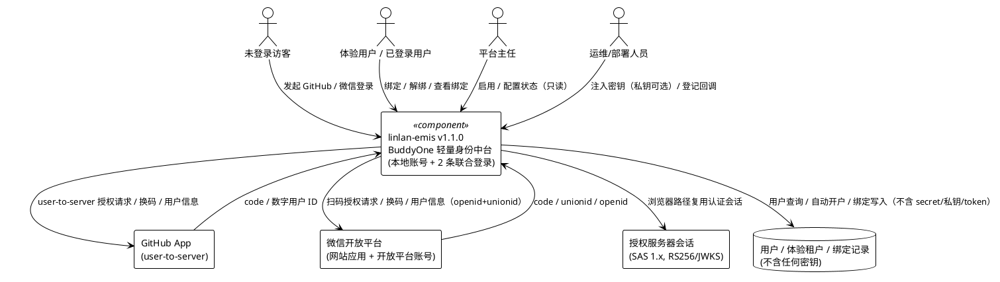
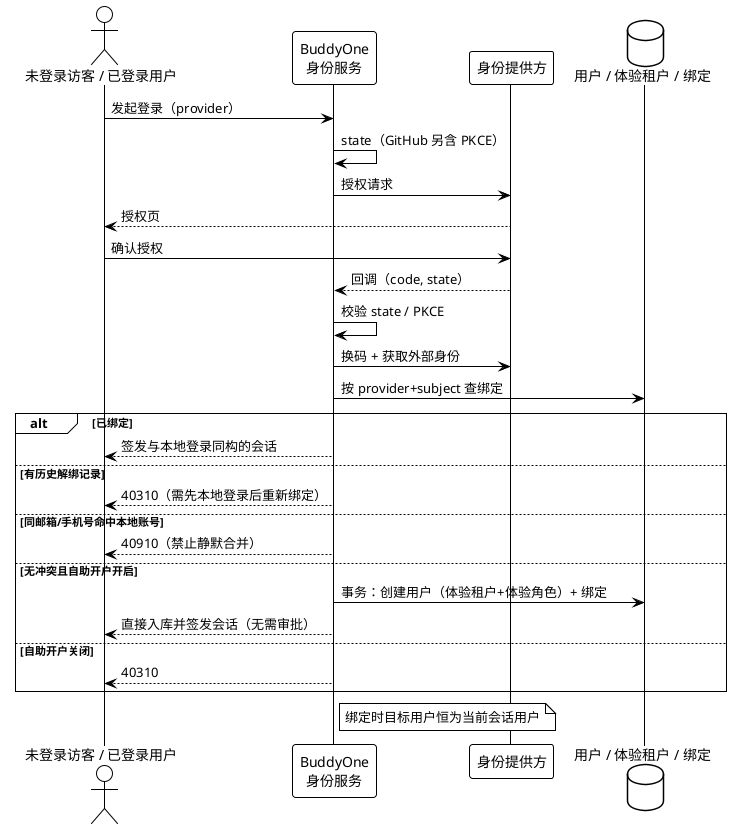
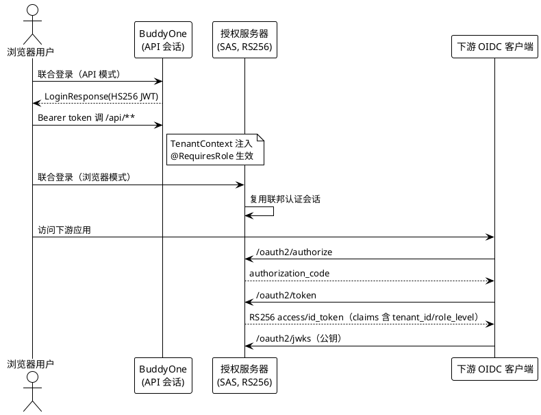
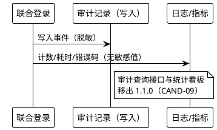

# linlan-emis (BuddyOne) v1.1.0 需求规格 —— 多租户本地扩展型 IAM 中台（GitHub App / 微信扫码两条轻量联合登录）

> 版本：`v1.1.0` | 特性：本地扩展型身份中台 + 两条按需选用的联合登录（GitHub App user-to-server、微信开放平台网站应用扫码，`unionid` 主键） | 基线：`v1.0.0`（本地账号 + JJWT + 多租户内核 + 基础角色 + SAS 1.x 授权服务器骨架）
>
> **产品定位（R4 澄清，2026-11-15）**：linlan-emis（BuddyOne）**不是**"全量 IdP / SSO 平台"，而是**多租户 + 多角色语义的本地扩展型 IAM 中台**——以本地账号、租户隔离、`role_level` 角色语义为主干，只提供**最小可用的联合登录入口**，可被 `dsh-java` 等产品**按需选用**。本文件中凡出现"统一身份提供商 / IdP 平台 / SSO 中台"等表述，一律按此定位理解为"轻量身份中台"，不得据此扩张范围。
>
> **与下游产品分工（R4）**：`dsh-java` 等产品**可以自行配置其他 IdP 源**（飞书、企业微信、任意 OIDC 等由产品侧自行接入）。因此 linlan-emis **不重复建设通用 IdP 接入平台**，本期只做 GitHub App 与微信扫码两条必需路径；provider 抽象仅为**最小扩展点**（一个接口 + 配置驱动），不承诺任意第三方不改代码即可接入，不做 provider 注册表数据库化、不做 SPI/插件发现、不做多 provider 编排与优先级路由、不做 provider 管理后台/CRUD（详见 §1.4-18..21、§12-18）。
>
> **文档状态**：v1.1.0 需求基线（修订版 **R4**，2026-11-15）。**R2** 在 `docs/1.1.0/spec.md` 原文件上**原地修订**，将 Open Questions 的 8 项用户决策落为正文需求与验收标准；**R3** 同一文件原地追加"参考实现 `emis-java-backend` 复用评估"（§13）；**R4** 按用户最新意见**收敛定位、减轻体量**：明确"轻量身份中台"定位与 dsh-java 分工、把非 MVP 能力移入 §14「1.2+ 候选清单」、新增"轻量红线"（§12-18..21）与"仅思路借鉴"声明（§13 开头），并对 REQ-GH-011 / REQ-WX-007 / REQ-ID-014 / REQ-CFG-009 / REQ-SEC-005 / REQ-SEC-013 做减重改写。全程不新建第二份规格，`REQ-*` / `AC-*` / `OQ-*` 编号体系保持不变（仅追加与标注，不改编号）；被削减的条目**保留编号**并标注"移出 1.1.0（1.2+）"，避免断档。
>
> **落点说明**：项目 SDD 约定为 `docs/<版本>/{spec.md, design.md, tasks.md, release-*.md}`。本特性属演进路线 **P1**，为 v1.0.0 的增量版本，归档于 `docs/1.1.0/`，**不改写 `docs/1.0.0/spec.md` 历史基线**。`design.md` / `tasks.md` 由后续设计/任务阶段在同一目录产出。
>
> **归档约定**：本文件是 v1.1.0 四件套中的需求规格，仅定义"做什么（What）"与验收标准，不含接口路径实现、类结构、SQL DDL、算法与部署方案（"怎么做（How）"由 `design.md` 承载）。
>
> **版本范围声明（R4 收敛为 MVP 唯一交付范围）**：v1.1.0 **只交付**以下 10 项：①GitHub App 授权码登录；②微信开放平台网站应用扫码登录（`unionid` 主键）；③外部身份绑定/解绑；④无本地账号自助开户（体验租户 + 体验角色）；⑤免审批直接入库；⑥复用现有 HS256 平台 JWT；⑦密钥零入库（环境变量/密钥管理注入）；⑧state/PKCE 与稳定错误码；⑨最小审计事件（仅写入，不含查询看板）；⑩README 中英双语与 CHANGELOG 同步。**其余一律移入 §14「1.2+ 候选清单」**，包括但不限于：IdP 源同步（LDAP/AD/钉钉/企微/飞书/Google/QQ/支付宝/Gitee）、多 provider 编排与优先级路由、provider 注册表 DB 化与 SPI/插件发现、provider 管理后台/CRUD、SAML/CAS/表单代填、MFA/OTP/短信、令牌吊销黑名单、跨租户身份绑定、昵称头像定时同步、审计报表与统计看板、微信多端（小程序/公众号）账号打通、体验租户升级运营面、GitHub App 私钥托管与 App JWT/管理 API。
>
> **依赖新增预期**：需求层面不强制新增第三方 SDK；GitHub App user-to-server 换码与微信网站应用换码均以标准 OAuth2 授权码协议 + 服务端 HTTP 调用实现。**本期不生成 App JWT、不调用 GitHub App 管理 API**（私钥托管与 App JWT 移出 1.1.0，见 CAND-12），GitHub 登录链路只依赖 `client_id` / `client_secret`。是否引入 `spring-boot-starter-oauth2-client` 由设计阶段决策，本规格不作要求。
>
> **参考实现坐标（R3 新增，R4 收窄为"仅思路借鉴"）**：同仓 `linlaninfo/emis-java-backend`（版本 `1.2.8`，`net.linlan.emis`，10 个 Maven 模块 + 4 个 Web 应用）仅作**只读思路参考**——允许借鉴常量语义、错误码映射、state 一次性、绑定与审计字段词汇等**思路**；**不引入**其模块、依赖、构建结构、服务分层与包组织，**不参照**其分层在本项目重做"重型模块化"。复用评估见 §13（开头含"仅思路借鉴"声明），结论为"**思路可借鉴、协议知识可复用、源码不可复制、结构不照搬**"。

## **决策基线（2026-11-15，用户已确认）**

> 以下 **10 项**决策（D1–D8 为 2026-11-15 用户确认的原有决策；D9–D10 为 R4 定位收敛决策）**取代**初稿中 Open Questions 的建议默认值，并已逐条落入正文与验收标准。已决项不再作为开放问题保留（见 §9）。

| # | 决策 | 关键结论 | 落点章节 |
| --- | --- | --- | --- |
| D1 | GitHub 接入方式 | 采用 **GitHub App**（非 OAuth App）：user-to-server token 授权换码；installation 与用户身份解耦；App 私钥仅服务端保管（**可选，本期不参与登录**） | §2、§5.1、§5.5、§6、§7、§8 |
| D2 | 微信身份主键 | **`unionid` 为 `provider_subject` 主键**；`openid` 作为应用维度附属标识记录（**仅最近一次**）；unionid 缺失即拒绝（`40115`），禁止回退 openid | §2、§5.2、§5.3、§6、§7、§8 |
| D3 | 首次登录租户与角色 | 默认 **体验租户** + **体验角色**（映射 `role_level=2`）；体验租户建议 `tenant_id=2`（待设计确认）；**"主任升级为正式租户"已移出 1.1.0（CAND-11）** | §2、§5.3、§6、§8 |
| D4 | 入库审批 | **不需要管理员审批**；联合登录成功后用户记录 + 绑定记录同时入库，原"待审批/审批流"需求改为"不适用" | §1.4、§5.3、§8 |
| D5 | 本地账号前置 | **不强制先有本地账号**；无匹配账号时自动开户并赋体验租户 + 体验角色；同邮箱/手机号仍返回 `40910`，禁止静默合并 | §5.3、§6、§7、§8 |
| D6 | GitHub 组织限制 | **不限制** GitHub 组织/团队成员，任意 GitHub 账号均可登录 | §1.4、§5.1、§6 |
| D7 | 令牌契约 | **复用现有 HS256 平台 JWT**（claims 契约不变）；OIDC **RS256 + JWKS** 链路不变；本次仅做联邦身份对接 | §2、§5.4、§8、§12 |
| D8 | 微信内置浏览器 | 提供**备用路径**：UA 检测后引导"在系统浏览器打开" + 保留账号密码本地登录兜底（兜底用户仍为体验租户/体验角色语义）；本期不做公众号网页授权 | §5.2、§5.8、§8、§9 |
| D9 | **产品定位（R4 用户确认）** | 收敛为**多租户 + 多角色语义的本地扩展型 IAM 中台**，只提供最小可用的联合登录入口，**不是**统一 IdP/SSO 平台；1.1.0 只交付 GitHub App + 微信扫码两条路径 | 文档头、§1、§2、§10、§12、§13、§14 |
| D10 | **与 dsh-java 分工 / 轻量红线（R4 用户确认）** | `dsh-java` 自身可配置其他 IdP 源；linlan-emis **不重复建设**通用 IdP 接入平台；provider 抽象为**一个接口 + 配置驱动**的最小扩展点，禁止注册表 DB 化、SPI/插件发现、优先级路由、管理后台 CRUD；非 MVP 能力全部移入 §14 候选 | 文档头、§1.4、§1.5、§5.9、§10、§12、§14 |

> **R4 定位收敛说明**：D9/D10 是产品级决策，**优先于**任何"看起来更完整"的扩展设计。设计阶段遇到"是否顺手把 provider 做成可插拔平台 / 是否加管理后台 / 是否加审计看板"的取舍时，一律以 D9/D10 为准——**默认不做**，除非需求方单独提出。

---

# **1. 组件定位**

## **1.1 核心职责**

本组件以**本地账号 + 多租户隔离 + `role_level` 角色语义**为主干（即"本地扩展型 IAM 中台"），在此基础上只把 GitHub App 与微信开放平台网站应用作为**两条受信任的外部身份来源**，完成"第三方认证 → 外部身份映射（微信以 `unionid` 为主键）→ 无本地账号时自动开户（体验租户 + 体验角色）→ 复用平台会话签发"的最小闭环，实现免本地密码的联合登录与绑定/解绑。本组件**不**承担通用第三方身份接入平台、provider 编排与运营管理职责；其他 IdP 源由 `dsh-java` 等下游产品自行接入（D9/D10）。

## **1.2 核心输入**

1. **联合登录发起请求**：来自 Web 前端或浏览器用户，指定身份提供方（`github` / `wechat`），可携带登录完成后的回跳意图（仅限白名单内）。
2. **第三方授权回调**：来自 GitHub App 或微信开放平台重定向，携带一次性授权码 `code` 与关联值 `state`（GitHub App 另含 PKCE `code_verifier` 对应的 `code_challenge`）。
3. **已登录用户的绑定/解绑指令**：来自平台已认证会话，指定要绑定或解绑的身份提供方；绑定目标用户由会话决定，不由请求体决定。
4. **第三方用户信息响应**：服务端以授权码换取的外部身份标识与可选资料（GitHub App：不可变数字用户 ID、`login`、已验证邮箱、头像；微信：`openid`、`unionid`、昵称、头像）。微信 `unionid` 为必填身份键。
5. **凭证与开关配置**：GitHub 的 `client_id`、`client_secret`、回调地址（`app_id` / App 私钥为**可选**，本期不参与登录）；微信 `AppID` / `AppSecret`、unionid 获取前提；体验租户标识、体验角色映射、自助开户开关（默认开启）；提供方启用开关。
6. **管理侧查询指令（只读）**：主任查看各提供方"已启用 / 已配置"状态。审计查询、统计看板与体验租户升级属 1.2+ 候选（CAND-09 / CAND-11），本期**不提供**专用接口。

## **1.3 核心输出**

1. **联合登录结果**：成功时返回与本地登录**同构**的 `Result<LoginResponse>`（`token`、`userId`、`userName`、`nickName`、`roleLevel`、`tenantId`）；失败时返回稳定业务错误码与中文提示。
2. **浏览器 SSO 会话结果**：浏览器场景下，联合登录成功后建立与本地表单登录**等价**的授权服务器认证会话，使标准 OIDC 授权码流程可继续。
3. **外部身份绑定记录**：平台用户与 `provider + provider_subject` 的绑定关系（含微信 `open_id` 附属标识、状态、绑定时间、最近登录时间）。
4. **自动开户结果**：无匹配账号时创建的平台用户（体验租户 + 体验角色），与绑定记录同事务入库。
5. **最小审计事件（写入）**：联合登录成功/失败、自动开户、绑定、解绑、配置缺失、状态校验失败、凭据类型不匹配、第三方服务异常。审计**查询接口与统计看板不属本期**（CAND-09）。
6. **可观测数据（最小面）**：按提供方维度的登录尝试/成功/失败计数、耗时与错误码分布、体验租户开户量，仅以结构化日志/指标输出（不含敏感值）；**不做**统计看板与运营报表（CAND-09）。
7. **文档与变更记录**：`README.md` / `README.en.md` 同步的 GitHub App 与微信登录说明、`CHANGELOG.md` 变更分节、`AGENTS.md` / `llms.txt` 的能力摘要更新。

## **1.4 职责边界**

本组件**不负责**：

1. **微信小程序登录**（`wx.login` + `jscode2session`）与**微信公众号网页授权**（`snsapi_base` / `snsapi_userinfo`）：本版本仅覆盖**微信开放平台网站应用扫码登录**（桌面浏览器扫码）；微信内置浏览器仅提供引导与本地兜底，不引入公众号授权。
2. **Google / 飞书 / 企业微信 / QQ / 支付宝 / 钉钉 / Gitee** 等其余第三方身份源：本期**不做**，也**不建设"通用接入平台"**来接住它们——`dsh-java` 等下游产品可自行配置/接入其他 IdP 源（D10），不依赖本组件转发或代理。相关候选见 CAND-01。
3. **MFA / OTP / 短信验证码 / 邮件验证码**：不在本版本范围。
4. **GitHub App 的 installation 管理与仓库权限**：本次不安装/不管理 installation，不申请仓库或组织数据权限；登录资格与 installation 无关。
5. **GitHub 组织/团队成员校验**：已决策不限制（2026-11-15），平台不查询 org/team 成员关系作为登录条件。
6. **管理员审批流**：已决策**不适用**（2026-11-15）；联合登录成功后直接入库，不存在"待审批"账号状态。
7. **第三方平台侧的注册、资质审核、域名备案、回调地址登记、微信开放平台账号与网站应用绑定**：由运营/管理员在 GitHub 与微信开放平台完成，平台仅消费其结果并声明前提。
8. **第三方账号的密码与凭据管理**：平台不接触、不存储用户在 GitHub/微信的密码。
9. **第三方长期凭据托管**：平台不持久化第三方 `access_token` / `refresh_token` / user-to-server token，不代用户调用第三方业务 API。
10. **外部身份与本地账号的静默合并**：明确禁止自动按邮箱/手机号合并，详见 §5.3。
11. **下游产品（DSH-Desktop / dsh-java / xiaolan）的登录页改造**：其如何展示第三方登录入口属各产品范围。
12. **令牌即时吊销/黑名单**：**移出 1.1.0（1.2+，CAND-06）**。当前 JWT 无状态，本期明确"已签发令牌在有效期内有效"，不引入黑名单存储与校验。
13. **体验租户的升级、批量迁移、数据清理与试用期运营策略**：**移出 1.1.0（1.2+，CAND-11）**。本期只验证"开户落入体验租户 + 体验角色"的语义闭环，**不提供**体验租户升级专用接口、批量正式化与清理任务；体验用户由运维/管理员按既有手段处理。
14. **企业级身份源（LDAP/AD/SAML/CAS/表单代填）**：**移出 1.1.0（1.2+，CAND-04）**，不在本版本范围。
15. **参考工程源码的逐文件移植**（R3 新增，R4 收窄）：本组件**不负责**把 `emis-java-backend` 的既有实现（`emis-module-authn` 的 GitHub/微信过滤器、`emis-module-provider` 的 provider 注册与认证服务、`emis-module-user` 的绑定实体）整体搬入本项目；仅在**思路**层面借鉴（常量语义、`errcode` 映射、state 一次性、绑定/审计字段词汇，详见 §13 开头声明），原因有三：**许可证冲突**（参考工程 1528 个 Java 文件头声明 AGPL-3.0，而其 `LICENSE` 与 `pom.xml` 声明 Apache-2.0，本项目为 MIT，声明互相矛盾且存在传染风险）、**技术栈不兼容**（Java 1.8 / Spring Boot 2.7.18 / `javax.*` / jjwt 0.9.1 / SAS 0.4.0，本项目为 Java 17 / Boot 3.5.16 / `jakarta.*` / jjwt 0.12.6 / SAS 1.5.8）、**已拍板决策相反**（密钥入库、`openid` 主键、OAuth App 形态，均与本规格冲突）。
16. **必须自研的能力边界**（R3 新增，R4 调整）：以下能力**不得**依赖参考实现既有代码，必须按本规格在 `linlan-emis` 内自研——GitHub App 的 user-to-server 换码、PKCE S256 生成与校验、`unionid` 主键的绑定与冲突检查、体验租户/体验角色自动开户（同事务）、最小联合登录审计事件、有界超时的第三方 HTTP 调用、密钥零入库的配置装配。**App JWT / 私钥链路不属本期自研范围**（CAND-12）。
17. **参考工程与本期无关的子系统**（R3 新增）：`emis-module-app`（应用与权限策略）、`emis-module-link`（链接适配器）、`emis-module-idsource`（钉钉/企微/飞书/AD/LDAP 组织同步）、`emis-webs` 四端应用（console/portal/openapi/synchronizer）不属本组件职责，本期不引入（理由见 §13.6）。
18. **通用 IdP 接入平台能力**（R4 新增）：本组件**不负责**建设"任意第三方身份源接入"的平台能力——包括 provider 注册表数据库化、provider 管理后台/CRUD 接口、多 provider 编排与优先级路由、SPI/插件发现机制、SAML/CAS/表单代填协议栈、配置热更新中心。provider 抽象仅为**一个接口 + 配置驱动**的最小扩展点（§5.9、§12-18）。
19. **provider 运营管理面**（R4 新增）：本期**不提供** provider 的新增/编辑/删除/排序/优先级配置接口，也不提供前端管理页面；提供方清单、开关与凭据均由配置（环境变量/密钥管理/发布流程）决定。
20. **统计看板与运营报表**（R4 新增）：审计事件仅要求**写入**与可检索，**不提供**报表、统计看板、趋势分析（CAND-09）。
21. **身份资料定时同步**（R4 新增）：**不做**昵称/头像的定时任务或每次覆盖同步，仅首登填充（REQ-ID-014，CAND-08）。

## **1.5 范围界定**

| 维度 | 纳入 v1.1.0 | 明确排除 |
| --- | --- | --- |
| 身份提供方 | **仅** GitHub App、微信开放平台网站应用（两条） | Google、飞书、企业微信、QQ、支付宝、钉钉、Gitee、LDAP/AD/SAML（由下游产品自行接入或见 CAND-01/CAND-04） |
| provider 抽象 | **一个 provider 接口 + 配置驱动**（最小扩展点） | provider 注册表 DB、SPI/插件发现、优先级路由、管理后台 CRUD（CAND-02/CAND-03） |
| 与 `dsh-java` 分工 | 本组件只提供上述两条登录路径，可被按需选用；错误码风格可对齐 | 下游产品自身的其他 IdP 接入、登录页改造、令牌消费方式（§10） |
| GitHub 协议 | GitHub App user-to-server Authorization Code（`client_id/client_secret` 换码 + `state` + PKCE S256） | GitHub OAuth App、GitHub Device Code、installation token 作为用户身份、GitHub Actions OIDC |
| 微信协议 | 开放平台网站应用扫码（`snsapi_login`，PC 扫码），`unionid` 主键 | 微信小程序登录、公众号网页授权、微信内浏览器免密登录 |
| 账号形态 | 无本地账号自动开户（体验租户/体验角色）、已绑定登录、绑定/解绑 | 静默合并、管理员审批、批量导入外部身份、跨租户共享外部身份（CAND-07）、体验租户升级与批量正式化（CAND-11） |
| 令牌形态 | 复用 HS256 平台 JWT；浏览器路径复用 AS 会话；OIDC RS256/JWKS 不变 | 新增第二套平台令牌格式、独立 refresh 机制、令牌算法改造 |
| 安全能力 | state、PKCE S256、一次性授权码、重放防护、限流、最小审计写入、脱敏、密钥零入库、unionid 缺失拒绝 | 平台侧 MFA、设备指纹、风控评分、令牌吊销黑名单（CAND-06） |
| 参考实现复用（R3，R4 收窄） | **仅思路借鉴**：端点/参数名常量语义、微信 `errcode` 映射、state"取走即失效"语义、绑定与审计字段词汇 | 参考工程源码复制、其模块/依赖/构建结构、服务分层与包组织、私有框架、其技术栈（Java 8/Boot 2.7/`javax`）、密钥入库、`openid` 主键、OAuth App 形态、provider 注册表/优先级路由（§13 开头声明） |

## **1.6 与 OIDC 授权服务器（P2）的关系**

> v1.0.0 已具备 `spring-authorization-server` 1.x 的授权码/OIDC 端点与表单登录；本规格必须在需求层面锁定"联合登录是授权服务器的**联邦身份认证方式**"，避免后续返工。

1. **单一会话体系**：浏览器场景下，联合登录成功后必须复用授权服务器的认证会话继续 `/oauth2/authorize` 流程；**禁止**为联合登录建立与授权服务器并行的第二套浏览器会话。
2. **单一令牌契约**：无论经本地登录、API 联合登录还是浏览器 OIDC 流程进入，平台身份主体与 JWT claims 契约（`sub` = 用户 ID、`user_name`、`preferred_username`、`role_level`、`tenant_id`）必须一致；不得因身份来源不同而改变 claim 语义。
3. **双令牌链并存、职责分离**：`/api/**` 平台会话复用现有 `JwtUtil` 的 **HS256 对称签名** JWT；浏览器 OIDC 由授权服务器以 **RSA 私钥签名（RS256）** 并经 `/oauth2/jwks` 发布公钥。两条链**同时存在且不得合并**（详见 §5.4）。
4. **按 provider 维度建模，但不做平台化扩展**：身份绑定模型以单一 `provider` 字段区分来源（本期 `github` / `wechat`），不为单一提供方写死列；`provider_subject` 的语义由各 provider 自定（微信为 `unionid`）。**不预留** provider 注册表、优先级路由、SPI 发现等平台化扩展位（§12-18）；微信小程序/公众号多端打通不在本期（CAND-10）。
5. **不替代下游 SSO**：联合登录解决"人如何进入 BuddyOne"，下游产品仍通过标准 OIDC 获取 BuddyOne 令牌，二者不混用。

---

# **2. 领域术语**

**联合登录（Federated Login）**
: 平台以第三方身份提供方完成用户身份认证后，将外部身份映射为平台用户并建立平台会话的登录方式；本版本特指 GitHub App 与微信开放平台网站应用。

**身份提供方（Identity Provider / provider）**
: 外部身份来源的枚举标识，本版本**仅**取值为 `github`、`wechat`；同一平台用户可绑定多个提供方。provider 不是插件体系：新增来源须改代码与配置（一个接口 + 配置驱动），**不承诺**任意第三方在不改代码的情况下接入。

**轻量身份中台（Lightweight IAM Hub）**
: 本组件的产品定位：以本地账号、租户隔离与 `role_level` 角色语义为主干，提供最小可用的联合登录入口，供 `dsh-java` 等产品按需选用；**不是**统一 IdP/SSO 平台，不承担通用第三方身份接入、编排与运营管理职责（D9）。

**最小 provider 扩展点（Minimal Provider Extension Point）**
: provider 接入的最小抽象：**一个 provider 接口 + 环境变量/密钥管理驱动的配置**，承载"授权发起、回调换码、外部身份提取"三件事。**不包含** provider 注册表数据库、优先级路由、SPI/插件发现、管理后台 CRUD、配置热更新（D10、§12-18）。

**外部主体标识（provider_subject）**
: 提供方侧**不可变**的外部身份唯一标识，已决策（2026-11-15）：GitHub 取 GitHub App 返回的数字用户 ID（不得使用可改名的 `login`，不得使用可更换的邮箱）；微信取 `unionid`。该值必须由服务端令牌交换/用户信息响应获得，禁止由客户端提交。

**GitHub App**
: GitHub 提供的应用集成形态（区别于 OAuth App）。本版本使用其 **user-to-server 授权码流程**完成用户登录，使用 App 的 `client_id` / `client_secret` 换取代表用户的 user-to-server token；本版本**不生成 App JWT、不调用 App 管理 API**（能力见 CAND-12），私钥因此不参与登录换码。

**GitHub App installation（安装）**
: GitHub App 被安装到某个用户或组织账号下形成的授权实体，用于访问该账号下的仓库/资源。**本版本不依赖 installation**：用户是否能登录与是否安装 App 无关，installation 与用户身份**解耦**。

**GitHub App 私钥（App private key）**
: GitHub App 注册时生成/下载的 PEM 私钥，用于以 **RS256** 签名 App JWT（JWT assertion）；仅服务端保管，已决策（2026-11-15）禁止入库、禁止下发客户端、禁止写入日志。**本期不生成 App JWT，私钥为可选项，缺失不影响登录**（CAND-12）。

**user-to-server token**
: GitHub App 以用户身份换取、代表"某用户授权给某 App"的访问令牌；本版本仅在服务端内存中用于读取该用户资料，不持久化、不写日志、不返回前端。

**微信 openid**
: 微信开放平台在**某一应用（AppID）维度**内对用户的唯一标识；不同应用（网站应用 / 小程序 / 公众号）下同一用户的 `openid` 不同。已决策（2026-11-15）：`openid` 仅作为应用维度**附属标识**记录，**不得作为身份主键**。

**微信 unionid**
: 微信开放平台在**同一开放平台账号**维度内对用户的唯一标识；同一用户在不同应用下的 `unionid` 相同。已决策（2026-11-15）：`unionid` 是微信身份的 `provider_subject` 主键。获取前提：微信开放平台账号已绑定**同一主体下**的网站应用；平台在未获得 `unionid` 时必须拒绝登录/绑定（`40115`），**不得回退 `openid` 作为主键**。

**微信网站应用扫码登录**
: 微信开放平台"网站应用"提供的 PC 扫码授权登录（授权页扫码 → 回跳 `code` → 服务端换取 `access_token` + `openid` + `unionid`）；**区别于**小程序 `jscode2session` 与公众号网页授权。

**外部身份绑定（External Identity Binding）**
: 平台用户与 `provider + provider_subject` 之间的持久关联；一个平台用户在同一提供方下至多一条有效绑定。微信绑定的 `provider_subject` 即 `unionid`。

**体验租户（Experience Tenant）**
: 为自助开户用户（联合首登或本地自助注册）提供的**独立隔离租户**，默认承载试用/体验数据，与正式租户隔离。已决策（2026-11-15）：建议 `tenant_id=2`、名称"体验租户"（`tenant_id=1` 为 v1.0.0 种子"默认租户"，不得复用）；具体标识与是否自动创建**待设计阶段确认**。

**体验角色（Experience Role）**
: 体验租户用户的默认角色，展示名"体验角色"，映射 **`role_level=2`**（访客层级，最小权限）。已决策（2026-11-15）：**不新增 `role_level` 取值**，`@RequiresRole(N)` 语义不变（`N≥2` 放行）；角色命名与展示方式待设计阶段确认。

**自助开户（Self-provisioning）**
: 外部身份首次登录且无匹配平台账号时，平台自动创建平台用户并建立绑定的行为。已决策（2026-11-15）：**默认开启**（原"首次登录自动注册"默认关闭的设定废止），新用户固定为体验租户 + 体验角色；无需管理员审批。

**静默合并（Silent Merge）**
: 仅凭第三方返回的邮箱/手机号与既有本地账号相同，就自动把外部身份挂到该账号的行为。本规格**明确禁止**，命中即返回 `40910`。

**一次性关联值（state）**
: 平台在发起授权前生成、与会话绑定、仅可使用一次、有限期的高熵随机值，用于防 CSRF 与回调重放。

**PKCE**
: OAuth2 授权码流程的增强校验（`code_challenge` / `code_verifier`）；GitHub App 支持时必须使用 `S256`，微信网站应用不支持时必须以 state 补偿。

**HS256（HMAC-SHA256）**
: 基于 **HMAC-SHA256** 的 **JWS 对称签名算法**，签名与验签使用**同一密钥**；本平台 `/api/**` 会话 JWT 由 `JwtUtil` 以该算法签发（jjwt `signWith(SecretKey)`），默认有效期 24 小时。

**RS256（RSASSA-PKCS1-v1_5 + SHA-256）**
: 基于 **RSA 非对称密钥**的 **JWS 签名算法**，私钥签名、公钥验签；OIDC 标准推荐的做法，公钥通过 JWKS 发布。**RSA 不是协议而是非对称加密/签名算法族**，`RS256` 是其中一种 JWS 算法，常与 `JWKS` 端点配合供下游校验。

**联合登录主体（Federated Principal）**
: 联合登录成功后进入平台身份体系的用户主体；其 `userId`、`tenantId`、`roleLevel` 必须来自平台用户记录，不得来自第三方响应。

---

# **3. 角色与边界**

## **3.1 核心角色**

1. **未登录访客**：通过 GitHub App 或微信扫码发起登录；无匹配账号时按默认策略自动开户（体验租户 + 体验角色），不能自行指定租户或角色。
2. **体验用户（体验租户 + `role_level=2`）**：以最小权限使用平台；可绑定/解绑自身外部身份；不能访问管理级接口。
3. **已登录用户（`role_level = 0/1/2`）**：发起绑定、解绑、查看自身已绑定身份；绑定目标恒为当前会话用户。
4. **平台主任（`role_level = 0`）**：查看各提供方"已启用 / 已配置"只读状态；可通过配置（环境变量/发布流程）停用某提供方；不查看任何密钥/私钥明文。**体验租户用户的正式化升级不在 v1.1.0 交付范围**（移出 1.1.0，1.2+ 见 CAND-11），本期由运维/管理员按既有手段处理。
5. **运维/部署人员**：通过环境变量、密钥管理或文件挂载注入 `client_secret` / `AppSecret`，登记回调地址；App 私钥为**可选**（仅 1.2+ App JWT 能力需要，见 CAND-12）。

## **3.2 外部系统**

1. **GitHub App（GitHub 侧）**：提供 user-to-server 授权页、授权码交换、用户信息（不可变数字用户 ID、`login`、已验证邮箱、头像）；本期不调用 App 管理 API（私钥可选、不参与登录）。
2. **微信开放平台（网站应用 + 开放平台账号）**：提供扫码授权页、授权码交换、用户信息（`openid`、`unionid`、昵称、头像）；`unionid` 依赖开放平台账号绑定同一主体的网站应用。
3. **平台数据库（MySQL / H2）**：持久化平台用户、体验租户、外部身份绑定记录；不存储任何第三方密钥、App 私钥或第三方令牌。
4. **授权服务器（SAS 1.x，进程内）**：浏览器路径下承载认证会话，并以 RSA 私钥签发 RS256 的 OIDC access/id token、发布 JWKS。
5. **审计/日志与指标后端**：接收脱敏后的审计事件与指标。

## **3.3 交互上下文**



---

# **4. DFX 约束**

## **4.1 性能**

1. **端到端时延**：联合登录回调处理（不含用户在第三方页面停留与第三方网络耗时）P95 ≤ 500 ms；含第三方调用的完整登录 P95 ≤ 3 s。
2. **第三方调用超时**：连接超时 ≤ 3 s，读取超时 ≤ 5 s；超时必须有界，禁止无限等待。
3. **并发**：单实例支持 ≥ 50 并发联合登录回调，不出现会话串号或绑定错乱。
4. **不拖累本地登录**：第三方登录链路不得占用本地登录所需资源；第三方故障时本地登录性能不劣化。
5. **开户开销**：自动开户（用户 + 绑定同事务）相对已绑定登录的额外耗时 P95 ≤ 100 ms，不因唯一性校验引入全表扫描式等待（实现方式由设计阶段决定）。

## **4.2 可靠性**

1. **失败隔离**：GitHub/微信任一不可用，只影响该提供方，本地账号登录与另一提供方保持可用。
2. **无半成品**：联合登录失败（state 失败、code 无效、`unionid` 缺失、第三方超时、开户或绑定写入失败）不得产生孤立用户、孤立绑定或已签发令牌。
3. **幂等性**：同一回调重复到达时，第二次必须被拒绝且不重复创建用户/绑定；用户资料更新类操作必须可重复执行而无副作用。
4. **事务边界**：自动开户（创建用户 + 创建绑定）必须原子完成，任一步失败整体回滚，不允许"有用户无绑定"或"有绑定无用户"。
5. **可用性目标**：联合登录可用性 ≥ 99.5%（按月，排除第三方平台自身故障）；平台不得因第三方故障返回 5xx 白屏。
6. **私钥不阻断登录（R4 调整）**：GitHub 登录**只依赖** `client_id` / `client_secret` / `redirect-uri`；App 私钥缺失、不可读或无效**不得**导致登录失败、不得返回 `50300`（App JWT 与管理 API 调用已移出 1.1.0，见 CAND-12）。若部署方注入了私钥，加载失败必须显式告警，且不得导致应用启动失败。

## **4.3 安全性**

1. **state 强制**：所有联合登录授权请求必须携带服务端生成的一次性 state；缺失或不匹配一律拒绝。
2. **PKCE 强制**：GitHub App 必须使用 PKCE `S256`；微信网站应用不支持时必须以 state + 服务端会话绑定补偿。
3. **授权码一次性**：授权码只能交换一次；重复使用必须拒绝并记审计。
4. **密钥不落库、不出端**：`client_secret` / `AppSecret` / **GitHub App 私钥**仅存在于服务端环境变量、密钥管理或受限文件挂载；禁止入库、禁止返回前端、禁止写入日志、禁止进入异常堆栈。
5. **外部标识服务端获取**：`unionid` / `openid` / GitHub 数字用户 ID 必须由服务端交换获得，禁止信任客户端提交值。
6. **禁止令牌入 URL**：平台 JWT 不得出现在 URL 查询参数、Referer 可达位置或第三方回调参数中。
7. **不绕过授权**：联合登录回调属公开端点，但绑定/解绑/配置状态查询端点必须沿用 `@RequiresRole`；不得因第三方身份而提升 `role_level` 或改变 `tenant_id`。
8. **限流**：发起与回调端点必须限流，防止 state 耗尽、授权码爆破与审计洪泛；本地账号兜底登录沿用现有登录失败防护。
9. **日志脱敏**：`secret`、App 私钥、`code`、第三方 token、App JWT、平台 JWT 永不记录；`openid` / `unionid` 必须掩码。
10. **重定向白名单**：登录完成后的回跳地址必须命中白名单，防开放重定向。
11. **GitHub App 私钥最小暴露（若配置）**：私钥仅允许在服务端受限路径中读取；**本期不生成 App JWT**；禁止通过任何配置查询接口、管理页面或错误响应回显私钥内容或路径。
12. **unionid 不可回退**：微信身份主键缺失时禁止回退 `openid`、禁止以昵称/头像推断，必须拒绝并返回 `40115`。
13. **兜底通道不降级安全**：微信内置浏览器的本地账号兜底必须沿用 BCrypt 校验、停用校验与限流，不得提供绕过校验的快捷通道。

## **4.4 可维护性**

1. **错误码稳定**：业务错误码集中定义、不得复用、不得随版本改变语义；前端以错误码而非文案判断。
2. **配置缺失不阻断启动**：缺少第三方凭证（`client_secret` / `AppSecret` / `redirect-uri`）时应用必须正常启动（本地开发零配置可跑），仅在调用时返回 `50300`；私钥缺失/不可读**不影响启动与登录**。
3. **配置可观测**：管理员可查询"已启用/已配置"状态，但任何接口与日志不得回显密钥或私钥明文。
4. **结构化日志**：联合登录相关日志必须包含 `provider`、`event`、`result`、`error_code`、`request_id`、`user_id`（若已知）、`tenant_id`（若已知）。
5. **文档同步**：`README.md` 与 `README.en.md` 同步更新；`CHANGELOG.md` 记录新增能力与默认开户策略变更；`AGENTS.md` / `llms.txt` 更新能力摘要。
6. **配置项命名一致**：沿用项目既有 `emis.*` 前缀风格，按提供方分组，避免散落。
7. **私钥可观测（R4 收窄）**：若部署了私钥，仅要求"已加载 / 加载失败"可观测，日志不得包含私钥内容或可还原信息；App JWT 生成次数属 1.2+（CAND-12）。
8. **体验租户可运维（最小面）**：体验租户的启用状态、开户数量、异常开户速率可观测（仅结构化日志/指标，不含个人敏感信息，不做看板）。

## **4.5 兼容性**

1. **接口向后兼容**：`POST /api/auth/login`、`POST /api/auth/register`、`GET /api/auth/me`、`DELETE /api/auth/user/{id}` 的请求/响应契约不得破坏；`LoginResponse` 字段不得删除或改变语义（可新增可选字段）。
2. **JWT 契约不变**：`sub`、`user_name`、`preferred_username`、`role_level`、`tenant_id` 的语义与现有 `JwtUtil` / 授权服务器 token customizer 保持一致；算法仍为 HS256（平台）/ RS256（OIDC）。
3. **角色语义不变**：不新增 `role_level` 取值；体验角色固定映射 `role_level=2`；`@RequiresRole` 仍为 `role_level <= N` 放行、fail-closed。
4. **租户语义不变**：绑定不得修改用户既有 `tenant_id`；主任（`tenant_id` 为空）绑定后仍为空；体验租户用户的升级能力移出 1.1.0（CAND-11），本期联合登录/绑定/解绑均不改变租户与角色。
5. **数据库兼容**：新增绑定数据结构必须同时适配生产 MySQL 与本地 H2；不修改既有表语义。
6. **数据迁移**：v1.1.0 无需迁移存量用户；存量本地账号在首次成功绑定后即可使用联合登录。
7. **默认开户策略行为变更**：自助注册（本地）与联合首登统一使用体验租户/体验角色，属 v1.1.0 **行为变更**（接口契约不变）；存量用户不受影响，须在 README/CHANGELOG 明确声明。
8. **令牌链不合并**：不得把 HS256 平台 JWT 与 RS256 OIDC 令牌合并为单一算法或单一签发器；JWKS 端点与既有客户端校验方式保持兼容。

---

# **5. 核心能力**

> 需求编号规则：`REQ-<域>-<序号>`。EARS 类型标注为：通用（Ubiquitous）、事件驱动（Event）、状态驱动（State）、可选（Optional）、异常（Unwanted）。每条需求附验收条件与验收方式（接口 / 单测 / 集成 / 手工 / 文档检查）。标注"已决策（2026-11-15）"的条目为本次确认结论，不得再以默认值替代。

## **5.1 GitHub App 授权登录**

### **5.1.1 业务规则**

1. **REQ-GH-001**（通用，已决策 2026-11-15）：系统应当以 **GitHub App** 的 user-to-server 授权码流程接入 GitHub，使用 App 的 `client_id` + `client_secret` + `code` 在服务端交换 user-to-server token，并仅以该 token 读取用户信息；**禁止**使用 GitHub OAuth App 形态，**禁止**以 installation access token 代表用户身份。
   - 验收条件：[发起 GitHub 登录] → [浏览器被重定向至 GitHub App 授权页；换码请求使用 `client_id`/`client_secret`；平台不向浏览器暴露任何密钥]
   - 验收方式：接口测试 + 集成测试
2. **REQ-GH-002**（事件驱动）：当用户发起 GitHub 登录时，系统应当生成高熵一次性 `state` 并与会话绑定，有效期不超过 10 分钟。
   - 验收条件：[发起登录] → [授权请求含 `state`；10 分钟后使用该 state 回调被拒绝]
   - 验收方式：接口测试 + 单测
3. **REQ-GH-003**（通用）：GitHub App 支持 PKCE，系统必须使用 `S256` 方法发送 `code_challenge` 并在回调时校验 `code_verifier`。
   - 验收条件：[授权请求] → [含 `code_challenge` 与 `code_challenge_method=S256`；缺失 verifier 的回调被拒绝]
   - 验收方式：接口测试
4. **REQ-GH-004**（事件驱动）：当 GitHub 回调到达时，系统应当先校验 `state`（存在、未使用、未过期、与发起会话匹配），校验通过后才允许交换授权码。
   - 验收条件：[state 不匹配/缺失/已使用/过期] → [拒绝，返回 `40111`，不发生令牌交换与用户创建]
   - 验收方式：接口测试
5. **REQ-GH-005**（事件驱动）：当授权码交换成功后，系统应当以 GitHub 返回的**不可变数字用户 ID** 作为 `provider_subject`，不得使用 `login`、邮箱或昵称作为身份键。
   - 验收条件：[GitHub 用户改名后再次登录] → [仍匹配同一绑定]
   - 验收方式：单测（模拟响应）
6. **REQ-GH-006**（异常）：若 GitHub 返回 `error=access_denied` 或用户取消授权，系统应当返回 `40110`，不得创建用户或签发令牌。
   - 验收条件：[用户取消授权] → [`40110`，无用户/绑定新增]
   - 验收方式：接口测试
7. **REQ-GH-007**（异常）：若授权码缺失、无效、已使用或已过期，系统应当返回 `40112` 并记录审计；同一授权码的第二次回调必须失败。
   - 验收条件：[同一 code 连续回调两次] → [第一次成功，第二次 `40112`，仅一条绑定/一个会话]
   - 验收方式：接口测试
8. **REQ-GH-008**（异常）：若 GitHub 令牌交换或用户信息接口超时/不可用，系统应当返回 `50200`，不得返回 `200` 或降级为匿名。
   - 验收条件：[模拟 GitHub 5xx/超时] → [`50200`，无用户创建]
   - 验收方式：接口测试（打桩）
9. **REQ-GH-009**（事件驱动）：当 GitHub 返回的主邮箱标记为已验证时，系统应当仅将其用于**冲突检测**，不得用于自动绑定或自动合并。
   - 验收条件：[已验证邮箱与本地账号相同且未绑定] → [返回 `40910`，不自动绑定]
   - 验收方式：单测 + 接口测试
10. **REQ-GH-010**（异常）：若 GitHub 响应缺少数字用户 ID，系统应当返回 `40113`，并记录"响应缺主键"审计事件。
    - 验收条件：[响应无 `id`] → [`40113`]
    - 验收方式：单测
11. **REQ-GH-011**（通用，已决策 2026-11-15；R4 减轻）：GitHub App 私钥（PEM）在本期**不是登录前置**——v1.1.0 的 GitHub 登录只依赖 `client_id` / `client_secret` / `redirect-uri`，**不生成 App JWT、不调用 GitHub App 管理 API**（该能力移出 1.1.0，见 CAND-12）。若部署方选择注入私钥，则私钥必须仅由服务端进程读取，**禁止**入库、禁止下发浏览器/客户端、禁止写入日志与异常信息。私钥缺失/为空/无效**不得**阻断 GitHub 登录，也不得返回 `50300` 或 `40114`。
    - 验收条件：[未注入私钥但 `client_secret` 齐备] → [GitHub 登录正常可用]；[已注入私钥并检索全仓与运行日志] → [无私钥 PEM 内容]
    - 验收方式：接口测试 + 文档检查 + 日志检查
12. **REQ-GH-012**（通用，已决策 2026-11-15）：installation 必须与用户身份解耦；登录不得要求用户已安装 App，不得因"未安装/安装在其他账号"而拒绝；本版本不以 installation 权限作为登录或授权条件。
    - 验收条件：[从未安装过 App 的 GitHub 账号登录] → [正常登录或按账户策略开户，不以 installation 缺失拒绝]
    - 验收方式：接口测试 + 集成测试
13. **REQ-GH-013**（通用，已决策 2026-11-15）：系统不得限制 GitHub 组织/团队成员身份；**禁止**查询 org/team 成员关系作为登录条件，任何 GitHub 账号（含不属于任何组织的个人账号）均可登录。
    - 验收条件：[不属于任何组织/团队的 GitHub 账号登录] → [正常登录，不返回"无权限"]
    - 验收方式：接口测试 + 手工
14. **REQ-GH-014**（事件驱动）：user-to-server token 必须仅在服务端内存中用于当次用户信息读取，请求结束即丢弃；不得持久化、不得写入日志、不得返回前端或第三方回调参数。
    - 验收条件：[登录完成后的数据库与日志] → [无 user-to-server token；响应不含该 token]
    - 验收方式：单测 + 日志检查

### **5.1.2 交互流程**

```plantuml
@startuml
!theme plain
actor "浏览器用户" as U
participant "BuddyOne\n联合登录" as B
participant "授权服务器会话" as AS
cloud "GitHub App\n(user-to-server 授权)" as GH
database "用户/绑定" as DB

U -> B : 发起 GitHub 登录
B -> B : 生成一次性 state + PKCE S256
B --> U : 302 至 GitHub App 授权页
U -> GH : 登录并授权
GH --> U : 302 回平台回调（code, state）
U -> B : 回调
B -> B : 校验 state / PKCE
alt state 失败
  B --> U : 40111
else 通过
  B -> GH : client_id + client_secret + code 换 user-to-server token
  GH --> B : user-to-server access token
  B -> GH : GET /user（Bearer token）
  GH --> B : 数字用户 ID / login / 已验证邮箱
  B -> DB : 按 provider + 数字用户ID 查绑定
  alt 已绑定
    B -> DB : 更新最近登录时间
    B --> U : LoginResponse（API）/ AS 会话（浏览器）
  else 未绑定 + 无同邮箱/手机号冲突 + 自助开户开启
    B -> DB : 原子创建用户（体验租户 + 体验角色）+ 绑定
    B --> U : LoginResponse / AS 会话
  else 同邮箱/手机号命中本地账号
    B --> U : 40910（禁止静默合并）
  else 自助开户关闭
    B --> U : 40310
  end
end
note right of B : 本期不生成 App JWT\n私钥不参与登录换码
@enduml
```

### **5.1.3 异常场景**

1. **state 不匹配**
   a. 触发条件：回调 state 与发起会话不一致，或缺失、过期、已使用
   b. 系统行为：拒绝回调，不交换授权码，记录 `STATE_INVALID` 审计
   c. 用户感知：`40111`「登录校验已失效，请重新发起登录」
2. **授权码重放**
   a. 触发条件：同一 `code` 被二次回调
   b. 系统行为：拒绝，记录 `CODE_REPLAY` 审计
   c. 用户感知：`40112`「授权码已失效，请重新登录」
3. **GitHub 不可用**
   a. 触发条件：连接超时、5xx、限流
   b. 系统行为：有界超时后中止，不创建用户
   c. 用户感知：`50200`「GitHub 服务暂时不可用，请稍后重试或使用本地登录」
4. **凭证未配置**
   a. 触发条件：`client_id` / `client_secret` / `redirect-uri` 缺失或为空（私钥缺失不属此列）
   b. 系统行为：直接拒绝，不发起跳转，不降级，记录 `CONFIG_MISSING` 审计
   c. 用户感知：`50300`「GitHub 登录未配置」
5. **（1.2+，CAND-12）私钥无效或 App 不匹配**
   a. 触发条件：私钥格式错误、App ID 与私钥不匹配、App JWT 被 GitHub 拒绝
   b. 系统行为：本版本**无**依赖私钥的登录路径，故不触发；该场景随 App JWT / 管理 API 移出 1.1.0
   c. 用户感知：不适用（私钥缺失/无效不影响本期登录）
6. **用户未安装 GitHub App（非异常）**
   a. 触发条件：账号从未安装 App
   b. 系统行为：按正常用户登录处理，不查询 installation
   c. 用户感知：无差异

---

## **5.2 微信开放平台网站应用扫码登录（unionid 主键）**

### **5.2.1 业务规则**

1. **REQ-WX-001**（通用）：系统应当仅接入**微信开放平台网站应用扫码登录**，不得以小程序 `jscode2session` 或公众号网页授权替代。
   - 验收条件：[检查登录入口] → [使用网站应用扫码授权，非小程序/公众号授权]
   - 验收方式：接口测试 + 文档检查
2. **REQ-WX-002**（通用，已决策 2026-11-15）：系统必须以 **`unionid`** 作为微信的 `provider_subject` 身份主键；`openid` 仅作为**应用维度附属标识**单独记录，**禁止**以 `openid` 作为绑定唯一键或登录主键。
   - 验收条件：[响应同时含 `openid` 与 `unionid`] → [绑定记录 `provider_subject=unionid`，并另存 `openid` 附属标识]
   - 验收方式：单测 + 接口测试
3. **REQ-WX-003**（事件驱动）：当用户发起微信扫码登录时，系统应当生成一次性 `state` 并与会话绑定，有效期不超过 10 分钟；微信不支持 PKCE 时，必须以 state 作为唯一防 CSRF 手段。
   - 验收条件：[发起扫码] → [授权请求含 state；缺失/失配回调被拒]
   - 验收方式：接口测试
4. **REQ-WX-004**（事件驱动）：当微信回调到达时，系统应当先校验 state，再以 `AppID` + `AppSecret` + `code` 在服务端换取 `access_token`、`openid` 与 `unionid`。
   - 验收条件：[state 通过后] → [服务端发起交换；AppSecret 不出现在任何响应]
   - 验收方式：接口测试
5. **REQ-WX-005**（异常）：若微信返回 `invalid code`、`code been used` 或等价错误，系统应当返回 `40112`，且不得重试该授权码。
   - 验收条件：[模拟 errcode 40029/40163] → [`40112`，无重试、无用户创建]
   - 验收方式：单测
6. **REQ-WX-006**（异常，已决策 2026-11-15）：若微信响应**缺少 `unionid`**，系统必须拒绝绑定/登录并返回 `40115`，记录 `UNIONID_MISSING` 审计；**禁止**回退使用 `openid` 作为主键，**禁止**以昵称/头像推断身份，不得创建用户或绑定。
   - 验收条件：[响应含 openid 但无 unionid] → [`40115`；用户数、绑定数不变；绑定唯一键不写入 openid]
   - 验收方式：接口测试 + 单测
7. **REQ-WX-007**（状态驱动，已决策 2026-11-15；R4 简化）：当同一微信用户在不同应用下产生不同 `openid` 但 `unionid` 相同时，系统必须按 `unionid` 命中同一外部身份与同一绑定，不得因 `openid` 不同而新增账号。`open_id` **仅记录最近一次**登录所用应用的 `openid`，**不建立**多应用 openid 历史表、**不做**多端账号打通管理（移出 1.1.0，CAND-10）。
    - 验收条件：[应用 A、应用 B 返回相同 unionid、不同 openid] → [命中同一平台用户，绑定不新增；`open_id` 更新为最近一次]
    - 验收方式：单测 + 接口测试
8. **REQ-WX-008**（通用，已决策 2026-11-15）：系统必须在文档与配置中声明 `unionid` 获取前提——微信开放平台账号已绑定**同一主体下**的网站应用；平台不提供以 `openid` 替代 `unionid` 的降级开关；开放平台未返回 `unionid` 时一律按 REQ-WX-006 拒绝。
   - 验收条件：[检查配置项与文档] → [无"openid 主键/降级"开关；前提说明存在；缺 unionid 时拒绝]
   - 验收方式：文档检查 + 配置检查
9. **REQ-WX-009**（异常）：若微信接口超时或不可用，系统应当返回 `50200`，不得降级为匿名或本地登录。
   - 验收条件：[模拟超时] → [`50200`]
   - 验收方式：接口测试（打桩）
10. **REQ-WX-010**（状态驱动，已决策 2026-11-15）：系统应当仅支持桌面浏览器扫码；当检测到微信内置浏览器（`MicroMessenger` UA）时，必须给出明确的"请在系统浏览器打开"提示并保留可用备用路径，不得白屏、不得返回 5xx。
    - 验收条件：[微信内置浏览器访问登录页] → [展示引导提示与可复制链接；页面无异常]
    - 验收方式：手工 + 接口测试
11. **REQ-WX-011**（事件驱动，已决策 2026-11-15）：微信内置浏览器场景下，系统应当提供**账号密码本地登录兜底**；兜底登录不得降低安全（沿用 BCrypt、停用校验、限流），且兜底用户与联合登录用户共享同一体验租户/体验角色语义。
    - 验收条件：[微信内置浏览器中选择账号密码登录] → [本地登录成功；新开户用户落入体验租户 + 体验角色]
    - 验收方式：手工 + 接口测试
12. **REQ-WX-012**（状态驱动）：兜底路径不得改变既有本地账号的 `tenant_id` / `role_level`；仅对不存在账号的自助注册按统一默认策略（体验租户 + 体验角色）开户。
    - 验收条件：[存量本地账号经兜底登录] → [租户/角色与登录前一致]
    - 验收方式：接口测试
13. **REQ-WX-013**（异常）：系统不得以公众号/小程序 AppID 或 AppSecret 替代网站应用凭据换码；凭据类型不匹配时必须返回 `40114` 并记录审计。
    - 验收条件：[使用错误应用类型凭据] → [`40114`，不签发令牌]
    - 验收方式：单测

### **5.2.2 交互流程**

```plantuml
@startuml
!theme plain
actor "桌面浏览器用户" as U
participant "BuddyOne\n联合登录" as B
cloud "微信开放平台\n(网站应用)" as WX
database "用户/绑定" as DB

U -> B : 发起微信扫码登录
B -> B : 生成一次性 state
B --> U : 302 至微信扫码授权页
U -> WX : 微信扫码并确认
WX --> U : 302 回平台回调（code, state）
U -> B : 回调
B -> B : 校验 state
alt state 失败
  B --> U : 40111
else 通过
  B -> WX : AppID + AppSecret + code 换取令牌
  WX --> B : access_token + openid + unionid
  alt 缺少 unionid
    B --> U : 40115（禁止回退 openid）
  else 含 unionid
    B -> WX : 获取用户信息
    WX --> B : 昵称 / 头像
    B -> DB : 按 provider=wechat + unionid 查绑定
    alt 已绑定
      B -> DB : 更新最近登录时间 / 最近一次 openid
      B --> U : LoginResponse / AS 会话
    else 未绑定 + 无冲突 + 自助开户开启
      B -> DB : 原子创建用户（体验租户+体验角色）+ 绑定
      B --> U : LoginResponse / AS 会话
    else 同邮箱/手机号冲突
      B --> U : 40910
    else 自助开户关闭
      B --> U : 40310
    end
  end
end
@enduml
```

### **5.2.3 异常场景**

1. **扫码超时/用户取消**
   a. 触发条件：用户在微信授权页关闭或超时
   b. 系统行为：不交换授权码，不创建用户
   c. 用户感知：`40110`「已取消微信授权」
2. **微信返回错误码**
   a. 触发条件：无效 code、code 已使用、AppID 与 code 不匹配
   b. 系统行为：记录 `PROVIDER_ERROR` 审计（不含 secret），拒绝登录
   c. 用户感知：`40112`「微信授权已失效，请重新扫码」
3. **缺少 unionid**
   a. 触发条件：开放平台未返回 `unionid`（未绑定同主体网站应用等）
   b. 系统行为：拒绝，记录 `UNIONID_MISSING` 审计；不回退 openid、不创建用户/绑定
   c. 用户感知：`40115`「微信身份信息不完整，请联系管理员完成开放平台绑定后重试」
4. **AppSecret 未配置**
   a. 触发条件：`AppID` 或 `AppSecret` 为空
   b. 系统行为：不发起授权跳转/不调用微信接口
   c. 用户感知：`50300`「微信登录未配置」
5. **微信内置浏览器**
   a. 触发条件：`MicroMessenger` UA
   b. 系统行为：展示系统浏览器引导与复制链接，提供账号密码兜底入口；不渲染扫码组件
   c. 用户感知：明确提示 + 可继续的本地登录入口
6. **体验租户不可用**
   a. 触发条件：体验租户被停用或不可创建
   b. 系统行为：拒绝自动开户，不写入用户/绑定，记录 `EXPERIENCE_TENANT_UNAVAILABLE` 审计
   c. 用户感知：`40314`「体验通道已关闭，请联系管理员」

---

## **5.3 外部身份绑定、自动开户与账号映射**

### **5.3.1 业务规则**

1. **REQ-ID-001**（通用）：系统应当以 `provider + provider_subject` 作为外部身份的全局唯一键；同一外部身份在任一时刻只能绑定一个平台用户（微信主键为 `unionid`，已决策 2026-11-15）。
   - 验收条件：[同一 GitHub 用户/同一微信 unionid 尝试绑定到第二个平台用户] → [拒绝 `40312`]
   - 验收方式：单测 + 接口测试
2. **REQ-ID-002**（通用）：系统应当允许一个平台用户绑定多个提供方（GitHub 与微信各至多一条有效绑定）。
   - 验收条件：[用户先绑 GitHub 再绑微信] → [两条绑定并存，均可登录]
   - 验收方式：接口测试
3. **REQ-ID-003**（状态驱动）：当联合登录命中有效绑定时，系统应当以绑定用户的平台记录签发身份，`userId` / `tenantId` / `roleLevel` 必须取自平台用户记录。
   - 验收条件：[第三方响应携带任意租户/角色信息] → [签发的 claims 仍为平台记录值]
   - 验收方式：单测 + 接口测试
4. **REQ-ID-004**（通用，已决策 2026-11-15）：自助开户默认开启。未命中绑定、且无同邮箱/同手机号本地账号、且该外部身份无历史解绑记录时，系统必须在**同一事务**内创建平台用户与绑定：新用户 `tenant_id=体验租户`、`role_level=2`（体验角色）、`status=0`、`del_flag=0`；无需管理员审批，创建即可登录与使用。
   - 验收条件：[首次联合登录 + 无本地账号] → [同事务创建体验租户用户 + 绑定；返回 200 `LoginResponse`；无"待审批"状态]
   - 验收方式：集成测试 + 接口测试
5. **REQ-ID-005**（状态驱动）：仅当运营显式关闭自助开户（非默认值）时，未命中绑定且无本地账号的首次登录才返回 `40310`，且不得创建任何用户或绑定。
   - 验收条件：[首次登录 + 自助开户关闭] → [`40310`，用户数与绑定数不变]
   - 验收方式：接口测试
6. **REQ-ID-006**（通用）：自动开户生成的 `user_name` 必须全局唯一且可识别来源（建议前缀 `gh_` / `wx_` + 稳定后缀，具体规则设计阶段确认）；若与既有账号冲突，必须生成不冲突的替代值，禁止覆盖或复用既有账号。
   - 验收条件：[存在同名用户时首登] → [生成唯一新用户名，既有账号不受影响]
   - 验收方式：单测
7. **REQ-ID-007**（异常，已决策 2026-11-15）：若第三方已验证邮箱或手机号与既有本地账号一致，系统应当返回 `40910` 并提示"请先使用本地账号登录后绑定"，**禁止静默合并**，也**禁止**在冲突时另建新账号。
   - 验收条件：[同邮箱 + 未绑定] → [`40910`，不新增用户、不新增绑定]
   - 验收方式：接口测试
8. **REQ-ID-008**（通用）：绑定操作必须由已认证会话发起，绑定目标用户必须由会话身份决定；请求体中出现 `user_id` / `tenant_id` / `role_level` 时不得采信。
   - 验收条件：[用户 A 会话提交 `user_id=B`] → [绑定到 A 或直接拒绝，绝不绑定到 B]
   - 验收方式：接口测试
9. **REQ-ID-009**（事件驱动）：当用户发起绑定时，系统应当重新走一次提供方授权以证明外部身份所有权，禁止仅凭前端提交的 `openid` / `unionid` / 用户 ID 完成绑定。
   - 验收条件：[仅提交 openid/unionid 无授权流程] → [拒绝绑定]
   - 验收方式：接口测试
10. **REQ-ID-010**（异常）：若该提供方下当前用户已有有效绑定，再次绑定时系统应当拒绝 `40312`，提示"已绑定，请先解绑"。
    - 验收条件：[重复绑定同一 provider] → [`40312`]
    - 验收方式：接口测试
11. **REQ-ID-011**（状态驱动）：当平台用户 `status=1`（停用）或已软删时，其任何绑定均不得用于登录，系统应当返回 `40311`。
    - 验收条件：[停用用户联合登录] → [`40311`]
    - 验收方式：接口测试
12. **REQ-ID-012**（状态驱动）：当账号被回收（软删）后，其外部身份绑定必须失效且不得被自动开户逻辑复用；该外部身份再次登录应得到"未绑定"或"账号不可用"结果。
    - 验收条件：[软删用户后同一外部身份登录] → [`40310`/`40311`，不创建新账号]
    - 验收方式：接口测试
13. **REQ-ID-013**（通用）：绑定不得修改平台用户的 `user_name`、`tenant_id`、`role_level`；仅允许按策略更新昵称/头像等展示资料。
    - 验收条件：[绑定 GitHub/微信] → [上述三字段不变]
    - 验收方式：单测
14. **REQ-ID-014**（通用，R4 定稿）：外部身份资料（昵称/头像）**仅首次填充**：之后不覆盖用户已修改值，**不做**定时同步或每次覆盖（"每次同步 / 定时同步"移出 1.1.0，CAND-08）。策略写死为"仅首次填充"并在 README 声明，**不提供配置开关**。
    - 验收条件：[第三方昵称变化后再次登录] → [平台展示资料保持首次填充值不变]
    - 验收方式：单测 + 文档检查
15. **REQ-ID-015**（通用，已决策 2026-11-15）：系统**不得**要求用户先有本地账号再使用联合登录；无匹配平台账号时必须按 REQ-ID-004 自动开户，不得返回"请先注册/请先绑定"作为默认路径。
    - 验收条件：[新用户直接使用 GitHub/微信登录] → [无需本地注册即可完成登录]
    - 验收方式：接口测试 + 手工
16. **REQ-ID-016**（通用，已决策 2026-11-15）：联合登录成功后，平台用户记录与外部身份绑定记录必须**同时落库**，不存在"待审批""待激活"中间态；管理员审批流在本版本**不适用**，不得引入审批阻塞登录。
    - 验收条件：[首次联合登录成功] → [用户与绑定同时可见，且该用户可立即调用受保护接口]
    - 验收方式：集成测试
17. **REQ-ID-017**（通用，已决策 2026-11-15）：体验租户必须是独立租户（建议 `tenant_id=2`，名称"体验租户"；`tenant_id=1` 为 v1.0.0 种子"默认租户"，不得复用），与正式租户数据隔离；其标识、创建方式与是否参与统一租户管理**待设计阶段确认**。
    - 验收条件：[自动开户] → [新用户 `tenant_id` 指向体验租户，且不落入任意正式租户]
    - 验收方式：集成测试 + 配置检查
18. **REQ-ID-018**（通用，已决策 2026-11-15）：体验角色必须映射为 `role_level=2`（访客层级、最小权限），展示名"体验角色"；**不得新增 `role_level` 取值**，`@RequiresRole(N)` 语义保持 `role_level <= N` 放行、fail-closed。
    - 验收条件：[体验用户访问 `@RequiresRole(0)` 接口] → [403]；[访问 `@RequiresRole(2)` 接口] → [放行]
    - 验收方式：接口测试
19. **REQ-ID-019（移出 1.1.0 → 1.2+，见 CAND-11）**：原"平台主任将体验租户用户显式升级为正式租户并调整 `role_level`"**不在 v1.1.0 交付范围**。**保留的约束**：联合登录、绑定、解绑**永不**改变用户的 `tenant_id` 与 `role_level`（由 REQ-ID-013 / REQ-UNB-007 承接）。移出理由：MVP 只验证"开户落入体验租户 + 体验角色"的语义闭环；升级属运营流程，需要专用鉴权接口与审计，超出轻量定位（D9）。
    - 验收条件：[联合登录 / 绑定 / 解绑前后对比] → [`tenant_id`、`role_level` 完全不变]（升级场景本身不在本期验收）
    - 验收方式：接口测试 + 单测
20. **REQ-ID-020**（事件驱动）：开户前必须依次完成"按 `provider+provider_subject` 查绑定 → 查历史解绑记录 → 按已验证邮箱/手机号查本地账号"的冲突检查；任一命中即按对应规则终止（已绑定则登录、已解绑 `40310`、邮箱/手机号冲突 `40910`），不得跳步直接建号。
    - 验收条件：[同邮箱 + 该 provider 无绑定] → [`40910`，不发生建号]
    - 验收方式：单测 + 接口测试

### **5.3.2 交互流程（联合首登自动开户 / 已登录用户绑定）**



### **5.3.3 异常场景**

1. **外部身份已被占用**
   a. 触发条件：`provider + provider_subject` 已绑定其他平台用户
   b. 系统行为：拒绝写入，记录 `BIND_CONFLICT` 审计（不含 subject 明文）
   c. 用户感知：`40312`「该第三方账号已绑定其他平台账号」
2. **绑定目标越权**
   a. 触发条件：请求体携带他人 `user_id` 或租户/角色参数
   b. 系统行为：忽略请求体身份参数，仅使用会话身份
   c. 用户感知：绑定到本人或明确拒绝，不泄露他人信息
3. **绑定过程中账号被停用**
   a. 触发条件：授权期间用户被停用
   b. 系统行为：绑定时复核用户状态，拒绝写入
   c. 用户感知：`40311`「账号已停用」
4. **开户事务失败**
   a. 触发条件：用户创建成功但绑定写入失败（或反之）
   b. 系统行为：整体回滚，记录 `PROVISION_FAILED` 审计，不返回 200
   c. 用户感知：`50200`「登录暂不可用，请稍后重试」
5. **体验租户不可用**
   a. 触发条件：体验租户不存在或 `status=1`
   b. 系统行为：不创建用户/绑定，记录 `EXPERIENCE_TENANT_UNAVAILABLE` 审计
   c. 用户感知：`40314`「体验通道已关闭，请联系管理员」

---
## **5.4 会话、令牌与退出**

### **5.4.1 业务规则**

1. **REQ-SES-001**（通用，已决策 2026-11-15）：联合登录成功后签发的平台会话令牌必须**复用现有 `JwtUtil` 的 HS256 对称签名 JWT**，claims 契约保持 `sub=userId`、`user_name`、`preferred_username`、`role_level`、`tenant_id` 不变；**禁止**为联合登录引入第二套平台令牌格式或改变签名算法。
   - 验收条件：[GitHub/微信登录] → [令牌 header `alg=HS256`；claims 键集合与本地登录完全一致]
   - 验收方式：单测 + 接口测试
2. **REQ-SES-002**（通用）：联合登录 API 成功后必须返回与本地登录同构的 `LoginResponse`（`token`、`userId`、`userName`、`nickName`、`roleLevel`、`tenantId`），不得改变字段语义。
   - 验收条件：[回调成功] → [响应结构字段齐备且类型一致]
   - 验收方式：接口测试
3. **REQ-SES-003**（状态驱动）：浏览器 SSO 场景下，联合登录成功后必须复用授权服务器的认证会话继续 OIDC 授权码流程，禁止建立第二套并行会话。
   - 验收条件：[浏览器完成第三方登录] → [`/oauth2/authorize` 可直接继续，无需再次登录]
   - 验收方式：集成测试 + 手工
4. **REQ-SES-004**（通用）：联合登录平台令牌有效期必须与本地登录一致（`emis.jwt.expiration-ms` 默认 `86400000`，即 24 小时），不得为第三方来源单独延长或缩短。
   - 验收条件：[比较两类令牌 `exp`] → [有效期策略一致]
   - 验收方式：单测
5. **REQ-SES-005**（通用）：v1.1.0 不新增独立的 refresh token 机制；需续期时重新走联合登录或本地登录（OIDC 客户端侧的既有 refresh 能力不受影响）。
   - 验收条件：[平台令牌过期后访问受保护接口] → [401，需重新登录]
   - 验收方式：接口测试
6. **REQ-SES-006**（状态驱动）：浏览器路径登出时，系统必须使授权服务器会话失效，后续授权请求需重新认证；平台 JWT 为无状态令牌，API 侧登出以客户端丢弃令牌为准。
   - 验收条件：[登出后访问 `/oauth2/authorize`] → [要求重新登录]
   - 验收方式：集成测试
7. **REQ-SES-007**（异常）：平台令牌不得通过 URL 参数、回调地址参数或第三方重定向参数传递。
   - 验收条件：[检查回调 URL 与响应] → [不含平台 JWT]
   - 验收方式：接口测试 + 代码评审
8. **REQ-SES-008**（状态驱动）：联合登录成功后必须按现有语义注入 `TenantContext`（`tenantId` / `roleLevel` / `userId`），使 `@RequiresRole` 与租户隔离立即生效。
   - 验收条件：[体验用户通过联合登录后访问主任接口] → [403]
   - 验收方式：接口测试
9. **REQ-SES-009**（通用，已决策 2026-11-15）：OIDC 授权服务器的 **RS256 令牌链**（`NimbusJwtEncoder` + `JWKSource` + `/oauth2/jwks`，access_token / id_token 的 claims 定制）必须保持不变；联合登录仅改变"认证会话的来源"，不得改变令牌签名算法、claims 语义或 JWKS 发布方式。
   - 验收条件：[联合登录后走 OIDC 授权码流程] → [access_token/id_token 仍为 RS256，`/oauth2/jwks` 可验签，claims 与本地登录会话一致]
   - 验收方式：集成测试
10. **REQ-SES-010**（通用，已决策 2026-11-15）：两条令牌链职责必须分离——HS256 平台 JWT 仅用于 `/api/**`（由 `JwtAuthenticationFilter` + `RoleInterceptor` 校验）；RS256/JWKS 令牌仅用于下游 OIDC 客户端校验；禁止混用或互相替代。
    - 验收条件：[用 OIDC access_token 调 `/api/auth/me` 或反之] → [按既定校验边界拒绝，不出现跨链放行]
    - 验收方式：接口测试 + 集成测试

### **5.4.2 令牌链契约（已决策 2026-11-15）**

| 维度 | 平台会话令牌（`/api/**`） | OIDC 令牌（下游 SSO） |
| --- | --- | --- |
| 签名算法 | **HS256**（HMAC-SHA256，对称密钥） | **RS256**（RSA 非对称，私钥签名 / 公钥验签） |
| 签发组件 | `JwtUtil`（jjwt `signWith(SecretKey)`） | 授权服务器 `NimbusJwtEncoder` + `JWKSource` |
| 密钥来源 | `emis.jwt.secret`（对称密钥，环境注入） | RSA 密钥对；公钥经 `/oauth2/jwks` 发布 |
| claims | `sub`、`user_name`、`preferred_username`、`role_level`、`tenant_id` | 同左（由 `OAuth2TokenCustomizer` 注入） |
| 有效期 | 默认 24 h（`emis.jwt.expiration-ms`） | 由 `TokenSettings` 决定（当前 access token 1 h） |
| 校验方 | 本服务 `JwtAuthenticationFilter` / `RoleInterceptor` | 下游 OIDC 客户端（JWKS 公钥验签） |
| 本次变更 | **无**（仅复用，claims 契约不变） | **无**（仅增加联邦登录入口，不改令牌形态） |

> **术语澄清（防止误解）**：**RSA 不是协议**，而是非对称加密/签名算法族；**RS256 是 JWS 签名算法**（RSASSA-PKCS1-v1_5 + SHA-256），OIDC 标准推荐使用。**HS256 是对称签名算法**（HMAC-SHA256），签名与验签共用同一密钥。两条链并存是现状，不是本次新增的"两套协议"。



### **5.4.3 异常场景**

1. **令牌过期**
   a. 触发条件：超过有效期访问受保护接口
   b. 系统行为：拒绝并清理上下文
   c. 用户感知：`401`「登录已过期，请重新登录」
2. **会话与绑定不一致**
   a. 触发条件：登录后管理员解绑、停用账号或调整租户/角色
   b. 系统行为：已签发令牌在有效期内仍按现状可验签（无黑名单），新登录立即按最新记录签发
   c. 用户感知：下次登录生效；即时失效已移出 1.1.0（OQ-01 已关闭，见 CAND-06）
3. **令牌链误用**
   a. 触发条件：客户端将 OIDC RS256 令牌用于 `/api/**`，或将 HS256 平台令牌提交给依赖 JWKS 的资源服务器
   b. 系统行为：按各自校验边界拒绝，不互相降级
   c. 用户感知：`401`/`invalid_token`，提示重新登录

---

## **5.5 配置与凭证管理**

### **5.5.1 业务规则**

1. **REQ-CFG-001**（通用，已决策 2026-11-15）：GitHub 与微信的敏感凭据（`client_secret`、`AppSecret`，以及**可选**的 App 私钥 PEM）必须通过环境变量、密钥管理或受限文件挂载注入；**禁止**写入数据库、配置明文、前端产物、镜像层与日志。
   - 验收条件：[全仓检索凭据值] → [仅出现在部署环境注入说明中，不出现于代码/配置/日志]
   - 验收方式：配置检查 + 代码评审
2. **REQ-CFG-002**（通用）：`client_id` / `AppID`（`app_id` 为可选项）可配置为非敏感项，但仍不得与密钥合并存放于可回显接口。
   - 验收条件：[配置查询接口] → [仅返回"已配置"状态，不回显任何值]
   - 验收方式：接口测试
3. **REQ-CFG-003**（状态驱动，R4 收窄）：当某提供方 `client_id` / `AppID`、密钥（`client_secret` / `AppSecret`）或回调地址缺失时，系统应当拒绝该提供方登录并返回 `50300`，**不得降级为匿名登录、不得回退为本地登录成功**；私钥缺失**不**触发该拒绝。
   - 验收条件：[缺失 `AppSecret` 或 `client_secret` 调用对应登录] → [`50300`，无匿名会话]；[仅私钥缺失] → [登录正常]
   - 验收方式：接口测试
4. **REQ-CFG-004**（通用）：回调地址必须与提供方登记值精确匹配，生产环境必须为 HTTPS（本地 `localhost` 允许 HTTP）。
   - 验收条件：[回调地址不一致] → [提供方拒绝；平台返回 `40114`，不签发令牌]
   - 验收方式：接口测试 + 手工
5. **REQ-CFG-005**（通用）：每个提供方必须具备独立启用开关；关闭时不得发起授权、不得受理回调，返回明确"已停用"错误。
   - 验收条件：[关闭 GitHub 登录] → [发起与回调均被拒绝]
   - 验收方式：接口测试
6. **REQ-CFG-006**（可选）：若配置了登录后回跳白名单，系统应当仅允许白名单内地址；未配置时不得接受任意回跳地址。
   - 验收条件：[回跳地址不在白名单] → [拒绝并提示，不发生开放重定向]
   - 验收方式：接口测试
7. **REQ-CFG-007**（状态驱动）：当配置缺失时，系统应当正常启动，仅在使用该提供方时失败；启动日志须明确告警"未配置"但不得输出任何密钥/私钥值。
   - 验收条件：[无任何第三方凭证启动] → [应用启动成功；本地登录可用]
   - 验收方式：集成测试
8. **REQ-CFG-008**（通用，已决策 2026-11-15）：体验租户标识、体验角色映射、自助开户开关（**默认开启**）、state 有效期、超时与限流阈值必须可配置，且具备安全默认值。
   - 验收条件：[未显式配置] → [自助开户开启、新用户落体验租户、`role_level=2`、state ≤10 min、超时有界]
   - 验收方式：配置检查
9. **REQ-CFG-009**（通用，已决策 2026-11-15；R4 收窄）：GitHub 登录**必需**配置项为 `client-id`、`client-secret`（敏感）、`redirect-uri`、`enabled`。`app-id` / `private-key` 为**可选项**：仅当部署方计划后续使用 App JWT（1.2+，CAND-12）时注入，且私钥必须以文件挂载/密钥管理引用方式提供，内容不得出现在 `application.yml` 等仓库内配置文件中；这两项**缺失不影响**本期 GitHub 登录。
    - 验收条件：[检查配置项清单] → [四项必需项齐备即可登录；`app-id`/`private-key` 缺失时登录仍可用；仓库无 PEM 内容]
    - 验收方式：配置检查 + 文档检查 + 接口测试
10. **REQ-CFG-010**（通用，已决策 2026-11-15）：系统**不得**提供"以 `openid` 替代 `unionid`"的配置开关；微信配置仅提供开放平台 unionid 前提声明与启动期/调用期校验，缺 unionid 一律按 REQ-WX-006 拒绝。
    - 验收条件：[检索配置项] → [不存在 openid 主键降级开关；文档含 unionid 前提说明]
    - 验收方式：配置检查 + 文档检查

### **5.5.2 异常场景**

1. **密钥为空字符串 / 私钥不可读**
   a. 触发条件：`client_secret` / `AppSecret` 环境变量存在但为空；或（可选）私钥文件不可读
   b. 系统行为：密钥为空 → 等同"未配置"，返回 `50300` 并记录 `CONFIG_MISSING`；私钥不可读 → 仅告警，**不阻断登录**（REQ-GH-011）
   c. 用户感知：密钥缺失时明确"未配置"；私钥不可读时用户无感
2. **回调地址登记错误**
   a. 触发条件：平台回调地址与提供方登记不一致
   b. 系统行为：提供方侧拒绝，平台返回 `40114` 并记录审计
   c. 用户感知：「第三方回调地址配置错误，请联系管理员」
3. **提供方被停用**
   a. 触发条件：管理员关闭开关
   b. 系统行为：拒绝发起与回调
   c. 用户感知：「该登录方式已停用」
4. **体验租户配置缺失**
   a. 触发条件：体验租户标识未配置或指向不存在的租户
   b. 系统行为：启动告警；自动开户返回 `40314`，不写入半成品数据
   c. 用户感知：「体验通道未配置，请联系管理员」

---

## **5.6 安全、审计与可观测**

### **5.6.1 业务规则**

1. **REQ-SEC-001**（通用）：所有联合登录回调必须依赖服务端生成的一次性 state；禁止无 state 或客户端自造 state 的流程。
   - 验收条件：[无 state 回调] → [`40111`]
   - 验收方式：接口测试
2. **REQ-SEC-002**（通用）：state 必须一次性使用，成功或失败后立即失效，防止重放与并发复用。
   - 验收条件：[同一 state 并发两次回调] → [至多一次成功]
   - 验收方式：集成测试
3. **REQ-SEC-003**（通用）：授权码必须一次性使用；重放必须被拒绝并记为安全事件。
   - 验收条件：[重复 code] → [`40112` + 审计 `CODE_REPLAY`]
   - 验收方式：接口测试
4. **REQ-SEC-004**（通用，已决策 2026-11-15）：外部主体标识必须由服务端获取并校验归属（GitHub 数字用户 ID 来自 `/user` 响应；微信 `unionid`、`openid` 来自令牌交换响应），禁止客户端提交；微信主键缺失时不得回退 `openid`。
   - 验收条件：[请求体注入 openid/unionid] → [被忽略或拒绝]
   - 验收方式：接口测试
5. **REQ-SEC-005**（通用，R4 收窄）：绑定、解绑、配置状态查询端点必须沿用 `@RequiresRole`；未登录返回 401，权限不足返回 403。审计查询与体验租户升级端点**不在 1.1.0 交付范围**（CAND-09 / CAND-11）。
    - 验收条件：[未登录调用绑定接口] → [401]；[体验用户调用配置状态查询] → [403]
    - 验收方式：接口测试
6. **REQ-SEC-006**（通用）：联合登录不得接受外部请求头（如 `X-Tenant-Id` / `X-Role-Level` / `X-User-Id`）影响登录结果；签发身份必须完全来自数据库用户记录。
   - 验收条件：[回调携带伪造租户/角色 Header] → [签发 claims 仍为真实值]
   - 验收方式：接口测试
7. **REQ-SEC-007**（通用）：绑定/解绑等有副作用的操作必须防 CSRF（state、CSRF token 或等价机制），不得仅依赖 Cookie 会话。
   - 验收条件：[跨站构造绑定请求] → [被拒绝]
   - 验收方式：集成测试
8. **REQ-SEC-008**（通用）：错误响应不得包含 `secret`、App 私钥、`code`、第三方 `access_token`、完整 `openid`/`unionid`、堆栈或第三方原始响应体。
   - 验收条件：[构造各类失败] → [响应仅含业务码 + 中文提示]
   - 验收方式：接口测试
9. **REQ-SEC-009**（通用）：日志与审计必须脱敏；`openid` / `unionid` 仅保留可关联的掩码形式，平台 JWT、App JWT、第三方 token 不落日志。
   - 验收条件：[检索日志] → [无 secret/私钥/code/token 明文；标识为掩码]
   - 验收方式：日志检查
10. **REQ-SEC-010**（通用）：联合登录发起与回调必须限流（按 IP 与会话），超限返回 `42900` 并记录审计；本地账号兜底入口沿用现有登录防护并在异常时告警。
    - 验收条件：[高频发起] → [`42900`，不产生额外 state/调用]
    - 验收方式：接口测试
11. **REQ-SEC-011**（事件驱动，R4 收窄）：当发生安全事件（state 失败、code 重放、绑定冲突、配置缺失、凭据类型不匹配、`unionid` 缺失、体验租户不可用、账号停用）时，系统应当记录审计事件，字段至少包含时间、`provider`、`event`、`result`、`error_code`、`request_id`、IP、UA、`user_id`（若已知）、`tenant_id`（若已知）。
    - 验收条件：[触发上述事件] → [审计记录完整且无敏感值]
    - 验收方式：集成测试
12. **REQ-SEC-012（移出 1.1.0 → 1.2+，见 CAND-09）**：原"审计事件按时间范围与提供方查询接口"**不在本期交付范围**。**保留的约束**：审计事件必须可检索（至少通过结构化日志/存储表），字段完整且脱敏；若未来开放查询，必须按租户隔离。移出理由：MVP 只要求"最小审计事件"写入，查询/报表/看板属运营分析面（D9）。
    - 验收条件：[触发事件] → [可通过结构化日志/存储检索到该事件，字段完整且脱敏]
    - 验收方式：日志检查 + 集成测试
13. **REQ-SEC-013**（通用，R4 收窄）：若部署了 GitHub App 私钥，其"已加载 / 加载失败"必须记日志告警（不含私钥内容或任何可还原信息），且**不得阻断登录**；App JWT 生成审计属 1.2+（CAND-12）。
    - 验收条件：[部署私钥并触发加载失败] → [有告警日志、无 PEM 内容、登录仍可用]
    - 验收方式：日志检查 + 集成测试
14. **REQ-SEC-014**（通用，R4 调整）：体验租户用户不得因"自助开户"获得任何高于体验角色的权限；任何请求参数、第三方资料或请求头都不能提升其 `role_level`；升级能力移出 1.1.0（CAND-11），本期不存在通过登录链路提升权限的路径。
    - 验收条件：[体验用户提交 `role_level=0`] → [被忽略；claims 仍为 2]
    - 验收方式：接口测试

### **5.6.2 交互流程（审计）**



### **5.6.3 异常场景**

1. **审计写入失败**
   a. 触发条件：审计存储不可用
   b. 系统行为：登录主流程不被阻断，但必须降级记录到应用日志并告警；不得因审计失败放行本应拒绝的登录
   c. 用户感知：无感知（安全拒绝仍然生效）
2. **限流误伤**
   a. 触发条件：共享出口 IP 高频访问
   b. 系统行为：返回 `42900` 并提示稍后重试
   c. 用户感知：明确重试提示
3. **（可选）私钥加载失败**
   a. 触发条件：文件缺失、权限不足、格式错误
   b. 系统行为：启动告警；本期无依赖私钥的登录或管理调用，故不影响登录；不返回 `50300` / `40114`
   c. 用户感知：无感（登录可用）

---

## **5.7 账号解绑与回收**

### **5.7.1 业务规则**

1. **REQ-UNB-001**（事件驱动）：当已登录用户发起解绑时，系统应当仅解绑当前会话用户自身的绑定，禁止按请求参数指定他人。
   - 验收条件：[用户 A 解绑请求携带 B 的绑定 ID] → [拒绝或仅影响 A]
   - 验收方式：接口测试
2. **REQ-UNB-002**（状态驱动）：当用户仅有第三方登录方式（无本地密码且无其他有效绑定）时，系统应当拒绝解绑最后一个登录方式并返回 `40313`，防止账号锁死。
   - 验收条件：[纯第三方用户解绑唯一绑定] → [`40313`]
   - 验收方式：接口测试
3. **REQ-UNB-003**（事件驱动，已决策 2026-11-15）：解绑成功后，该 `provider + provider_subject` 必须立即不能用于登录，并留下"已解绑"记录；自动开户必须跳过存在历史解绑记录的外部身份，要求用户先本地登录再重新绑定（返回 `40310`），**禁止**因自助开户默认开启而静默创建第二个账号。
   - 验收条件：[解绑后同一第三方账号登录] → [`40310`；不自动恢复绑定、不新建账号]
   - 验收方式：接口测试
4. **REQ-UNB-004**（通用）：解绑必须记录审计事件（操作者、provider、时间、结果），不得记录 subject 明文。
   - 验收条件：[解绑成功] → [审计含 `UNBIND` 事件]
   - 验收方式：集成测试
5. **REQ-UNB-005**（状态驱动）：账号停用或软删后，其绑定必须标记失效；失效绑定不得被自动开户逻辑复用为"新用户"。
   - 验收条件：[回收账号后同一外部身份登录] → [不创建新账号]
   - 验收方式：接口测试
6. **REQ-UNB-006**（通用）：管理员不得查看或导出任何第三方密钥/App 私钥；仅可查看绑定数量与配置状态等聚合信息。
   - 验收条件：[主任查询绑定统计] → [无密钥、无私钥、无完整 openid/unionid]
   - 验收方式：接口测试
7. **REQ-UNB-007**（通用，已决策 2026-11-15；R4 调整）：解绑不得改变用户的 `tenant_id` 与 `role_level`；体验租户用户的升级流程移出 1.1.0（CAND-11），本期解绑后仍为体验租户 + `role_level=2`。
    - 验收条件：[绑定前后、解绑前后对比] → [租户/角色完全一致]
    - 验收方式：接口测试 + 单测

### **5.7.2 异常场景**

1. **解绑不存在的绑定**
   a. 触发条件：绑定 ID 不存在或不属于当前用户
   b. 系统行为：返回明确"绑定不存在"，不泄露他人绑定存在性
   c. 用户感知：`404` 等价提示
2. **解绑时账号已停用**
   a. 触发条件：会话有效但账号已被停用
   b. 系统行为：拒绝操作
   c. 用户感知：`40311`
3. **解绑后误登录**
   a. 触发条件：解绑后用户再次尝试联合登录
   b. 系统行为：识别历史解绑记录，返回 `40310`，引导先本地登录后绑定
   c. 用户感知：`40310`「该第三方账号已解绑，请先登录后重新绑定」

---

## **5.8 兼容、文档与发布治理**

### **5.8.1 业务规则**

1. **REQ-COMP-001**（通用）：本特性不得改变本地登录、注册、`/me`、用户注销接口的契约；`LoginResponse` 字段不得删除或改语义。
   - 验收条件：[回归本地登录全链路] → [行为与 v1.0.0 一致]
   - 验收方式：接口测试（回归）
2. **REQ-COMP-002**（通用）：JWT claims 与 `TenantContext` 注入语义不得改变；`@RequiresRole` 继续 fail-closed；HS256/RS256 两条令牌链均保持现状。
   - 验收条件：[联合登录用户访问受保护端点] → [权限判定与本地登录一致]
   - 验收方式：接口测试
3. **REQ-COMP-003**（通用）：新增数据结构必须同时适配生产 MySQL 与本地 H2，且不修改既有表语义。
   - 验收条件：[H2 与 MySQL 分别启动] → [建表与读写均成功]
   - 验收方式：集成测试
4. **REQ-COMP-004**（通用，已决策 2026-11-15）：v1.1.0 不要求存量用户迁移；存量用户首次绑定联合身份时不得被改租户/角色。
   - 验收条件：[存量账号绑定 GitHub/微信] → [租户/角色不变，绑定可用]
   - 验收方式：接口测试
5. **REQ-COMP-005**（通用，已决策 2026-11-15）：自助注册（本地注册与微信内置浏览器兜底）与联合首登统一使用体验租户 + 体验角色，属 v1.1.0 **行为变更**（接口契约不变）；须在 README 与 CHANGELOG 明确声明，且不得影响存量账号。
   - 验收条件：[新自助注册账号] → [落体验租户 + `role_level=2`；存量账号不受影响；文档已声明]
   - 验收方式：接口测试 + 文档检查
6. **REQ-DOC-001**（通用，R4 调整）：`README.md` 与 `README.en.md` 必须同步说明：GitHub App 启用条件与 `client_secret` 注入方式（**App 私钥可选、本期不生成 App JWT**）、微信 unionid 前提、体验租户/体验角色默认策略、微信内置浏览器兜底路径与限制（不含小程序/公众号）、**产品定位与 dsh-java 分工**。
   - 验收条件：[检查两份 README] → [能力与前提描述一致，无单边缺失]
   - 验收方式：文档检查
7. **REQ-DOC-002**（通用，R4 补充）：`CHANGELOG.md` 必须新增 v1.1.0 分节，记录 GitHub App/微信（unionid）联合登录、体验租户自动开户、令牌链说明、错误码与安全约束、默认开户策略变更，并**明确产品定位**（"多租户本地扩展型 IAM 中台，只提供两条轻量联合登录，其余由下游产品自行接入"）与"1.2+ 候选清单"。
   - 验收条件：[检查 CHANGELOG] → [分节存在、分类清晰、含行为变更声明]
   - 验收方式：文档检查
8. **REQ-DOC-003**（通用）：`AGENTS.md` / `llms.txt` 必须更新能力摘要与配置约定（密钥/私钥仅服务端注入、禁止入库、unionid 主键），保持 AI 可发现性。
   - 验收条件：[检查文件] → [能力与约束已同步]
   - 验收方式：文档检查

---

## **5.9 参考实现复用治理（R3 新增，R4 收窄为"仅思路借鉴"）**

> **仅思路借鉴（R4 声明）**：本节保留 R3 的复用评估，但**借鉴范围收紧为"思路"**——常量语义、错误码映射、state 一次性语义、绑定字段词汇、审计字段命名等；**不引入**其模块、依赖、构建结构、服务分层与包组织，**不参照**其分层在本项目重做"重型模块化"（多模块拆分、provider 平台层、插件体系）。评估结论对 `design.md` 是"**上限**"而非"目标"。
>
> 本节把"参考工程 `emis-java-backend` 哪些可借鉴"从工程经验上升为**可验收的需求**。评估证据与四级结论见 §13；本节只约束"必须怎样用"，不规定"怎样实现"。

### **5.9.1 业务规则**

1. **REQ-REUSE-001**（通用，R4 措辞收窄）：对参考工程的每一项候选借鉴内容，系统设计必须给出**四级判定**之一——`可直接复用`（**仅思路**：协议知识/常量/语义/数据形态，代码须在本项目内自研）、`借鉴改造`（**仅模型与字段词汇**，须按本项目约定重写；**不含**服务分层与模块结构）、`冲突不可复用`（与已定决策或红线相反）、`不引入`（与本期范围无关），并注明依据的**包 / 类 / 表**坐标；不得出现"整体参考某个模块"这类不可核验的表述。
   - 验收条件：[检查 §13 矩阵与后续 `design.md` 的采纳记录] → [每条候选均有等级、坐标、理由；无"整体照搬"式条目]
   - 验收方式：文档检查
2. **REQ-REUSE-002**（通用，禁止项）：系统**禁止**复制参考工程的任何源文件、类、方法体、SQL 片段与前端产物；仅允许基于本规格的等价重写。原因是参考工程许可证声明矛盾（1528 个 `.java` 文件头 AGPL-3.0 与 `LICENSE`/`pom.xml` 的 Apache-2.0 不一致），本项目为 MIT。
   - 验收条件：[全仓检索 + 代码评审] → [无 `net.linlan.emis.authn.*` / `net.linlan.emis.ubind.*` / `net.linlan.emis.manage.*` 包；无 AGPL 文件头；无与参考工程逐字相同的类/方法体]
   - 验收方式：代码评审 + 文档检查
3. **REQ-REUSE-003**（通用）：实现必须保持本项目技术基线（Java 17 / Spring Boot 3.5.16 / `jakarta.*` / MyBatis 3.0.5 / jjwt 0.12.6 / SAS 1.5.8），**禁止**为复用参考实现而引入 `javax.*` API、`eframe` / `linlan.tools` / `linlan.commons` 私有依赖、Spring Boot 2.x 或 SAS 0.x。
   - 验收条件：[检查 `backend/pom.xml` 与依赖树、检索 `javax\.` 引用] → [无上述依赖与包引用；应用可在 Java 17 下编译启动]
   - 验收方式：配置检查 + 代码评审
4. **REQ-REUSE-004**（通用）：**协议知识与常量属"仅思路级"**，系统应当在本项目内新建自有常量/配置承载：GitHub App 授权与换码端点、用户信息端点；微信网站应用 `qrconnect` 授权端点、`access_token` 与 `userinfo` 端点、`snsapi_login` 作用域、`unionid` / `openid` / `errcode` / `headimgurl` / `nickname` 字段名；以及微信 `errcode` 的业务语义（授权码无效/已使用须稳定映射 `40112`）。复用后仍须满足 REQ-GH-001（GitHub App 而非 OAuth App）与 REQ-WX-002（`unionid` 主键）。（落位包建议 `net.linlan.emis.federated`，最终由设计阶段确认。）
   - 验收条件：[检查常量来源与端点使用] → [端点与字段名与官方文档一致（GitHub App 的 user-to-server 授权与 OAuth App 共用 `/login/oauth/*`，区分依据为 App 的 client_id 归属与 `ghu_` 前缀 token）；换码请求使用 App 的 `client_id`/`client_secret`；**未出现** `/app/installations/**`，**不生成** App JWT；`errcode` 非法码映射 `40112`]
   - 验收方式：单测 + 代码评审
5. **REQ-REUSE-005**（通用；R4 收窄为"最小扩展点"）：**抽象形态**仅借鉴四点思路而不复制其代码——①按提供方编码取配置、取不到即拒绝（**配置来自环境变量/密钥管理**，**不得**落成 provider 注册表或配置表）；②外部身份详情的数据形态；③一次性 state 的"取走即失效"语义；④"绑定目标恒为当前会话身份"的判定顺序。上述四点的落地形态必须是**一个 provider 接口 + 配置驱动**，**禁止**扩展为注册表 DB、优先级路由、SPI/插件发现、provider 管理后台（§12-18；CAND-02/CAND-03）。
    - 验收条件：[检查实现] → [按编码查配置、缺失即拒；身份详情不含密钥字段；state 二次使用失败；绑定目标取会话身份；不存在 provider 注册表/插件发现/优先级路由]
    - 验收方式：单测 + 接口测试 + 代码评审
6. **REQ-REUSE-006**（通用，禁止项）：系统**禁止**沿用参考实现的密钥持久化设计——`EMIS_IDENTITY_PROVIDER.CONFIG` 的 JSON 配置列、`EMIS_PROTOCOL_OAUTH2_CONFIG` 的 `CLIENT_SECRET` / `ALGORITHM_KEY` 列、以及从配置表读取 AES 密钥的工具（`EncryptContextHelper`）。任何提供方配置表**不得**出现机密列。
   - 验收条件：[检查数据模型与建表脚本] → [无机密列；配置查询仅返回"已配置"；缺失返回 `50300`]
   - 验收方式：接口测试 + 代码评审
7. **REQ-REUSE-007**（通用，R4 措辞收窄）：**身份模型仅借鉴字段词汇**，系统可按 §6.1-14 与 §6.2-10 借鉴字段（绑定时间独立成列、附加信息 JSON 扩展位、资料字段与身份键分列、开户来源、登录次数/最近登录时间），但必须满足本项目三条硬约束：`provider_subject`（微信为 `unionid`）为唯一键且在 `active` 范围唯一、绑定状态三态（`active`/`unbound`/`invalid`）、**禁止**以外部标识作为平台用户外键做隐式映射。
   - 验收条件：[检查数据约束实现] → [唯一键生效；三态可区分；无"按外部 ID 直查用户自动绑定"路径]
   - 验收方式：单测 + 接口测试
8. **REQ-REUSE-008**（通用，R4 补充）：采纳与实施顺序为"**最小 provider 扩展点与 state/PKCE 语义 → 绑定模型（三态+唯一）→ 回调链路（有界超时+错误码映射）→ 最小审计写入**"；每步只实现本期所需的最小形态，**禁止**为未来扩展预留重型抽象（§12-18）。
   - 验收条件：[检查 `tasks.md` 任务顺序与提交记录] → [顺序与上述一致；无越级依赖]
   - 验收方式：文档检查 + 代码评审
9. **REQ-REUSE-009**（通用）：以下参考工程模块在本期**不引入**：`emis-module-app`（应用与权限策略）、`emis-module-link`（链接适配器）、`emis-module-idsource`（钉钉/企微/飞书/AD/LDAP 组织同步，依赖 Quartz）、`emis-module-protocol`（CAS/SAML2/表单代填/JWT，且其 SAS 为 0.4.0）、`emis-webs` 四端应用（console/portal/openapi/synchronizer）、`emis-core` 的 MFA/验证码/许可/存储/地理能力、`emis-support` 的弱口令库/Excel/UA 库/GeoIP。理由见 §13.6。
   - 验收条件：[检查代码与依赖] → [未引入上述模块或其功能副本；范围未膨胀]
   - 验收方式：文档检查 + 代码评审
10. **REQ-REUSE-010**（通用）：复用评估必须**可追溯且可复核**：`design.md` 须对 §13.3 / §13.4 的每条候选逐项记录"采纳 / 不采纳 + 理由 + 落位包（建议 `net.linlan.emis.federated`，待设计确认）"；交付时须能证明"无参考源码残留"（见 AC-44）。
    - 验收条件：[检查 `design.md` 采纳表] → [逐项覆盖；无遗漏；落位包明确]
    - 验收方式：文档检查

---

# **6. 数据约束**

> 本章仅定义逻辑约束（业务含义、取值范围、唯一性、必填性），不含数据库类型、索引与存储实现。

## **6.1 外部身份绑定（External Identity Binding）**

1. **binding_id**：必填，全局唯一，创建后不可变。
2. **user_id**：必填，必须指向未删除的平台用户；创建后不可变（绑定不可转移）。
3. **provider**：必填，取值仅允许 `github`、`wechat`；创建后不可变。
4. **provider_subject**：必填，非空，长度上限 128；GitHub 为数字用户 ID 的字符串形式，微信为 **`unionid`**（已决策 2026-11-15）；创建后不可变；不得由客户端提供。
5. **open_id**：可选，仅微信使用，长度上限 128；记录该绑定**最近一次**登录所用应用维度的 `openid`，用于应用维度关联与排障；**不作为唯一键、不参与身份判定**；**不单独承载多应用历史**（CAND-10）。
6. **display_name**：可选，长度上限 128；仅用于展示，不参与身份判定。
7. **avatar_url**：可选，长度上限 512，必须为 `http(s)` 地址；不参与身份判定。
8. **bound_at**：必填，绑定建立时间。
9. **last_login_at**：可选，最近一次通过该绑定成功登录的时间。
10. **status**：必填，取值 `active`（有效）/ `unbound`（已解绑）/ `invalid`（账号回收导致失效）。`unbound` 记录必须保留，用于阻止自动开户静默建号（REQ-UNB-003）。
11. **唯一性约束**：`provider + provider_subject` 在 `status=active` 范围内全局唯一；`user_id + provider` 在 `status=active` 范围内唯一。
12. **禁止字段**：不得存储第三方 `access_token`、`refresh_token`、user-to-server token、授权码、`client_secret`、`AppSecret`、GitHub App 私钥及任何密钥。
13. **微信主键约束**：`provider=wechat` 时 `provider_subject` 必须为 `unionid`，为空即拒绝写入；同一 `unionid` 下允许不同 `open_id`，但只能存在一条 `active` 绑定。
14. **参考实现字段对照（参考，待设计确认；R3 新增）**：参考工程 `EMIS_USER_IDP_BIND`（`ID` / `USER_ID` / `OPEN_ID` / `ID_PROVIDER_ID` / `ID_PROVIDER_TYPE` / `BIND_TIME` / `ADDITION_INFO` / `DEL_FLAG`）与 `EMIS_USER_THIRD_PARTY`（`UNION_ID` / `OPEN_ID` / `EMAIL` / `MOBILE` / `STATE_CODE` / `NICK_NAME` / `AVATAR_URL`）提供以下**可借鉴点**，但**不得**改变本章 1–13 已定约束：
    a. **可借鉴**：绑定时间独立成列（`BIND_TIME`，对应 `bound_at`）；附加信息以 JSON 承载（`ADDITION_INFO`，对应可选扩展位，但**禁止**存放 token/secret/私钥/授权码）；资料展示字段（昵称/头像/邮箱）与身份键分列存放。
    b. **可借鉴但需改造**：参考以 `ID_PROVIDER_ID + ID_PROVIDER_TYPE` 双列定位提供方，本规格以单一 `provider` 枚举定位（`github` / `wechat`），提供方标识不得成为身份判定的一部分。
    c. **必须改造**：参考绑定表 `UNION_ID` 虽存在但**未作为主键或查询键**（查询走 `OPEN_ID`），本规格 `provider_subject` 必须是唯一键且在 `active` 范围内唯一；参考表索引 `UK_USER_IDP_BIND(USER_ID, ID_PROVIDER_ID, ID_PROVIDER_TYPE)` **非唯一索引**，本规格必须为唯一性约束。
    d. **必须改造**：参考表仅有 `DEL_FLAG`（0/1），无 `unbound` 语义；本规格必须区分 `active` / `unbound` / `invalid` 三态，以支撑"解绑后禁止静默建号"（REQ-UNB-003）。
    e. **禁止照搬**：参考 `EMIS_IDENTITY_PROVIDER.CONFIG`（varchar 2000，JSON 内含 `clientSecret` / `appSecret`）与 `EMIS_PROTOCOL_OAUTH2_CONFIG.CLIENT_SECRET` / `ALGORITHM_KEY` 的"密钥列"设计，本规格密钥零入库（REQ-CFG-001）。

## **6.2 平台用户（沿用 v1.0.0 语义，新增默认开户约束）**

1. **user_id**：必填，唯一，创建后不可变。
2. **user_name**：必填，唯一，不因联合登录而修改；自动开户时必须生成唯一值（建议 `gh_` / `wx_` 前缀，规则设计确认）。
3. **tenant_id**：允许为空（主任/平台级）；联合首登与自助注册默认取**体验租户**（建议 `2`，待设计确认）；绑定、解绑、联合登录均不得修改该值。升级能力移出 1.1.0（CAND-11），本期如需变更由运维/管理员按既有手段处理。
4. **role_level**：必填，取值 0/1/2；体验角色固定为 `2`；联合首登与自助注册固定为 `2`；绑定、解绑、联合登录均不得修改。升级能力移出 1.1.0（CAND-11）。
5. **status**：必填，`0` 正常 / `1` 停用；停用用户不得通过任何绑定登录。
6. **del_flag**：必填，`0` 正常 / `1` 删除；软删用户的绑定必须失效。
7. **password**：本地账号必填；纯联合登录开户用户允许为空/不可用，但必须显式标记，不得以空密码通过本地登录。
8. **created_by**：自动开户必须可识别来源（建议 `federated:github` / `federated:wechat` / `register`），便于审计与统计（具体取值设计确认）。
9. **开户默认值**：联合首登与自助注册创建的账号必须同一套默认值（体验租户 + 体验角色 + `status=0` + `del_flag=0`），不得因入口不同产生权限差异。
10. **参考实现字段对照（参考，待设计确认；R3 新增）**：参考工程 `EMIS_USER_INFO` 的 `USERNAME` / `PASSWORD` / `SALT` / `MOBILE` / `EMAIL` / `NICK_NAME` / `AVATAR_URL` / `CREATE_TYPE` / `STATUS`（`ENABLE`/`DISABLE`/`LOCKING`）/ `DEL_FLAG` / `LOGIN_COUNT` 等字段词汇已被 v1.0.0 采纳（见 `backend/src/main/resources/schema.sql` 注释"整合来源：… emis-java-backend -> UserInfo 用户字段词汇"）。本版本**仅增量借鉴**两点：`CREATE_TYPE`（对应 `created_by`，标识开户来源）与 `LOGIN_COUNT` / `CURRENT_LOGIN_TIME`（对应登录次数与最近登录时间，可观测性用）；**不采纳** `SALT`（本项目使用 BCrypt 自带盐）、`LOCKING` 三态（本项目 `status` 仅 0/1）、`SHARED_SECRET` / `TOTP_BIND`（OTP/MFA 不在本期范围）。

## **6.3 配置项（逻辑约束）**

1. **github.enabled**：布尔，默认关闭；关闭时拒绝发起与回调。
2. **github.client-id**：必填（启用时），非敏感；**github.app-id**：可选（仅 1.2+ App JWT 能力使用）。
3. **github.client-secret**：仅环境变量/密钥管理，禁止入库；启用 GitHub 登录时必填。
4. **github.private-key（可选，1.2+ 用）**：仅文件挂载/密钥管理引用，敏感；禁止以明文写入仓库配置文件；**缺失不影响本期登录**（App JWT 能力见 CAND-12）。
5. **github.redirect-uri**：必填（启用时），必须与登记值精确匹配，生产 HTTPS。
6. **wechat.enabled**：布尔，默认关闭。
7. **wechat.app-id / app-secret**：`app-id` 可为配置项；`app-secret` 仅环境变量/密钥管理，禁止入库。
8. **wechat.redirect-uri**：必填（启用时），必须与登记值精确匹配，生产 HTTPS。
9. **wechat.require-unionid**：必须恒为 `true`（不提供 `false` 的可用配置）；用于声明"unionid 主键"前提而非降级开关。
10. **provisioning.enabled**：布尔，**默认 `true`**；关闭时首次登录返回 `40310`。
11. **provisioning.default-tenant-id**：体验租户标识，建议 `2`（`1` 为种子"默认租户"，不得复用），待设计确认；必须指向存在且 `status=0` 的租户。
12. **provisioning.default-role-level**：固定 `2`（体验角色），不得配置为 0/1。
13. **state.ttl**：时长，默认 10 分钟，上限 10 分钟。
14. **http.connect-timeout / read-timeout**：默认 3 s / 5 s，必须为有界值。
15. **rate-limit**：发起、回调、本地兜底登录各自的每分钟上限，必须有默认值。

---

# **7. 错误码体系**

> 业务码为稳定契约，前端以业务码判断；HTTP 状态按语义映射，但不得替代业务码。文案可国际化，业务码不得随版本改变语义。

| 业务码 | 含义 | HTTP | 用户提示（中文） |
| --- | --- | --- | --- |
| `50300` | 第三方登录未配置（provider 的 `client_id`/`client_secret`/`AppID`/`AppSecret` 或回调地址缺失） | 503 | 该登录方式未配置，请联系管理员 |
| `40110` | 用户取消或拒绝授权 | 401 | 已取消授权 |
| `40111` | state 缺失/不匹配/过期/已使用 | 401 | 登录校验已失效，请重新发起登录 |
| `40112` | 授权码缺失/无效/已使用/过期 | 401 | 授权已失效，请重新登录 |
| `40113` | 第三方身份标识缺失（无数字用户 ID / 无 openid） | 401 | 未能获取第三方身份，请重试 |
| `40114` | 第三方回调地址/客户端配置错误，或应用类型不匹配（"私钥无效"场景随 CAND-12 移至 1.2+，本期不触发） | 502 | 第三方登录配置错误，请联系管理员 |
| `40115` | 微信 `unionid` 缺失（禁止回退 openid 作为主键） | 401 | 微信身份信息不完整，请联系管理员完成开放平台绑定后重试 |
| `40310` | 外部身份未绑定且不可自动开户（自助开户关闭 / 历史已解绑） | 403 | 该第三方账号尚未绑定平台账号，请先登录后绑定 |
| `40311` | 平台账号停用/已删除 | 403 | 账号已停用，请联系管理员 |
| `40312` | 绑定冲突（外部身份已被占用 / 同 provider 已绑定） | 409 | 该第三方账号已绑定其他平台账号 |
| `40313` | 禁止解绑最后一个登录方式 | 403 | 请先设置本地密码或绑定其他登录方式 |
| `40314` | 体验租户不可用（未配置/已停用），自动开户被关闭 | 403 | 体验通道已关闭，请联系管理员 |
| `40910` | 同邮箱/手机号存在本地账号，禁止静默合并 | 409 | 已存在同邮箱或手机号账号，请先用本地账号登录后绑定 |
| `42900` | 请求过于频繁 | 429 | 操作过于频繁，请稍后重试 |
| `50200` | 第三方服务超时/不可用 | 502 | 第三方服务暂时不可用，请稍后重试或使用本地登录 |

**通用约束**：
1. 错误响应结构沿用 `Result`，仅含业务码与提示；不得包含第三方原始响应、堆栈、密钥、App 私钥、授权码。
2. 同一失败原因必须稳定映射同一业务码，禁止同一场景返回不同码。
3. `40115` 只表示"缺 unionid"，不得与 `40112`（授权码问题）或 `40114`（配置问题）混用；不得以 `40115` 掩盖其他错误。
4. 错误文案必须中文，并可由前端按业务码映射英文；文档需提供中英对照表。

---

# **8. 验收标准（Given / When / Then）**

> 验收方式：**接口** = 通过 HTTP 调用验证；**单测** = 单元测试；**集成** = 启动应用 + 打桩第三方；**手工** = 浏览器人工验证；**文档** = 文档检查；**日志** = 日志/审计检索。

| ID | Given | When | Then | 验收方式 |
| --- | --- | --- | --- | --- |
| AC-01 | GitHub App 已配置，自助开户默认开启，某 GitHub 账号从未绑定且无本地账号 | 完成 GitHub App 授权回调 | 同事务创建用户 + 绑定并直接入库；用户 `tenant_id=体验租户`、`role_level=2`；返回 200，无"待审批"状态 | 接口 + 集成 |
| AC-02 | 某 GitHub 用户已绑定平台用户 U（`tenant_id=1`，`role_level=2`） | 该用户完成 GitHub 登录 | 返回 200 `LoginResponse`；JWT 的 `sub=U.userId`、`tenant_id=1`、`role_level=2`、`user_name=U.userName` | 接口 |
| AC-03 | 已绑定用户 U 被停用（`status=1`） | 该用户完成联合登录 | 返回 `40311`，不签发令牌 | 接口 |
| AC-04 | 某微信用户从未绑定、无本地账号，响应含 `openid` + `unionid` | 完成微信扫码授权 | 创建体验租户 + 体验角色用户并绑定；`provider_subject=unionid`，`open_id` 记录 openid；返回 `LoginResponse` | 集成 |
| AC-05 | 某微信用户已绑定平台用户 U | 该用户再次扫码登录 | 返回 200；`last_login_at` 更新；不重复创建用户/绑定；`open_id` 按本次应用更新 | 接口 |
| AC-06 | 已发起 GitHub 登录并获得 state S | 使用不匹配的 state（或篡改）回调 | 返回 `40111`；不发生授权码交换；无用户/绑定新增；审计记录 `STATE_INVALID` | 接口 |
| AC-07 | 已发起微信登录并获得 state S | 使用同一 state 回调两次 | 至多一次成功；第二次返回 `40111`；仅一个会话 | 集成 |
| AC-08 | 已成功用 code C 完成登录 | 再次用同一 code C 回调 | 返回 `40112`；审计记录 `CODE_REPLAY`；不新增绑定/会话 | 接口 |
| AC-09 | 微信 `AppSecret` 未配置 | 调用微信登录入口 | 返回 `50300`；不跳转第三方；不签发匿名令牌；本地登录仍可用 | 接口 |
| AC-10 | GitHub `client_secret` 为空/缺失（含未注入 App 私钥的情形） | 调用 GitHub 登录入口 | `client_secret` 缺失返回 `50300` 且不发起跳转；**仅私钥缺失但 `client_secret` 齐备**时登录正常可用；本地登录可用 | 接口 |
| AC-11 | 用户曾绑定 GitHub，随后解绑 | 该 GitHub 用户再次登录 | 返回 `40310`；不自动恢复绑定；不因自助开户默认开启而新建账号 | 接口 |
| AC-12 | 用户仅有微信一种登录方式（无本地密码、无其他绑定） | 发起解绑微信 | 返回 `40313`；绑定仍有效 | 接口 |
| AC-13 | 存在本地账号 `a@x.com`；自助开户开启；某 GitHub 用户已验证邮箱同为 `a@x.com` 且未绑定 | 该用户首次 GitHub 登录 | 返回 `40910`；不创建第二账号；不自动绑定；本地账号可正常登录 | 接口 + 单测 |
| AC-14 | 体验租户的用户 U 通过微信登录成功 | 检查签发 claims 与后续访问 | `tenant_id` 仍为体验租户；访问其他租户管理数据被拒绝；伪造 `X-Tenant-Id` 不改变结果 | 接口 |
| AC-15 | 未登录 | 调用绑定接口 | 返回 401；不写入任何绑定 | 接口 |
| AC-16 | 外部身份 E 已绑定用户 A；用户 B 已登录 | B 尝试绑定 E | 返回 `40312`；绑定归属不变 | 接口 |
| AC-17 | 体验用户（`role_level=2`）通过联合登录成功 | 访问 `@RequiresRole(0)` 的用户列表接口 | 返回 403；访问 `@RequiresRole(2)` 接口放行 | 接口 |
| AC-18 | 已配置凭据并完成一次失败回调 | 检查应用日志与审计 | 无 `client_secret` / App 私钥 PEM / `AppSecret` / `code` / 平台 JWT 明文；`openid`/`unionid` 为掩码 | 日志 |
| AC-19 | 回调地址与提供方登记值不一致 | 完成授权回调 | 提供方侧拒绝或平台校验失败，返回 `40114`；不签发令牌 | 手工 + 接口 |
| AC-20 | 第三方接口被模拟为超时 | 发起联合登录回调 | 返回 `50200`；无用户/绑定新增；本地登录可用 | 集成 |
| AC-21 | 用户在第三方授权页取消 | 回调携带 `error=access_denied` | 返回 `40110`；无用户/绑定新增 | 接口 |
| AC-22 | 已登录用户完成一次绑定与一次解绑 | 检索审计存储/结构化日志 | 分别存在 `BIND`、`UNBIND` 事件；不含 subject 明文；含 request_id；**不要求**提供审计查询接口（CAND-09） | 集成 + 日志 |
| AC-23 | 本地登录与 GitHub 登录各成功一次 | 解码两枚令牌 | 两者 header `alg=HS256`；claims 键集合一致；`exp` 均为 24 h；`LoginResponse` 字段一致 | 单测 |
| AC-24 | 启用 GitHub 登录 | 完成一次性浏览器联调 | 授权后可直接继续 `/oauth2/authorize`（无需再次登录）；不产生第二套会话 | 手工 + 集成 |
| AC-25 | 某 IP 在 1 分钟内高频发起登录 | 继续请求 | 返回 `42900`；不再生成有效 state | 接口 |
| AC-26 | 微信响应含 `openid` 但无 `unionid` | 完成登录回调 | 返回 `40115`；不创建用户/绑定；不回退 openid 主键；审计记录 `UNIONID_MISSING` | 接口 + 单测 |
| AC-27 | 微信回调缺少 `code` | 请求回调 | 返回 `40112`；不调用微信接口 | 接口 |
| AC-28 | 账号 A 被软删，其外部身份曾绑定 | 该外部身份再次登录 | 不创建新账号；返回 `40310`/`40311`；绑定标记失效 | 接口 |
| AC-29 | 用户 A 会话发起绑定，请求体伪造 `user_id=B` | 完成绑定 | 绑定归属 A（或整体拒绝）；B 无新增绑定 | 接口 |
| AC-30 | 无任何第三方凭证（也未注入 App 私钥）启动应用 | 启动并访问本地登录 | 启动成功；本地登录正常；第三方入口返回 `50300` | 集成 |
| AC-31 | 提供方启用开关关闭 | 发起登录与模拟回调 | 均被拒绝并给出明确提示；不调用第三方 | 接口 |
| AC-32 | 功能完成后检查文档 | 查看 README/CHANGELOG/AGENTS/llms | 中英文 README 同步（含 `client_secret` 注入与"私钥可选"、unionid 前提、体验租户策略、微信内置浏览器兜底、**产品定位与 dsh-java 分工**）；CHANGELOG 有 v1.1.0 分节并列出 1.2+ 候选；AI 文档已更新 | 文档 |
| AC-33 | 已配置 GitHub App 的 `client_id`/`client_secret`（私钥未部署或已部署） | 完成一次 GitHub App 登录 | 换码请求使用 `client_id`/`client_secret`，未使用 installation token、未生成 App JWT；若部署了私钥则未出现在请求/响应/日志；user-to-server token 不落库 | 集成 + 单测 |
| AC-34 | 仓库（可选）部署了私钥 | 全仓检索 + 配置状态查询 + 私钥不可读路径 | 仓库无 PEM 内容；配置接口仅返回"已配置/未配置"；私钥不可读仅告警、不阻断登录、不返回 `50300`/`40114`；无断言原文入日志。App JWT 生成与"私钥无效返回 `40114`"属 1.2+（CAND-12） | 文档 + 日志 + 接口 |
| AC-35 | 某 GitHub 账号从未安装 App，且不属于任何组织/团队 | 完成 GitHub 登录 | 正常登录（或按账户策略自动开户）；不因 installation 缺失或 org 不匹配拒绝 | 接口 + 手工 |
| AC-36 | 无本地账号、无冲突的 GitHub 用户，自助开户开启 | 首次联合登录成功 | 用户记录与绑定记录同时入库；无"待审批/待激活"状态；管理员无需操作即可登录；返回 200 | 集成 + 接口 |
| AC-37 | 自助开户被显式关闭，某外部身份无绑定且无本地账号 | 首次联合登录 | 返回 `40310`；用户数、绑定数均不变 | 接口 |
| AC-38 | 某微信用户已有 `unionid` 主键的有效绑定，本次回调响应缺少 `unionid` | 完成登录回调 | 返回 `40115`；不更新 `last_login_at`；不改以 openid 为主键；已有绑定保持不变；审计记录 `UNIONID_MISSING` | 接口 + 单测 |
| AC-39 | 同一微信用户在不同网站应用下返回不同 `openid`、相同 `unionid` | 分别完成应用 A、应用 B 登录 | 命中同一平台用户；不新增账号/绑定；`open_id` 仅更新为最近一次（不建多应用历史，CAND-10） | 单测 + 接口 |
| AC-40 | 使用微信内置浏览器（`MicroMessenger` UA）访问登录页 | 尝试登录 | 展示"请在系统浏览器打开"引导与可复制链接，不白屏、不 5xx；账号密码兜底登录可用，新开户落体验租户 + 体验角色 | 手工 + 接口 |
| AC-41 | 体验租户用户先完成绑定、再完成解绑 | 对比操作前后 `tenant_id`/`role_level` | 绑定、解绑、联合登录均不改变租户/角色（体验租户 + `role_level=2` 保持不变）；"主任升级为正式租户"移出 1.1.0（CAND-11） | 接口 + 单测 |
| AC-42 | 同一用户分别经本地登录、GitHub 登录、微信登录成功 | 解码三类平台 JWT，并走一次 OIDC 授权码流程 | 平台 JWT 均为 HS256，claims 键与值语义完全一致；OIDC access/id_token 仍为 RS256 且 `/oauth2/jwks` 可验签 | 单测 + 接口 |
| AC-43 | 体验租户 `status=1` 或体验租户标识未配置 | 无本地账号的用户首次联合登录 | 返回 `40314`；不写入用户/绑定；不返回 5xx；审计记录 `EXPERIENCE_TENANT_UNAVAILABLE` | 接口 |

| AC-44 | 参考工程 `emis-java-backend` 已完成复用评估（§13） | 检查 v1.1.0 交付物与依赖树 | 交付物中无参考工程源码副本（无 `net.linlan.emis.authn.*` / `ubind` 等包、无 AGPL 文件头、无 `javax.servlet` / `javax.validation` 引用、未引入 `eframe` / `linlan.tools` / `spring-security-oauth2-authorization-server:0.4.0`）；§13.3"可直接复用级"各项均以本项目自有实现落地（常量语义、**最小 provider 扩展点**、身份详情形态、state 一次性语义、审计字段词汇），且**未**出现 provider 注册表/SPI/优先级路由/管理后台等超出 §12-18 的结构 | 文档 + 代码评审 |
| AC-45 | 参考实现以 `EMIS_IDENTITY_PROVIDER.CONFIG` / `EMIS_PROTOCOL_OAUTH2_CONFIG.CLIENT_SECRET` 持久化密钥（反例） | 检查本项目数据模型与运行期配置查询 | 本项目任何表均无机密列（`client_secret` / `app_secret` / 私钥）；配置查询接口仅返回"已配置/未配置"；仅环境变量注入可生效；缺失时 GitHub/微信登录返回 `50300` | 接口 + 日志 |
| AC-46 | 第三方（GitHub/微信）被模拟为**挂起不返回**（>10 s） | 发起并回调一次联合登录 | 在连接超时 3 s + 读取超时 5 s 的有界窗口内中止并返回 `50200`；无用户/绑定新增；日志无第三方 `access_token` / `code` / `client_secret` / 原始响应体 | 集成 + 日志 |

**验收统计（R4）**：**46 条**，编号无删减（R3 新增 AC-44..AC-46）。按主验收方式归类：接口 22 条、集成 6 条、单测 1 条、文档 2 条、日志 1 条；其余 14 条为组合验证（接口+单测 4、单测+接口 2、手工+接口 2、集成+接口 1、集成+单测 1、接口+集成 1、接口+手工 1、手工+集成 1、文档+日志+接口 1）；AC-44（文档+代码评审）、AC-45（接口+日志）、AC-46（集成+日志）。

**R4 瘦身改写 7 条**：AC-10（私钥缺失不再阻断登录）、AC-22（审计改为写入可检索，查询接口移出）、AC-32（文档增加定位与分工声明）、AC-33（不生成 App JWT）、AC-34（私钥可选、不阻断登录）、AC-39（open_id 仅最近一次）、AC-41（体验租户升级移出）。其中 5 条在验收文本中显式标注了对应 `CAND-*` 候选，**无新增验收、无删除编号**。

---

# **9. 开放问题（Open Questions）**

> **R4 收敛**：原 8 项开放问题中，5 项因"移出 1.1.0"或"已明确不做"而**关闭**（OQ-01/02/03/06/07），编号保留以便追溯；3 项继续开放（OQ-04 合规保留期、OQ-05 体验数据清理、OQ-08 许可证）。已决策项（原 OQ 中的 GitHub App / unionid / 体验租户与角色 / 入库审批 / 本地账号前置 / 令牌链 / org 限制）仍以正文 `REQ-*` 的"已决策（2026-11-15）"标注为唯一事实来源。

| ID | 状态 | 问题 | 影响 | 结论 / 当前建议默认 |
| --- | --- | --- | --- | --- |
| OQ-01 | **已关闭（R4）** | ~~是否需要令牌吊销/黑名单以实现登出、解绑、停用后的即时失效？~~ | 无状态 JWT 下已签发令牌在有效期内仍可验签 | **本期不做**（D9 减重）；已签发令牌在有效期内有效，下次登录按最新记录签发；能力移交 1.2+ **CAND-06** |
| OQ-02 | **已关闭（R4）** | ~~同一外部身份是否允许绑定到多个租户下的不同平台账号？~~ | 影响 `provider+provider_subject` 唯一键范围与租户隔离规则 | **禁止**（全局唯一，§6.1-11）；跨租户绑定不移入 1.2 默认路线，如确有需求另立需求（登记为 CAND-07，不推荐） |
| OQ-03 | **已关闭（R4）** | ~~第三方昵称/头像同步策略：仅首次填充还是每次覆盖？~~ | 影响用户自定义资料被覆盖的风险 | **定稿**：仅首次填充，不覆盖、不定时同步（REQ-ID-014）；"每次覆盖/定时同步"移交 1.2+ **CAND-08** |
| OQ-04 | **开放** | 审计日志保留期与合规要求（等保 / 个人信息保护）？ | 影响存储、脱敏与删除策略 | 默认保留 180 天，仅存脱敏字段；上线前由合规确认 |
| OQ-05 | **开放（收窄）** | 体验租户的**数据保留期与清理策略**？ | 影响体验数据生命周期与存储成本 | 默认体验数据保留 90 天并定期清理；**批量正式化/试用期/升级接口已移出**（CAND-11），不再作为本项开放内容 |
| OQ-06 | **已关闭（R4）** | ~~微信内置浏览器最终取舍：维持引导 + 本地兜底，还是引入公众号网页授权？~~ | 影响移动端体验与新增协议/凭据的运维成本 | **定稿**：本期维持"系统浏览器引导 + 本地账号兜底"（D8），**不做**公众号授权；公众号/小程序多端打通移交 1.2+ **CAND-10** |
| OQ-07 | **已关闭（R4）** | ~~GitHub App 私钥的托管与轮换方式？~~ | 影响私钥泄露风险、发布流程与高可用 | **本期无依赖私钥的能力**（CAND-12）；若部署私钥，仅要求文件挂载/密钥管理注入且零入库；托管与轮换随 CAND-12 在 1.2+ 决策 |
| OQ-08 | **开放** | 参考工程 `emis-java-backend` 的许可证声明互相矛盾（1528 个 `.java` 文件头 AGPL-3.0，`LICENSE`/`pom.xml` Apache-2.0；本项目 MIT）。 | 影响能否复制参考实现代码 | 默认**零复制、仅思路借鉴**（§13 开头声明）；如需复制须先取得权利人书面授权并更新 `THIRD_PARTY` 声明 |

**开放问题统计（R4）**：登记 8 条，其中**开放 3 条**（OQ-04 / OQ-05 / OQ-08）、**已关闭 5 条**（OQ-01 / OQ-02 / OQ-03 / OQ-06 / OQ-07）。关闭项编号保留，不重新编号。

---

# **10. 与现有文档 / 规划的关系**

| 现有文档 | 关系说明 |
| --- | --- |
| `docs/1.0.0/spec.md` §1.4 | v1.0.0 明确"第三方联合登录（GitHub/Google/微信/飞书）与 OTP/SMS/MFA"不在范围内。本规格是 v1.1.0 的**增量需求**，不修改 1.0.0 历史条目。 |
| `README.md` / `README.en.md` | 现写"第三方联合登录（GitHub/Google/微信/飞书，规划中）"；v1.1.0 将 **GitHub（App 形态）与微信（unionid 主键）** 从"规划中"转为"已支持"；**Google/飞书不再列为本组件规划**（由 `dsh-java` 等下游产品自行接入，D10），需中英同步。
| `CHANGELOG.md` 演进分期 P1 | P1 = "第三方联合登录 + 短信/OTP"。本规格仅交付 P1 的第三方登录子集（GitHub/微信），OTP/短信仍为规划。 |
| `docs/1.0.0/03-oauth2-authorization-server.md` | 该文档定义 SAS 1.x 的 RSA/JWKS 授权服务器与下游 OIDC。本规格锁定"联合登录是 AS 的联邦身份认证方式、复用同一会话与同一 claims 契约"，并明确 **RS256/JWKS 链不变**；`JwtUtil` 的 **HS256 平台链**同样不变（§5.4.2）。 |
| `docs/1.0.0/02-user-tenant-model.md` | 用户/租户/角色模型保持不变；本规格新增"外部身份绑定"逻辑对象与"体验租户/体验角色"默认开户语义，不改变 `emis_user` 既有字段语义。 |
| `docs/1.0.0/04-permission-model.md` | `@RequiresRole`（fail-closed）与 `role_level` 语义完全复用；体验角色固定 `role_level=2`，不得绕过。 |
| `backend/.../user/security/JwtUtil.java` | 现状核对：jjwt `signWith(SecretKey)` ⇒ HS256；claims `sub/user_name/preferred_username/role_level/tenant_id`；默认 `expiration-ms=86400000`（24 h）。本规格要求复用而非改造。 |
| `backend/.../security/SecurityConfig.java` | 现状核对：RSA 密钥对 + `JWKSource` + `NimbusJwtEncoder` ⇒ RS256；`OAuth2TokenCustomizer` 注入同一组 claims；`/oauth2/jwks` 发布公钥。本规格要求保持不变。 |
| 参考实现 `emis-java-backend`（`linlaninfo/emis-java-backend`，v1.2.8，只读） | 坐标：`net.linlan.emis:emis-java-backend:1.2.8`，Java 1.8 / Spring Boot 2.7.18 / `javax.*` / jjwt 0.9.1 / SAS 0.4.0，10 模块（`emis-core`、`emis-support`、`emis-module-{authn,provider,user,link,app,audit,idsource,protocol}`、`emis-webs`）。本规格**仅借鉴思路**（常量语义、`errcode` 映射、state 一次性、绑定/审计字段词汇，见 §13 开头"仅思路借鉴"声明），**不引入**其模块、依赖、构建结构、服务分层与包组织；**差异与红线**：①参考实现把 `client_secret` / `AppSecret` 持久化入库（`EMIS_IDENTITY_PROVIDER.CONFIG`、`EMIS_PROTOCOL_OAUTH2_CONFIG.CLIENT_SECRET`），本规格**禁止密钥入库**；②参考实现为 **GitHub OAuth App** 风格（`github.com/login/oauth/*`，无 PKCE、无 App 私钥），本规格采用 **GitHub App user-to-server + PKCE S256**（私钥可选、本期不生成 App JWT）；③参考实现以 **openid** 为查询键（`checkIdpUserIsExistBind(openId, providerId)`）且绑定表 `UNION_ID` 未做主键，本规格以 **unionid** 为主键并拒绝缺失（`40115`）；④参考实现"未绑定即跳转本地账号绑定页"，本规格默认**自动开户**。完整评估见 §13。 |
| `dsh-java`（下游产品，v0.2.3） | **分工边界（R4，D10）**：`dsh-java` 自身可配置/接入其他 IdP 源（飞书、企业微信、任意 OIDC 等），其登录页展示、第三方流量与令牌消费方式均由产品侧决定；**linlan-emis 不充当其通用 IdP 网关**，不代理/转发其第三方登录流量，只提供本项目内的两条联合登录路径（可被按需选用）。可对齐的仅限错误码风格（未配置返回 `50300`、不降级匿名）。本规格的微信是**网站应用扫码**，不是小程序登录，二者协议与身份键不同。 |

## **10.1 与 dsh-java 的分工矩阵（R4）**

> 目的：避免"两边各建一套第三方登录"或"本组件被当成通用 IdP 网关"。

| 能力 | `linlan-emis`（本组件） | `dsh-java` 等下游产品 | 边界结论 |
| --- | --- | --- | --- |
| 本地账号、租户隔离、`role_level` 角色语义 | **负责**（主干） | 消费（OIDC/令牌） | 身份语义以本组件为准 |
| GitHub App 登录、微信网站扫码登录 | **负责**（本期两条） | 可选择接入本组件的入口 | 下游如需，只对接本组件，不另建同源实现 |
| 飞书 / 企业微信 / 任意 OIDC 等**其他 IdP** | **不负责**（CAND-01） | **自行配置/接入** | 本组件不代理、不转发、不作为网关 |
| provider 注册表 / 插件机制 / 优先级路由 | **不做**（§12-18） | 若需要，产品侧自建（与本组件无关） | 本组件只保留"一个接口 + 配置驱动" |
| provider 管理后台 / CRUD | **不做**（CAND-03） | 产品侧自建 | 本组件仅暴露只读配置状态 |
| 登录页展示、第三方流量、令牌消费方式 | 不负责 | **负责** | 下游自主决定 |
| 下游 OIDC（SAS RS256/JWKS） | **负责**（保持不变） | 作为 OIDC 客户端消费 | 本组件只当 IdP，不当 RP 网关 |
| 错误码风格（`50300`、不降级匿名） | 负责 | 可对齐 | 仅风格对齐，不共享实现 |

---

# **11. 需求与验收统计**

| 域 | 编号前缀 | 需求条数 |
| --- | --- | --- |
| GitHub App 授权登录 | `REQ-GH` | 14（其中 REQ-GH-011 私钥能力部分移出，编号保留） |
| 微信扫码登录（unionid 主键） | `REQ-WX` | 13（其中 REQ-WX-007 多应用历史移出，编号保留） |
| 身份绑定、自动开户与账号映射 | `REQ-ID` | 19（原 20；**REQ-ID-019 移出 1.1.0 → CAND-11**） |
| 会话、令牌与退出 | `REQ-SES` | 10 |
| 配置与凭证 | `REQ-CFG` | 10（其中 REQ-CFG-009 私钥项降为可选，编号保留） |
| 安全、审计与可观测 | `REQ-SEC` | 13（原 14；**REQ-SEC-012 移出 1.1.0 → CAND-09**） |
| 解绑与回收 | `REQ-UNB` | 7 |
| 兼容与文档治理 | `REQ-COMP` / `REQ-DOC` | 8 |
| 参考实现复用治理（R3 新增，R4 收窄为"仅思路"） | `REQ-REUSE` | 10 |
| **合计（编号体系内，1.1.0）** | — | **104** |
| 其中"仅保留约束、功能移出" | `REQ-ID-019` / `REQ-SEC-012` | 2 |
| **1.1.0 实际功能交付需求** | — | **102** |
| **1.2+ 候选条目（不计入本期，见 §14）** | `CAND-*` | **12** |

| 验收 / 问题类别 | 条数 |
| --- | --- |
| 验收场景（AC，1.1.0 必做） | **46**（编号无删减；R4 瘦身改写 7 条，见 §8 末尾） |
| 开放问题登记 | **8**（**开放 3**：OQ-04 / OQ-05 / OQ-08；**已关闭 5**：OQ-01 / OQ-02 / OQ-03 / OQ-06 / OQ-07） |
| 1.2+ 候选条目 | **12**（CAND-01..CAND-12） |

## **11.1 版本变更说明（修订版 R2，2026-11-15）**

| 变更类型 | 内容 | 影响章节 |
| --- | --- | --- |
| 决策落地 | GitHub OAuth App → **GitHub App**（user-to-server、私钥服务端保管、installation 解耦、不限制 org） | 文档头、§1.4、§1.5、§2、§5.1、§5.5、§6、§7、§8、§12 |
| 决策落地 | 微信 `openid` 主键 → **`unionid` 主键**，openid 降为附属标识；缺 unionid 返回 `40115` | §2、§5.2、§5.3、§6、§7、§8、§9 |
| 决策落地 | 首次登录 → **体验租户 + 体验角色（role_level=2）**；主任可显式升级 | §2、§3、§5.3、§6、§8、§12 |
| 决策落地 | **取消管理员审批**，用户 + 绑定直接入库；原审批相关默认值废止 | §1.4、§5.3、§8 |
| 决策落地 | **不强制本地账号前置**；无匹配即自动开户；同邮箱/手机号仍 `40910` | §5.3、§6、§7、§8 |
| 决策落地 | 令牌契约明确为**双链不变**：HS256 平台 JWT / RS256 OIDC JWKS；新增术语澄清 | §1.6、§2、§5.4（含 5.4.2 契约表）、§8、§12 |
| 决策落地 | 微信内置浏览器新增**系统浏览器引导 + 本地账号兜底**，最终取舍保留 OQ | §5.2、§5.8、§8、§9 |
| 新增需求 | `REQ-GH-011..014`、`REQ-WX-011..013`、`REQ-ID-015..020`、`REQ-SES-009..010`、`REQ-CFG-009..010`、`REQ-SEC-013..014`、`REQ-UNB-007`、`REQ-COMP-005` | §5 |
| 新增验收 | `AC-33..AC-43`（GitHub App 换码与私钥、无 installation/org 限制、直接入库、unionid 拒绝与多端打通、微信内置浏览器兜底、租户角色不变、双链契约、体验租户不可用） | §8 |
| 新增错误码 | `40115`（unionid 缺失）、`40314`（体验租户不可用） | §7 |
| 统计变化 | 需求 74 → **96**；验收 32 → **43**；开放问题 12 → **7**（7 项已决策移入正文、4 项顺延、1 项收窄保留，另新增体验租户运营与私钥托管 2 项） | §9、§11 |

## **11.2 版本变更说明（修订版 R3，2026-11-15）**

> 本次为**需求层**修订：基于对参考工程 `linlaninfo/emis-java-backend`（v1.2.8）的源码级核查（非 README 转述），把"可借鉴边界"沉淀为可验收的需求条目，为 `design.md` 前置划定复用红线。**未新增任何实现方案、接口签名或类图**。

| 变更类型 | 内容 | 影响章节 |
| --- | --- | --- |
| 新增章节 | **§13 参考实现 `emis-java-backend` 复用评估**：评估坐标与技术栈对照、模块级复用矩阵、类级候选清单、"可直接复用/借鉴改造/冲突不可复用/不引入"四级结论、定量建议与采纳顺序 | §13 |
| 新增需求 | `REQ-REUSE-001..010`（复用等级判定、许可证零复制、技术栈隔离、协议知识复用边界、抽象形态复用边界、密钥反例禁止、模型借鉴边界、采纳顺序、模块不引入清单、复用评估的可追溯与复核） | §5（新增 §5.9） |
| 新增验收 | `AC-44`（无参考源码副本与依赖残留）、`AC-45`（密钥零入库复核，针对参考反例）、`AC-46`（第三方调用有界超时与日志脱敏复核） | §8 |
| 新增开放问题 | `OQ-08`（参考工程许可证声明矛盾，是否需书面授权澄清；默认零复制） | §9 |
| 边界更新 | §1.4 新增第 15–17 条：禁止逐文件移植参考源码、必须自研的 7 项能力、参考工程与本期无关的子系统 | §1.4 |
| 数据约束更新 | §6.1 新增第 14 条（绑定表参考字段对照，5 条可借鉴/需改造/禁止照搬判定）；§6.2 新增第 10 条（用户表字段词汇借鉴边界） | §6 |
| 关系更新 | §10 参考工程坐标由"仅 `emis-module-authn`"扩充为"整仓 10 模块 + 4 Web 应用"，并列出 4 条差异与红线，指向 §13 | §10 |
| 约束更新 | §12 新增第 13–16 条**复用红线**（许可证、技术栈、密钥反例、模型反例）与第 17 条采纳顺序 | §12 |
| 统计变化 | 需求 96 → **106**；验收 43 → **46**；开放问题 7 → **8** | §11 |

## **11.3 版本变更说明（修订版 R4，2026-11-15）**

> 本次为**定位收敛与减重**修订：用户明确"linlan-emis 只是多租户、多角色的本地扩展思路，dsh-java 内也可以配置其他 IdP 源，暂时不要做太重"。R4 **未新增功能**、**未新增验收**、**未写任何实现方案**；只做"收窄 + 标注 + 移出 + 红线"。

| 变更类型 | 内容 | 影响章节 |
| --- | --- | --- |
| 定位收敛 | 文档头新增"产品定位（R4）"与决策 D9/D10：多租户 + 多角色语义的**本地扩展型 IAM 中台**，`dsh-java` 可自行接入其他 IdP；不建设统一 IdP/SSO 平台 | 文档头、§1.1、§2、§10 |
| 分工边界 | §1.4 新增第 18–21 条（禁止通用 IdP 平台能力、provider 运营管理面、统计看板、资料定时同步）；§1.5 新增"provider 抽象""与 dsh-java 分工"两行 | §1.4、§1.5 |
| 减重改写 | REQ-GH-011（私钥不阻断登录、不做 App JWT）、REQ-WX-007（open_id 仅最近一次）、REQ-ID-014（仅首次填充、不定时同步）、REQ-CFG-009（私钥/ app-id 降为可选）、REQ-SEC-005（去掉审计查询/升级端点）、REQ-SEC-013（私钥仅告警） | §5.1、§5.2、§5.3、§5.5、§5.6 |
| 移出 1.1.0 | `REQ-ID-019`（体验租户升级 → CAND-11）、`REQ-SEC-012`（审计查询 → CAND-09）；编号保留，条目内标注"移出 1.1.0"并保留约束语义 | §5.3、§5.6、§14 |
| 验收瘦身 | AC-10 / AC-22 / AC-32 / AC-33 / AC-34 / AC-39 / AC-41 七条改写；**无新增、无删除编号** | §8 |
| 开放问题收敛 | 关闭 OQ-01（令牌黑名单）、OQ-02（跨租户绑定）、OQ-03（资料同步策略）、OQ-06（微信内置浏览器取舍）、OQ-07（私钥托管）；保留 OQ-04 / OQ-05（收窄）/ OQ-08 | §9 |
| 新增候选清单 | **§14「1.2+ 候选清单」**：CAND-01..CAND-12，逐条注明来源编号、移出理由、重新评估触发条件；并明确"不进入任何版本候选"的三类能力 | §14 |
| 另增红线 | §12 新增第 18–21 条**轻量红线**（禁止重型抽象、不重复建设通用 IdP、功能面最小化、仅思路借鉴） | §12 |
| 复用评估收窄 | §13 开头新增"仅思路借鉴声明"；§13.4 T-03 服务分层改为"不借鉴"；§5.9 开头同步声明；§10 参考实现行改为"仅思路" | §5.9、§10、§13 |
| 数据/配置/错误码 | §6.1-5（open_id 不承载多应用历史）、§6.3-2..4（github 配置项收窄）、§7（`50300` / `40114` 含义去掉私钥） | §6、§7 |
| 统计变化 | 编号需求 106 → **104**（2 条功能移出、编号保留）；实际功能交付 **102**；验收 **46**（7 条瘦身改写）；开放问题登记 8（开放 3 / 关闭 5）；1.2+ 候选 **12** | §11 |

---

# **12. 关键设计约束摘要（供设计阶段遵循）**

1. **单一会话**：浏览器路径复用 SAS 认证会话，禁止第二套会话体系。
2. **双令牌链不合并**：`/api/**` 复用 HS256 平台 JWT（claims 与 24 h 有效期不变）；OIDC 保持 RS256 + JWKS 不变；禁止混用或改造算法。
3. **GitHub App 私钥零外泄（私钥可选，R4 调整）**：私钥不是登录前置，本期不生成 App JWT；若部署方注入私钥，仅服务端受限路径读取，禁止入库、下发、日志；私钥缺失/无效**不影响登录**（App JWT 能力见 CAND-12）。
4. **GitHub 登录资格与 installation/组织解耦**：不要求安装 App，不校验 org/team，任何 GitHub 账号可登录。
5. **微信 unionid 主键**：`provider_subject=unionid`；`openid` 仅附属记录；缺 unionid 返回 `40115`，禁止回退或静默合并。
6. **体验租户 + 体验角色自动开户**：默认自助开户开启；无本地账号直接开户并**同时入库**（无审批）；`tenant_id` 指向体验租户（建议 2，待设计确认）、`role_level=2`。
7. **禁止静默合并**：邮箱/手机号冲突返回 `40910`，必须先本地登录后绑定；解绑后再次登录返回 `40310`，不得静默建号。
8. **租户/角色稳定**：联合登录、绑定、解绑均不得改变 `tenant_id`/`role_level`；升级能力移出 1.1.0（CAND-11）。
9. **绑定不可越权**：绑定目标只来自会话；请求体中的 `user_id` / `tenant_id` / `role_level` 一律不采信。
10. **微信内置浏览器兜底**：UA 检测 → 系统浏览器引导 + 本地账号密码兜底（体验租户/体验角色语义），不得白屏或 5xx。
11. **一次性与防重放**：state 一次性（≤10 min）、授权码一次性、GitHub App 强制 PKCE S256、微信以 state 补偿。
12. **失败隔离与原子性**：第三方故障只影响该提供方，本地登录始终可用；失败不产生半成品用户/绑定/令牌，开户与绑定必须同事务。
13. **复用红线（R3）·许可证零复制**：禁止把参考工程 `emis-java-backend` 的任何源文件、类、方法体复制进本项目。理由：其 1528 个 `.java` 文件头声明 **AGPL-3.0**，而 `LICENSE` 与 `pom.xml` 声明 **Apache-2.0**，声明自相矛盾；本项目为 **MIT**，AGPL 具传染性。仅允许"读实现、按本规格重写"；如需复制须先关闭 OQ-08。
14. **复用红线（R3）·技术栈隔离**：设计阶段不得为"少写代码"而引入参考工程的技术栈或私有依赖——包括 `javax.servlet` / `javax.validation` / `javax.annotation`（参考工程 316 个文件使用）、`linlan.eframe:*`（1.1.6）、`linlan.tools:*`（2.6.7）、`linlan.commons:*`、Spring Boot 2.7.x、Spring Security 5.7.x、jjwt 0.9.1、`mybatis-spring-boot-starter` 2.2.2、`spring-security-oauth2-authorization-server` 0.4.0。本项目基线固定为 Java 17 / Boot 3.5.16 / `jakarta.*` / MyBatis 3.0.5 / jjwt 0.12.6 / SAS 1.5.8。
15. **复用红线（R3）·密钥反例**：参考工程的三处密钥持久化设计**不得**被沿用——`EMIS_IDENTITY_PROVIDER.CONFIG`（JSON 含 `clientSecret` / `appSecret`）、`EMIS_PROTOCOL_OAUTH2_CONFIG.CLIENT_SECRET` 与 `ALGORITHM_KEY`、`EncryptContextHelper` 从配置表读取 AES 密钥（`getAesSecret()` 依赖 `EmisSettingService`）。本项目密钥仅环境变量/密钥管理/受限文件挂载（REQ-CFG-001，缺失返回 `50300`，不降级）。
16. **复用红线（R3）·模型反例**：参考工程的身份模型**不得**被沿用——①以 `openId` 作为查询键（`IdentityProviderAuthenticationService.checkIdpUserIsExistBind` / `getUserDetails`）；②以 `userInfoService.getByForeignId(openId)` 把外部标识当作用户外键做隐式自动绑定（等同静默合并）；③绑定表 `EMIS_USER_IDP_BIND` 的唯一索引 `UK_USER_IDP_BIND(USER_ID, ID_PROVIDER_ID, ID_PROVIDER_TYPE)` **非唯一**、且仅有 `DEL_FLAG` 无 `unbound` 态。本项目按 §6.1 的 `unionid` 主键 + `active` 唯一 + 三态约束执行。
17. **采纳顺序（R3，R4 轻量化）**：若设计阶段确需借鉴参考实现的形态，按"**最小 provider 扩展点与 state/PKCE 语义 → 绑定模型（三态+唯一）→ 回调链路（有界超时+错误映射）→ 最小审计写入**"顺序推进；每步只实现本期所需的最小形态，不越级。
18. **轻量红线（R4）·禁止为未来扩展预留重型抽象**：provider 接入只允许"**一个 provider 接口 + 环境变量/密钥管理驱动的配置**"，承载授权发起、回调换码、外部身份提取三件事；**禁止** provider 注册表数据库化、SPI/`ServiceLoader` 插件发现、多 provider 编排与优先级路由、provider 管理后台/CRUD、配置热更新中心、通用 OAuth2/OIDC 客户端接入框架。
19. **轻量红线（R4）·不重复建设通用 IdP 能力**：`dsh-java` 等下游产品可自行接入其他 IdP 源；本组件不得以"统一身份提供商/SSO 中台"为目标扩张，不得代理或转发下游产品的第三方登录流量；SAS 只承担本组件作为 IdP 的下游 OIDC，不改造为通用联邦网关。
20. **轻量红线（R4）·功能面最小化**：除 §1 版本范围与 §14 候选清单明确列出的内容外，不得自发增加登录方式、管理接口、统计看板、同步任务；任何新增须先改需求（本规格）。
21. **轻量红线（R4）·借鉴仅限思路**：参考工程只提供"常量语义、`errcode` 映射、state 一次性、绑定/审计字段词汇"等思路；不得引入其模块/依赖/构建结构，不得按其 10 模块分层在本项目重做模块化拆分（§13 开头声明）。

---

# **13. 参考实现 emis-java-backend 复用评估（R3 新增，R4 收窄为"仅思路借鉴"）**

> **仅思路借鉴声明（R4 新增，优先级最高）**：本章保留 R3 的源码级核查结论，但**定位已从"复用评估"收窄为"思路借鉴上限"**。允许借鉴的**只有**：①协议端点/参数名常量语义；②微信 `errcode` 映射；③state"取走即失效"语义；④绑定与审计的字段词汇。**不借鉴**：模块划分（10 模块 + 4 Web 应用）、服务分层与包组织、基类体系（`BaseEntity`/`BaseController`）、私有框架（`eframe`/`linlan.*`）、provider 注册表与优先级路由、任何源文件/类/方法体。本章"可直接复用级（R）"一律理解为"**思路可采纳，代码必须自研**"；本章结论是设计阶段的**上限**，不是目标。
>
> **本章性质**：需求层的"可借鉴边界"声明，用于约束 `design.md` 的取材范围。结论基于对 `linlaninfo/emis-java-backend`（v1.2.8）的**源码级核查**（pom、模块树、关键类、建表 SQL、过滤器链、许可证文件），不采信 README 自述。核查为**只读**，未修改参考工程任何文件。
>
> **一句话结论**：**"思路与协议知识可借鉴，模型与链路须按本项目重写，源码一行不可复制，结构一分不照搬，无关模块一律不引入。"**

## **13.1 评估坐标与技术栈对照**

| 维度 | 参考工程 `emis-java-backend` | 本项目 `linlan-emis` | 兼容性判定 |
| --- | --- | --- | --- |
| 坐标 | `net.linlan.emis:emis-java-backend:1.2.8`（10 模块 + `emis-webs` 4 应用） | `emis-backend:1.0.0`（单应用） | 结构不可平移 |
| Java | **1.8** | **17** | ✗ 不兼容 |
| Spring Boot | **2.7.18**（Spring 5.3.31 / Security 5.7.11） | **3.5.16** | ✗ 不兼容 |
| Servlet API | `javax.servlet`（316 个文件引用 `javax.*`） | `jakarta.*` | ✗ 不兼容 |
| 持久层 | MyBatis + `mybatis-spring-boot-starter` **2.2.2** + PageHelper + Druid | MyBatis **3.0.5** + JDBC | ✗ 版本不兼容 |
| JWT | `jjwt` **0.9.1**（`SignatureAlgorithm` 旧 API） | `jjwt` **0.12.6**（`Jwts.builder().signWith(key)`） | ✗ API 不兼容 |
| 授权服务器 | `spring-security-oauth2-authorization-server` **0.4.0** | **1.5.8**（SAS 1.x） | ✗ 两代差异 |
| 私有依赖 | `linlan.eframe:*` 1.1.6、`linlan.tools:*` 2.6.7、`linlan.commons:*`、`eframe-model/core/api` | 无 | ✗ 不可获取/不需要 |
| 构建 | Maven 多模块 + license/formatter 插件 | Maven 单模块 | 结构差异 |
| 许可证 | `.java` 文件头 **AGPL-3.0**（1528 个文件）；`LICENSE` 与 `pom.xml` **Apache-2.0**；README 徽章 Apache 2.0 | **MIT** | ✗ **声明矛盾 → 零复制（OQ-08）** |
| 前端 | VUE / REACT 控制台 + 门户 + 移动端 | 本期不做前端登录页改造 | 不引入 |

> **判定**：不存在"整模块依赖即用"的可能；可借鉴的只能发生在**思路层**（端点常量语义、协议知识、state 一次性、字段词汇），代码一律自研。

## **13.2 模块级复用矩阵**

| 参考模块 | 代码职责（依据关键类/表） | 本期复用等级 | 主要依据与结论 |
| --- | --- | --- | --- |
| `emis-core` | 安全内核：`security/form`、`security/csrf`、`security/mfa(+provider)`、`security/captcha/geetest`、`security/session/ClusterSessionRegistryImpl`、`security/jump`、`security/savedredirect`；`logger/LogAspect`；`encrypt/*`（`EncryptContextHelper`）；`storage`、`license`、`geo` | **冲突不可复用 / 不引入** | `LogAspect` 仅做"去空白"（`replaceBlank`）而非脱敏，且整串打印 Controller 入参/返回值（C-09）；AES 密钥来自配置表（C-03）；MFA/验证码/许可/存储/地理不在本期范围（N-06） |
| `emis-support` | 通用支撑：`repository/domain`、`cache/EmisKeyGenerator`、`userdetails(useragent/geo)`、`security/password`（passay 弱口令库）、`http/HttpClientUtils`、`excel`、`manage/trace`、`exception/enums/ExceptionStatus`（`EX9000xx`/`EX0001xx`） | **不引入（仅取错误码组织思想）** | `HttpClientUtils` 超时 3,000,000 ms（C-08）；弱口令/Excel/UA 库/GeoIP 非本期（N-07）；错误码为 `EX` 前缀 6 位，与本项目 `40111` 五位风格不同，仅借鉴"集中枚举 + 稳定 key + 中文文案" |
| `emis-module-authn` | 11 类登录方式（`authn/{github,wechat,wechatwork,dingtalk,feishu,gitee,qq,alipay,sms,mail}`，每类 config/constant/filter + Configurer）；抽象基类 `AbstractIdentityProviderAuthenticationProcessingFilter`；绑定过滤器 `IdentityProviderBindUserAuthenticationFilter`；共 58 个类 | **仅思路／冲突（关键实现）** | 仅借：一次性 state 的"取走即失效"语义（R-05）、绑定目标取会话身份（R-06）、错误分支结构（T-06）；**不借**过滤器/Configurer 体系与 11 类登录的编排结构；忌：OAuth App 端点（C-04）、openid 查询键（C-05）、无 PKCE、无超时（C-08）、日志泄露（C-09）、本地账号前置（C-07） |
| `emis-module-provider` | 提供方注册与认证：`IdentityProvider`（表 `EMIS_IDENTITY_PROVIDER`）、`IdentityProviderType/Category`、`RegisteredIdentityProviderClient(+Repository 接口)`、`IdentityProviderConfig{enabled}`、`IdentityProviderAuthenticationService`（接口）、`IdentityProviderUserDetails`、`IdentityProviderAuthenticationProvider`、`BindIdentityProviderTemplate` | **仅思路（R4 收窄）** | 仅借两点：按编码取配置、取不到即拒（R-03，配置改环境变量）；`IdentityProviderUserDetails` 数据形态（R-04）。**不借** provider 注册表、`is_displayed/priority/category` 平台化元数据、优先级路由（CAND-02/CAND-03）；忌 `CONFIG` 列持久化 `clientSecret/appSecret`（C-03）；`RegisteredIdentityProviderClientRepository` **无实现类在本仓**，无法移植也不应移植 |
| `emis-module-user` | 用户：`UserInfo`（表 `EMIS_USER_INFO`）、`UserInfoService`（含 `getByForeignId`）、`UserExt`、`UserGroup*`、`UserHistoryPassword`；组织：`EmisOrgan`、`UserOrganRelation`、`EmisAdmin`；绑定：`ubind/{UserIdpBind, UserThirdParty}`（表 `EMIS_USER_IDP_BIND`、`EMIS_USER_THIRD_PARTY`） | **字段词汇借鉴** | 仅借：绑定时间独立列、`ADDITION_INFO` 扩展位、资料字段分列、`CREATE_TYPE`、`LOGIN_COUNT`（§6.1-14 / §6.2-10）；忌：`OPEN_ID` 作查询键、索引非唯一、仅 `DEL_FLAG` 无三态（C-05/C-06/C-10）；组织/用户组模型不引入 |
| `emis-module-audit` | 审计：`@Audit` 注解 + `AuditAspect`（SpEL）+ `AuditEventPublish`（`ApplicationEventPublisher`）+ `@Async AuditEventListener`（try/catch 不阻断）+ 表 `EMIS_AUDIT_INFO` + `AuditInfoController` + `AuditStatisticsRepository` | **字段词汇借鉴（查询/统计不引入）** | 仅借：结构化字段模型（R-07）、异步不阻断思路（§5.6.3 同向）；**不引入** `@Audit` 注解体系、`AuditInfoController` 查询面与统计仓储（CAND-09）；忌：事件粒度过粗（C-12）、无 `tenant_id` |
| `emis-module-link` | `LinkAdapter`（protocol/adapter/type/icon/priority）：应用链接适配 | **不引入（N-02）** | 与联合登录无关 |
| `emis-module-app` | 应用与权限：`AppInfo`、`AppAccount`、`AppGroup*`、`AppAccessPolicy`、`AppPermission{Action,Policy,Resource,Role}`、`AppCertification` | **不引入（N-01）** | 下游应用与权限策略管理，本期范围外；`/api/**` 授权已有 `@RequiresRole` |
| `emis-module-idsource` | 身份源同步：`IdentitySource(+EventRecord/SyncHistory/SyncRecord)`、`StrategyConfig`/`JobConfig`、`IdentitySourceProvider`（钉钉/企微/飞书/AD/LDAP）+ Quartz | **不引入（N-03）** | 是"组织/用户同步"，不是"用户登录认证"；依赖 Quartz 与外部协议客户端 |
| `emis-module-protocol` | 本平台作为 IdP 的协议实现：CAS（`cas/*`）、SAML2、JWT（`jwt/*`，`SignatureAlgorithm.RS256`）、OIDC/OAuth2（`oidc/*`）、表单代填；表 `EMIS_PROTOCOL_{CAS,OAUTH2,OIDC,SAML2,JWT,FORM,TOKEN,TSA}_CONFIG` | **不引入（N-04）** | 方向相反（参考是"被配置为 IdP"，本期是"作为 RP 做联邦登录"）；本项目已有 SAS 1.5.8；其 `CLIENT_SECRET`/`ALGORITHM_KEY` 列属密钥入库反例（C-03） |
| `emis-webs` | 4 个可运行应用：`emis-console`、`emis-portal`、`emis-openapi`、`emis-synchronizer` | **不引入（N-05）** | 多应用拆分；本项目单应用 + 已有 `test-client` |

## **13.3 可直接复用级（R：仅思路与知识点，代码须在本项目内自研）**

> "可直接复用"指**知识、常量、语义、数据形态**可原样采纳；代码仍须在本项目内独立书写（受 C-01 约束）。落位包为建议，最终由设计阶段确认。

| 编号 | 候选内容 | 参考依据（包 / 类 / 表） | 本项目落位（建议） | 最小改造 |
| --- | --- | --- | --- | --- |
| R-01 | 协议端点与参数名常量 | `authn/github/constant/GithubAuthenticationConstants`（`URL_AUTHORIZE` / `URL_GET_ACCESS_TOKEN` / `URL_GET_USER_INFO`）；`authn/wechat/constant/WeChatAuthenticationConstants.QrConnect`（`QR_CONNECT_AUTHORIZATION_REQUEST` / `ACCESS_TOKEN` / `USER_INFO` / `APP_ID` / `SNSAPI_LOGIN` / `UNION_ID` / `NICK_NAME` / `HEADIMGURL` / `ERROR_CODE`） | `net.linlan.emis.federated.provider.{github,wechat}` 常量 | GitHub 端点须换成 **GitHub App** 端点（**不得**使用 `/login/oauth/*`，C-04）；微信授权地址须补 `#wechat_redirect` |
| R-02 | 微信 `errcode` 的协议语义 | 同上（参考仅判 `errcode` 存在即抛异常，**未做映射**） | `net.linlan.emis.federated.provider.wechat` 错误映射 | 新增映射：`40029`（code 无效）/`40163`（code 已使用）→ `40112`；`40013`（AppID 无效）/`40125`（AppSecret 无效）→ `40114`；未知 → `50200` |
| R-03 | **按编码取配置的最小契约**（非注册表；取不到即拒） | `provider`/`manage/client/RegisteredIdentityProviderClient{id,code,name,config}`、`RegisteredIdentityProviderClientRepository.findByCode`、`IdentityProviderConfig{enabled}`、`IdentityProviderType`（`getAuthorizationPathPrefix` / `getLoginPathPrefix`） | `net.linlan.emis.federated.provider` | **只保留"按编码 → 配置 → 缺失即拒"这一条语义**；配置来源改为**环境变量/密钥管理**（禁止 DB）；保留 `enabled` 开关；**禁止**复活注册表/Repository/优先级路由；**不移植其 Repository 实现**（本仓无实现类） |
| R-04 | 外部身份详情的数据形态 | `manage/core/IdentityProviderUserDetails`（`email`/`mobile`/`nickName`/`avatarUrl`/`openId`/`unionId`/`providerId`/`providerCode`/`providerType`/`additionalInfo` + Builder） | `net.linlan.emis.federated.dto` | 去掉对 DB 主键 `providerId` 的依赖，改为提供方编码；`unionId` 提升为**必填身份键**（微信）；`additionalInfo` 禁止承载 token/secret |
| R-05 | 一次性关联值"取走即失效"语义 + URL-safe 随机生成 | `filter/AbstractIdentityProviderAuthenticationProcessingFilter`（`removeAuthorizationRequest` 取走即失效）、`Base64StringKeyGenerator(Base64.getUrlEncoder())` | `net.linlan.emis.federated.state` | 增加 TTL ≤ 10 min（REQ-GH-002）、`SecureRandom`、服务端存储（内存/Redis/DB，设计定）；失败映射 `40111`；不依赖 `HttpSession`（C-14） |
| R-06 | "绑定目标恒为当前会话身份"的判定顺序 | `AbstractIdentityProviderAuthenticationProcessingFilter` 首段 `SecurityUtils.isAuthenticated()` → 绑定当前用户 | 本项目绑定服务 | **仅保留判定顺序**；不得沿用其"未绑定即跳本地账号绑定页"（C-07） |
| R-07 | 审计结构化字段模型 | 表 `EMIS_AUDIT_INFO`（`REQUEST_ID`/`SESSION_ID`/`EVENT_TYPE`/`EVENT_PARAM`/`EVENT_CONTENT`/`EVENT_RESULT`/`EVENT_TIME`/`EVENT_STATUS`/`ACTOR_ID`/`ACTOR_TYPE`/`ACTOR_AUTH_TYPE`/`TARGET`/`USER_AGENT`/`GEO_LOCATION`）；实体 `Actor{id,type,authType}`、`Target{id,name,type,typeName}`、`Event{type,param,content,result,time,status}` | 本项目审计表（与绑定同域） | 字段按 REQ-SEC-011 映射（`provider`/`event`/`result`/`error_code`/`request_id`/IP/UA/`user_id`/`tenant_id`）；**新增 `tenant_id`**（参考无租户维度） |
| R-08 | "审计异步写入、失败不阻断"思路 | `audit/annotation/{Audit,AuditAspect}`、`audit/event/{AuditEvent,AuditEventPublish,AuditEventListener}` | 本项目审计写入 | **仅借思路**：写入失败不得阻断登录、需降级到应用日志；**不引入** `@Audit` 注解体系与 SpEL 切面；事件类型须覆盖 C-12 要求的细粒度（见 REQ-SEC-011） |
| R-09 | 按提供方编码的路径式路由形态 | `IdentityProviderType.getAuthorizationPathPrefix()` + `AntPathRequestMatcher("/{providerCode}")`（参考实际为 `/oauth2/{code}`、`/login/{code}`） | 本项目回调路由 | **禁止占用 `/oauth2/**` 与 `/login`**（本项目 `/oauth2/authorize`、`/oauth2/token`、`/oauth2/jwks` 由 SAS 提供，`/login` 为表单登录页，C-13）；建议置于 `/api/auth/federated/{provider}/**` 并同步 `/api/**` 的 CSRF 豁免策略 |

## **13.4 借鉴改造级（T：仅字段 / 表结构词汇；服务分层不借鉴）**

| 编号 | 借鉴点 | 参考依据 | 改造要求 |
| --- | --- | --- | --- |
| T-01 | 绑定表字段设计 | `EMIS_USER_IDP_BIND`（`USER_ID`/`OPEN_ID`/`ID_PROVIDER_ID`/`ID_PROVIDER_TYPE`/`BIND_TIME`/`ADDITION_INFO`/`DEL_FLAG`）、`EMIS_USER_THIRD_PARTY`（`UNION_ID`/`OPEN_ID`/`EMAIL`/`MOBILE`/`NICK_NAME`/`AVATAR_URL`） | 采 §6.1-14：绑定时间独立列、附加信息 JSON、资料字段分列；**改**：`provider` 单列枚举替代双列、`provider_subject` 唯一、三态状态、禁止密钥列 |
| T-02 | 提供方元数据 | `EMIS_IDENTITY_PROVIDER`（`CODE`/`TYPE`/`CATEGORY`/`IS_ENABLED`/`IS_DISPLAYED`/`PRIORITY`/`DESCRIPTION`） | **仅借 `CODE` + `IS_ENABLED` 两点语义**；`IS_DISPLAYED`（入口展示）、`PRIORITY`（排序/路由）、`CATEGORY` 属平台化运营能力，**移出 1.1.0**（CAND-02/CAND-03）；**删** `CONFIG` 列；状态改为"只读注册 + 配置来自环境变量"；**不建提供方元数据表** |
| T-03 | 服务分层风格 | 各模块统一的 `controller/api → service → dao + mapper.xml → entity/dto/param/constant` | **不借鉴（R4 调整）**：沿用本项目 `backend` 现有 `controller → service → dao/mapper` 分层即可；**不按**参考工程的多模块/多应用结构拆包，不建 `api` 子层与统一 `param` 体系；**不引入**其 `BaseEntity`/`BaseController`（依赖 `linlan.utils`/`linlan.frame`） |
| T-04 | 审计查询与统计 | `audit/api/AuditInfoController`（`@PreAuthorize("@ss.hasPerms('audit:info:list')")` + 分页 + `@Encrypt`）、`audit/repository/AuditStatisticsRepository`（`AuthnQuantityResult`/`AuthnZoneResult`） | **移出 1.1.0（CAND-09）**：本期只做审计写入，不做查询接口与统计仓储；若未来开放，权限须改用 `@RequiresRole(0)` 并按 `tenant_id` 隔离 |
| T-05 | 未绑定用户的绑定交互 | `manage/core/IdentityProviderNotBindAuthentication` + `filter/IdentityProviderBindUserAuthenticationFilter`（`/login/idp_bind_user`，用户名/密码） | **仅**用于"已登录用户绑定"与"解绑后重新绑定（`40310` 引导）"；**不得**作为首登默认路径（D5 已决：自动开户） |
| T-06 | 第三方错误分支结构（反向改造） | `GithubOAuth2LoginAuthenticationFilter` / `WeChatScanCodeLoginAuthenticationFilter` 的"换码失败 / 取用户信息失败 / 缺主键"三分支 | 保留**分支划分**；**否定**其错误暴露方式（`throw new SupportException("..." + result.toJSONString())`）：本项目仅返回业务码 + 固定中文文案（REQ-SEC-008） |

## **13.5 冲突不可复用级（C：与 1.1.0 已定决策或红线相反）**

| 编号 | 参考实现做法 | 证据 | 冲突的本规格条款 |
| --- | --- | --- | --- |
| C-01 | 源码许可声明矛盾，且具 AGPL 传染性 | 1528 个 `.java` 文件头 AGPL-3.0；`LICENSE`/`pom.xml` Apache-2.0 | REQ-REUSE-002（零复制）、OQ-08 |
| C-02 | 技术栈与私有依赖 | Boot 2.7.18 / Java 1.8 / `javax.*` 316 文件 / jjwt 0.9.1 / SAS 0.4.0 / `eframe` 1.1.6 / `linlan.tools` 2.6.7 | REQ-REUSE-003、§12-14 |
| C-03 | **密钥持久化入库** | `EMIS_IDENTITY_PROVIDER.CONFIG`（JSON 序列化 `GithubIdentityProviderOAuth2Config.clientSecret` / `WeChatIdentityProviderOAuth2Config.appSecret`）；`EMIS_PROTOCOL_OAUTH2_CONFIG.CLIENT_SECRET`/`ALGORITHM_KEY`；`EncryptContextHelper.getAesSecret()` 从 `EmisSettingService`（配置表）读 AES 密钥 | REQ-CFG-001、REQ-CFG-009、§4.3-4、§12-15 |
| C-04 | **GitHub OAuth App 形态** | `URL_AUTHORIZE=https://github.com/login/oauth/authorize`、`URL_GET_ACCESS_TOKEN=https://github.com/login/oauth/access_token`；无 PKCE、无 App JWT、无私钥加载、无 installation 概念 | REQ-GH-001（GitHub App user-to-server）、REQ-GH-003（PKCE S256）、REQ-GH-011（私钥） |
| C-05 | **以 `openid` 为身份键** | `IdentityProviderAuthenticationService`（`checkIdpUserIsExistBind`/`getUserDetails` 入参为 openId + providerId）；`EMIS_USER_IDP_BIND.OPEN_ID`；`UserIdpBindService.getByProviderIdAndOpenId`；`UNION_ID` 列存在但未参与查询 | REQ-WX-002、REQ-WX-007、§6.1-4/-13 |
| C-06 | **隐式账号映射（静默合并）** | `AbstractIdentityProviderAuthenticationProcessingFilter` 中 `userInfoService.getByForeignId(openId)` → 命中即自动绑定 | REQ-ID-007（`40910`）、REQ-ID-020、§5.3.1 |
| C-07 | **未绑定即阻塞，强制本地账号前置** | `IdentityProviderNotBindAuthentication` + `/login/idp_bind_user`（用户名/密码） | D5 / REQ-ID-004 / REQ-ID-015（自动开户） |
| C-08 | **第三方调用无有界超时** | `HttpClientUtils.CONN_TIME_OUT = READ_TIME_OUT = 3_000_000`（ms）；`GithubOAuth2LoginAuthenticationFilter.request` 使用 `new RestTemplate()` 未设超时 | §4.1-2（3 s / 5 s）、AC-46 |
| C-09 | **日志与错误响应泄露第三方凭据/令牌** | `core/logger/LogAspect` 整串打印 Controller 入参与返回值，`replaceBlank` 仅去空白；`logger.error("获取access_token发生错误: {}" + result.toJSONString())`（响应体含 `access_token`）；`SupportException("..." + result.toJSONString())` | §4.3-9（日志脱敏）、REQ-SEC-008/-009、AC-18 |
| C-10 | **多租户 / 角色模型不匹配** | 参考无 `tenant_id` / `role_level`，用 `EMIS_ORGAN` + `UserOrganRelation` + `EmisAdmin` + `AppAccessPolicy` | §4.5-3/-4、§6.2（`tenant_id`/`role_level`）、REQ-ID-017/-018 |
| C-11 | **无自助开户 / 无体验租户** | `EMIS_USER_INFO.IDSOURCE_ID` 属"身份源同步"维度，非体验租户；无 `provisioning` 语义 | REQ-ID-004、REQ-ID-017、§6.2-9 |
| C-12 | **审计粒度过粗** | `audit/event/type/AuthenticationEventType` 仅含 `ADD/UPDATE/ENABLE/DISABLE/DELETE_IDP` + `LOGIN_CONSOLE`/`LOGIN_PORTAL`/`LOGOUT` | REQ-SEC-011 要求 `STATE_INVALID`/`CODE_REPLAY`/`BIND_CONFLICT`/`CONFIG_MISSING`/`UNIONID_MISSING`/`APP_CREDENTIAL_INVALID` 等（`TENANT_UPGRADE` 随 CAND-11 移出） |
| C-13 | **路由空间冲突** | 参考 `/oauth2/{providerCode}`（授权重定向）与 `/login/{providerCode}`（回调） | 本项目 `/oauth2/authorize`、`/oauth2/token`、`/oauth2/jwks` 由 SAS 占用，`/login` 为表单登录页（`SecurityConfig` 现状）；照抄会拦截 AS 端点或覆盖登录页 |
| C-14 | **依赖 `javax.servlet` HttpSession 承载 state** | `HttpSessionOAuth2AuthorizationRequestRepository` | 本项目 `jakarta.*` + SAS 统一会话；state 存储方案须另定（内存/Redis/DB），不得复用该实现 |

## **13.6 不引入级（N：与本期无关，防止范围膨胀）**

| 编号 | 模块/能力 | 不引入理由 |
| --- | --- | --- |
| N-01 | `emis-module-app`（应用、应用账号、组、访问策略、权限策略/角色/资源） | 本期无"下游应用注册与权限策略管理"需求；`/api/**` 鉴权已有 `@RequiresRole` |
| N-02 | `emis-module-link`（链接适配器） | 与登录认证无关 |
| N-03 | `emis-module-idsource`（钉钉/企微/飞书/AD/LDAP 同步 + Quartz + 策略配置） | 是"组织与用户同步"，不是"用户登录"；引入即需 Quartz、外部协议客户端与同步冲突策略，远超 v1.1.0 范围 |
| N-04 | `emis-module-protocol`（CAS/SAML2/JWT/OIDC/OAuth2/表单代填） | 本项目已用 SAS 1.5.8 提供 OIDC；本期是"作为 RP 接入第三方"，方向相反 |
| N-05 | `emis-webs` 四端（console/portal/openapi/synchronizer） | 多应用部署形态；本期单 `backend` + 既有 `test-client` |
| N-06 | `emis-core` 的 MFA、图形/行为验证码、许可、存储、地理定位、登录跳转/暂存 | 不在 v1.1.0 范围（§1.4-3） |
| N-07 | `emis-support` 的弱口令库（passay）、Excel、UA 库、GeoIP、拼音 | 与联合登录无直接关系，引入增加依赖面 |
| N-08 | `authn` 中其余 9 类登录（QQ/支付宝/钉钉/飞书/Gitee/企业微信/短信/邮件/公众号网页授权） | §1.4-2 明确保持"规划中" |

## **13.7 建议方案：复用多少、自研多少**

**总体建议（一条）**：**"以参考工程为协议字典与字段词汇样例，按本项目规格自研全部执行代码；本期不引入其任何模块、依赖、源文件或分层结构。"**（R4 补充：本章结论是**上限**，本期只做到 §1 版本范围的最小面；任何"顺手平台化"的倾向按 §12-18..21 否决。）

理由：①许可证声明矛盾（C-01）使任何复制都带法律不确定性；②技术栈跨两个 Spring Boot 大版本 + `javax`→`jakarta`（C-02），改写成本已接近重写；③其三个关键决策（密钥入库、OAuth App、openid 主键）与本规格**方向相反**（C-03/C-04/C-05），改造成本高于自研；④真正有价值的部分（端点常量语义、错误语义、state 一次性、字段词汇）体量很小，自研代价低；⑤其 10 模块分层对本期是**负资产**（引入即膨胀），按 §12-18 一律不照搬。

**定量口径**

| 层 | 内容 | 量化 | 归属 |
| --- | --- | --- | --- |
| 知识/常量复用 | GitHub 3 个端点 + 微信 12 个参数名 + 2–4 条 `errcode` 语义 | 约 **60–80 行**常量 + **1 张**错误映射 | 自有实现（R-01/R-02） |
| 思路形态借鉴 | 按编码取配置（最小契约）、身份详情形态、state 一次性语义、绑定会话归属 | 约 **150–250 行**自有实现（**须为最小扩展点，不得扩成注册表/插件**） | 自有实现（R-03..R-06） |
| 模型/结构借鉴 | 绑定字段 6 项、审计字段 10 项（仅字段词汇）、绑定交互 1 处、错误分支结构 1 处 | 无代码复用，仅设计参照 | 重写（T-01、T-05、T-06）；**T-02/T-03/T-04 不借鉴**（CAND-02/CAND-09） |
| 自研（不可复用） | GitHub App 换码（私钥可选、App JWT 移 1.2+）、PKCE S256、`unionid` 主键与冲突检查、体验租户自动开户（同事务）、最小审计事件、有界超时 HTTP 客户端、密钥装配、state TTL 存储、回调路由、限流 | 占实现主体 | **100% 自研** |
| 合计复用比例 | 参考 `authn` 中 github+wechat 合计 **1081 行 / 10 文件** | 按行数计 **≤ 10%**，且仅限常量与语义对应物 | — |

**推荐采纳顺序（与 REQ-REUSE-008 / §12-17 一致）**

1. **第一步：最小 provider 扩展点 + state/PKCE 语义**（R-03/R-05，排除 C-04/C-14）——先定"按编码取配置（环境变量）→ 生成一次性 state → 回调校验取走即失效 → GitHub 加 PKCE S256"；**不扩注册表/插件**。
2. **第二步：绑定模型**（T-01，排除 C-05/C-06）——定 `provider_subject`（`unionid`）唯一键、三态、`active` 唯一，再谈业务。
3. **第三步：回调链路**（R-01/R-02 + T-06，排除 C-07..C-09、C-13）——端点常量、错误码映射、有界超时、脱敏、路由不占用 `/oauth2/**`。
4. **第四步：最小审计写入**（R-07/R-08，补齐 C-12）——字段模型 + 异步写入不阻断；**查询接口与统计看板不做**（CAND-09）。

## **13.8 复用评估的需求条目（REQ-REUSE）**

> 条目的规则正文见 §5.9.1；本节仅登记编号、要点与验收锚点，避免重复。

| 编号 | 要点 | 验收锚点 |
| --- | --- | --- |
| `REQ-REUSE-001` | 四级判定 + 包/类/表坐标，禁止"整体参考"式表述 | AC-44 |
| `REQ-REUSE-002` | 零复制（许可证矛盾） | AC-44、OQ-08 |
| `REQ-REUSE-003` | 技术栈隔离（禁 `javax`/私有依赖/Boot 2.x/SAS 0.x） | AC-44 |
| `REQ-REUSE-004` | 协议知识与常量复用边界（GitHub App 端点、微信字段与 `errcode`） | AC-44、AC-19 |
| `REQ-REUSE-005` | 抽象形态仅思路（按编码取配置/身份详情/state 一次性/会话归属）且必须是"一个接口 + 配置驱动" | AC-06、AC-07、AC-29 |
| `REQ-REUSE-006` | 禁止沿用密钥持久化设计 | AC-45、AC-09、AC-10 |
| `REQ-REUSE-007` | 身份模型借鉴边界（唯一键、三态、禁隐式映射） | AC-11、AC-13、AC-16、AC-28 |
| `REQ-REUSE-008` | 采纳顺序 | AC-44 |
| `REQ-REUSE-009` | 不引入模块清单 | AC-44 |
| `REQ-REUSE-010` | 可追溯与复核（`design.md` 逐项采纳表 + 落位包） | AC-44 |

> **对 `design.md` 的交付要求（需求层声明，R4 补充）**：设计文档须包含一张"§13.3 / §13.4 候选 → 采纳/不采纳 → 理由 → 落位包"的表，并显式引用 §12-13..21 的复用红线与**轻量红线**；任何与 C-01..C-14 相同或近似的设计，或任何"provider 注册表/插件发现/优先级路由/管理后台/统计看板"的设计，必须在设计评审中被否决。

---

# **14. 1.2+ 候选清单（不计入 v1.1.0）**

> **性质**：本节登记被移出 v1.1.0 的能力，**不构成本期验收范围**，也**不构成 1.2 的承诺**。每条注明来源编号、移出理由与"重新评估触发条件"。正文中对应条目保留原编号并标注"移出 1.1.0（1.2+）"，避免编号断档、便于追溯。

## **14.1 候选条目**

| 编号 | 候选能力 | 来源（原编号 / 章节） | 移出理由 | 重新评估触发条件 |
| --- | --- | --- | --- | --- |
| CAND-01 | IdP 源同步与组织/用户同步（LDAP/AD/钉钉/企微/飞书/Google/QQ/支付宝/Gitee） | §1.4-2、§1.4-14、§1.5 | 属"身份源同步"而非"登录认证"；需 Quartz、外部协议客户端与冲突策略；下游产品可自行接入 | 出现企业客户统一目录同步需求，且下游产品不自行接入 |
| CAND-02 | 多 provider 编排与优先级路由（provider 注册表 DB 化、SPI/插件发现、`priority`/`category` 元数据） | §1.4-18、§12-18、§13 T-02 | 违背"最小扩展点"定位；本期只有 2 个固定 provider | 登录方式 ≥ 5 且需按租户差异化启用时 |
| CAND-03 | provider 管理后台 / CRUD 接口（新增/编辑/删除/排序/启用配置页面） | §1.4-19、§12-18 | 管理面属产品化能力，需权限、审计、前端协同 | 需要非运维人员自助配置 provider 时 |
| CAND-04 | SAML / CAS / 表单代填 | §1.4-14 | 企业协议栈，与本期 OAuth2 授权码路径无关 | 出现企业 SSO（SAML/CAS）对接需求 |
| CAND-05 | MFA / OTP / 短信 / 邮件验证码 | §1.4-3 | 本期认证强度由"本地密码 + 第三方"承担；MFA 需独立风控设计 | 合规要求二次验证时 |
| CAND-06 | 令牌吊销黑名单 / 登出即时失效 | OQ-01（已关闭，R4） | 无状态 JWT 下需引入黑名单存储与校验，属架构级变更 | 合规要求解绑/停用即时生效时 |
| CAND-07 | 跨租户身份绑定（同一外部身份绑定多租户账号） | OQ-02（已关闭，R4） | 与 `provider+provider_subject` 全局唯一冲突；需重定义唯一键与租户隔离；**不推荐** | 多租户共享外部身份成为明确业务需求 |
| CAND-08 | 昵称头像每次覆盖 / 定时同步 | REQ-ID-014 移出部分、OQ-03（已关闭） | 覆盖用户自定义资料有风险；定时任务增加运行面 | 需要统一头像墙/资料一致性时 |
| CAND-09 | 审计查询接口、统计看板、运营报表 | REQ-SEC-012、§1.3-6、OQ-04 关联 | MVP 只要求事件写入；查询/统计属运营分析面 | 需要按 provider/时间分析登录质量时 |
| CAND-10 | 微信多端打通（多应用 openid 历史、小程序登录、公众号网页授权） | REQ-WX-007 移出部分、OQ-06（已关闭） | 需新增协议/凭据与多端映射模型；本期只做网站应用扫码 | 微信移动端成为主入口，或需与小程序账号统一时 |
| CAND-11 | 体验租户升级运营面（专用升级接口、批量正式化、试用期规则、清理任务） | REQ-ID-019、OQ-05（收窄） | 属运营流程；本期只验证"开户落体验租户/体验角色"语义 | 体验租户用户规模增长、需要自助转正时 |
| CAND-12 | GitHub App 私钥托管、App JWT 生成、GitHub App 管理 API 调用、私钥轮换 | REQ-GH-011 功能部分、REQ-CFG-009 可选项、OQ-07（已关闭） | 本期登录链路不依赖私钥；引入 App JWT 需密钥托管与轮换机制 | 需要读 GitHub App installation/管理数据时 |

## **14.2 计数口径**

| 口径 | 数量 | 说明 |
| --- | --- | --- |
| 1.1.0 编号需求 | **104** | §11 合计；编号体系保持不变 |
| 其中"仅保留约束、功能移出" | 2 | `REQ-ID-019`（升级 → CAND-11）、`REQ-SEC-012`（审计查询 → CAND-09） |
| **1.1.0 实际功能交付需求** | **102** | 不含上述 2 条的功能面；另 5 条为"部分瘦身但保留编号"（REQ-GH-011 / REQ-WX-007 / REQ-ID-014 / REQ-CFG-009 / REQ-SEC-013） |
| 1.1.0 验收 | **46** | 编号无删减；7 条瘦身改写 |
| 1.1.0 开放问题 | **3**（登记 8、关闭 5） | 开放：OQ-04 / OQ-05 / OQ-08 |
| **1.2+ 候选条目** | **12** | CAND-01..CAND-12，**不计入本期** |

## **14.3 不进入任何版本候选的能力（明确不做）**

1. **通用 IdP 接入平台**、**provider 插件市场/SPI 发现**、**多 provider 智能路由**：与 D9/D10 定位冲突，不列入任何版本候选。
2. **代理/转发下游产品（`dsh-java` 等）的第三方登录流量**：下游自行接入，本组件不做网关。
3. **把 linlan-emis 改造成统一 IdP / SSO 中台**：不是产品方向；本组件始终是"本地账号 + 多租户/多角色语义"的主干，联合登录只是入口。
