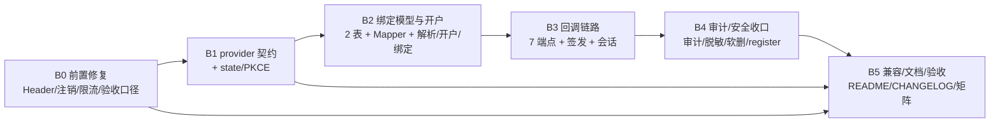
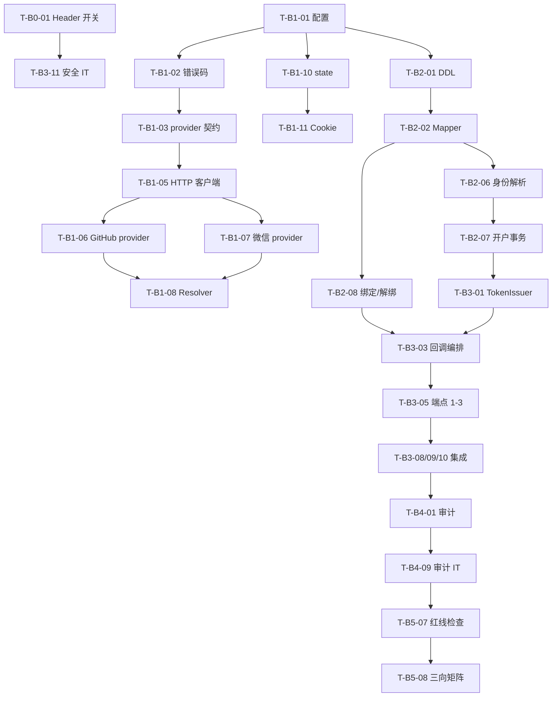

# linlan-emis (BuddyOne) v1.1.0 编码任务清单（tasks.md）

> 版本：`v1.1.0` ｜ 输入：`docs/1.1.0/spec.md`（R4，编号需求 **106** 条）+ `docs/1.1.0/design.md`（2209 行，44 个新增类型 / 2 张表 / 7 个端点 / 15 个业务码 / D-01..D-23 / B1–B5）
> 代码基线：`emis-backend:1.0.0`（Spring Boot 3.5.16 / Java 17 / MyBatis 3.0.5 / jjwt 0.12.6 / MySQL + H2）
> 本文性质：**只做任务分解**，不含实现代码。编码、测试与文档落地由后续执行阶段按本清单推进。

---

## 0. 口径、编号与任务规范

### 0.1 计数口径（与 design §1.5-C7 对齐）

| 口径 | 数量 | 说明 |
| --- | --- | --- |
| 编号需求（`REQ-*`） | **106** | GH 14 + WX 13 + ID 20 + SES 10 + CFG 10 + SEC 14 + UNB 7 + COMP/DOC 8 + REUSE 10 |
| 其中功能移出 1.2+（编号保留） | **2** | `REQ-ID-019`（体验租户升级 → CAND-11）、`REQ-SEC-012`（审计查询 → CAND-09） |
| 1.1.0 实际功能交付需求 | **104** | spec §11 写 “104 / 102”，差异按 design C7 解释；本清单按 **106 条全量映射**，移出项以“仅保留约束”的方式落任务 |
| 验收场景（`AC-*`） | **46** | 编号无删减；本清单 **AC 46/46** 全覆盖 |
| 1.2+ 候选（`CAND-*`） | **12** | **不实现、不预留**；以任务级红线检查项排除（见 §9） |

> **重要**：本清单不新增任何 REQ/AC 编号，也不改变 spec 语义；`REQ-ID-019`、`REQ-SEC-012` 仅以“不得实现/仅保留约束”的任务级检查存在。

### 0.2 批次口径（以 design §2.9.1 为准）

| 批次 | 本清单内容 | 与 design 的关系 |
| --- | --- | --- |
| **B0 前置修复** | Header 信任开关、`UserController.delete` 修正、最小限流骨架、GitHub 端点验收口径修正 | design 的 C1/C3/C4/C11 属本期必要修复；**单列前置**，避免 AC-14/AC-25 无法通过 |
| **B1 provider 契约 + state/PKCE** | 配置、错误码、provider 接口、GitHub/微信两个 provider、HTTP 客户端、PKCE、state、Cookie、白名单、私钥探针 | 严格对齐 design B1（含“两个 provider 的 URL 构造 + exchange + errcode 映射”） |
| **B2 绑定模型与开户** | 2 张表 DDL、实体/Mapper、体验租户种子、用户名生成、`IdentityResolver`、`UserProvisioningService`、`FederatedIdentityService`/`UnbindGuard` | 严格对齐 design B2；**身份解析/绑定/解绑/自助开户在本批完成**（不放入 B3/B4） |
| **B3 回调链路** | `FederatedLoginService`、7 个端点、异常全链路、`FederatedTokenIssuer`、`AsSessionBridge`、微信引导页、集成测试 | 严格对齐 design B3；GitHub/微信“协议适配”在 B1，“链路组装与端点”在 B3 |
| **B4 审计/安全收口** | 审计事件与写入、RequestId、脱敏、软删联动、`register` 落点、哨兵密码、密钥零入库自查 | 严格对齐 design B4；B0 已完成的 Header/限流/注销修正在本批复核 |
| **B5 兼容与文档** | 兼容回归、README 双语、CHANGELOG、AGENTS/llms、手工验证、红线检查、三向矩阵核对 | 严格对齐 design B5；补“验收口径修订落地”与交付说明 |

> **不越级**：B1 不引入表结构；B2 不引入 web 层；B3 不改 `SecurityConfig`；B4 的安全修复在 B3 合入后同批复核（design §2.9.1 注）。

> **与口头批次列法的对应**：你列出的“B3 GitHub/微信链路（含 unionid、errcode）”在 design 中拆为 **B1 协议适配**（provider 的 URL/exchange/errcode）+ **B3 链路组装**（回调与端点）；“B4 身份解析/绑定/解绑/自助开户”按 design 归入 **B2**；“B5 审计事件/限流”按 design 拆为 **B4 审计/安全** + **B0/B3 限流**（`RateLimitGuard` 骨架在 B0、federated 接线在 B3、端到端验收在 T-B3-13），文档仍在 **B5**。此归位不改变任何任务内容，只固定依赖顺序。

### 0.3 任务字段与规模定义

每个任务固定给出 9 项：**编号 / 标题 / REQ / 设计章节 / 文件 / 依赖 / 验证 / 规模 / DoD**。

| 规模 | 变更量参考 | 约束 |
| --- | --- | --- |
| **S** | ≤ 80 行，或 1 个文件（测试类可 150 行内） | 一次提交 |
| **M** | 80–200 行，或 2–4 个文件 | 一次提交 |
| **L** | 200–300 行 | **单任务上限 300 行**；若实现时超出，按方法拆为 `T-xxx.a` / `T-xxx.b` 两个子提交，不新增主任务编号 |

- 验证方式标签：`编译`、`单测`、`接口`、`集成`、`手工`、`文档`、`日志`、`评审`。
- 统一构建命令：`cd backend && mvn -q -DskipTests clean package`。
- 统一测试命令：`cd backend && mvn -q -Dtest=<Class> test`；集成测试类统一以 `IT` 结尾。
- 测试红线：**禁止连接真实 GitHub / 微信**；provider 一律用 `@MockitoBean ProviderHttpClient` 打桩。
- 文件路径均相对仓库根 `/Users/mac/Workspace/linlannet/linlan-emis`。

### 0.4 任务统计

| 批次 | 主任务数 | S | M | L | 其中测试/验收任务 |
| --- | --- | --- | --- | --- | --- |
| B0 前置修复 | 4 | 3 | 1 | 0 | 0 |
| B1 provider + state/PKCE | 15 | 6 | 7 | 2 | 2 |
| B2 绑定模型与开户 | 12 | 2 | 7 | 3 | 4 |
| B3 回调链路 | 14 | 3 | 7 | 4 | 8 |
| B4 审计/安全收口 | 10 | 6 | 4 | 0 | 2 |
| B5 兼容/文档/验收 | 10 | 7 | 2 | 1 | 3 |
| **合计** | **65** | **27** | **28** | **10** | **19** |

---

## 1. 批次总览

| 批次 | 最小可验收闭环 | 前置 |
| --- | --- | --- |
| B0 | Header 伪造不再提权；注销响应正确；本地登录第 11 次 `42900`；GitHub 验收口径定稿 | 无 |
| B1 | 单测全绿；`authorize` 能 302 到授权页（不回调）；无凭据可启动 | B0（可并行） |
| B2 | 开户事务（用户 + 绑定）回滚测试绿；H2/MySQL 建表幂等；体验租户种子幂等 | B1 |
| B3 | AC-01..AC-13 主干绿（假 provider）；7 个端点可用 | B2 |
| B4 | AC-14/18/22/25/28/45 绿；审计可检索、日志脱敏 | B3 |
| B5 | AC-32 + 手工三项（AC-24/35/40）+ AC-44/45 红线自查通过 | B1–B4 |

---

## 2. B0 前置修复（4 项，可全部并行）

| 编号 | 标题 | REQ | 设计 | 文件（新增 / 修改） | 依赖 | 验证 | 规模 | DoD |
| --- | --- | --- | --- | --- | --- | --- | --- | --- |
| T-B0-01 | 默认关闭不可信 Header 身份透传 | REQ-SEC-006、REQ-ID-008；AC-14 | §1.5-C4、§2.5.5 M4、D-17、§2.6.1 | 改 `backend/src/main/java/net/linlan/emis/plat/config/WebMvcConfig.java`（读取 `emis.tenant.header-trust-enabled`，`false` 时不读任何 `X-*`）；改 `backend/src/main/resources/application.yml` 与 `application-standalone.yml`（`emis.tenant.header-trust-enabled: ${EMIS_TENANT_HEADER_TRUST_ENABLED:false}`）；新增 `backend/src/test/java/net/linlan/emis/federated/security/TenantHeaderTrustTest.java` | 无 | 单测 + 接口：带 `X-Role-Level:0`/`X-User-Id:1`/`X-Tenant-Id:999` 访问 `@RequiresRole(0)` 仍 403；Bearer 鉴权不受影响 | S | 开关默认 `false`；不读 Header；既有 JWT 身份不被覆盖；AC-14 前置断言绿 |
| T-B0-02 | 修正注销重复调用 `softDelete` | REQ-COMP-001；AC-28 前置 | §1.5-C11、§2.2.2 | 改 `backend/src/main/java/net/linlan/emis/user/controller/UserController.java`（`int n = userService.softDelete(id);` 仅调用一次）；新增 `backend/src/test/java/net/linlan/emis/federated/user/UserControllerDeleteTest.java` | 无 | 单测 + 接口：首次删除返回 `data=1`、`message="删除1条记录"`；再次删除 `data=0`；`Result` 字段不变 | S | 契约字段/语义不变；重复副作用消失；测试绿 |
| T-B0-03 | 新增最小限流（authorize / callback / local.login）并接入本地登录 | REQ-SEC-010、REQ-WX-011；AC-25 | §1.5-C3、§2.5.9、D-19、§2.6.1 | 新增 `backend/src/main/java/net/linlan/emis/federated/security/RateLimitGuard.java`（`federated.authorize` / `federated.callback` / `local.login` 三个 scope；1 分钟滑动窗口；容量上限 + 惰性清理；超限 `42900`）；改 `backend/src/main/java/net/linlan/emis/user/controller/AuthController.java`（`login` 入口先 `check("local.login", ip)`）；新增 `RateLimitGuardTest` | 无（federated 端点接线在 T-B3-03/T-B3-05） | 单测 + 接口：第 11 次 `/api/auth/login` → `42900`；正常登录仍 200；阈值可配；不新增依赖 | M | 三个 scope 常量可注入；本地登录语义不变；AC-25 的 guard 单测绿（端到端在 T-B3-13） |
| T-B0-04 | 修正 GitHub App 端点验收口径 | REQ-REUSE-004；AC-44、AC-33 | §1.5-C1、§2.2.3 端点常量注 | 改 `docs/1.1.0/spec.md` §5.9.1 `REQ-REUSE-004` 验收条件、§8 `AC-44`；改 `docs/1.1.0/design.md` §1.5-C1 / §2.8.5 相关措辞（仅验收口径，不改设计结论）；本 tasks 记录定稿口径 | 无 | 文档 + 评审：验收措辞为“换码使用 App 的 `client_id`/`client_secret`；token 为 `ghu_` 前缀 user-to-server token；**禁止** `/app/installations/**` 与 App JWT 生成”，不再出现“禁止 `github.com/login/oauth/*`” | S | 评审确认；后续 T-B1-06/T-B3-08/T-B5-07 均按此口径断言 |

**B0 回滚**：T-B0-01/02/03 为纯代码/配置追加，`git revert` 即回退；T-B0-01 回退会恢复 Header 透传（**不建议**，属安全回退）；T-B0-04 为文档口径，回退即恢复旧措辞（会与 design C1 冲突，不建议）。

---

## 3. B1 provider 契约 + state/PKCE（15 项）

| 编号 | 标题 | REQ | 设计 | 文件（新增 / 修改） | 依赖 | 验证 | 规模 | DoD |
| --- | --- | --- | --- | --- | --- | --- | --- | --- |
| T-B1-01 | 配置装配、体验角色常量与启动校验 | REQ-CFG-001/003/004/005/007/008/009/010、REQ-WX-008、REQ-ID-018、REQ-SEC-014、REQ-GH-002、REQ-REUSE-003 | §2.6.1/2.6.2/2.6.3、D-02/03/19 | 新增 `federated/config/FederatedProperties.java`（`emis.federated.*` 强类型分组）、`FederatedHttpConfig.java`（`RestClient`，3s/5s）、`RoleLevels.java`（`EXPERIENCE(2,"体验角色")`）；改 2 个 yml（追加 `emis.federated` 与 `emis.tenant`）；新增 `FederatedPropertiesTest` | 无 | 编译 + 单测 + 启动：无凭据可启动；`require-unionid=false` / `state.ttl>10m` / `default-role-level!=2` 三处启动失败；其余缺失仅 WARN | M（≈180 行，含 yml） | 全部属性绑定；仓库 yml 无密钥字面量；不引入 `oauth2-client`/webflux/redis；私钥缺失不阻断 |
| T-B1-02 | 业务错误码、异常与统一异常处理 | REQ-SEC-008、REQ-CFG-003/005 | §2.4.4、§2.4.5、§2.2.5 | 新增 `federated/error/FederatedErrorCode.java`（15 个业务码，`NOT_CONFIGURED(50300)` 单条）、`FederatedException.java`、`FederatedExceptionHandler.java`（`@RestControllerAdvice` → `ResponseEntity<Result<Void>>`） | T-B1-01（配置无强依赖） | 单测：code→HTTP→固定中文文案；响应体仅 `code`/`message`；无堆栈、无原始响应体；`50300` 与 `40114` 边界正确 | M（≈150 行） | 一码一义；停用态复用 `50300` + 独立文案（不新增编号）；不输出敏感值 |
| T-B1-03 | provider 最小接口与 DTO | REQ-REUSE-005、REQ-GH-014、REQ-WX-002、REQ-SEC-004、REQ-ID-003；AC-44 | §2.2.3、§2.4.3、D-12 | 新增 `federated/provider/FederatedProvider.java`（`code/enabled/configured/buildAuthorizeUrl/exchange` 五方法）、`federated/dto/ExternalIdentity.java`、`ProviderStatusView.java`、`BindingView.java`、`BindResult.java` | T-B1-01 | 编译 + 单测：接口仅五方法；`ExternalIdentity` 无 token/secret/code 字段；DTO 为 record | S（≈70 行） | 一个接口 + 配置驱动；无注册表/Map 装配/SPI；`provider_subject` 语义由 provider 自定 |
| T-B1-04 | 协议常量与第三方错误映射 | REQ-REUSE-004、REQ-GH-006/007、REQ-WX-005/013；AC-19/21/27/44 | §2.2.3 常量表、§2.4.4、§2.11.3 R-01/R-02/T-06 | 新增 `federated/provider/GitHubEndpoints.java`、`WechatEndpoints.java`（含字段名常量）、`GitHubErrorMapper.java`、`WechatErrcodeMapper.java` | T-B1-02 | 单测：`40029`/`40163`→`40112`；`40013`/`40125`/`40001`→`40114`；`-1`/`45011`/未知→`50200`；`access_denied`→`40110`；`bad_verification_code`→`40112`；`incorrect_client_credentials`/`redirect_uri_mismatch`→`40114`；不记录 `errmsg` 原文 | M（≈160 行） | 端点与官方一致（GitHub 共用 `/login/oauth/*`；微信 `qrconnect` + `snsapi_login` + `#wechat_redirect`）；无小程序/公众号端点；映射稳定 |
| T-B1-05 | 有界超时 HTTP 客户端 | REQ-GH-008、REQ-WX-009、REQ-SEC-008、REQ-REUSE-003；AC-20/46 | §2.6.4、§2.2.5、D-13/D-22 | 新增 `federated/provider/ProviderHttpClient.java`（`RestClient` 封装，`postForm`/`getJson`） | T-B1-01/02 | 单测（本地桩）：连接 3s/读取 5s 生效；超时/5xx/网络异常统一 `FederatedException(50200)`；请求与响应日志不含 code/token/secret | M（≈120 行） | 零新增依赖；不重试授权码；异常不透传第三方原始响应体 |
| T-B1-06 | GitHub App provider 适配 | REQ-GH-001/003/005/008/009/010/011/012/013/014、REQ-SEC-004、REQ-REUSE-004；AC-02/10/33/35 | §2.2.3、§2.5.7、§2.7.2、D-15 | 新增 `federated/provider/GitHubFederatedProvider.java` | T-B1-01/03/04/05 | 单测（Mock `ProviderHttpClient`）：授权 URL 含 `client_id`/`redirect_uri`/`state`/`code_challenge`/`code_challenge_method=S256`；换码体含 `client_id`/`client_secret`/`code`/`code_verifier`；`subject=id`（不使用 `login`/邮箱）；缺 `id`→`40113`；`/user/emails` 403→降级跳过；token 仅局部变量；不调 installation/org | L（≈260 行） | `configured()` 只看 client-id/client-secret/redirect-uri；私钥不参与；无 App JWT；不建 installation；AC-33/35 前置断言可构造 |
| T-B1-07 | 微信网站应用 provider 适配 | REQ-WX-001/002/003/004/005/006/007/008/009/013、REQ-SEC-004；AC-04/26/27/40 | §2.1.4、§2.2.3、§2.7.2、D-14 | 新增 `federated/provider/WechatFederatedProvider.java` | T-B1-03/04/05 | 单测：授权 URL 为 `qrconnect` + `snsapi_login` + `#wechat_redirect`；换码含 `appid`/`secret`/`code`/`grant_type`；`unionid` 缺失→`40115`（不回退 `openid`）；`openid` 仅附属；`userinfo` 仅补昵称/头像；`codeVerifier=null` | L（≈240 行） | `unionid` 只认换码响应；无 PKCE；无小程序/公众号端点；`open_id` 只存最近一次 |
| T-B1-08 | provider 解析器（显式 switch） | REQ-REUSE-005、REQ-CFG-005；AC-31/44 | §2.2.3 红线表、D-12 | 新增 `federated/provider/ProviderResolver.java` | T-B1-06/07 | 单测：`github`/`wechat` 返回正确 bean；未知 provider→404 且不泄露清单；无 `ServiceLoader`/`priority`/注册表 | S（≈50 行） | 显式 `switch`；新增 provider 必须改代码；红线自查通过 |
| T-B1-09 | PKCE S256 工具 | REQ-GH-003；AC-33 | §2.5.2 | 新增 `federated/security/PkceUtil.java` | 无（可与 T-B1-03 并行） | 单测：RFC 7636 附录 B 向量；`verifier` 43 字符、Base64URL 无填充；challenge = Base64URL(SHA-256(verifier)) | S（≈40 行） | S256 正确；verifier 不入日志、不返回前端 |
| T-B1-10 | 一次性 state 服务 | REQ-GH-002/004、REQ-WX-003、REQ-SEC-001/002、REQ-CFG-008；AC-06/07 | §2.5.1、§2.1.5、D-08/D-09 | 新增 `federated/state/FederatedState.java`（record）、`FederatedStateService.java` | T-B1-01 | 单测：同一 state 两次 `consume` 一次非 null、一次 null；过期 null；容量 10k 淘汰；并发仅一次成功；TTL 上限校验 | M（≈150 行） | `SecureRandom` 32 字节；原子 `remove`；无 HttpSession/Redis；失败统一 `40111` |
| T-B1-11 | 摘要 Cookie 与会话绑定 | REQ-SEC-007、REQ-GH-002；AC-06/07/14 | §2.5.1、§2.5.3、D-08 | 新增 `federated/state/StateCookieSupport.java` | T-B1-10 | 单测：Cookie 值为 `SHA-256(state)`；一致/不一致/缺失；属性 `HttpOnly`/`SameSite=Lax`/`Path=/api/auth/federated`/`Max-Age=600`/非 localhost `Secure` | S（≈90 行） | Cookie 不含 state 明文；篡改即 `40111`；不依赖 HttpSession |
| T-B1-12 | 回跳白名单 | REQ-CFG-006；AC-19（开放重定向负向） | §2.5.3 | 新增 `federated/security/RedirectWhitelist.java` | T-B1-01 | 单测：精确匹配 `scheme+host+port+path`；`good.com.evil.com`/`good.com@evil.com`/端口/大小写差异不命中；空白名单只允许默认 `/` | S（≈80 行） | 不用 `startsWith`；空白名单不接受任意回跳；不命中不回跳 |
| T-B1-13 | GitHub App 私钥探针（可选） | REQ-GH-011、REQ-SEC-013、REQ-CFG-009；AC-34 | §2.5.7、D-?（私钥可选） | 新增 `federated/config/GitHubAppKeyProbe.java`（`ApplicationRunner`，仅布尔日志） | T-B1-01 | 单测 + 日志：未配置→`loaded=false` 无异常；不可读/格式错→WARN；PEM 内容/路径不出现；不阻断启动/登录 | S（≈70 行） | 只读探针；不生成 App JWT；`configured()` 不含私钥 |
| T-B1-14 | 单测：PKCE / state / Cookie | REQ-GH-002/003、REQ-SEC-001/002/007；AC-06/07/33 | §2.8.2 | 新增 `backend/src/test/java/net/linlan/emis/federated/security/PkceUtilTest.java`、`state/FederatedStateServiceTest.java`、`state/StateCookieSupportTest.java` | T-B1-09/10/11 | 单测：`mvn -q -Dtest=PkceUtilTest,FederatedStateServiceTest,StateCookieSupportTest test` | M（≈200 行测试） | 三测全绿；并发用例重复 20 次稳定；无真实外网 |
| T-B1-15 | 单测：错误映射 / resolver / 白名单 | REQ-WX-005/013、REQ-GH-006、REQ-REUSE-005、REQ-CFG-006；AC-21/27/44 | §2.4.4、§2.8.2、§2.11.3 | 新增 `WechatErrcodeMapperTest.java`、`GitHubErrorMapperTest.java`、`ProviderResolverTest.java`、`RedirectWhitelistTest.java` | T-B1-04/08/12 | 单测：`mvn -q -Dtest=WechatErrcodeMapperTest,GitHubErrorMapperTest,ProviderResolverTest,RedirectWhitelistTest test` | M（≈180 行测试） | 全绿；断言无 `errmsg`/原始响应泄漏；resolver 无插件结构 |

**B1 回滚**：全部为新增包 + 2 个 yml 追加块，`git revert` 即回退；**无 DDL、无数据变更**；若已上线，可将 `emis.federated.*.enabled` 置 `false` 灰度停用，不影响本地登录。

---

## 4. B2 绑定模型与开户（12 项）

| 编号 | 标题 | REQ | 设计 | 文件（新增 / 修改） | 依赖 | 验证 | 规模 | DoD |
| --- | --- | --- | --- | --- | --- | --- | --- | --- |
| T-B2-01 | `schema.sql` 新增 2 张表（双库幂等） | REQ-COMP-003、REQ-ID-001/002/012/017、REQ-UNB-003/005、REQ-REUSE-006/007；AC-45 | §2.3.2/2.3.4/2.3.5、D-04 | 改 `backend/src/main/resources/schema.sql`（末尾追加 `emis_federated_identity`、`emis_federated_audit`；含 `uk_fed_subject_active`、`uk_fed_user_provider_active`、`ck_fed_provider`、`ck_fed_status`、`ck_fed_active_flag`） | T-B1（可并行开始，无类依赖） | 集成：H2 连续启动两次不报错；MySQL 执行两次不报错；无 `CREATE INDEX IF NOT EXISTS`；无密钥列 | M（≈80 行 SQL） | 双库幂等；`active_flag` 可空复合唯一；三态 CHECK；审计表列名避坑（`event_result`/`client_ip`/`extra_info`） |
| T-B2-02 | 绑定/租户实体与 Mapper | REQ-ID-001/002/011/012、REQ-UNB-001/003/005；AC-16/28 | §2.2.1、§2.3.6、§2.7.1/2.7.3 | 新增 `federated/repository/entity/FederatedIdentity.java`、`EmisTenant.java`；`FederatedIdentityMapper.java`（`insert`/`findActiveBySubject`/`findById`/`findActiveByUserAndProvider`/`existsHistoric`/`touchLogin`/`markUnbound`/`invalidateByUser`/`countActiveByUser`/`listActiveByUser`）、`EmisTenantMapper.java`（`findUsable`） | T-B2-01 | 单测 + 集成（H2）：唯一键冲突；`active→unbound/invalid`；`touchLogin` 更新 `last_login_at/login_count/open_id`；`invalidateByUser` 幂等 | L（≈280 行） | 无 `UPDATE user_id/provider/provider_subject`；无物理删除；`open_id` 只存最近一次；注解 SQL 与既有风格一致 |
| T-B2-03 | `EmisUserMapper` 新增查询（不改既有） | REQ-ID-007/011/014、REQ-UNB-005；AC-13/28 | §1.4.4、§2.2.1 | 改 `backend/src/main/java/net/linlan/emis/user/mapper/EmisUserMapper.java`（新增 `findByIdIncludeDeleted`、`existsActiveByEmail`、`existsActiveByPhonenumber`、`fillProfileIfBlank`；既有 5 个方法零改动） | T-B2-01（无强依赖） | 单测/H2：软删用户可查到；邮箱/手机号仅 `del_flag='0'` 命中；`fillProfileIfBlank` 不覆盖非空昵称/头像 | S（≈60 行） | 既有方法签名/语义不变；SQL 双库兼容；无 XML |
| T-B2-04 | 体验租户幂等种子与启动校验 | REQ-ID-017、REQ-CFG-008、REQ-ID-018；AC-43 | §2.3.3、§2.3.5、D-02 | 改 `backend/src/main/java/net/linlan/emis/config/DataInitializer.java`（默认租户后幂等播种 `tenant_id=2`「体验租户」）；新增 `federated/config/ExperienceTenantValidator.java`（`ApplicationRunner`，仅 WARN） | T-B2-02 | 集成：空库启动后 `emis_tenant` 有 1/2；id=2 被占用→WARN；`status=1`→启动 WARN；重复启动不重复插入 | M（≈120 行） | 播种幂等；不破坏 `userMapper.count()==0` 逻辑；不阻断启动 |
| T-B2-05 | 平台用户名生成器 | REQ-ID-006；AC-01 | §2.7.3、D-06 | 新增 `federated/identity/PlatformUserNameGenerator.java` | T-B2-03 | 单测：`gh_123`；`wx_`+12 hex；同名冲突 `_2.._5`；超 64 截断；不泄露 unionid | S（≈80 行） | 全局唯一重试；5 次仍冲突→`PROVISION_FAILED(50200)` |
| T-B2-06 | 身份解析五步固定顺序 | REQ-ID-003/005/007/011/012/015/020、REQ-WX-006；AC-03/11/13/26 | §2.7.2、D-14/D-15 | 新增 `federated/identity/IdentityResolver.java` | T-B2-02/03 | 单测：已绑定优先于邮箱冲突；历史解绑早于开户；缺 unionid→`40115` 早于一切；停用→`40311`；关开户→`40310`；邮箱冲突→`40910` | M（≈180 行） | 顺序固定 ①②③④⑤；无“按外部 ID 直查用户”；不静默合并 |
| T-B2-07 | 开户事务（用户 + 绑定同事务） | REQ-ID-004/016/017/018、REQ-COMP-005；AC-01/36/43 | §2.7.1、§2.1.6、D-01/D-05/D-07/D-23 | 新增 `federated/identity/UserProvisioningService.java`（独立 `@Service`，`@Transactional(rollbackFor=Exception.class)`） | T-B2-02/03/04/05 | 单测（H2）：用户+绑定同事务；绑定 INSERT 抛异常→用户回滚；租户不可用→`40314` 无写入；用户名冲突重试；哨兵密码 `!`；`tenant_id` 快照只写一次 | L（≈260 行） | 独立 bean（防自调用失效）；无 `pending` 状态；`status=0`/`del_flag=0`/`role_level=2`；AC-01/36 可构造 |
| T-B2-08 | 绑定/解绑/失效联动与 40313 判定 | REQ-ID-009/010/013/014、REQ-UNB-001/002/003/004/007；AC-05/11/12/16/29/41 | §2.7.3/2.7.5、§2.3.6 | 新增 `federated/identity/FederatedIdentityService.java`、`federated/identity/UnbindGuard.java` | T-B2-02/03/06 | 单测：`bind` 不改 `user_name`/`tenant_id`/`role_level`；同 provider 已绑→`40312`；`unbind` 非本人→404；最后一个方式→`40313`；`touchLogin` 只更新登录痕迹；资料仅首次填充 | L（≈300 行） | 事务边界正确；无 user 身份列 UPDATE；解绑行保留；超出 300 行时按方法拆 `T-B2-08.a/.b` |
| T-B2-09 | 单测：身份解析 + 用户名规则 | REQ-ID-006/020、REQ-WX-006；AC-13/26 | §2.8.2 | 新增 `IdentityResolverTest.java`、`PlatformUserNameGeneratorTest.java` | T-B2-05/06 | 单测：`mvn -q -Dtest=IdentityResolverTest,PlatformUserNameGeneratorTest test` | M（≈200 行测试） | 顺序/冲突/用户名规则全绿；断言不含明文 subject |
| T-B2-10 | 单测：解绑守卫 + 身份不变负向断言 | REQ-ID-013、REQ-UNB-002/007、REQ-SEC-014；AC-12/41 | §2.8.2、§2.7.3/2.7.5 | 新增 `UnbindGuardTest.java`、`FederatedIdentityServiceTest.java` | T-B2-08 | 单测：哨兵密码+1 active→true；真实 BCrypt+1→false；2 条→false；`bind`/`unbind` 前后 user 三字段不变；`touchLogin` 不覆盖资料 | M（≈180 行测试） | 全绿；负向断言以 SQL 快照对比 |
| T-B2-11 | 集成：DDL 双库幂等与体验租户种子 | REQ-COMP-003、REQ-ID-017；AC-43（种子部分） | §2.3.5、§2.9.1 B2 | 新增 `backend/src/test/java/net/linlan/emis/federated/FederatedSchemaIT.java`（H2）；新增 `scripts/verify-federated-schema.sh`（MySQL 执行两次） | T-B2-01/04 | 集成 + 手工：H2 连续两次启动成功；MySQL 执行 `schema.sql` 两次成功；表/约束存在 | M（≈120 行） | 无重复索引错误；两库列语义一致；脚本可复跑 |
| T-B2-12 | 单测：开户事务回滚（用户 + 绑定） | REQ-ID-004/016、REQ-COMP-005；AC-01/36/43 | §2.8.2、§2.7.1 | 新增 `UserProvisioningServiceTest.java` | T-B2-07 | 单测：`mvn -q -Dtest=UserProvisioningServiceTest test`；绑定抛异常→用户 0 新增；租户不可用→`40314` | M（≈180 行测试） | 回滚断言基于真实 H2 事务；不 mock Mapper |

**B2 回滚**：DDL 为 `CREATE TABLE IF NOT EXISTS`，**回滚代码后表可保留**（不影响既有表；删除需运维单独评估，且应先确认无数据）；种子为幂等 INSERT，回滚代码不删除租户行（保留 `tenant_id=2` 更安全）；开户测试数据按 `created_by='federated:*'` 清理。

---

## 5. B3 回调链路（14 项）

| 编号 | 标题 | REQ | 设计 | 文件（新增 / 修改） | 依赖 | 验证 | 规模 | DoD |
| --- | --- | --- | --- | --- | --- | --- | --- | --- |
| T-B3-01 | 平台令牌唯一签发点 | REQ-SES-001/002/004/005、REQ-ID-003、REQ-SEC-014；AC-23/42 | §1.4.1、§2.2.4、§2.10.3 | 新增 `federated/identity/FederatedTokenIssuer.java`（claims 契约测试见 T-B3-14） | T-B2-07 | 编译 + 单测（claims 契约由 T-B3-14 覆盖） | S（≈80 行） | 唯一签发点；调用既有 `JwtUtil`；不改 claims 契约 |
| T-B3-02 | 浏览器 AS 会话桥接（单一会话） | REQ-SES-003/006/009；AC-24 | §2.5.6、D-11 | 新增 `federated/identity/AsSessionBridge.java` | T-B2-07 | 集成/手工：`redirect`+`login` 后 `/oauth2/authorize` 不跳 `/login`；会话中无 token；`json` 模式不建会话；不改 `SecurityConfig` | M（≈100 行） | 复用 `HttpSessionSecurityContextRepository`；不新增第二套会话；不存 token |
| T-B3-03 | 回调主流程编排（固定顺序） | REQ-GH-004/006/007、REQ-WX-004/005、REQ-SEC-001/002/003/006/007/008/010、REQ-SES-003/007/008、REQ-CFG-005/006；AC-06/07/08/20/21/25/27 | §2.7.4、§2.2.6 | 新增 `federated/identity/FederatedLoginService.java` | T-B1-10/11/12、T-B2-06/07/08、T-B3-01/02/04 | 单测/集成：限流→state→Cookie→error→code→exchange→usedCode→resolve/bind→issue→session→audit 顺序不可交换；失败无半成品；`TenantContext` `finally clear` | L（≈300 行） | 顺序固定；state 先于 exchange；usedCode 后于 exchange；解析先于签发；会话后于签发；超 300 行拆 `T-B3-03.a/.b` |
| T-B3-04 | 授权码去重缓存 | REQ-GH-007、REQ-SEC-003；AC-08 | §2.5.4 | 新增 `federated/state/UsedCodeCache.java`；新增 `UsedCodeCacheTest.java` | T-B1-01 | 单测：`SHA-256(code)` 去重；TTL 10min；容量 10k；重复→`CODE_REPLAY`；不记录 code 原文；首次不误拒 | S（≈80 行） | 原子 `checkAndMark`；与 provider 侧双层防护 |
| T-B3-05 | 端点 1–3：发起登录 / 发起绑定 / 统一回调 | REQ-CFG-005/006、REQ-ID-008/009、REQ-SES-002/007、REQ-WX-010、REQ-SEC-010；AC-25/29/31 | §2.4.1/2.4.2、§2.2.6 | 新增 `federated/web/FederatedAuthController.java`（`authorize`、`bind/authorize`、`callback`；`@PublicApi`/`@RequiresRole(2)`；`response_mode=json / redirect`；未知 provider→404） | T-B1-01..12、T-B3-03 | MockMvc：302 `Location`；`Set-Cookie` 摘要；未启用→503；未配置→`50300`；限流→`42900`；不读取请求体 `user_id`/`tenant_id`/`role_level` | L（≈280 行） | 路径与 design 一致；不改 `SecurityConfig`；回调可被第三方 302 直达 |
| T-B3-06 | 端点 4–7：绑定列表 / 解绑 / provider 状态 / 微信引导页 | REQ-UNB-001/002/006、REQ-CFG-002、REQ-WX-010/011；AC-15/17/40/45 | §2.4.2（4–7）、§2.7.6、D-20 | 改 `federated/web/FederatedAuthController.java`（`bindings`/`unbind`/`providers`/`wechat guide`）；新增 `federated/web/WechatInAppBrowserPage.java` | T-B3-05、T-B2-08 | MockMvc：`bindings` 仅本人 active 且 `subjectMasked`；`unbind` 404/`40313`；`providers` 仅 3 布尔；guide 200 HTML 含文案；无 5xx | M（≈220 行） | 注解角色正确；无密钥/路径/明文 subject；HTML 不渲染扫码组件 |
| T-B3-07 | 全链路错误映射复核 | REQ-SEC-008、REQ-GH-006/008/010、REQ-WX-005/006/009/013；AC-09/10/18/19/20/21/26/27 | §2.4.4/2.4.5、§2.7.7 | 复核 `FederatedAuthController`/`FederatedLoginService`/`FederatedExceptionHandler`；新增 `FederatedErrorMappingTest.java`（参数化） | T-B3-03/05/06 | 单测：15 码触发条件→HTTP/文案；响应体无原始响应/堆栈/敏感值；`50300` vs `40114` 边界正确 | M（≈180 行测试） | 一因一码；`40115` 不与其他混用；停用不新增编号 |
| T-B3-08 | 集成：GitHub 登录链路（假 provider） | REQ-GH-001/004/006/007/008/009/010/012/013、REQ-ID-004/015/016、REQ-CFG-009；AC-01/02/08/20/21/33/35/36/37/46 | §2.8.3、§2.8.5 | 新增 `FederatedGitHubLoginIT.java`（`@SpringBootTest` + H2 + `@MockitoBean ProviderHttpClient`） | T-B2-12、T-B3-05 | 集成：`mvn -q -Dtest=FederatedGitHubLoginIT test`；不连真实 GitHub；桩响应来自官方文档样例 | L（≈280 行） | 10 条 AC 断言全绿；DB 计数断言；换码体含 App 凭据、无 installation/App JWT |
| T-B3-09 | 集成：微信扫码链路 | REQ-WX-001/002/004/005/006/007/009/010；AC-04/05/26/27/38/39/40 | §2.8.3、§2.8.5 | 新增 `FederatedWechatLoginIT.java` | T-B2-12、T-B3-05/06 | 集成：unionid 缺失、同 unionid 不同 openid、缺 code、UA 引导页、open_id 最近一次 | L（≈260 行） | 7 条 AC 全绿；不连真实微信；`provider_subject=unionid` 断言 |
| T-B3-10 | 集成：绑定 / 解绑 / 租户角色不变 | REQ-ID-009/010/013、REQ-UNB-001/002/003/007；AC-11/12/16/29/41 | §2.8.5 | 新增 `FederatedBindUnbindIT.java` | T-B2-08、T-B3-06 | 集成：绑定冲突 `40312`；伪 `user_id` 无效；解绑唯一方式 `40313`；解绑后 `40310`；租户/角色不变 | M（≈220 行） | 5 条 AC 绿；归属断言；不泄露他人绑定存在性 |
| T-B3-11 | 集成：安全边界（Header/角色/停用/软删） | REQ-SEC-005/006/007/014、REQ-ID-011、REQ-UNB-005；AC-03/14/15/17/28 | §2.8.5、§2.5.5 | 新增 `FederatedSecurityIT.java` | T-B0-01、T-B3-06、T-B4-05 | 集成：未登录绑定 401；伪造 Header 无效；体验角色 `(0)`→403、`(2)`→200；停用 `40311`；软删绑定 `invalid` | M（≈240 行） | 5 条 AC 绿；`X-Role-Level:0` 不提权；无跨链放行 |
| T-B3-12 | 集成：配置缺失 / 停用 / 私钥 / 体验租户不可用 | REQ-CFG-002/003/004/005/009、REQ-GH-011、REQ-SEC-013、REQ-ID-017；AC-09/10/19/30/31/34/43 | §2.8.5 | 新增 `FederatedConfigMissingIT.java`、`FederatedTenantUnavailableIT.java` | T-B1-01/02/12、T-B2-04 | 集成：无凭据启动成功；调用 `50300`；停用拒绝；私钥缺失登录正常；租户停用 `40314`；启动日志无密钥 | M（≈240 行） | 7 条 AC 绿；不返回匿名令牌；不 5xx 白屏 |
| T-B3-13 | 集成：限流端到端 | REQ-SEC-010；AC-25 | §2.5.9、§2.8.5 | 新增 `FederatedRateLimitIT.java` | T-B0-03、T-B3-05 | 集成：第 21 次 authorize→`42900`；state 不增长；callback 第 31 次→`42900`；本地登录第 11 次→`42900` | S（≈100 行） | AC-25 绿；阈值可配；超限不触发外部调用 |
| T-B3-14 | 单测：JWT claims 与本地登录一致性 | REQ-SES-001/002/004、REQ-COMP-002；AC-23 | §1.4.1、§2.10.3、§2.8.2 | 新增 `backend/src/test/java/net/linlan/emis/federated/identity/FederatedTokenIssuerTest.java`（必要时扩 `JwtClaimsContractTest`） | T-B3-01、T-B2-07 | 单测：`mvn -q -Dtest=FederatedTokenIssuerTest test`；`alg=HS256`；claims 键集合与本地登录逐键相等；`exp-iat=86400000`；`LoginResponse` 六字段同构；无新增 claim | M（≈160 行测试） | 本地/GitHub/微信三组 claims 断言一致；不依赖网络；不 mock `JwtUtil` |

**B3 回滚**：新增端点与编排类，`git revert` 即回退；**无 DDL**；上线后可按 `enabled=false` 停用两个 provider（回调与发起均拒绝），本地登录不受影响；已签发 JWT 按无状态策略在有效期内有效（CAND-06 明确不做黑名单）。

---

## 6. B4 审计/安全收口（10 项）

| 编号 | 标题 | REQ | 设计 | 文件（新增 / 修改） | 依赖 | 验证 | 规模 | DoD |
| --- | --- | --- | --- | --- | --- | --- | --- | --- |
| T-B4-01 | 审计事件枚举与写入（失败降级） | REQ-SEC-011/012、REQ-UNB-004、REQ-ID-004/012；AC-22 | §2.3.4、§2.8.4、D-21 | 新增 `federated/audit/FederatedAuditEventType.java`（27 个）、`FederatedAuditEvent.java`、`FederatedAuditService.java`；新增 `federated/repository/FederatedAuditMapper.java`（若 B2 未含） | T-B2-01/02 | 单测：27 枚举；`record()` 全包 try/catch，失败仅 WARN；`audit.enabled=false` 跳过表写仍打日志；字段完整；subject 掩码 | M（≈200 行） | 覆盖 REQ-SEC-011 全部事件；无查询端点；不阻断主流程 |
| T-B4-02 | 请求关联 ID 过滤器 | REQ-SEC-011；AC-22 | §2.2.5、§2.5.8 | 新增 `federated/security/RequestIdFilter.java`（`X-Request-Id` 缺失则生成；MDC + 响应头） | 无 | 单测：缺失生成、已存在透传、`finally` 清理 MDC、响应头回写；不记录敏感值 | S（≈60 行） | `request_id` 进入审计/日志；无内存泄漏 |
| T-B4-03 | 敏感标识掩码工具 | REQ-SEC-009；AC-18 | §2.5.8 | 新增 `federated/security/SensitiveMasker.java` | 无 | 单测：前 3 + `***` + 后 3；短值全掩码；null 安全；email `a***@x.com` | S（≈50 行） | 全链路只用掩码值；不还原明文 |
| T-B4-04 | 日志脱敏接线与审计双写复核 | REQ-GH-014、REQ-SEC-008/009/011、REQ-CFG-001；AC-18 | §2.5.8、D-21 | 改 `FederatedLoginService`/`FederatedIdentityService`/`ProviderHttpClient` 的日志点；新增 `LogRedactionTest.java`（`ListAppender`） | T-B4-01/03 | 日志：`client_secret`/PEM/`code`/token/`eyJ` 出现 0 次；subject/email 掩码；`provider`/`event`/`result`/`error_code`/`request_id`/耗时保留 | M（≈150 行） | 审计 + 结构化日志双写；无敏感明文；失败降级 |
| T-B4-05 | 用户软删联动绑定失效 | REQ-UNB-005、REQ-ID-012；AC-28 | §1.5-C11、§2.1.6、§2.7.3 | 改 `backend/src/main/java/net/linlan/emis/user/service/UserService.java`（`softDelete` 同事务调用 `invalidateByUser`）；新增 `UserSoftDeleteTest.java` | T-B2-08、T-B0-02 | 单测/集成：软删后绑定 `status='invalid'`；幂等；事务回滚一致；响应条数正确 | S（≈50 行） | 不改既有软删语义；绑定不可被开户复用；AC-28 断言可构造 |
| T-B4-06 | 本地注册落体验租户 | REQ-COMP-005、REQ-CFG-008、REQ-ID-017/018；AC-40 | §1.5-C5、D-18 | 改 `UserService.register`（忽略 `RegisterRequest.tenantId`，统一取 `props.provisioning().defaultTenantId()`；`role_level=2`）；新增 `UserServiceRegisterTest.java` | T-B1-01、T-B2-04 | 单测/接口：请求体 `tenantId=999` 仍落 2；`role_level=2`；`RegisterRequest` 字段保留；`/api/auth/register` 契约不变 | S（≈40 行） | 行为变更在 README/CHANGELOG 声明（B5）；存量用户不受影响 |
| T-B4-07 | 本地登录拒绝联合用户哨兵密码 | REQ-WX-011/012、REQ-COMP-001、REQ-ID-016；AC-40 | D-07、§2.7.6 | 改 `UserService.login`（`!` 哨兵密码前置拒绝，文案与普通失败一致）；新增 `UserLoginSentinelTest.java` | T-B2-07 | 单测：哨兵密码 + 任意密码→失败；真实 BCrypt 正常；错误文案不泄露账号存在性；不改 `LoginRequest/LoginResponse` | S（≈30 行） | 纯联合用户不可本地登录；兜底安全不降级（BCrypt/停用校验/限流） |
| T-B4-08 | 单测：掩码 / RequestId / 审计降级 | REQ-SEC-009/011；AC-18/22 | §2.8.2 | 新增 `SensitiveMaskerTest.java`、`RequestIdFilterTest.java`、`FederatedAuditServiceTest.java` | T-B4-01/02/03 | 单测：`mvn -q -Dtest=... test` | M（≈160 行测试） | 全绿；审计降级用例无异常外抛 |
| T-B4-09 | 集成：审计事件可检索与脱敏 | REQ-SEC-011/012、REQ-UNB-004；AC-18/22 | §2.8.5、§2.3.4 | 新增 `FederatedAuditIT.java` | T-B4-01/04 | 集成：`BIND_SUCCESS`/`UNBIND_SUCCESS`/`STATE_INVALID`/`UNIONID_MISSING` 落表；subject 掩码；`request_id` 非空；**无查询端点** | M（≈180 行） | 2 条 AC 绿；审计失败不阻断（单测覆盖） |
| T-B4-10 | 密钥零入库与安全回归自查 | REQ-CFG-001、REQ-REUSE-006、REQ-SEC-009、REQ-UNB-006；AC-45/14 | §2.3.1、§2.5.8、§2.9.3 | 新增 `scripts/verify-fed-secrets.sh`（`rg` 检查 schema/yml/日志）；复核 `providers` 仅布尔、伪造 Header 回归 | T-B2-01、T-B4-04 | 脚本 + 接口：无 `client_secret`/`app_secret`/`private_key` 列；仓库无 PEM；`providers` 仅布尔；AC-14 回归绿 | S（≈60 行脚本） | AC-45 自查通过；结果记录在交付说明 |

**B4 回滚**：审计写入失败不影响登录，回退代码即可；`softDelete` 联动与 `register` 落点属行为变更，回滚代码**不会**自动回滚已写入数据（绑定已 `invalid`、注册已落租户 2），需按 `event_time`/`created_by` 评估；`header-trust-enabled` 回滚需谨慎（恢复会重新暴露 Header 提权）。

---

## 7. B5 兼容、文档与验收（10 项）

| 编号 | 标题 | REQ | 设计 | 文件（新增 / 修改） | 依赖 | 验证 | 规模 | DoD |
| --- | --- | --- | --- | --- | --- | --- | --- | --- |
| T-B5-01 | 集成：三类入口 claims 一致与本地契约回归 | REQ-COMP-001/002/004、REQ-SES-001/004/009/010；AC-23/42 | §2.8.5、§2.10.3 | 新增 `FederatedCompatIT.java`；扩 `JwtClaimsContractTest`（三类入口） | T-B3-01 | 集成/单测：本地/GitHub/微信 JWT 均 HS256、claims 键与值语义一致；OIDC RS256 + `/oauth2/jwks` 可验签；OIDC token 调 `/api` 被拒；本地登录/注册/me/注销回归 | L（≈260 行） | AC-23/42 绿；`SecurityConfig` 零改动；跨链不放行 |
| T-B5-02 | 登出与单一会话复核 | REQ-SES-003/006/010；AC-24 | §2.5.6、§2.10.3 | 无生产代码新增；新增手工步骤记录/IT 断言（可并入 T-B5-01） | T-B3-02 | 集成/手工：登出后 `/oauth2/authorize` 需重新登录；无第二套会话；不新增登出端点 | S | REQ-SES-006 结论记录；API 侧以客户端丢弃令牌为准 |
| T-B5-03 | README 中英双语同步 | REQ-DOC-001、REQ-WX-008、REQ-CFG-009、REQ-COMP-005；AC-32 | §2.10.2、REQ-DOC-001 | 改 `README.md`、`README.en.md`（中文为主、英文副本） | T-B4-06（行为变更定稿） | 文档：检查 6 项——GitHub App 启用条件/私钥可选、微信 unionid 前提、体验租户与角色策略、微信内置浏览器兜底与限制、产品定位与 `dsh-java` 分工、`header-trust-enabled` 默认关闭 | M（≈150 行文档） | 中英一致、无单边缺失；无密钥示例值；不写小程序/公众号 |
| T-B5-04 | CHANGELOG v1.1.0 与 AI agent 友好性 | REQ-DOC-002；AC-32 | §2.10.2 | 改 `CHANGELOG.md`（v1.1.0 分节；含默认开户策略变更、header 行为变更、15 业务码、定位、CAND 清单、**AI agent 友好性优化**） | T-B5-03 | 文档：分节存在、分类清晰；含“1.2+ 候选清单”；含 AI agent 友好条目 | S（≈80 行文档） | 行为变更与定位声明完整；不承诺 1.2 功能 |
| T-B5-05 | AGENTS.md / llms.txt 能力与配置同步 | REQ-DOC-003；AC-32 | §2.10.2 | 改 `AGENTS.md`、`llms.txt`（能力摘要、7 端点、配置约定、错误码指针、`federated` 包边界） | T-B5-03 | 文档：AI 可发现性；与 README 一致；无“third-party federation planned”旧表述 | S（≈70 行文档） | 密钥/私钥仅服务端注入、零入库、unionid 主键写清 |
| T-B5-06 | 手工验证三项（AC-24/35/40） | REQ-GH-012/013、REQ-WX-010/011、REQ-SES-003；AC-24/35/40 | §2.8.6 | 无代码；记录到 `docs/1.1.0/release-v1.1.0-development-notes.md` | T-B3-02/06、T-B5-03 | 手工：真实 GitHub App 一次（AC-24/35）；微信内置浏览器一次（AC-40）；记录步骤/结果/阻塞 | M（外部依赖） | 三项通过或记录阻塞原因与替代证据；不把未验证项标为通过 |
| T-B5-07 | 禁止项与红线验收检查 | REQ-REUSE-001/002/003/008/009/010、REQ-CFG-001、REQ-ID-019/SEC-012（不实现）；AC-44/45 | §12-18..21、§13、§2.11.3、§2.10.5 | 新增 `scripts/verify-fed-redlines.sh`（参考包/AGPL/javax/新依赖/密钥列/ServiceLoader/priority/registry/CRUD/热更新/审计查询/升级接口）；评审记录 | 全部实现任务 | 脚本 + 评审：全部 OK；无 CAND-02/03/09/11/12 结构；无参考源码副本 | S（≈80 行脚本） | 脚本全 OK；评审签字；CAND-01..12 均“不实现、不预留” |
| T-B5-08 | 三向矩阵核对与缺口修复 | 全部 106 REQ；46 AC | 本文 §12/§13 | 改 `docs/1.1.0/tasks.md`（矩阵/缺口补充）；必要时新增任务 | T-B5-07 | 文档：REQ 106/106、AC 46/46；每个 REQ 至少 1 个任务；每个 AC 至少 1 个验证手段 | S | 无遗漏；移出项标注“1.2+ 不实现”；缺口有修复任务 |
| T-B5-09 | 验收口径修订落地（GitHub 端点） | REQ-REUSE-004；AC-44 | §1.5-C1 | 与 T-B0-04 配套，完成 `spec.md`/`design.md` 措辞修订与评审记录 | T-B0-04 | 文档：不再出现“禁止 `github.com/login/oauth/*`”；改为“禁止 `/app/installations/**`、App JWT 生成”；换码使用 App 凭据 | S（≈40 行文档） | 与 T-B0-04 口径一致；无残留矛盾 |
| T-B5-10 | 交付说明与验收记录 | REQ-DOC-001/002/003、REQ-COMP-005；AC-32 | spec 落点说明、§2.10.2 | 新增 `docs/1.1.0/release-v1.1.0-development-notes.md`（构建/启动/验收结果/手工项/风险/回滚） | T-B5-03..09 | 文档：可交付；含回滚说明；含 AC 结果汇总 | S（≈100 行文档） | 与 tasks/spec/design 一致；不新增未实现能力声明 |

**B5 回滚**：文档回退 = `git revert`，无运行影响；手工验证仅记录，不改代码；红线脚本保留可复用。

---

## 8. 测试任务索引（独立成项，19 项）

> 原则：测试任务与实现任务分开验收；**单测不得 mock Mapper**（事务/唯一键用 H2 真库）；**集成测试不得连真实 GitHub/微信**。

| # | 任务 | 类型 | 覆盖 | 关键命令 |
| --- | --- | --- | --- | --- |
| 1 | T-B1-14 | 单测 | PKCE / state 一次性 / TTL / 并发 / Cookie 摘要 | `mvn -q -Dtest=PkceUtilTest,FederatedStateServiceTest,StateCookieSupportTest test` |
| 2 | T-B1-15 | 单测 | 微信 errcode / GitHub error / resolver / 白名单 | `mvn -q -Dtest=WechatErrcodeMapperTest,GitHubErrorMapperTest,ProviderResolverTest,RedirectWhitelistTest test` |
| 3 | T-B2-09 | 单测 | 身份解析五步顺序 / 用户名规则 | `mvn -q -Dtest=IdentityResolverTest,PlatformUserNameGeneratorTest test` |
| 4 | T-B2-10 | 单测 | `40313` 判定 / 绑定解绑不改租户角色 / 资料仅首次填充 | `mvn -q -Dtest=UnbindGuardTest,FederatedIdentityServiceTest test` |
| 5 | T-B2-11 | 集成 | DDL 双库幂等 / 体验租户种子幂等 | `mvn -q -Dtest=FederatedSchemaIT test` + MySQL 脚本 |
| 6 | T-B2-12 | 单测 | 开户事务回滚（用户 + 绑定） | `mvn -q -Dtest=UserProvisioningServiceTest test` |
| 7 | T-B3-07 | 单测 | 15 业务码全链路映射 | `mvn -q -Dtest=FederatedErrorMappingTest test` |
| 8 | T-B3-08 | 集成 | GitHub 登录 AC-01/02/08/20/21/33/35/36/37/46 | `mvn -q -Dtest=FederatedGitHubLoginIT test` |
| 9 | T-B3-09 | 集成 | 微信登录 AC-04/05/26/27/38/39/40 | `mvn -q -Dtest=FederatedWechatLoginIT test` |
| 10 | T-B3-10 | 集成 | 绑定/解绑 AC-11/12/16/29/41 | `mvn -q -Dtest=FederatedBindUnbindIT test` |
| 11 | T-B3-11 | 集成 | 安全边界 AC-03/14/15/17/28 | `mvn -q -Dtest=FederatedSecurityIT test` |
| 12 | T-B3-12 | 集成 | 配置/停用/私钥/租户不可用 AC-09/10/19/30/31/34/43 | `mvn -q -Dtest=FederatedConfigMissingIT,FederatedTenantUnavailableIT test` |
| 13 | T-B3-13 | 集成 | 限流 AC-25 | `mvn -q -Dtest=FederatedRateLimitIT test` |
| 14 | T-B4-08 | 单测 | 掩码 / RequestId / 审计降级 | `mvn -q -Dtest=SensitiveMaskerTest,RequestIdFilterTest,FederatedAuditServiceTest test` |
| 15 | T-B4-09 | 集成 | 审计写入/脱敏 AC-18/22 | `mvn -q -Dtest=FederatedAuditIT test` |
| 16 | T-B5-01 | 集成 | 三类入口 claims 一致 AC-23/42 + 本地回归 | `mvn -q -Dtest=FederatedCompatIT test` |
| 17 | T-B5-06 | 手工 | 浏览器 SSO / 微信内置浏览器 / 无 org 账号 AC-24/35/40 | 按 §2.8.6 步骤执行并记录 |
| 18 | T-B5-07 | 评审 | 红线/禁止项 AC-44/45 | `bash scripts/verify-fed-redlines.sh` |
| 19 | T-B3-14 | 单测 | JWT claims 与本地登录一致性 AC-23 | `mvn -q -Dtest=FederatedTokenIssuerTest test` |

---

## 9. 禁止项与红线（任务级验收检查项）

> 以下不是“建议”，而是 **AC-44/45 的验收断言**；任一命中即视为任务未完成。

| # | 禁止项 | 检查方式 | 责任任务 |
| --- | --- | --- | --- |
| 1 | provider 注册表 DB 化（provider 表 / `Repository.findByCode`） | `rg "provider_registry|IdentityProvider.*Repository|findByCode" backend/src/main` 无命中；DDL 无 provider 元数据表 | T-B1-08、T-B5-07 |
| 2 | SPI / `ServiceLoader` / `spring.factories` 插件发现 | `rg "ServiceLoader|spring.factories|META-INF/services" backend/src` 无命中 | T-B1-08、T-B5-07 |
| 3 | 多 provider 编排 / 优先级路由（`priority`、链式尝试） | `rg "priority|routeChain|fallbackProvider" backend/src/main/java/net/linlan/emis/federated` 无命中 | T-B1-08、T-B5-07 |
| 4 | provider 管理后台 / CRUD（新增/编辑/删除/排序接口） | 端点清单仅 7 个；无 `POST/PUT/DELETE /providers` | T-B3-06、T-B5-07 |
| 5 | 配置热更新中心 | 仅 `@ConfigurationProperties` 启动期绑定；无 `@RefreshScope`/配置监听 | T-B1-01、T-B5-07 |
| 6 | 通用 OAuth2/OIDC 客户端框架 | `mvn dependency:tree` 无 `oauth2-client`/webflux/redis；无 `ClientRegistrationRepository` | T-B1-01、T-B5-07 |
| 7 | 引入 `emis-java-backend` 代码/模块/依赖/分层 | `rg "net\.linlan\.emis\.(authn|ubind|manage|provider)\."` 无命中；无 AGPL 头；无 `javax.`；无 `eframe`/`linlan.tools` | T-B5-07 |
| 8 | 密钥入库（`client_secret`/`app_secret`/私钥列） | `rg -i "client_secret|app_secret|private_key|appsecret" schema.sql` 无命中；`providers` 仅布尔 | T-B4-10、T-B5-07 |
| 9 | 以 `openid` 为主键 / 降级开关 | `require-unionid=false` 启动失败；`provider_subject=unionid`；无 openid 主键分支 | T-B1-01/07、T-B5-07 |
| 10 | 静默合并（按外部 ID 直查用户） | 无 `getByForeignId`/`findUserBySubject` 路径；邮箱冲突只 `40910` | T-B2-06、T-B5-07 |
| 11 | 审计查询接口 / 统计看板（CAND-09） | 端点清单无 `audit/**`；无 `AuditStatistics` | T-B4-01、T-B5-07 |
| 12 | 体验租户升级/批量正式化接口（CAND-11） | 无 `upgrade`/`promote` 端点；登录/绑定/解绑不改租户/角色 | T-B2-08、T-B5-07 |
| 13 | App JWT / GitHub App 管理 API / installation（CAND-12） | `rg "/app/installations|App JWT|createAppJwt"` 无命中；私钥仅探针 | T-B1-06/13、T-B5-07 |
| 14 | 令牌黑名单 / 即时失效（CAND-06） | 无黑名单表/校验；文档声明“有效期内有效” | T-B5-07 |
| 15 | 资料定时同步（CAND-08） | 无 `@Scheduled`；仅首次填充 | T-B2-08、T-B5-07 |
| 16 | 微信多端历史表 / 小程序 / 公众号端点（CAND-10） | `open_id` 单值列；无历史表；无 `jscode2session`/`snsapi_userinfo` | T-B1-07、T-B2-01、T-B5-07 |
| 17 | MFA/OTP/短信/邮件验证码（CAND-05） | 无 OTP 表/端点 | T-B5-07 |
| 18 | LDAP/AD/SAML/CAS/表单代填（CAND-01/04） | 无相关依赖/端点/模块 | T-B5-07 |

**CAND-01..12 处置**：全部标注 **“1.2+ 不实现”**；其中 CAND-02/03/09/11/12 额外要求“不预留抽象/接口/表/端点”（design §2.10.5）。

---

## 10. 依赖图、关键路径与并行

### 10.1 批次依赖图

### 10.2 关键任务依赖图（主干）

### 10.3 关键路径（最长链，20 个节点）

`T-B0-01 → T-B1-01 → T-B1-02 → T-B1-03 → T-B1-05 → T-B1-06 → T-B1-08 → T-B2-01 → T-B2-02 → T-B2-06 → T-B2-07 → T-B3-01 → T-B3-03 → T-B3-05 → T-B3-08 → T-B4-01 → T-B4-09 → T-B5-07 → T-B5-08 → T-B5-10`

> 并行分支：`T-B1-10/11/12`、`T-B2-04/05/08`、`T-B3-02/04/06`、`T-B4-02/03/05/06/07`、`T-B5-03/04/05` 均可与主干并行推进。上图为**主干简化图**，完整依赖以各批次任务表的“依赖”列为准。

### 10.4 每批次可并行任务

| 批次 | 可并行任务 | 并行度 |
| --- | --- | --- |
| B0 | T-B0-01、T-B0-02、T-B0-03、T-B0-04 | 4 |
| B1 | T-B1-09、T-B1-12、T-B1-13 可先起；T-B1-06 与 T-B1-07 可并行；T-B1-14/T-B1-15 在依赖就绪后并行 | 5–6 |
| B2 | T-B2-01 起后，T-B2-03 与 T-B2-05 可并行；T-B2-09/T-B2-10/T-B2-11/T-B2-12 四组测试并行 | 4 |
| B3 | T-B3-01、T-B3-02、T-B3-04 可并行；T-B3-08..T-B3-13 六组集成测试在端点就绪后并行 | 6 |
| B4 | T-B4-02、T-B4-03 可并行；T-B4-05、T-B4-06、T-B4-07 可并行；T-B4-08/T-B4-09/T-B4-10 并行 | 5 |
| B5 | T-B5-03、T-B5-04、T-B5-05 三份文档可并行；T-B5-01/T-B5-06/T-B5-07 并行 | 5 |

**单批次最大并行度：6**（B3 的六组集成测试）；**各批次可并行任务合计 29 项**（按上表清单计；同一时刻仍受人力与批次依赖约束）。

### 10.5 首个可开工任务

**`T-B0-01`（默认关闭不可信 Header 身份透传）**。理由：无前置依赖、变更小（≈40 行）、直接解除 AC-14 的阻断；`T-B0-02`/`T-B0-03`/`T-B0-04` 可与其同日并行开工。

---

## 11. 风险与回滚（按批次）

| 批次 | 主要风险 | 缓解 | 回滚方式 | 数据影响 |
| --- | --- | --- | --- | --- |
| B0 | `header-trust-enabled=false` 影响既有 `dsh-java` Header 透传联调（R-06） | README/CHANGELOG 声明；需要透传的部署显式开启 | `git revert`；不建议恢复 `true` | 无 |
| B0 | 登录限流误伤共享出口 IP | 阈值可配（默认 10/min）；返回 `42900` 明确提示 | 回退 `AuthController` 接线；guard 类保留 | 无 |
| B1 | 无真实 GitHub/微信联调，桩与真实响应差异（R-09） | 桩样例取官方文档；B5 保留一次真实联调 | 回退新增包 + yml 块 | 无（无 DDL） |
| B1 | 私钥被误判为登录前置（R-05） | `configured()` 不含私钥；探针只 WARN；README 声明 | 回退探针与配置项 | 无 |
| B2 | MySQL < 8.0.16 忽略 CHECK（R-10） | 唯一写入路径 + 单测；生产要求 MySQL ≥ 8.0.16 | 回退代码，**表保留** | 新增 2 张空表；不删既有数据 |
| B2 | 体验租户 id=2 被生产占用（D-02） | 播种捕获 `DuplicateKeyException` + WARN；配置 `default-tenant-id` 可改 | 回退种子代码；租户行保留 | 仅新增租户行（若未占用） |
| B2 | 开户事务并发唯一键冲突 | `uk_fed_subject_active` 兜底；`DuplicateKeyException`→`40312` | 无需回滚（事务自动回滚） | 无半成品 |
| B3 | 多实例部署 state 落错实例（R-02） | 本期明确单实例/会话粘滞，写入部署文档 | 回退端点代码；`enabled=false` 停用 | 无 |
| B3 | 微信回调域名/备案未完成（R-04） | 运营前置；本地仅 GitHub 联调 | `wechat.enabled=false` | 无 |
| B4 | 软删联动/注册落点属行为变更 | 文档声明；测试覆盖；`created_by` 可追溯 | 回退代码；已变更数据按 `event_time`/`created_by` 评估修复 | 绑定 `invalid`；注册用户落租户 2 |
| B4 | 审计表增长（180 天约 18 万行） | 只写不删；运维按 `event_time` 清理（本期不做定时任务） | 回退审计写入开关 `audit.enabled=false` | 既有审计行保留 |
| B5 | 手工验证依赖真实凭据 | 记录阻塞原因与替代证据，不伪造通过 | 文档回退 | 无 |

**DDL/种子专用回滚口径**：
1. 代码回退优先，**不 DROP 新表**（避免误删生产数据）；新表在旧代码下闲置，无副作用。
2. 确需删除表时，先确认 `emis_federated_identity`/`emis_federated_audit` 无业务数据，并按运维变更单执行。
3. 体验租户种子幂等；回退代码不删除 `tenant_id=2` 行（保留可避免二次播种冲突）。
4. 测试数据清理按 `created_by LIKE 'federated:%'` 与 `provider_subject` 精确匹配，禁止全表删除。

---

## 12. 三向矩阵：需求 → 任务 → 验收（REQ 106/106）

> 口径：每行至少一个任务；AC 列给出主要验收锚点，“—”表示无直接 AC、由单测/评审覆盖。`CAND` 行明确“1.2+ 不实现”。

### 12.1 REQ-GH（14）

| REQ | 任务 | AC | 备注 |
| --- | --- | --- | --- |
| REQ-GH-001 | T-B1-06 | AC-33 | GitHub App user-to-server；不用 OAuth App 形态/installation 身份 |
| REQ-GH-002 | T-B1-01、T-B1-10、T-B1-11 | AC-06、AC-07 | state ≤10min、一次性、Cookie 绑定 |
| REQ-GH-003 | T-B1-06、T-B1-09 | AC-33 | PKCE S256 强制 |
| REQ-GH-004 | T-B3-03 | AC-06 | 先 state 后换码 |
| REQ-GH-005 | T-B1-06 | AC-02 | subject=数字用户 ID；改名仍匹配 |
| REQ-GH-006 | T-B1-04、T-B3-03 | AC-21 | `access_denied`→`40110` |
| REQ-GH-007 | T-B1-04、T-B3-04 | AC-08 | code 一次性；重放 `40112` |
| REQ-GH-008 | T-B1-05、T-B3-03 | AC-20、AC-46 | 有界超时→`50200` |
| REQ-GH-009 | T-B1-06、T-B2-06 | AC-13 | 已验证邮箱仅冲突检测；403 降级跳过 |
| REQ-GH-010 | T-B1-06 | AC-33（单测） | 缺 `id`→`40113` |
| REQ-GH-011 | T-B1-01、T-B1-06、T-B1-13 | AC-10、AC-34 | 私钥可选、不阻断、不生成 App JWT |
| REQ-GH-012 | T-B1-06 | AC-35 | installation 解耦 |
| REQ-GH-013 | T-B1-06 | AC-35 | 不限制 org/team |
| REQ-GH-014 | T-B1-06、T-B4-04 | AC-18、AC-33 | token 仅内存；不落库/日志/响应 |

### 12.2 REQ-WX（13）

| REQ | 任务 | AC | 备注 |
| --- | --- | --- | --- |
| REQ-WX-001 | T-B1-07 | AC-04 | 仅网站应用扫码 |
| REQ-WX-002 | T-B1-07、T-B2-01、T-B2-06 | AC-04、AC-26、AC-39 | `unionid` 主键；`open_id` 附属 |
| REQ-WX-003 | T-B1-10、T-B3-03 | AC-07 | 一次性 state；无 PKCE 以 state 补偿 |
| REQ-WX-004 | T-B1-07、T-B3-03 | AC-04 | 先 state 后换码；secret 不出响应 |
| REQ-WX-005 | T-B1-04、T-B3-04 | AC-27 | `40029`/`40163`→`40112` 不重试 |
| REQ-WX-006 | T-B1-07、T-B2-06 | AC-26、AC-38 | 缺 unionid→`40115`；不回退 |
| REQ-WX-007 | T-B1-07、T-B2-08 | AC-05、AC-39 | 同 unionid 不同 openid 命中同一身份 |
| REQ-WX-008 | T-B1-01、T-B1-07、T-B5-03 | AC-26、AC-32 | `require-unionid` 恒 true；文档声明前提 |
| REQ-WX-009 | T-B1-05、T-B3-03 | AC-20、AC-46 | 超时→`50200` |
| REQ-WX-010 | T-B3-05、T-B3-06、T-B5-03 | AC-40 | UA 引导页；不白屏/5xx |
| REQ-WX-011 | T-B0-03、T-B3-06、T-B4-06 | AC-40 | 本地密码兜底；限流；体验租户语义 |
| REQ-WX-012 | T-B4-06、T-B4-07 | AC-40、AC-41 | 兜底不改存量租户/角色 |
| REQ-WX-013 | T-B1-04、T-B1-07 | AC-19、AC-34 | 凭据类型不匹配→`40114` |

### 12.3 REQ-ID（20）

| REQ | 任务 | AC | 备注 |
| --- | --- | --- | --- |
| REQ-ID-001 | T-B2-01、T-B2-02、T-B2-06 | AC-16 | `provider+subject` active 唯一 |
| REQ-ID-002 | T-B2-01、T-B2-08 | AC-05、AC-16 | 一用户多 provider，各一条 active |
| REQ-ID-003 | T-B2-06、T-B3-01 | AC-02、AC-42 | 身份只取自平台记录 |
| REQ-ID-004 | T-B2-06、T-B2-07 | AC-01、AC-36 | 同事务开户；体验租户/角色 |
| REQ-ID-005 | T-B2-06 | AC-37 | 关闭开户→`40310`，不建号 |
| REQ-ID-006 | T-B2-05 | AC-01 | `gh_`/`wx_` 唯一用户名 |
| REQ-ID-007 | T-B2-03、T-B2-06 | AC-13 | 邮箱/手机号冲突→`40910` |
| REQ-ID-008 | T-B3-03、T-B3-05 | AC-29 | 绑定目标只取会话身份 |
| REQ-ID-009 | T-B2-08、T-B3-05 | AC-16 | 绑定需重走授权 |
| REQ-ID-010 | T-B2-08 | AC-16 | 同 provider 已绑→`40312` |
| REQ-ID-011 | T-B2-03、T-B2-06 | AC-03、AC-28 | 停用/软删→`40311` |
| REQ-ID-012 | T-B2-02、T-B4-05 | AC-28 | 回收后绑定 `invalid`，不得复用 |
| REQ-ID-013 | T-B2-08、T-B2-10 | AC-41 | 绑定不改三字段 |
| REQ-ID-014 | T-B2-03、T-B2-08 | AC-05 | 资料仅首次填充，无定时同步 |
| REQ-ID-015 | T-B2-06、T-B2-07 | AC-01 | 不强制本地账号前置 |
| REQ-ID-016 | T-B2-07 | AC-36 | 用户与绑定同时落库；无审批态 |
| REQ-ID-017 | T-B2-01、T-B2-04、T-B2-07 | AC-01、AC-43 | 体验租户独立（2），不复用 1 |
| REQ-ID-018 | T-B1-01、T-B2-04、T-B2-07 | AC-17、AC-41 | 体验角色 `role_level=2` |
| REQ-ID-019 | T-B2-08、T-B5-07 | AC-41 | **1.2+ 不实现升级接口**；仅保留租户/角色不变约束 |
| REQ-ID-020 | T-B2-06 | AC-13 | 五步固定顺序 |

### 12.4 REQ-SES（10）

| REQ | 任务 | AC | 备注 |
| --- | --- | --- | --- |
| REQ-SES-001 | T-B3-01 | AC-23、AC-42 | 复用 HS256 `JwtUtil` |
| REQ-SES-002 | T-B3-01、T-B3-05 | AC-01、AC-23 | `LoginResponse` 同构 |
| REQ-SES-003 | T-B3-02 | AC-24 | 复用 AS 会话；无第二套 |
| REQ-SES-004 | T-B3-01 | AC-23 | 24h 一致 |
| REQ-SES-005 | T-B3-01、T-B5-07 | —（AC-23/42 间接） | 不新增 refresh |
| REQ-SES-006 | T-B3-02、T-B5-02 | AC-24 | 复用既有登出；不新增端点 |
| REQ-SES-007 | T-B3-03、T-B3-05 | AC-24 | 令牌不入 URL |
| REQ-SES-008 | T-B3-03 | AC-17 | 注入/清理 `TenantContext` |
| REQ-SES-009 | T-B5-01 | AC-42 | RS256/JWKS 不变 |
| REQ-SES-010 | T-B5-01、T-B5-07 | AC-42 | 两链分离，不混用 |

### 12.5 REQ-CFG（10）

| REQ | 任务 | AC | 备注 |
| --- | --- | --- | --- |
| REQ-CFG-001 | T-B1-01、T-B2-01、T-B4-04 | AC-45 | 密钥零入库/日志/前端 |
| REQ-CFG-002 | T-B3-06 | AC-34、AC-45 | 查询只回“已配置”布尔 |
| REQ-CFG-003 | T-B1-01、T-B1-06、T-B1-07 | AC-09、AC-10、AC-30 | 缺三要素→`50300`；私钥不触发 |
| REQ-CFG-004 | T-B1-01、T-B1-04 | AC-19 | 回调地址精确匹配；生产 HTTPS |
| REQ-CFG-005 | T-B1-01、T-B3-05 | AC-31 | 独立启用开关 |
| REQ-CFG-006 | T-B1-12、T-B3-05 | AC-19 | 白名单；未配置不接受任意回跳 |
| REQ-CFG-007 | T-B1-01、T-B5-10 | AC-30 | 缺配置可启动；仅 WARN |
| REQ-CFG-008 | T-B1-01、T-B2-04 | AC-01、AC-43 | 体验租户/角色/开关/TTL/超时/限流可配 |
| REQ-CFG-009 | T-B1-01、T-B1-06、T-B1-13 | AC-10、AC-33、AC-34 | 四项必需；app-id/私钥可选 |
| REQ-CFG-010 | T-B1-01、T-B1-07、T-B5-03 | AC-26、AC-32 | 无 openid 降级开关 |

### 12.6 REQ-SEC（14）

| REQ | 任务 | AC | 备注 |
| --- | --- | --- | --- |
| REQ-SEC-001 | T-B1-10、T-B3-03 | AC-06 | 回调必须依赖服务端 state |
| REQ-SEC-002 | T-B1-10 | AC-07 | state 一次性 |
| REQ-SEC-003 | T-B3-04 | AC-08 | code 一次性 + 审计 |
| REQ-SEC-004 | T-B1-06、T-B1-07、T-B3-03 | AC-26、AC-29 | 外部标识服务端获取 |
| REQ-SEC-005 | T-B3-05、T-B3-06、T-B3-11 | AC-15、AC-17 | `@RequiresRole` 沿用 |
| REQ-SEC-006 | T-B0-01、T-B3-03、T-B3-05 | AC-14 | 外部 Header 不影响登录 |
| REQ-SEC-007 | T-B1-11、T-B3-03 | AC-07、AC-14 | 副作用操作防 CSRF |
| REQ-SEC-008 | T-B1-02、T-B3-07 | AC-18、AC-19 | 错误响应不含敏感/原始体 |
| REQ-SEC-009 | T-B4-03、T-B4-04 | AC-18 | 日志/审计脱敏 |
| REQ-SEC-010 | T-B0-03、T-B3-03、T-B3-05 | AC-25 | 发起/回调限流→`42900` |
| REQ-SEC-011 | T-B4-01 | AC-22 | 安全事件字段完整 |
| REQ-SEC-012 | T-B4-01、T-B5-07 | AC-22 | **1.2+ 不实现查询接口**；仅保留可检索/脱敏 |
| REQ-SEC-013 | T-B1-13 | AC-34 | 私钥加载可观测、不阻断 |
| REQ-SEC-014 | T-B1-01、T-B2-10、T-B3-01 | AC-14、AC-17 | 体验用户不可提权 |

### 12.7 REQ-UNB（7）

| REQ | 任务 | AC | 备注 |
| --- | --- | --- | --- |
| REQ-UNB-001 | T-B2-08、T-B3-06 | AC-16 | 仅解绑本人 |
| REQ-UNB-002 | T-B2-08、T-B2-10 | AC-12 | 最后一个方式→`40313` |
| REQ-UNB-003 | T-B2-02、T-B2-06、T-B2-08 | AC-11 | 解绑留痕；再登录 `40310` |
| REQ-UNB-004 | T-B4-01 | AC-22 | 解绑审计（不含明文） |
| REQ-UNB-005 | T-B2-02、T-B4-05 | AC-28 | 停用/软删→`invalid` |
| REQ-UNB-006 | T-B3-06 | AC-45 | 不查看/导出密钥 |
| REQ-UNB-007 | T-B2-08、T-B2-10 | AC-41 | 解绑不改租户/角色 |

### 12.8 REQ-COMP / REQ-DOC（8）

| REQ | 任务 | AC | 备注 |
| --- | --- | --- | --- |
| REQ-COMP-001 | T-B0-02、T-B5-01 | AC-23（回归） | 本地契约不变 |
| REQ-COMP-002 | T-B3-01、T-B5-01 | AC-23、AC-42 | claims/`@RequiresRole` 不变 |
| REQ-COMP-003 | T-B2-01、T-B2-11 | AC-44（自查） | MySQL/H2 兼容；不改既有表 |
| REQ-COMP-004 | T-B2-08、T-B5-01 | AC-41 | 无存量迁移；绑定不改租户/角色 |
| REQ-COMP-005 | T-B4-06、T-B5-03 | AC-40 | 自助注册统一体验租户/角色；文档声明 |
| REQ-DOC-001 | T-B5-03 | AC-32 | README 中英同步 6 项 |
| REQ-DOC-002 | T-B5-04 | AC-32 | CHANGELOG v1.1.0 + 定位 + CAND |
| REQ-DOC-003 | T-B5-05 | AC-32 | AGENTS/llms 同步 |

### 12.9 REQ-REUSE（10）

| REQ | 任务 | AC | 备注 |
| --- | --- | --- | --- |
| REQ-REUSE-001 | T-B5-07 | AC-44 | 四级判定 + 坐标（design §2.11.3 已满足，任务复核） |
| REQ-REUSE-002 | T-B5-07 | AC-44 | 零复制（无参考包/AGPL/方法体） |
| REQ-REUSE-003 | T-B1-01、T-B5-07 | AC-44 | 技术栈隔离；零新增依赖 |
| REQ-REUSE-004 | T-B0-04、T-B1-04、T-B5-09 | AC-44 | 常量自建；端点口径按 C1 修正 |
| REQ-REUSE-005 | T-B1-03、T-B1-08 | AC-44 | 一接口 + 配置；无注册表/SPI/路由 |
| REQ-REUSE-006 | T-B2-01、T-B4-10 | AC-45 | 无机密列；不沿用参考密钥设计 |
| REQ-REUSE-007 | T-B2-01、T-B2-06 | AC-11、AC-13、AC-16、AC-28 | 唯一键/三态/无隐式映射 |
| REQ-REUSE-008 | T-B5-08 | AC-44 | 采纳顺序与 B1–B5 一致 |
| REQ-REUSE-009 | T-B5-07 | AC-44 | 不引入模块清单（N-01..N-08） |
| REQ-REUSE-010 | T-B5-07 | AC-44 | 可追溯 + 落位包 `net.linlan.emis.federated` |

**矩阵覆盖核对**：14 + 13 + 20 + 10 + 10 + 14 + 7 + 8 + 10 = **106/106**；其中 `REQ-ID-019`、`REQ-SEC-012` 标注“1.2+ 不实现”，仅保留约束。

---

## 13. AC 核对表（AC-01..AC-46，46/46）

| AC | 验证方式 | 任务 | 关键断言 |
| --- | --- | --- | --- |
| AC-01 | 接口 + 集成 | T-B3-08、T-B2-07 | 首次登录同事务开户；`tenant_id=2`、`role_level=2`；200 `LoginResponse`；无 pending |
| AC-02 | 接口 | T-B3-08 | JWT 的 `sub`/`tenant_id`/`role_level`/`user_name` 全部来自 DB |
| AC-03 | 接口 | T-B3-11 | 停用用户→`40311`，无 token |
| AC-04 | 集成 | T-B3-09 | `provider_subject=unionid`；`open_id=openid` |
| AC-05 | 接口 | T-B3-09 | `last_login_at` 前进；用户/绑定行数不变；`open_id` 更新 |
| AC-06 | 接口 + 单测 | T-B1-14、T-B3-08 | state 失败→`40111`；`ProviderHttpClient` 零调用；无新增行 |
| AC-07 | 集成 | T-B1-14、T-B3-09 | 两次回调至多一次成功；第二次 `40111`；仅一个会话 |
| AC-08 | 接口 | T-B3-04、T-B3-08 | 新 state + 旧 code→`40112`；`CODE_REPLAY`；不新增绑定/会话 |
| AC-09 | 接口 | T-B3-12 | 微信未配置→`50300`；无跳转/匿名 token；本地登录 200 |
| AC-10 | 接口 | T-B3-12 | `client_secret` 缺失→`50300`；仅私钥缺失→登录正常 |
| AC-11 | 接口 | T-B3-10 | 解绑后再登录→`40310`；不恢复绑定；用户数不变 |
| AC-12 | 接口 | T-B3-10、T-B2-10 | 唯一登录方式解绑→`40313`；绑定仍 active |
| AC-13 | 接口 + 单测 | T-B2-09、T-B3-08 | 同邮箱→`40910`；用户数 +0；本地账号可登录 |
| AC-14 | 接口 | T-B0-01、T-B3-11、T-B4-10 | 伪造 `X-Tenant-Id`/`X-Role-Level` 不改 claims；跨租户访问被拒 |
| AC-15 | 接口 | T-B3-11 | 未登录绑定→401；绑定表零新增 |
| AC-16 | 接口 | T-B3-10 | 外部身份已绑 A，B 绑定→`40312`；归属不变 |
| AC-17 | 接口 | T-B3-11 | `(0)`→403；`(2)`→200 |
| AC-18 | 日志 | T-B4-04、T-B4-09 | 无 secret/PEM/`code`/JWT 明文；subject/email 掩码 |
| AC-19 | 手工 + 接口 | T-B3-12、T-B3-07 | 回调地址不一致→`40114`；无 token |
| AC-20 | 集成 | T-B3-08 | 模拟超时→`50200`；用户/绑定 +0；本地登录 200 |
| AC-21 | 接口 | T-B3-08 | `error=access_denied`→`40110`；无新增 |
| AC-22 | 集成 + 日志 | T-B4-09 | `BIND_SUCCESS`/`UNBIND_SUCCESS`；subject 掩码；含 `request_id`；无查询接口 |
| AC-23 | 单测 | T-B3-14、T-B5-01 | 两枚 token `alg=HS256`；claims 键集合一致；`exp-iat=24h`；`LoginResponse` 一致 |
| AC-24 | 手工 + 集成 | T-B5-06、T-B5-02 | 联合登录后直接继续 `/oauth2/authorize`；无第二套会话 |
| AC-25 | 接口 | T-B3-13 | 第 21 次发起→`42900`；state 不再增长 |
| AC-26 | 接口 + 单测 | T-B3-09、T-B1-15 | 缺 unionid→`40115`；用户/绑定 +0；`UNIONID_MISSING`；不回退 |
| AC-27 | 接口 | T-B3-09 | 缺 code→`40112`；`ProviderHttpClient` 零调用 |
| AC-28 | 接口 | T-B3-11、T-B4-05 | 软删后不建新号；`40311`；绑定 `invalid` |
| AC-29 | 接口 | T-B3-10 | 请求体伪造 `user_id=B`→绑定归属 A 或整体拒绝；B 无新增 |
| AC-30 | 集成 | T-B3-12 | 无凭据启动成功；本地登录 200；第三方入口 `50300` |
| AC-31 | 接口 | T-B3-12 | 开关关闭→发起/回调均拒绝；不调用第三方 |
| AC-32 | 文档 | T-B5-03、T-B5-04、T-B5-05 | 中英 README 同步 6 项；CHANGELOG v1.1.0 + CAND；AGENTS/llms 更新 |
| AC-33 | 集成 + 单测 | T-B3-08、T-B1-14 | 换码用 App `client_id`/`client_secret`；无 installation/App JWT；token 不落库 |
| AC-34 | 文档 + 日志 + 接口 | T-B1-13、T-B3-12 | 仓库无 PEM；`providers` 仅布尔；不可读仅 WARN；登录 200 |
| AC-35 | 接口 + 手工 | T-B5-06、T-B3-08 | 无 installation/org 账号正常登录 |
| AC-36 | 集成 + 接口 | T-B3-08 | 用户与绑定同时入库；无审批态；200 |
| AC-37 | 接口 | T-B3-08 | 开户关闭→`40310`；两表 +0 |
| AC-38 | 接口 + 单测 | T-B3-09 | 缺 unionid→`40115`；`last_login_at` 不变；绑定不变 |
| AC-39 | 单测 + 接口 | T-B3-09 | 同 unionid 不同 openid→同一 `userId`；绑定行数不变；`open_id` 最近一次 |
| AC-40 | 手工 + 接口 | T-B3-09、T-B5-06 | 200 HTML 引导；含可复制链接；本地登录可用且新开户落体验租户 |
| AC-41 | 接口 + 单测 | T-B3-10、T-B2-10 | 绑定/解绑前后 `tenant_id`/`role_level` 完全一致 |
| AC-42 | 单测 + 接口 | T-B5-01 | 三类 HS256 claims 一致；OIDC 仍 RS256；`/oauth2/jwks` 可验签 |
| AC-43 | 接口 | T-B3-12 | 体验租户停用/未配置→`40314`；两表 +0；非 5xx；审计 |
| AC-44 | 文档 + 代码评审 | T-B5-07、T-B5-09 | 无参考包/AGPL/`javax`；无注册表/SPI/优先级/CRUD/热更新/通用 RP；依赖树无新增 |
| AC-45 | 接口 + 日志 | T-B4-10、T-B5-07 | 任何表无密钥列；`providers` 仅布尔；缺失 `50300` |
| AC-46 | 集成 + 日志 | T-B3-08 | 3s+5s 窗口内 `50200`；两表 +0；日志无 token/code/secret/原始响应 |

**AC 覆盖核对**：46/46 均有任务与验证方式；无编号缺失。

---

## 14. 交付核对清单

- [ ] **REQ 106/106** 均有任务落位；`REQ-ID-019`、`REQ-SEC-012` 标注“1.2+ 不实现/仅保留约束”。
- [ ] **AC 46/46** 均有验证方式与责任任务；无“只写文档未验证”的 AC。
- [ ] **CAND-01..12** 全部标注“1.2+ 不实现”，且 CAND-02/03/09/11/12 额外通过“不预留结构”检查。
- [ ] **B0 四项** 前置修复完成，AC-14/AC-25 不再被阻断。
- [ ] **B1 单测全绿**：PKCE/state/Cookie/errcode/resolver/白名单。
- [ ] **B2 事务与 DDL**：开户回滚、双库幂等、体验租户种子幂等。
- [ ] **B3 7 端点** 与 design §2.4.1 完全一致；集成测试不连真实第三方。
- [ ] **B4 审计/脱敏**：审计落表可检索、日志无敏感明文、软删联动、注册落点。
- [ ] **B5 文档**：README 中英一致、CHANGELOG 含行为变更与 AI agent 友好性、AGENTS/llms 同步。
- [ ] **构建**：`cd backend && mvn -q -DskipTests clean package` 成功。
- [ ] **本地运行**：`./scripts/start-local-jar.sh --build` 成功；无第三方凭据可启动。
- [ ] **红线脚本**：`bash scripts/verify-fed-redlines.sh` 全 OK。
- [ ] **交付说明**：`docs/1.1.0/release-v1.1.0-development-notes.md` 已记录验收结果/手工项/回滚。

---

## 15. 变更记录

| 版本 | 日期 | 变更 |
| --- | --- | --- |
| tasks-v1 | 2026-11-17 | 基于 `spec.md`（R4，106 条编号需求 / 46 AC / 12 CAND）与 `design.md`（2209 行、44 类型、2 表、7 端点、15 业务码、D-01..D-23、B1–B5）生成 65 个主任务（含 19 项独立测试/验收任务）；单列 B0 四项前置修复；批次严格对齐 design §2.9.1；给出依赖图、关键路径、并行度、风险回滚、REQ 106/106 与 AC 46/46 三向矩阵 |

> **本文件边界**：仅任务规划；不包含实现代码、不修改 `backend/src`。编码与测试由后续执行阶段按本清单推进。